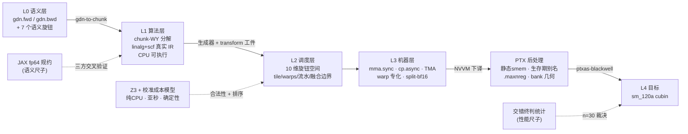

# GDN-MLIR

**Gated DeltaNet（`chunk_gated_delta_rule`）前向与反向算子的 MLIR 渐进式下降编译器**：输入一个只声明意图的语义 op，输出 RTX 5090 Laptop（sm_120a）上可直接装载的 cubin。调度决策在编译期由 Z3 约束求解与校准解析成本模型做出，编译产物不携带任何运行时搜索。全部实现基于 stock MLIR（2026-10 LLVM 主干 fork）——自定义 NVVM op 的预算为 ≤5 个，实际只使用了 1 个。

[这是什么](#这是什么) · [证据速览](#证据速览) · [问题](#问题gn-内核为什么值得一个编译器) · [编译器总览](#编译器总览l0l4-每层回答一个问题) · [内核设计](#内核设计与关键机制) · [编译期调度](#编译期调度z3-与校准成本模型) · [覆盖证明](#覆盖证明与逃生舱预算) · [验证与测量](#验证与测量) · [反向的精度上界](#反向的精度上界) · [工具链发现](#工具链发现) · [复现](#仓库结构与复现) · [相关工作](#相关工作) · [论文与证据](#论文与证据)

---

## 这是什么

这个仓库的交付物是一个编译器。所有前向与反向内核都是同一条 L0→L4 渐进式下降管线的产物；fla（Triton）与 FlashQLA（TileLang）两家手写实现的设计点，在本仓中被表达为调度层旋钮空间中的两个极端配置——**复现一个参考实现的工作从重写内核变成调参**。

内核速度用于检验方法论的有效性。四个可检验的主张：

1. **表达力**：旋钮空间在 PTX 指令族与结构两层覆盖两家手写参考（T1/T2 覆盖矩阵），mma 指令签名层对 fla 与 FlashQLA 双向一致；为此只需 1 个自定义 NVVM op（预算 ≤5）。
2. **调度**：编译期 Z3 求解 + 一次性硬件标定的解析成本模型，以每新形状 **0.8 秒纯 CPU** 完成调度决策，对比 fla 运行时调优首搜 39.8 秒设备时间（≈50×）；排序质量与实测的 Spearman 秩相关 ρ=0.8962。
3. **性能**：前向在全部三个基准形状上超过 fla Triton（共载窗口 2.125× / 1.221× / 1.349×，见下）；反向小形状 **1.72×**。
4. **边界**：反向大形状为 0.41–0.49×。我们用四类独立分析证明这是梯度容差约束下的结构性上界（理想执行的上限为 0.85–0.92×），而非实现缺陷——见[反向的精度上界](#反向的精度上界)一节。

对标的哲学是 Google 的 XLA/TPU 栈：调度决策全部在编译期做出、编译产物不携带运行时搜索、每一层 IR 独立可验证。四支柱对位：

| XLA/TPU 支柱 | 本仓对应物 |
|---|---|
| 语义单一事实源（HLO + autodiff） | `gdn` 方言 L0 op + JAX fp64 可执行规约（三方交叉验证闭合） |
| 编译期确定性调度 | Z3 合法性求解 + 校准解析成本模型（固定种子，两次完整编译逐字节一致） |
| 分层可验证 IR | 每层一把独立尺子：L1 三方交叉验证 → L2 静态资源复核 → L3 fp64 参考对照 → L4 统计裁决 |
| 布局系统 | 共享内存/寄存器布局旋钮族 + 生存期别名 |

## 证据速览

环境：RTX 5090 Laptop（Blackwell sm_120a，82 SM，24GB），WSL2，CUDA 13.x，bf16 输入 / fp32 累加，K=V=128。形状记号 `B·T·H`（批·序列长·头数）。基线为 fla 的纯 Triton 路径（`FLA_FLASH_QLA=0`）。

**测量口径**（全文适用）：所有性能对比采用**交错终判**（interleaved adjudication）——在同一 GPU 窗口内，将本方与基线在同一进程、同一位相同的输入上交替成对计时，每形状 30 对，以逐对比值的中位数为点估计，以精确符号检验给出显著性；绝对时延即使无其它负载也会随进程与时钟状态漂移，不可跨窗口直接比较。**共载**（co-load）指测量窗口内 GPU 上常驻其它计算任务；与之相对的是**空闲窗口**（GPU 上无其它计算任务）。两类窗口的结果分别报告。

### 前向 vs fla Triton

| 形状 | 共载窗口（n=30 对） | 空闲窗口（n=30 对） | 绝对时间 我方 / fla（共载中位） |
|---|---|---|---|
| B1·T2048·H16 | **2.125×**（30/30 胜，p<1e-9） | **1.611×**（30/30 胜，p<1e-9） | 0.187 / 0.396 ms |
| B4·T2048·H16 | **1.221×**（25/30 胜，p≈3.2e-4） | 1.067×（30/30 胜） | 0.821 / 1.003 ms |
| B1·T8192·H16 | **1.349×**（29/30 胜，p≈5.8e-8） | 0.991×（持平，p=0.043） | 0.785 / 1.059 ms |

两类窗口的全部测量中，本方在逐对比值中位数意义上均未低于基线；B1·T8192 在空闲窗口为持平档。

### 反向 vs fla Triton

反向以形状负载参数 `u = B·H·(T/64)/512`（总 chunk 数除以 512）刻画：u 越大，跨 chunk 的状态扫描链越长。

| 形状 | u | 比值（优化终态） |
|---|---|---|
| B1·T512·H4 | 1/16 | **1.72×（本方胜）** |
| B1·T2048·H16 | 1 | 全阶梯 0.411–0.488× |
| B1·T2048·H32 | 2 | （u=8 记录 0.462） |
| B4·T2048·H16 | 4 | |
| B1·T8192·H16 | 4 | |
| B1·T16384·H16 | 8 | 0.462 |

小形状本方更快；u≥1 的大形状受梯度容差约束的结构性限制（理想执行上限 0.85–0.92×，四类独立分析，见[反向的精度上界](#反向的精度上界)）。时间对 u 的仿射拟合：`本方 = 0.138 + 1.996u ms`，`fla = 0.298 + 0.746u ms`——斜率差来自精度合同强制的 f32 中间量字节。

### 冷启动与部署形态

| | 本方 | fla Triton |
|---|---|---|
| 部署形态 | AOT cubin，无运行时调优 | 运行时 autotune |
| 新进程冷启动 | ~27µs（发射 AOT kernel，约 3µs/个） | 每形状前向 18.7–30.8s + 反向 29.3–38.3s |
| 缓存命中后 | 同上 | 0.65–5.67s |
| 新形状调度决策 | **0.8s 纯 CPU**（Z3，GPU 时间为零） | 39.8s 设备时间（48 个配置逐个上机，B1·T2048 实测） |

50× 为首搜口径；fla 缓存摊销后为 7.7×–67×。两个口径同时报告。

### 与 FlashQLA（TileLang）的相对位置

FlashQLA 前向是 sm_120 上现役最快的实现（0.139 / 0.404 / 0.355 ms，为 fla 的 2.16–2.38×）；本方前向（0.187 / 0.821 / 0.785 ms）明确快于 fla、**落后 FlashQLA 前向约 1.4–1.5×**。FlashQLA 的 sm_120 反向链在当前发布状态下无法启动（缺少 export；单 kernel 共享内存 112,640B 超出 101,376B 上限）；加垫片修复后为 1.435ms @B1·T2048，与 fla 相当。三方对比（本方 / fla / FlashQLA）完整记录在 `evidence/G5/` 基线报告。

### 一句话覆盖结论

T1 指令族终态 33 族：8 YES / 19 PARTIAL / 6 NO，全部 PARTIAL 的残差为指令变体（拼写/向量宽度）而非能力缺口；mma 指令签名层对两家参考双向一致；T2 结构匹配：fla 极点与 FlashQLA 极点的每个结构要素都在旋钮空间内可生成。逃生舱预算 ≤5，实际支出 1（`gdn.mma.tf32k8`）。

---

## 问题：GDN 内核为什么值得一个编译器

**算子**。Gated DeltaNet 是线性注意力家族中带门控 delta rule 的代表性算子。它的逐 token 递推是：

```
h ← 2^g · h                    （衰减在先，g≤0）
b_v ← β ⊙ (v − k·h)            （delta 修正项）
h ← h + kᵀ ⊗ b_v               （外积写回）
o ← q · h
```

四步顺序不可交换——这是语义契约的一部分。直接按扫描实现意味着每个 token 都读写一遍 `[K,V]` 状态，带宽不可承受；fla 一系的 chunk 化把递推改写为矩阵乘：**一个 chunk 内 C 步递推对状态 S 是一个仿射映射——这是从"扫描"到"矩阵乘"的转换枢纽**。chunk 化后的核心是三个对象：

- **KKT 矩阵** `A = strict_tril(β·(k·kᵀ) ⊙ 2^(gc_i−gc_j))`——严格下三角，因此 `I+A` 是单位下三角，其逆 `T=(I+A)⁻¹` 可用**前代换**（利用下三角结构逐行求解，无需主元选取与除法）求得；数值稳定性由三重压制保证（|k_i·k_j|≤1（L2 归一）、β∈(0,1)、衰减因子≤1 单调）。
- **状态递推** `S' = (2^gcl·I − ktermᵀw)·S + ktermᵀu`——每个 chunk 把整段历史衰减折叠成对入口状态的一次乘法（跨 chunk 衰减只通过两个显式因子进入：状态上的 `2^gcl` 与 k 行上的 `2^(gcl−gc)`）。
- **输出分解** `o = o_intra + o_inter`（chunk 内贡献 + 携带状态贡献）。

反向最微妙的一步是 dA 的收缩：**单侧近似形式既重复计数直达项、又丢失交叉项**——C=3 反例在符号级将其证伪；正确形式是双侧掩蔽收缩 `dA = −strict_tril(Tᵀ·strict_tril(G)·Tᵀ)`，与 fla `prepare_wy_repr_bwd` 等价。

**现状**。这个算子当前由手写内核服务：fla（Triton，运行时 autotune，每形状首搜 39.8s 设备时间）、FlashQLA（TileLang，手写 warp 专化调度）。TileLang 自身的 z3 调度器只存在于 Ascend 后端，CUDA 侧退化为运行时 autotune。手写路线的两个结构性代价：调度知识不可组合（每个新形状/新算子重新手写），以及调度决策推迟到运行时（冷启动与部署开销）。

**本仓的回答**：把"调度"从内核源码里抽出来，变成编译期可求解的问题——调度即 IR（transform dialect 参数化工件 + 方言属性承载旋钮），合法性交给 Z3，优劣交给校准解析成本模型，正确性交给分层验证。参考实现由此变成旋钮空间中的坐标。

---

## 编译器总览：L0→L4，每层回答一个问题

每一层固定一类决策、把另一类决策留给下层作为旋钮，并由一把独立的尺子把关。任何下层改动若破坏语义，可以回退到 L1 口径重新对照验证——这是"分层可验证"在工程里的持续价值：后续每次性能优化都重过同一组数值验证。



### L0 语义层（`dialect/`）——这个算子是什么

L0 只声明意图，不掺入任何展开选择：数值约定（衰减在先、β 作用于修正项、L2 归一化位置）全部固定在方言 verifier 与生成器里。GDN 的数值约定密集，弄错任何一条会出现"形状都对、数值全错"的静默偏移——语义只有一份，是全部后续验证的地基。

```mlir
// dialect/test/smoke_l0.mlir —— 一个 op 声明全部语义（玩具形状 B2·T128·H2·K16）
func.func @smoke(%q: tensor<2x128x2x16xf32>, %k: tensor<2x128x2x16xf32>,
                 %v: tensor<2x128x2x16xf32>, %beta: tensor<2x128x2xf32>,
                 %g: tensor<2x128x2xf32>, %h0: tensor<2x2x16x16xf32>)
    -> (tensor<2x128x2x16xf32>, tensor<2x2x16x16xf32>) {
  %o, %ht = "gdn.fwd"(%q, %k, %v, %beta, %g, %h0)
      <{config = #gdn.config<64, true, false, true, true, true, false>}>
      : (tensor<2x128x2x16xf32>, tensor<2x128x2x16xf32>, tensor<2x128x2x16xf32>,
         tensor<2x128x2xf32>, tensor<2x128x2xf32>, tensor<2x2x16x16xf32>)
      -> (tensor<2x128x2x16xf32>, tensor<2x2x16x16xf32>)
  return %o, %ht : tensor<2x128x2x16xf32>, tensor<2x2x16x16xf32>
}
```

- **语义 op**：`gdn.fwd`（q,k,v,β,g[,h0] → o,ht）与 `gdn.bwd`（→ dq,dk,dv,dβ,dg,dh0；可选 A 复用槽由 `AttrSizedOperandSegments` 消解尾随歧义）。
- **`GdnConfigAttr` 七个语义旋钮**：`chunk_size∈{16,32,64}`、`use_g`、`use_gk`、`normalize_q`、`use_initial_state`、`store_final_state`、`is_varlen`。
- **Pass**：`gdn-to-chunk`（L0→L1 入口改写，config 属性原样透传）；`gdn-lower-hatch`（12 个硬件直通 op 1:1 下降到树内 nvgpu/nvvm op）。
- **硬件直通 op 族**（`GdnHatch.td`）：11 个是树内 op 的薄封装（`setmaxnreg`/`elect`/`mbarrier×4`/`TMA×3`/`bulk×2`——2026-10 LLVM 主干已原生支持其中大部分，薄封装的作用是过渡与可审计），唯一真实支出是 `gdn.mma.tf32k8`（完整故事见[覆盖证明](#覆盖证明与逃生舱预算)）。
- **工具**：`gdn-opt`（外建 MLIR 项目，含全部树内 pass + 方言注册，`scripts/build_dialect.sh` 构建）。

### L1 算法层（`tools/gdn_l1_gen.py` + `gdn_ref_jax.py`）——它等价于哪条程序

chunk-WY 分解在这里被表达为**真正的 linalg+scf MLIR**（非伪码），在 CPU 上经 11 个树内 pass 下降到 LLVM 并由 `mlir-runner` 执行。生成器即未来 L1 展开 pass 的参考输出定义。下面是前代换求逆 `T=(I+A)⁻¹` 的真实 IR（节选自 `evidence/G1/l1_bwd_chunked_T128_C64.mlir`）——数学即 IR，无库调用、无黑盒 op：

```mlir
linalg.fill ins(%f0 : f32) outs(%Tbuf : memref<64x64xf32>)
scf.for %i2 = %c0 to %cC step %c1 {
  memref.store %f1, %Tbuf[%i2, %i2] : memref<64x64xf32>          // 单位对角
  scf.for %j2 = %c0 to %i2 step %c1 {
    %sum = scf.for %k2 = %j2 to %i2 step %c1 iter_args(%acc2 = %f0) -> (f32) {
      %aik = memref.load %Abuf[%i2, %k2] : memref<64x64xf32>
      %tkj = memref.load %Tbuf[%k2, %j2] : memref<64x64xf32>
      %ak  = arith.addf %acc2, arith.mulf %aik, %tkj : f32
      scf.yield %ak : f32
    }
    %neg = arith.negf %sum : f32
    memref.store %neg, %Tbuf[%i2, %j2] : memref<64x64xf32>       // T[i,j] = −Σ A[i,k]·T[k,j]
  }
}
```

**尺子：三方交叉验证。** JAX fp64 可执行规约（顺序递推 + 分块 + `jax.vjp` 三实现互证）是语义单一事实源；MLIR L1 与 fla naive 的对照经 fp64 JAX 中转（fla naive 内部固定 fp32）：

- JAX 规约自洽 44/44 项：分块与顺序（两条独立算法路径）fp64 下 o 相差 5.6e-16（舍入量级），VJP 梯度 1.2e-14，有限差分独立验证 2.3e-9——**评分参考自身先被验证**。
- MLIR L1 ⇄ JAX：前向 7/7 用例 ~6e-7；反向六梯度最差 6.4e-6（验证门 2e-4）。
- JAX ⇄ fla naive：前向 1.2e-7 / 反向 2.3e-6（fla naive 内部固定 fp32，对照只能取 fp32 口径）。

### L2 调度层（`tools/gdn_l2_gen.py` + `gdn_solver.py` + `gdn_costmodel.py`）——这条程序在硬件上怎么铺

调度即 IR：每份内核是一个参数化 transform 工件 + 旋钮向量的实例化。旋钮空间十维（dtype、mma 精度、tile M/N/K、warps、流水深度、mma 开关、warp 专化、TMA），合法组合由 Z3 枚举、由成本模型排序（详见[编译期调度](#编译期调度z3-与校准成本模型)）。transform dialect 的有效写法已逐个验证：`transform.memref.multibuffer <factor, skip_analysis>`、`transform.nvgpu.create_async_groups bypass_l1`（树内 pass 会在每组后立即插入 `wait_group 0`，异步复制无法重叠——异步 staging 需手动发射）、`transform.nvgpu.pipeline_shared_memory_copies failures(propagate) depth=N peel_epilogue`、`tile_using_for` 等。

### L3 机器层（`gdn_full_gen.py` / `gdn_bwd_gen.py` 内建机器）——数据怎么流进张量核

- **MMA 发射器族**：`mma_gemm`（warp 贴图 mma.sync m16n8k16 bf16→fp32 基础发射器）、`mma_gemm_mh`（mi-half×ni-strip 二维 warp 映射，512 线程铺满 16 warps/SM）、`tgemm`（tf32 k8，消费 `gdn.mma.tf32k8`）、`rgemm/rgemm_aw`（寄存器累加串行链 GEMM + A 窗口 ping-pong，反向扫描专用）、**split-bf16 hi/lo 分解发射**（机制见[内核设计](#内核设计与关键机制)）。
- **Staging 原语族**：`astage_sync`（thread-strided 16B 手动 cp.async——block-uniform 形态会被每线程重复执行 256 次）、`stage_split_*`（split-bf16 操作数分级助手）、`launder_pass`（cp.async 写入的 tile 经 `ld.shared` 读回正确、经 `ldmatrix` 读回错误——只影响构建调度相关的行块子集；修复为 st.shared 或逐元素重写）、`epi_bar`（epilogue 分裂存储越过已死亡数据源的栅栏规则）。
- **warp 专化与 TMA**：warp 专化（同一线程块内生产者/消费者 warp 分工）下的 `setmaxnreg` 寄存器再分配（实测某内核溢出 22,844B→48B）、`elect.sync` 选举 leader 发射 TMA、宿主 CUtensorMap 维序契约（encode 反序、坐标不反、UTMALDG 目的地址需共享内存 128B 对齐）。

### PTX 后处理层（`tools/gdn_smem_fix.py`，856 行）——stock 流水线遗留的四个问题

MLIR 语义完整下译之后、ptxas 定案之前，stock 流水线遗留四个真实问题——两个影响正确性、一个影响驻留、一个影响发射效率，全部经 GPU 探针或源码级对照确认：

1. **静态共享内存修复**：workgroup `memref.alloc()` 被下译为设备端堆分配（`call.uni malloc` + `cvta.to.shared`），携带共享内存 tile 的 cubin 在真机上全部非法地址错误、通过率为零。修复方式是复刻 MLIR 自身为静态共享内存已经使用的写法（`.shared` 声明 + cvta 补丁 + 128B 对齐）。通过率 0 → 全量。
2. **生存期别名**（详见[内核设计](#内核设计与关键机制)）：让生存期不重叠的 tile 复用同一片共享内存字节，把静态池压过"每 SM 驻留 2 个线程块"的容量门槛。
3. **`.maxnreg` 注入**：ptxas-blackwell 忽略 `--maxrregcount` 但遵循 PTX 源内 `.maxnreg` 指令；逐 kernel 入口注入寄存器上限（效果见[内核设计](#内核设计与关键机制)）。
4. **bank 几何**：编译器既不知道行距的语义，也不会为 bank 冲突重排 lane→cell 映射；WST/W32P 两个变换把共享内存→全局内存的 16 位逐 cell 搬运合并为 32 位存储并消除冲突（几何与数字见[内核设计](#内核设计与关键机制)）。

工程原则：每步改写**要么逐位相同、要么回退到正确而不省的形态、失败时显式报告**；`cache_key = sha256(全部旋钮环境变量 + 源码指纹)` 保证陈旧缓存不会混入。

### L4 目标层

`gpu-lower-to-nvvm-pipeline="cubin-chip=sm_120a ..."` → PTX 抽取 → `gdn_smem_fix.py` → `ptxas-blackwell -v` →（审计）nvdisasm SASS。全链以树内 sm_80 transform-mma 集成测试冒烟：测试文件取自上游（现成的独立裁判），chip 重定向为 sm_120a 后在 5090 上编译运行——sm_120 的张量核即 Ampere 风格 mma.sync，同指令族故该测试有效（`scripts/smoke_sm80.sh`）。

---

## 内核设计与关键机制

本节按最终系统状态描述全部机制，文中 kernel 代号均为仓库内真实标识符。

### 前向：三内核分阶段、单一 cubin（staged mono）

fla 同构的三 kernel 分解，装进单一 cubin（kernel 边界即流序同步，跨 kernel 的设备间拷贝 ~0.1ms/形状 消失）：

| kernel | 网格 | 职责 |
|---|---|---|
| **F1 "wy"** | (NC, B·H) | token 并行 WY 预计算：gc 扫描、A、T、u、w |
| **F2 "scan"** | (B·H·VT) | 全算子唯一的跨 chunk 串行链，状态 S 常驻共享内存 |
| **F3 "o"** | (NC·B·H, VT) | 从 h_all/v_new 重算输出 |

（NC = chunk 数，VT = 值维切片数。）单 launch 的 persistent 融合版本（fused）按目标实现且数值全部通过，但性能上由三内核方案承担判定：fused 4.53 ms vs 三内核 0.785 ms @T8192——WY 预计算从 2048 个 CTA 的并行塌缩进 64-CTA 串行链，结构性并行度损失不可交换。fused 保留为融合边界旋钮的极限端设计记录（其三段流水化机制 −27.8% 仍有效）。

**正式配置**（三个判定形状同套）：`mono, warps=4/bv=32` + 环境旋钮 `GDN_F1KS GDN_F2US GDN_WST GDN_ZFIX GDN_SCANDB GDN_F1ZF GDN_W32P`。

**关键机制**（每个都带机制与测量）：

- **F1KS——前向第一个每 SM 双 CTA kernel**。F1 属延迟受限（long_scoreboard 停顿占 24.3%、barrier 22.9%、DRAM 利用率仅 56.8%），驻留翻倍直接转化为延迟下降：bf16 求解压缩共享内存 + B 操作数 K 分裂 + 生存期别名三步把申报池压到 46,352B ≤ 49,152B（双 CTA 门槛），F1 **−53.5µs** @T8192（278.7→225.2µs）。配套的 ZFIX/SCANDB 修复（共享内存清零步长、跨 warp 扫描原语）保证双 CTA 配置逐位正确。
- **F1ZF——清零折进空闲线程**。phase-0 的 8.5µs 清零与 64 线程串行代入期间全程空闲的线程 64–127 并发执行；两者写集不相交故逐位一致；三形状 −6.7~−7.9µs，约为理论删除上限 8.5µs 的 91%。
- **F2 +16B 垫行——单笔最大杠杆**。被 ldmatrix 读取的 tile 行距恰为 128B 整数倍时，8 行落入同一 4-bank 组形成 8 路冲突；每 tile 增加 8 列 bf16（+16B）使行距错开，F2 **473→249µs**，F1/F3 的全部 tile 同样受益。
- **F2US——u 段重回预取管线**。2B 装载×4B 跨距把 4KB 放大成约 8KB 内存扇区且位于串行链上；u 进组 A 乒乓缓冲后 F2 **−104.5µs（60 对中 0 对变慢）**，T8192 判定从 1.021× 提升到 1.101×。
- **WST+W32P——无冲突的 32 位合并存储**。F2 的 BV=32 tile 行距 80B；直接把相邻 cell 配对成 32 位存储（WST 合并，LSU 指令与循环迭代减半）反而制造 2 路 bank 冲突（实测 +4.3µs）。W32P 在生成器层重排 lane→行映射：lane 0–15 读行 r、lane 16–31 读行 r+4，**80 mod 32 = 16** 使两个半 warp 恰好命中 32 个 bank 的两个互补 16-bank 半区——零冲突，纯下标算术，不影响池与占用。F2 七个场景 −17.9~−22.6µs，与带宽核算一致（0.176µs/MB × 100.6MB ≈ 17µs 上限，基本达到）。
- **时间分布**（F1 @T8192 约 227µs 的分段测量）：uw 段 51.2%、kkt 26.2%、solve phase-1 仅 14.3%、gc 扫描 7.8%——分段测量显示临界路径在 uw 段而非求解段，后续优化据此集中。

### 反向：重算前向 + 双向扫描 + 梯度组装

终态 8-kernel 链：`wy → fwdscan → caryM → bpre → dhs → dkb → dqkwg → wyb`。三族分工：**wy** 重算 WY 因子（六个梯度都穿过它写的张量）；**扫描族**（fwdscan/caryM/bpre/dhs/dkb）执行两条方向相反的状态扫描；**计算族**（dqkwg/wyb）组装梯度——dqkwg 是最大 kernel（dq/dk_local/dW/dvp_all），wyb 执行 dA 双侧掩蔽收缩、产出最终 dk/dβ/dg/dv。

**机制一：扫描的仿射改写。** 反向 dh 递推每 chunk 原需 8 段 GEMM 的串行链；代数重结合（非近似，fp64 对照 2–3 ulp）改写为仿射携带形式 `Xₙ₋₁ = AₙXₙ + Bₙ` 后，拆成**并行预复合**（caryM/bpre）+ **每步仅 1 个 GEMM 的携带链**（dhs）+ **部分和独立重算**（dkb）。算子的超收缩性 ρ(A)≤2.3e-18 保证复合误差不随链长放大；Aₙ 与 v-切片无关，一次复合服务全部 NV 列切片。

**机制二：split-bf16 hi/lo mma。** bf16 mma 截断 fp32 指数域；tf32 尾数只剩 10 位（会把 dk 推到 1.04e-2、超出 8e-3 容差）。方案：`hi = bf16(x)`、`lo = bf16(x−hi)`，hi+lo 在 fp32 中精确可加（8+8 位尾数装得进 24 位）；乘积展开 **hi·hi + hi·lo + lo·hi 三条 bf16 mma 以 fp32 累加器链接**，lo·lo（约 2⁻³²）舍弃，残差约 2⁻¹⁷ 相对量级——以 mma 的吞吐获得接近 fp32 的乘积质量，在 dkb 位点误差比 tf32 低约 30×。两条省一条 mma 的代数路径：**行尺度折入 epilogue**（缩放因子只依赖输出行时，缩放完全移出缩并，dvp_bh 3→2 mma）；**2 的幂尺度可交换性** `split(v·2ᵈ) == split(v)·2ᵈ` 精确成立——caryA 的预乘 Bhat tile 由此退化为原样拷贝（caryA 5.00×、池 82,176→28,592B、寄存器 255→76）。

**机制三：生存期别名 + `.maxnreg`。** 每 SM 驻留两个线程块（2 CTA/SM）要求每 kernel 静态共享内存池 ≤50.2–50.7KB，但算法 tile 的生存期拼接远超上限、任意时刻活跃字节却在门槛之下；MLIR 的 SSA 合法性要求每 tile 一次分配，"生存期不重叠的 tile 共享字节"这一物理事实只能在 PTX 层实现（生成器产出 `smem_alias.json` 布局表，后处理按分配尺寸识别 tile 并重写地址；对编译器的指令重排/死代码消除/前向传播各有对策）。设计立场：**别名是纯增益变换，失败模式必须是"不省"，绝不允许"算错"**——任何识别失配整体回退。效果：dqkwg 100,864→47,616B、caryA 82,176→28,592B、wyb 100,096→45,056B，三个 kernel 全部达成 2 CTA/SM（dqkwg 实测 warp/SM 7.59→14.53）。`.maxnreg` 逐 kernel 定 128 寄存器后占用 15.02%→29.17%、waves 6.24→3.12、T8192 阶段 1.26×。两个名字相近的机制各司其职：`.maxnreg` 是 PTX 后处理注入的逐 kernel 寄存器上限；`gdn.setmaxnreg` 是 warp 专化下的生产者/消费者寄存器再分配。

**族级结果**：wy 3.04×（0.70→0.23ms，零溢出）、dqkwg 3.2×、wyb 2.40×、dkb 3.8×、fwdscan 2.45×；整体链从 58.88ms 优化至 2.15ms。数值侧同步改善：wy 链重构后 dk 1.691e-3→1.284e-3，dβ/dg/dh0 的容差裕度扩大 23×/61×/36900×。

### 两个负结果与其物理

失败按机制记录、按测量关闭：

- **占用提升是杠杆还是空转，取决于 kernel 受限于延迟还是带宽。** F1KS 驻留翻倍带来 −53.5µs（F1 延迟受限）；同一手段用于 F3 却 +96.1µs @T8192。对照测量确定原因：同一份 F3 代码强制单 CTA 为 +115.6µs，其中 K-循环重排本身约 +110µs、驻留只带来约 20µs——F3 是带宽受限 kernel（@T8192 流量约 120MB），不因波次减半而变快。
- **串行扫描的剩余延迟来自 staging/barrier/交换延迟。** fwdscan 的 K-split 家族三个数据点：warp 组形态 0.98–0.99×、cluster 双 CTA 形态 0.88–0.89×，且 cluster 属性本身零开销（挂 2×1×1 与不挂同为 361.4µs，差异全部来自 +57µs 的交换成本）。当每 warp/CTA 工作量不变时，调度器层面的指令级并行已经饱和，剩余延迟由数据搬运与同步构成。附带一个上游级发现：**sm_120 线程块 cluster>1 可用**（`%cluster_nctarank` 设备验证，推翻"仅 1×1×1"的通行假设）。

---

## 编译期调度：Z3 与校准成本模型

XLA 在 TPU 上的哲学是"调度决策全部在编译期做出，编译产物不携带运行时搜索"；把它移植到原生 MLIR + 消费级 Blackwell + 单算子族，必须回答两问：**凭什么排序**（成本模型的可靠性）与**凭什么相信生成的代码**（覆盖与验证，见下节）。

### 求解器

决策变量是 10 维旋钮向量（固定声明序）：dtype、mma 精度、tile M/N/K、warps、流水深度、mma 开关、warp 专化、TMA。约束三类：

- **旋钮耦合**（如 bf16 输入只有 bf16 mma）；
- **结构合法性**（bt%16、bk%16(bf16)/%4(tf32)、bv%(8·warps)、流水深 ≤K 趟数、TMA 依赖 warp 专化）;
- **资源容量**——显式共享内存字节模型（三种 tile 形态公式，文档化于 docstring）+ 寄存器 `32·(w+w_spec)·255 ≤ 65,536`。

目标函数含非线性项（max/混合/除法）无法交给 Z3 Optimize，故采用 SAT + 阻塞子句**全空间枚举**、求解器外按 `(预测时间, 配置名)` 排序。合法空间：kkt 阶段 368 配置 0.29s、o 阶段（K128V128）465 配置 0.33s 枚举完毕——**合法空间以亚秒级纯 CPU 穷尽、以 unsat 判定可核查、以固定种子与固定序逐字节复现**。

两处防御性设计：求解器对被其余指派唯一决定的变量可能不返回取值，用"固定其余指派 + 逐候选 SAT 探测"补全，保证不注入非法值；枚举若因资源上限截断而非完备（unsat）终止，则重新枚举一次，仍失败即抛异常拒绝输出——不完备空间里的 Top-K 排序没有意义。

### 成本模型：零逐配置拟合

模型中不存在任何对实测配置时间调参的自由常数——每一个速率要么来自一次性标定，要么是文档化的 sm_120 结构常数；输出以 `calibration_fallback_keys` 空集自证后备未触发。形式上每项都是"计数÷速率"，**分子的计数在编译期就是精确的**——18 个配置的静态 PTX 自检中 mma.sync/ld.shared/bar.sync 计数 18/18 精确，cp.async 偏差 +0.4–1.6%；误差只剩分母（速率）。

一次性标定表（六个微基准 kernel、分钟级、显存 <2GB、单次沉没成本）：

| 量 | 值 |
|---|---|
| mma bf16 峰值 | 115.5 TFLOP/s（tf32 57.8 导出） |
| 共享内存读带宽 | 113.1 TB/s |
| L2 / DRAM | 2144.3 / 824.6 GB/s（空闲窗口 851.4） |
| SFU ex2 | 3.23 Telem/s |
| bar.sync | 7.707 ns |
| cp.async | 1388 GB/s |
| launch 基准 | 6.073 µs |

**验证与限度**：Spearman ρ=0.8962（n=18 实测配置，kkt 0.936 / o 0.829，top-5 重叠 0.8，门槛 0.7）；±2× 结构常数扰动下 ρ∈[0.882, 0.902]，±30% 噪声下最差分位 p5=0.856。模型的输出用于排序；绝对值有已记录的偏差（mma 路径低估 3–5×，均匀缩放、秩不变）。

### 搜索成本对比

Z3 + 成本模型：**0.8s/新形状、纯 CPU、两次完整编译逐字节一致、本方 GPU 时间为零**。fla 设备首搜：39.81s（前向 16.55s + 反向 23.26s，48 个配置逐个上机编译计时，B1·T2048 实测）≈ **50×**（首搜口径）；fla 磁盘缓存摊销后 7.7×–67×。两个口径同时报告。

---

## 覆盖证明与逃生舱预算

### 参考 PTX 的纯 CPU 收割

不依赖 GPU：fla 经 Triton AOT `GPUTarget("cuda",120,32)`（自带 ptxas -v 资源日志）；FlashQLA 经 TileLang 锁定 target；SASS 经 nvdisasm。两家构成调度谱系的两个极点——**fla**：寄存器 40–255 顶格带大量溢出、多级流水、无 warp 专化、循环全展开；**FlashQLA**：寄存器 88–128 由 setmaxnreg 固定、TMA+mbarrier+elect.sync 单 kernel 融合、真循环。FlashKDA 作为第三风格点以 L2 旋钮吸收（网格映射旋钮显式含 token 并行 WY 预段）。

### T1：指令族覆盖

以 fla∪FlashQLA 收割 PTX 的 **33 个指令族**为合同，本方生成集（20 配置）逐族三态判定：**8 YES / 19 PARTIAL / 6 NO**。feature 层 15 族中 8 YES / 6 PARTIAL / 1 NO；全部 PARTIAL 的残差属于**指令变体**（操作码拼写/向量宽度/旗标，如 mbarrier 差一个 `.shared::cta` 拼写），能力层无缺口；唯一的 feature 级 NO 是 stmatrix——实测 +40% 回归后按测量结论关闭。mma 指令签名层：

| mma 签名 | fla | FlashQLA | 本方 |
|---|---|---|---|
| bf16 m16n8k16 | 2708 条 | 2496 条 | **552 条，YES** |
| tf32 m16n8k8 | 576 条 | 0 条 | **YES（经唯一逃生舱，fla 精确拼写）** |

本方是三者中唯一同时发射两家族 mma 签名的生成方。

### T2：结构匹配

四张卡（fla chunk_fwd_o / fla dhu / FlashQLA fused_fwd / fused_bwd），按"族 Jaccard + mma 签名匹配 + 总数接近度"选本方最近配置，资源项（寄存器/共享内存/溢出）±30% 包络判分。结论：**fla 极点（多级流水 mma + cp.async + 255 寄存器）与 FlashQLA 极点（setmaxnreg warp 专化 + TMA + mbarrier 单 kernel 融合）的每个结构要素都在旋钮空间内可生成**。需要交代的限度：T2 度量风格的可达性（各结构要素能否生成），规模差异由资源包络单独判分——FlashQLA fused_bwd 单 kernel 1600 条 mma，与本方单 chunk kernel 相差 50×，该卡资源判定为 OUT，结构要素全部在格内。

### 逃生舱：预算 5 个，支出 1 个

**逃生舱**（escape hatch）指为突破 stock MLIR 表达力边界而引入的自定义 NVVM op，其数量是"stock MLIR 极限"的度量指标。12 个直通 op 中 11 个是树内 op 的 1:1 薄封装（零预算支出）。唯一真实支出 `gdn.mma.tf32k8` 的完整故事，按"必要性→工具链缺陷→硬件探针→克制"四步：

1. **必要性**：NVVM 表列的 `mma.sync m16n8k8` 只有 f16/bf16/i8；`nvgpu.mma.sync` verifier 强制 8×8×128b 基本片使 tf32 封顶 K=4——而反向的 fp32 GEMM 恰需 fla 收割到的 `mma.sync.aligned.m16n8k8.row.col.f32.tf32.tf32.f32`。表内不可达属于 **NVVM TableGen 的限制**，与调度能力无关。
2. **工具链缺陷**（对任何在 mma 上使用 inline asm 的人成立）：经 `llvm.inline_asm` 发射时，普通 `"=f"` 输出约束下 ptxas 会把 D 四元组分配到同一条 mma 的 A 四元组上（SASS：`HMMA R12,R12,R10,R16`），张量核读/写重叠损坏操作数——K=16 整型探针 118/128 单元确定性失败；early-clobber `"=&f"` 禁止重叠后消失。
3. **硬件探针**：A-fragment 寄存器序是 **row-half 外层**（a₁ 与 a₀ 同 k、行 +8），与 bf16 k16 的 k-八元组配对直觉相反——16×8×8 整型探针在真机确认（D==A@B+C 精确相等；N(0,1) 偏差 4.2e-3 证实真 tf32 语义），不靠文档推断。
4. **克制**：tf32 按 24 个 fp32 GEMM 位点逐点数值验证，仅 16 个放行（wy.u 误差 1.06e-2 超容差被否决、dhu 性能负收益整体回退）；放行位点贡献了其所在阶段的端到端 14.16→11.06ms。

---

## 验证与测量

### 四层验证

| 层 | 被测对象 | 尺子 | 关口 |
|---|---|---|---|
| L1 语义 | MLIR L1 IR（CPU 执行） | JAX fp64 规约 ⇄ fla naive | 前向 ~6e-7 / 反向最差 6.4e-6（三方闭合） |
| L2 配置 | 20 个旋钮配置 | ptxas -v 资源包络 + SASS 指令组合 | 编译期静态复核 |
| L3 阶段 | 逐配置 GPU kernel | fp64 numpy 参考实现（逐位相同的 bf16 输入） | 20/20，双随机种子 |
| L4 全算子 | 端到端 kernel 链 | JAX fp64 / fp64 参考 + 结构不变量 | 全部元素在容差内 + 每次变更后复验 |

fp64 参考实现的两条纪律：与被测 kernel 吃**位相同**的输入（主机端精确 bf16 量化），且算法同构——差值只度量 kernel 数学与内部截断，不引入参考自身的误差。

### 容差合同：与 fla 同级准确是可证伪命题

容差定在"fla 自己的 Triton kernel 对 fp64 参考的距离"量级上：**o/ht ≤5e-3；dq/dk/dv/dh0 ≤8e-3；dβ/dg ≤2e-2**（dβ/dg 放宽 2.5 倍，反映其被积量的舍入暴露更大）。fla 标定（`evidence/G5/refs/tolerances.json`）：fla 对 fp64 的距离系统性落在其输出 dtype 的 bf16 舍入下界的约 2 倍（1.36–4.33×，中位 1.9×）——即 fla 的残差基本就是 bf16 舍入，上述容差覆盖"fla 级准确"的可达域。本方裕度：前向 o 6.486e-4 / ht 7.493e-4（约 7×/6.7× 门限余量）；反向最紧的 dk 15.6×，dv 736–848×，dh0 达 3.7e4–5.7e4×。

### 测量协议

所有性能对比采用前述**交错终判**：同窗口、同进程、位相同输入、每形状 30 对交替计时；点估计为逐对比值的中位数，显著性为精确符号检验。分离进程的绝对时延即使无共载也会随时钟状态漂移，不可跨窗口直接比较，故共载与空闲两类窗口分别报告（见[证据速览](#证据速览)）。

### 确定性

**编译端**：Z3 固定声明序 + 种子 7 + 资源上限 2×10⁷——两次完整编译**逐字节一致**；生成器同种子两次生成的 MLIR 哈希相同；旋钮全关断时产物与默认配置逐字节等价（27/27 payload、18/18 cubin）。可复现的排名是可存档、可 diff、CI 可断言的证据文件。

**运行端**：定义 = 同一 cubin、同一输入、同一发射几何下输出**逐位一致**；跨进程（全新 CUDA 上下文与模块加载）5 次全过方算通过。逐位可复现的代价约 0.3%@T2048。

---

## 反向的精度上界

先把结果说清：反向小形状 1.72× 胜、前向全形状超过 fla、冷启动全形状胜；u≥1 的大形状为 0.41–0.49×。对后者，结论是：

> **0.41–0.49× 由误差容差合同决定，与实现质量无关。** 在 fla 的梯度容差（dq/dk/dv≤8e-3、dβ/dg≤2e-2）下，u≥1 形状的 1.1× 目标结构性不可达——把执行做到理想也只有 0.85–0.92×。

四类独立分析各自排除一条逃逸方向，松动任何一条其余仍成立：

| 分析 | 排除的逃逸方向 | 内容 |
|---|---|---|
| ① 误差预算 | "把中间量降到 bf16" | 16 个 fp32 中间量候选：10 个可降、6 个被否决（合计 470 KiB/兆行）。否决原因是**读取方对数值敏感**——O(10) 的相消把值压到 O(0.1)，bf16 舍入 4.6–6.9e-2 超出容差 2.4–11×；split-bf16 不节省流量。dq/dk/dv 是被评分的输出，合同锁定 fp32。 |
| ② 流量下界算术 | "把执行做到理想" | 优化终态的字节流量下界约 0.75 ms/u。**100% 屋顶线（roofline，带宽/计算上限模型）理想执行下，u=8 也需 6.1–6.6 ms，对 fla 的 5.62 ms 上限只有 0.85–0.92×**（容差扫描精确值 0.916）。实测 12.15 ms 距下界还有约 2× 的执行余量——但把执行余量全部兑现也只到 0.92×；即使整段删除 dqkwg+wyb+dhs（非真实选项）也只到 0.88×。 |
| ③ 融合定价 | "删除 kernel 间数据搬运" | 最后两个大 kernel（dqkwg+wyb）的融合被三重否定：可行最优池 97,024B（仅完美融合需求的 82%）；单 CTA 占用反转实测 1.155–1.26×；u=8 净时间差 best/mid/worst +0.62/−0.11/−0.83 ms。即使不可实现的完美融合也被字节算术限制在约 0.54×。结论 NO-GO。 |
| ④ 容差扫描 | "放宽容差合同" | dk 容差 8e-3→2e-2（2.5×）分四档测试，**全部档位零符号解锁**（被否决符号的误差增量 4.6–6.9e-2，比最宽档还紧 6×）；首个解锁需 dk ≥6.6e-2（8.2×）；达到 1.1× 需 dk 放宽约 15× **且** dβ 放宽 2.4× 两条轴同时进行——且全部解锁也只把上界移到 1.08–1.15，还要先兑现约 2× 执行差。**容差的作用是阶跃的：达到特定档位之前，放宽不解锁任何符号。** |

四条合起来把 u≥1 的 1.1× 目标在合同层面封死；可改的输入（梯度容差、门控衰减设计、带宽标定）没有一项在编译器手里。全部核算可复算：`tools/rc1_price.py`、`tools/r4_price.py`、`tools/tol_sweep.py`——第三、四类分析的结论在零内核代码修改的情况下得出。

---

## 工具链发现

对 MLIR/NVIDIA 上游有独立价值的取证清单（每条都有探针或 SASS 级证据，详见论文第 3/4 章与 `evidence/`）：

1. workgroup `memref.alloc` 被 stock 管线下译为设备端 malloc——真机全部非法地址错误；PTX 级修复方案在 `gdn_smem_fix.py`。
2. transform `create_async_groups` 在每组后立即插入 `wait_group 0`——异步复制结构性无法重叠，staging 必须手动发射。
3. block-uniform staging 被每线程重复执行（256 次冗余 cp.async）。
4. ptxas-blackwell 忽略 `--maxrregcount`、遵循 PTX 源内 `.maxnreg`；`ptxas -v` 报告只对应第一次编译——最终 cubin 出自第二次编译，资源对账必须以第二次为准。
5. **cp.async→ldmatrix 静默数据损坏**：cp.async 写入的 tile 经 `ld.shared` 读回正确、经 `ldmatrix` 读回错误，且只影响构建调度相关的行块子集；st.shared 安全。
6. ptxas 跨入口静默合并重名 `.shared` 符号（越界写，compute-sanitizer 定位）。
7. **模块布局顺序效应**：同进程内两个 cubin 的先后加载顺序决定 `.global` 布局，访存最重的 kernel 出现约 6% 的系统性偏差；加载顺序互换偏差精确反号。
8. 分离进程的绝对时延即使无共载也随时钟状态漂移（可达数十个百分点）——同窗口交替成对计时的依据。
9. **sm_120 线程块 cluster>1 可用**（`%cluster_nctarank` 设备验证，推翻"仅 1×1×1"的通行假设）。
10. `cp.async wait_group` 是每线程语义——跨 warp 可见性需显式栅栏。
11. tf32 m16n8k8 inline-asm：early-clobber `"=&f"` 是正确性必要条件；A-fragment 寄存器序为 row-half-outer（16×8×8 整型探针确认，与文档直觉相反）。

---

## 仓库结构与复现

```
dialect/          gdn 方言（L0 op + GdnConfigAttr + 12 个直通 op + passes + gdn-opt）
tools/            全部生成器与 harness：
                    gdn_l1_gen.py       L1 chunk-WY IR 生成器
                    gdn_ref_jax.py      JAX fp64 可执行规约
                    gdn_l2_gen.py       L2 旋钮化 transform 工件
                    gdn_solver.py       Z3 合法性求解（确定性枚举）
                    gdn_costmodel.py    校准解析成本模型（零逐配置拟合）
                    gdn_full_gen.py     前向内核生成器（F1/F2/F3 + fused）
                    gdn_bwd_gen.py      反向内核生成器（8-kernel 链）
                    gdn_smem_fix.py     PTX 后处理（四个问题修复 + 生存期别名 + maxnreg + W32P）
                    gdn_verify.py       fp64 参考验证 harness
                    gdn_final_adjudicate.py  交错终判（--stats 符号检验）
                    rc1_price.py / r4_price.py / tol_sweep.py  精度上界核算
scripts/          幂等驱动（build_llvm / build_dialect / run_calib / repro / 空闲窗口轮询）
evidence/G0-G7    每个 gate 的报告 + 原始数据（PTX/SASS/计时 JSON/交叉验证记录/覆盖矩阵）
paper/zh/         深挖论文 11 章（676KB md + 818KB KaTeX HTML）
docs/             L0_SEMANTICS.md、PLAN.md
```

```bash
make status                  # 现场状态（各 stage 与下一步）
make repro-list              # 列出全部复现 gate 与成本
make repro-g1                # 语义：JAX 44/44 + MLIR L1 交叉验证（纯 CPU，~15min）
make repro-g2                # 旋钮矩阵：20 配置编译 + PTX 覆盖分析（纯 CPU，~25min）
make repro-g3                # 调度：标定 + 20 配置计时 + Spearman 门（2 步 GPU，~45min）
make repro-g4                # GPU 正确性：fp64 参考逐配置双种子（GPU，~1h）
make repro-g5                # 全算子验证 + 计时 + 交错终判（GPU，~1-1.5h）
make repro-g6                # 搜索成本：Z3 计时（CPU）vs fla autotune 成本（GPU）（~10min）
make repro-all               # G0→G6 顺序执行，首个失败即停止，末尾汇总表
```

复现需求：WSL2 + conda env `gdn`（torch cu130 / triton / fla / z3 / jax）+ clang/cmake/ninja + CUDA 13.x（ptxas-blackwell 随 triton wheel 提供）+ 计算能力 ≥12 的 GPU。G1/G2 与求解器完全纯 CPU。资源纪律（内存预算封顶、全局单重构建、幂等断点）见 `CONTRIBUTING.md` 与 `scripts/resource_guard.sh`。

## 相关工作

| 系统 | 栈 | 调度方式 | 与本仓的关系 |
|---|---|---|---|
| **fla** | Triton | 运行时 autotune（首搜 39.8s/形状） | 性能基线；T1/T2 覆盖合同一方 |
| **FlashQLA** | TileLang | 手写 warp 专化调度 | 覆盖合同另一方；sm_120 前向现役最快（本方落后 1.4–1.5×） |
| **TileLang** | DSL | z3 调度器（**仅 Ascend 后端**） | 编译期求解机制的来源；其 CUDA 侧空白正是本仓的移植点 |
| **XLA/TPU** | 编译器 | 编译期确定性调度 | 哲学对标的四支柱（语义单一事实源/编译期调度/分层验证/布局系统） |
| **CAKE** | agent 写 IR | 自改进闭环（规则库+归因表） | 不同路线：本仓以约束求解替代 agent 迭代 |
| FlexLA / Hexcute / TileLoom | 各系 DSL | 调度不由 IR 承载 | 相关工作空白：无"调度即 IR 的 stock-MLIR 渐进下降 + SMT 编译期调度 + PTX 覆盖验证" |

血统如实交代：Z3 编译期调度的机制来自 TileLang 的 Ascend 实践（本仓将其上移一层：决策变量从指令时槽改为旋钮向量，此移植在 CUDA 侧无先例）；验证塔的组织借鉴 XLA 分层可验证哲学；2026-10 LLVM 主干已原生支持本仓以薄封装过渡的大部分直通 op 词汇。

## 论文与证据

- **深挖论文（11 章，中文）**：`paper/zh/gdn-mlir-deep-dive.md`（676KB）与同名 KaTeX HTML——方言与语义 / L1 算法 IR / MMA 机制 / PTX 后处理 / 前向内核族 / 反向扫描族 / 反向计算族 / 验证与确定性 / 测量与裁决 / 求解器·成本模型·覆盖 / 反向的精度上界。逐模式展开，每项含动机/源码/IR 前后/效果。
- **证据索引**：`EVIDENCE_INDEX.md`（gate 级）；`evidence/G5/CAMPAIGN_CLOSEOUT.md`（收官与采纳状态）；`RECOVERY.md`（恢复协议）。

## 许可

TBD（代码与证据树待定；参考实现 fla=MIT / FlashQLA=MIT 仅作对照基准使用，其 PTX 收割物不含其源码）。
