# 从一段 IR 到 GPU 内核：GDN-MLIR 实战教程

*用真实的 Gated DeltaNet 编译器理解 MLIR 方言、pass、结构化 IR、调度、Z3 与 NVVM*

GDN-MLIR 以 Gated DeltaNet 前向和反向为实例，把语义方言、可执行算法、调度脚本、约束求解和 GPU 目标代码放在同一条学习路径上。阅读时先弄清 IR 的结构和 pass 的作用，再进入真实内核：每一个抽象都对应仓库中的文件、命令或可复核证据。

文中将项目实现、上游 MLIR 的通用机制、教程补充的小例和归档测量分开标注。性能数字保留测量窗口、估计量和证据路径；它们用于说明方法的有效范围，不构成对所有形状、所有实现的笼统排名。

## 一、一段 IR 如何成为程序：Operation、SSA 与区域

MLIR 的程序由操作（Operation）及其嵌套区域组成。文本中的百分号、花括号与类型注解共同描述数据怎样产生、在哪里可见、由谁消费；读懂这些结构之后，方言名称与具体算法才有可靠的附着点。

本书的两套编号先固定：L0 是 `gdn.fwd/bwd` 的语义入口，L1 是可执行算法结构，L2 是调度，L3 是机器指令与流水，L4 是 NVVM、PTX 与 cubin；G0–G6 是证据与复现门，和 L 层不是同一套编号。

### 1. 一个 `gdn.fwd` 操作包含什么

下面的冒烟输入保留了一个前向算子的完整通用形式。

```mlir
func.func @smoke(%q: tensor<2x128x2x16xf32>,
                 %k: tensor<2x128x2x16xf32>,
                 %v: tensor<2x128x2x16xf32>,
                 %beta: tensor<2x128x2xf32>,
                 %g: tensor<2x128x2xf32>,
                 %h0: tensor<2x2x16x16xf32>)
    -> (tensor<2x128x2x16xf32>, tensor<2x2x16x16xf32>) {
  %o, %ht = "gdn.fwd"(%q, %k, %v, %beta, %g, %h0)
      <{config = #gdn.config<64, true, false, true, true, true, false>}>
      : (tensor<2x128x2x16xf32>, tensor<2x128x2x16xf32>, tensor<2x128x2x16xf32>,
         tensor<2x128x2xf32>, tensor<2x128x2xf32>, tensor<2x2x16x16xf32>)
      -> (tensor<2x128x2x16xf32>, tensor<2x2x16x16xf32>)
  return %o, %ht : tensor<2x128x2x16xf32>, tensor<2x2x16x16xf32>
}
```

[dialect/test/smoke_l0.mlir:2-14]

`"gdn.fwd"` 是操作名，圆括号中的六个 SSA 值是操作数（operands），`%o` 与 `%ht` 是结果（results）。尖括号内的属性字典携带编译期已知的配置（attributes）；冒号后的函数类型依次列出操作数类型与结果类型。`gdn.fwd` 自身没有区域（regions），它所在的花括号属于外层 `func.func` 的函数体区域。操作数、结果、属性与区域回答不同问题，不能用一串无类型的文本互相替代。

这段采用通用形式（generic form）：名字加引号，操作数、属性和类型完整显式给出。美化形式（pretty form）由操作自定义的解析器、打印器或 `assemblyFormat` 提供，可省略部分标点与类型。两种形式可以构造同样的 `Operation`；`gdn.fwd` 当前未声明专用操作格式，所以冒烟文件使用通用形式。同文件中的 `func.func`、`return` 以及后文的 `linalg.generic` 都采用 pretty 形式，两种格式可以在一份 IR 中混用；第二章还会看到 hatch 操作的自定义格式。

阅读打印结果时，还要把 SSA 值的身份与显示名字分开。`%o` 只是便于阅读的符号，重新编号后程序仍可等价；多结果操作在自动打印时常呈现为 `%0:2`，单个结果再以 `%0#0`、`%0#1` 引用。操作本身不是 SSA 值，只有它声明的 results 才进入 use-def 图。属性也没有结果编号，因此不能让 `config` 像 `%q` 一样流向另一个操作。

类型注解提供独立于名字的检查依据。这里的张量维数全部静态写出，其他程序也可能用 `?` 表示动态维；解析器保留这些类型事实，操作 verifier 再判断该操作能否接受它们。张量的元素类型、秩和形状属于类型，序列用哪组算法配置属于属性，实际张量内容则要在执行时才确定。

### 2. SSA 名称连接定义与使用

静态单赋值（SSA，Static Single Assignment）约束一个值只有一个定义点，却不限制它被使用多少次。`%q` 等六个名字来自函数入口块参数（block arguments），并非某个操作的 results；`%o`、`%ht` 各自由 `gdn.fwd` 定义一次，随后被 `return` 使用。沿“定义到使用”建立的边称为 use-def 链。编译器沿它寻找生产者、消费者与可替换的边，改写时无需猜测同名列的赋值历史。

块参数也承担控制流合流处的值传递。分支把实际值交给目标块，目标块以参数接收，因此 MLIR 无需把 phi 表示成一种特殊操作。值具有类型，SSA 还提供作用域与支配信息；名字唯一、类型相同和控制流上可用是三项独立条件。

### 3. 区域与块让操作成为程序树

`gdn.fwd` 的函数体已经展示一层区域。真实 L1 IR 中的 `linalg.generic` 再展示一层：操作可以在属性与操作数之外拥有自己的计算体。

```mlir
linalg.fill ins(%f0 : f32) outs(%kkt : memref<64x64xf32>)
linalg.generic {
      // indexing_maps 与 iterator_types 在此只作区域属性，详见第九章
    } ins(%k_c, %k_c) outs(%kkt) {
  ^bb0(%a: f32, %b2: f32, %acc: f32):
  %p = arith.mulf %a, %b2 : f32
  %s2 = arith.addf %acc, %p : f32
  linalg.yield %s2 : f32
}
```

[evidence/G1/l1_chunked_T128_C64.mlir:1925-1938；indexing_maps、memref 类型有省略]

这里先只读区域结构，不要求提前掌握 linalg 的映射或 memref 的布局。`linalg.generic` 的区域含入口块 `^bb0`，该块又含乘、加与 `linalg.yield`；`%a`、`%b2`、`%acc` 是由 `linalg.generic` 的迭代语义绑定的块参数，`%p` 与 `%s2` 则有各自的定义操作。`yield` 把区域末次迭代的值交给父操作，不能换成函数级 `return`。映射、迭代器和内存类型分别在第九章与第十一章展开。

区域中的值默认不能越过定义它的区域向外引用；向内捕获外层值则受层级支配以及父操作的隔离 Trait 约束。区域的具体执行含义由所属操作定义，花括号本身不提供循环或并行语义。

普通 SSACFG 区域的块以终结操作结束：函数体常见 `return`，结构化区域常见 `yield`，多块控制流还可使用分支。`linalg.yield` 与 `scf.for` 的关系也由父操作规定，不能把任意终结操作拼到任意区域末尾。遍历 IR 时，仅扫描顶层函数体会漏掉这些嵌套操作；递归 walk 才能看到区域内部的乘法和加法。

use-def 边与区域树可以交叉。一个外层 SSA 值可能被深层区域使用，一个区域结果则可由父操作暴露给外层；内层普通临时值不能直接逃逸。分析改写时要先确定值定义所在的层级，再检查使用点是否处于它的作用域和支配范围内。

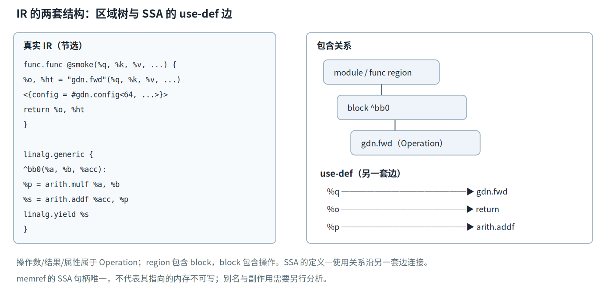

*图 1：IR 的区域树与 SSA use-def 边。Operation 承载操作数、结果和属性，Region/Block 组织嵌套结构；memref 的 SSA 句柄唯一并不禁止底层内存更新。*


概念图应对应上面两段真实 IR：树的一侧展开模块、函数区域、操作、嵌套区域与块，边的另一侧连接 `%q` 到 `gdn.fwd`、`%o` 到 `return`，以及 `^bb0` 中的乘法到加法。它能辅助区分“包含关系”与“值依赖”，这些边不能仅凭文本缩进混为一谈。

### 4. 支配决定一个定义能否服务某个使用

在普通控制流区域中，定义支配（dominates）使用，要求从区域入口到该使用的每条控制流路径都经过定义。同一块内通常表现为定义先于使用；跨块与跨区域时还要考虑所有路径和层级作用域。

【通用补充】下面两个函数给出最小对照。它们是新写示例，不属于项目测试。

```mlir
func.func @ok(%c: i1, %a: i32) -> i32 {
  cf.cond_br %c, ^then, ^else
^then:
  %t = arith.addi %a, %a : i32
  cf.br ^join(%t : i32)
^else:
  cf.br ^join(%a : i32)
^join(%x: i32):
  return %x : i32
}

func.func @bad(%c: i1, %a: i32) -> i32 {
  cf.cond_br %c, ^then, ^else
^then:
  %t = arith.addi %a, %a : i32
  cf.br ^join
^else:
  cf.br ^join
^join:
  return %t : i32
}
```

`@ok` 的两条前驱分别给 `^join` 传入值，入口参数 `%x` 在合流块中有定义，且每条路径都为其提供一个来源。`@bad` 的 `%t` 只在 `^then` 定义；走 `^else` 时合流块没有经过该定义，所以 `return %t` 违反支配。把 `%t` 写成块参数并补齐两个前驱的实参，修复的是控制流上的定义可用性；仅修改名称无法修复支配。

### 5. SSA 值唯一仍允许内存原地更新

张量值与内存描述符需要分开理解。这里只借 L1 的状态说明 SSA 与内存是两件事；memref 的布局、subview 和 bufferize 在第十一章再展开。`memref` 类型的 SSA 值指向一块存储，该值可以只有一个定义，而存储内容能被后续操作修改。L1 的真实状态递推提供了直接证据。

```mlir
%S = memref.alloc() : memref<16x16xf32>
// 中间的 h0h 是 h0 的 subview；此处略去其长类型声明
linalg.copy ins(%h0h : memref<16x16xf32, strided<[16, 1], offset: ?>>) outs(%S : memref<16x16xf32>)
// 中间的 chunk 计算略去
linalg.generic {
      // indexing_maps 与 iterator_types 略去
    } ins(%S, %prod : memref<16x16xf32>, memref<16x16xf32>) outs(%S : memref<16x16xf32>) {
  ^bb0(%xs: f32, %xp: f32, %out8: f32):
  %ms = arith.mulf %xs, %dl : f32
  %rs = arith.addf %ms, %xp : f32
  linalg.yield %rs : f32
}
```

[evidence/G1/l1_chunked_T128_C64.mlir:1880、1897-1898、2115-2127；长属性有省略]

`%S` 只由 `memref.alloc` 定义一次，`linalg.copy` 已向它写入初态，后面的 `linalg.generic` 又同时把它列为输入与输出，实现原地状态更新。可见 SSA 约束的是值定义，内存写由具有副作用的操作表达。`subview` 还会产生新的 SSA 描述符并引用既有存储，因此不同 SSA 值也可能别名；是否可重排、可消除，必须查询内存效果与别名信息。

当前 L1 已是 memref 级、f32、原地状态的 CPU 标量 IR，`run_l1.sh` 中保留的 bufferize 对该输入没有实际 tensor 转换工作。反过来看高层的 `gdn.fwd`，它只给出签名、配置与语义入口，未在这段操作中包含已实现的 chunk 算法。当前 `gdn-to-chunk` 仅把它改为 L1 调用边界；可执行算法文本由 `tools/gdn_l1_gen.py` 生成，不能从一个高层操作名推断实现已经展开。

## 二、方言把语义写成合同：ODS、属性、Trait 与接口

方言（Dialect）为一组操作、类型与属性提供命名空间和注册边界。声明式定义还要回答更细的问题：哪些值来自数据流，哪些选择固定在编译期，哪些结构可以机械检查，哪些能力要暴露给通用 pass。

### 1. 方言声明与 TableGen 生成物

`gdn` 方言先声明自己的名字、C++ 命名空间和依赖方言。

```tablegen
def Gdn_Dialect : Dialect {
  let name = "gdn";
  let summary = "Gated DeltaNet (gated delta rule) operator dialect";
  let cppNamespace = "::gdn";
  let useDefaultAttributePrinterParser = 1;
  let dependentDialects = [
    "tensor::TensorDialect", "linalg::LinalgDialect", "scf::SCFDialect",
    "func::FuncDialect", "mlir::NVVM::NVVMDialect", "nvgpu::NVGPUDialect",
    "gpu::GPUDialect", "arith::ArithDialect",
  ];
}
```

[dialect/include/Gdn/GdnDialect.td:13-35；描述字段省略]

`name = "gdn"` 对应 `gdn.fwd` 的前缀，`cppNamespace` 决定生成 C++ 类的位置。`dependentDialects` 保证加载本方言时准备下降所需的方言，并不表示每个操作都会使用这些词汇。`useDefaultAttributePrinterParser` 接入方言属性的默认打印与解析入口。`GdnDialect::initialize()` 仍要明确调用 `addAttributes` 和 `addOperations`，把生成类注册进方言 [dialect/lib/GdnDialect.cpp:28-36]。

操作定义规约（ODS，Operation Definition Specification）用 TableGen 记录这些声明。构建规则把 `.td` 转成 C++ 声明与实现：

```cmake
set(LLVM_TARGET_DEFINITIONS Gdn/GdnOps.td)
mlir_tablegen(GdnOps.h.inc -gen-op-decls)
mlir_tablegen(GdnOps.cpp.inc -gen-op-defs)

set(LLVM_TARGET_DEFINITIONS Gdn/GdnHatch.td)
mlir_tablegen(GdnHatchOps.h.inc -gen-op-decls)
mlir_tablegen(GdnHatchOps.cpp.inc -gen-op-defs)
mlir_tablegen(GdnHatchEnums.h.inc -gen-enum-decls)
mlir_tablegen(GdnHatchEnums.cpp.inc -gen-enum-defs)
```

[dialect/include/CMakeLists.txt:7-15]

生成代码承担访问器、builder、通用解析打印、属性存储与约束检查等样板，例如 `getQ()`、`getConfig()`。`GdnAttrDefs` 与方言本身也在同文件前段生成。TableGen 不会替作者写出完整数值语义，`hasVerifier` 对应的 C++ 检查体仍由项目维护。

生成的 `.inc` 是构建产物，修改它会在下次生成时丢失。需要改变操作签名时，应修改 `.td` 并检查生成的声明；需要改变非法输入的判定时，则修改手写 verifier。ODS 还生成 adaptor，供通用代码在不构造具体 op wrapper 的情况下访问操作数与属性。具体 op wrapper、adaptor 和底层 `Operation*` 是三种抽象层级，前两者提供强类型便利，最后一种保留遍历任意 IR 的通用性。

声明错误与输入错误发生在不同阶段。dag 写错、参数类型无法识别属于 TableGen 或 C++ 构建问题；某段 IR 的秩不符合合同则由运行中的 verifier 报告。把这两类问题分开，能避免用测试输入去掩盖一个本来就无法生成的定义。

### 2. `dag` 把类型约束、名字和槽位绑定

ODS 的参数列表使用有向无环图记录（dag）语法，每个 `约束:$名字` 同时供代码生成与模式匹配使用。前向和反向定义展示了固定、可选输入及属性的分工。

```tablegen
def GdnFwdOp : GdnOp<"fwd", [Pure]> {
  let arguments = (ins
    AnyRankedTensor:$q, AnyRankedTensor:$k, AnyRankedTensor:$v,
    AnyRankedTensor:$beta, AnyRankedTensor:$g,
    Optional<AnyRankedTensor>:$h0,
    GdnConfigAttr:$config
  );
  let results = (outs AnyRankedTensor:$o, AnyRankedTensor:$ht);
  let hasVerifier = 1;
}

def GdnBwdOp : GdnOp<"bwd", [Pure, AttrSizedOperandSegments]> {
  let arguments = (ins
    AnyRankedTensor:$q, AnyRankedTensor:$k, AnyRankedTensor:$v,
    AnyRankedTensor:$beta, AnyRankedTensor:$g,
    Optional<AnyRankedTensor>:$h0,
    Optional<AnyRankedTensor>:$A,
    AnyRankedTensor:$dout,
    Optional<AnyRankedTensor>:$dht,
    GdnConfigAttr:$config
  );
  let results = (outs AnyRankedTensor:$dq, AnyRankedTensor:$dk, AnyRankedTensor:$dv,
                        AnyRankedTensor:$dbeta, AnyRankedTensor:$dg, AnyRankedTensor:$dh0);
  let hasVerifier = 1;
}
```

[dialect/include/Gdn/GdnOps.td:14-58；description 省略]

`ins` 中的张量项是操作数，代表有 use-def 边的 SSA 输入；`outs` 定义结果。`AnyRankedTensor` 只约束为有秩张量，秩、维度关系与元素类型仍有更细的合同。`config` 是属性，没有 SSA 定义点，适合保存编译期选择。`Optional<AnyRankedTensor>` 允许对应槽缺失，生成的访问器返回可空值；`Variadic<T>` 则接收任意数量的连续值。

反向操作有三个可选张量槽，单看一个扁平操作数列表无法可靠判断 `h0`、`A`、`dht` 各自是否存在。`AttrSizedOperandSegments` 为每个 ODS 操作数槽记录实际段长，解析器和访问器据此切分。当前生成接口使用 `operandSegmentSizes`，并兼容旧文本拼写 `operand_segment_sizes`；普通固定槽记 1，可选槽记 0 或 1。前向只有一个尾随可选张量，总数已经足以消歧，因此没有附加该 Trait。

段长记录属于操作结构，不能被当成随意命名的普通属性省略。九个张量槽依次记录段长后，`getH0()`、`getA()`、`getDht()` 才能返回对应值；若手工构造 IR 时给出的段长总和与实际 operands 数不一致，生成的验证逻辑会拒绝它。`Optional` 限制每槽最多一个值，`Variadic` 允许一段含多个值，两者都依靠槽边界保证访问器稳定。

可选操作数与可选属性也要分开。前者改变 SSA 实参列表，后者只改变属性是否存在；`GdnBulkWaitOp` 的 `OptionalAttr<UnitAttr>:$read` 属于后者 [dialect/include/Gdn/GdnHatch.td:150-159]。把可选标志写成 UnitAttr 可以省去运行时布尔值，同时让 pretty 格式用 `read` 关键字表达它。

hatch 是本项目给硬件入口 op 的分组名，不是 MLIR 的标准术语；这里只借 setmaxnreg 与 TMA 的定义展示 ODS 和 assembly，机器协议在第二十章展开。hatch 定义补上了可变参数与自定义操作格式的实例。

```tablegen
def GdnSetmaxnregOp : GdnHatchOp<"setmaxnreg"> {
  let arguments = (ins I32Attr:$count, GdnRegDirAttr:$direction);
  let assemblyFormat = "enum($direction) $count attr-dict";
  let hasVerifier = 1;
}

def GdnTmaAsyncLoadOp : GdnHatchOp<"tma.async.load"> {
  let arguments = (ins AnyType:$dst, AnyType:$descriptor, AnyType:$barrier,
                       Variadic<Index>:$coordinates);
  let assemblyFormat = "$descriptor `[` $coordinates `]` `,` $barrier `to` $dst attr-dict `:` type($descriptor) `,` type($barrier) `->` type($dst)";
  let hasVerifier = 1;
}
```

[dialect/include/Gdn/GdnHatch.td:32-44、102-115；description 省略]

`coordinates` 是可变长 SSA 操作数段，`count` 与 `direction` 是属性。`assemblyFormat` 中 `$coordinates` 引用参数，反引号给出字面标点，`type(...)` 控制类型打印；它定义操作的 pretty 形式。`Variadic<Index>` 已限制每个坐标为 `index`，坐标个数为一至五则由 C++ verifier 补充。

### 3. `GdnConfigAttr` 固定七个编译期参数

属性也可以用 `AttrDef` 获得强类型参数和稳定文本形式。

```tablegen
def GdnConfigAttr : AttrDef<Gdn_Dialect, "GdnConfig"> {
  let mnemonic = "config";
  let parameters = (ins
    "int":$chunk_size,
    "bool":$use_g,
    "bool":$use_gk,
    "bool":$normalize_q,
    "bool":$use_initial_state,
    "bool":$store_final_state,
    "bool":$is_varlen
  );
  let assemblyFormat = "`<` $chunk_size `,` $use_g `,` $use_gk `,` $normalize_q `,` $use_initial_state `,` $store_final_state `,` $is_varlen `>`";
}
```

[dialect/include/Gdn/GdnDialect.td:50-67；summary 与 description 省略]

七个字段依次控制 chunk 长度、标量门、逐通道门、q 归一化、初始状态、终态输出和变长序列。它们挂在操作上，生成 `getChunkSize()` 等强类型访问器，并可原样透传到下降后的调用。张量形状与元素类型属于类型系统，q、k、v 等运行时数据属于操作数，这组离散配置属于属性；把配置伪装成 SSA 输入会引入不存在的数据依赖。

这组语义配置还要与调度参数分开审查。`chunk_size` 会固定 L1 算法结构，边界开关会改变输入输出行为；tile、warp 数和流水深度只应改变同一语义合同的实现方式。修改前者需要重新执行语义与数值对照，修改后者仍需验证等价性并检查资源与性能。两者都能成为编译期属性，是否改变算子合同决定了验证责任，存储载体本身无法替代这层分类。

属性对象在上下文中不可变，操作却可以通过 `setAttr` 换挂另一个属性值。改写因此能更新配置，但不能原地修改某个共享属性对象而影响无关操作。逐字段访问器让这种更新保持类型安全，打印出的固定顺序也便于复核。

`mnemonic = "config"` 与所属方言共同形成 `#gdn.config<...>`。这里的 `assemblyFormat` 只定义属性内部的七个字段及标点，不改变 `gdn.fwd` 的操作语法。属性在 MLIRContext 中驻留并按值比较，适合缓存与差异检查；驻留优化不会替配置检查合法域。

### 4. Trait、接口与 verifier 各守一层合同

特征（Trait）提供可组合的静态事实或实现钩子。这里的 `Pure` 在当前 MLIR 中展开为 `AlwaysSpeculatable` 与 `NoMemoryEffect`，并通过内存效果接口告知通用变换：该操作可推测执行且不访问内存。它支持死代码消除、公共子表达式消除等优化，但不证明数学公式正确，也不允许忽略结果类型与 SSA 关系。

操作接口（OpInterface）向异构操作暴露统一查询，例如类型推导或内存效果查询；调用方面向接口编程，具体操作提供实现。verifier 则返回成功或失败，专门拒绝非法 IR。当前 `GdnOps.td` 与 `GdnHatch.td` 没有声明项目自定义操作接口，`hasVerifier = 1` 只生成验证钩子；包含接口头文件或链接接口库不能当作已经实现接口的证据。

结构合同也有明确边界。ODS 与 verifier 能检查部分类型、秩、配置和硬件参数，完整 shape 关系、g 的非正约束、归一化位置及数值公式仍由 `docs/L0_SEMANTICS.md`、JAX fp64、fla naive 与 L1 生成器共同维护。阅读 ODS 时还要校正至少两处旧注释：`GdnOps.td:21` 与 `GdnDialect.td:53-55` 仍写着 log2-domain；现行语义规定外部 `g` 为自然对数域，`decay = exp(g)` 且 `g≤0`，内部乘 `log2(e)` 后使用 `math.exp2` [docs/L0_SEMANTICS.md:9-10；dialect/include/Gdn/GdnDialect.td:53-55]。

最后，声明存在不等于下降已经展开。当前 `gdn-to-chunk` 只把 `gdn.fwd/bwd` 改成 `func.call @__gdn_l1_*`，透传 `gdn.config` 并去重声明；完整 L1 来自生成器 [dialect/lib/GdnPasses.cpp:38-85]。第四章将分析这段改写本身。

## 三、先让非法程序报错：Verifier、诊断与 IR 测试

验证器（verifier）把非法 IR 挡在编译早期，并给出能定位、能回归的诊断。它能保证的范围取决于实际检查代码：通过验证表示已满足已实现的结构合同，不能由此推出算子的数学与数值行为正确。

### 1. ODS 约束与 C++ 检查接续工作

ODS 先生成机械约束，例如 `AnyRankedTensor` 要求有秩张量，`I32Attr` 要求 32 位整数属性，`Variadic<Index>` 要求每个坐标都是 `index`。C++ verifier 接着检查需要遍历多个字段或表达合法域的条件。

```cpp
static LogicalResult verifyConfig(gdn::GdnConfigAttr config, Operation *op) {
  if (!llvm::is_contained(gdn::kAllowedChunkSizes, config.getChunkSize()))
    return op->emitError() << "chunk_size must be one of {16,32,64}, got "
                           << config.getChunkSize();
  return success();
}

LogicalResult gdn::GdnFwdOp::verify() {
  if (failed(verifyConfig(getConfig(), *this)))
    return failure();
  auto q = mlir::dyn_cast<RankedTensorType>(getQ().getType());
  auto v = mlir::dyn_cast<RankedTensorType>(getV().getType());
  auto beta = mlir::dyn_cast<RankedTensorType>(getBeta().getType());
  if (!q || q.getRank() != 4)
    return emitError() << "q must be rank-4 [B,T,H,K]";
  if (!v || v.getRank() != 4)
    return emitError() << "v must be rank-4 [B,T,H,V]";
  if (!beta || beta.getRank() != 3)
    return emitError() << "beta must be rank-3 [B,T,HV]";
  return success();
}
```

[dialect/lib/GdnDialect.cpp:43-62]

合法 chunk 集合来自 `kAllowedChunkSizes = {16, 32, 64}` [dialect/include/Gdn/Gdn.h:31-32]，前向与反向都调用 `verifyConfig`。前向额外检查 q、v 为秩 4、beta 为秩 3；反向的 `verify()` 在第 65-69 行只复核配置。`emitError()` 把消息附着到操作的源位置，返回的 `failure()` 沿 `LogicalResult` 传给框架。解析后的验证和 pass 管线中的验证都使用同一套钩子，错误因此能指向具体 IR 行。

这里能看到明确的未覆盖区域：k、g、h0 的秩，跨操作数的维度一致性，元素类型组合，配置开关之间的依赖均未完整核对；`g≤0`、归一化、衰减顺序与梯度公式也不在 verifier 中证明。测试设计必须针对这些空白另建数值与语义检查。

有效的结构测试需要正负例成组。chunk 的三个合法值都应各有一次正常解析，15、48、128 可分别覆盖不在集合、落在常见倍率但仍不在集合、超出集合的情况。仅测一个非法值不能证明集合边界完整，仅测合法值也无法发现 verifier 根本没有被调用。每个负例还应断言关键消息与位置，防止测试因另一个无关解析错误而偶然通过。

自定义 verifier 与 ODS 约束的先后顺序也值得控制。若 ODS 已能保证操作数是张量，C++ 可以专注于秩和跨字段关系；若需要给出比通用类型错误更清楚的领域诊断，就应在定义中保留足够的信息。所有分支都应返回明确的 `LogicalResult`，避免检查失败后仍继续访问不成立的类型或字段。

### 2. 硬件入口更需要早期范围诊断

硬件直通操作把指令约束前移到 IR 层，避免非法参数直到汇编阶段才以底层报错出现。

```cpp
LogicalResult GdnSetmaxnregOp::verify() {
  if (getCount() < 24 || getCount() > 256 || getCount() % 8 != 0)
    return emitError() << "setmaxnreg count must be a multiple of 8 in "
                          "[24, 256], got "
                       << getCount();
  return success();
}

static LogicalResult verifyTmaCoords(Operation *op, ValueRange coords) {
  if (coords.empty() || coords.size() > 5)
    return op->emitError() << "tma coordinates must be 1..5 dims, got "
                           << coords.size();
  return success();
}

LogicalResult GdnTmaAsyncLoadOp::verify() {
  return verifyTmaCoords(*this, getCoordinates());
}
```

[dialect/lib/GdnHatch.cpp:246-263；store 的同构检查在 265-267 行]

`setmaxnreg` 的 count 必须同时满足闭区间 `[24, 256]` 与 8 的倍数：24、32、256 合法，16、25、260 非法。枚举属性已经限制方向为已声明值，C++ 再检查数值范围与步进。TMA load 和 store 复用坐标检查，零个或六个坐标都会报错，一至五个通过这一层；描述符内容、张量形状、运行时越界与异步完成协议仍需后续合同保证。

### 3. 期望诊断与结构输出是两种 IR 断言

`--verify-diagnostics` 用于负例。源码在预期出错的位置写 `// expected-error {{消息片段}}`，也可用 `expected-error@+1` 指向下一行；预期诊断缺失或出现额外诊断都会使测试失败。它检查诊断级别、位置和消息匹配，适合固定 chunk 越界、TMA 零坐标这类行为。正常输入无需错误注释，过度宽泛的消息匹配则会放过误诊。

FileCheck 面向命令标准输出。`CHECK`、`CHECK-SAME`、`CHECK-NOT` 等指令匹配文本片段和正则捕获，适合检查 roundtrip 后属性仍在、改写后调用符号存在、某个高层操作已经消失。它不会执行 IR，也不会自行比较浮点数组。`lit` 是测试运行器，负责发现测试、展开 substitutions、执行 `RUN` 行并汇总状态；FileCheck 通常只是其中一条命令。三者的职责可以组合，不能用一个 `PASS` 代替所有层级。

写结构断言时应匹配合同，少匹配打印细节。用变量捕获一个 SSA 名称再检查其使用，比固定 `%0` 更耐打印重编号；`CHECK-LABEL` 可隔离函数，`CHECK-DAG` 可表达一组无序出现项，`CHECK-NOT` 可约束相邻匹配之间不能出现的文本。另一方面，只写 `CHECK: "gdn.fwd"` 无法证明属性正确，只写函数名也无法证明调用参数顺序。断言应覆盖会支撑后续改写的关键结构。

诊断测试同样需要精度。普通 `expected-error` 检查消息片段，`expected-error-re` 才显式使用正则；位置设计符把期望绑定到相应源码行。一个文件中多个负例常配合 `--split-input-file` 隔离，防止第一个非法操作影响后续解析。错误消息可以包含实际值与期望值，例如 count 为 25，但测试最好保留稳定的领域短语，避免把完整格式字符串固化成脆弱快照。

### 4. 数值测试与 GPU 冒烟回答不同问题

真实 L1 检查先生成并执行 MLIR，再把输出数组与参考实现逐元素比较。

```python
diff_o = float(np.max(np.abs(o_m[:, :T, :, :] - o_ref)))
diff_ht = float(np.max(np.abs(ht_m - ht_ref)))
ok = diff_o < PASS_ATOL and diff_ht < PASS_ATOL
return {
    "name": name, "shape": f"B{B} T{T} H{H} K{K} V{V} C{C}",
    "diff_o": diff_o, "diff_ht": diff_ht,
    "algo_o": algo_check, "algo_ht": algo_ht, "ok": ok,
}
```

[tools/gdn_l1_check.py:299-306]

这里判定的是最大绝对误差是否越界，IR 是否漂亮并不影响结果。相邻的 `run_npz_case` 使用 JAX 转储参考值，反向检查还覆盖六个梯度 [tools/gdn_l1_check.py:309-341、345-385]。文档、JAX fp64、fla naive 与生成的 MLIR L1 通过可执行交叉测试约束同一份数值语义，verifier 不承担这层证明。容差、有限值和 shape 都必须单独判定。

一个结构完全合法的程序仍可能算错。外部语义的 `g` 位于自然对数域，内部需要乘 `log2(e)` 后调用 `math.exp2`；漏掉比例变换不会自动改变秩、类型或操作数个数，verifier 因而可以接受错误程序，FileCheck 也能继续匹配到 `math.exp2`。只有执行并比较输出才会暴露这类偏差。数值测试还应拒绝 NaN 和 Inf，并按任务记录绝对误差、相对误差或位级条件；仅检查进程返回码不足以判定正确。

参考链也要避免共同误解。让同一个错误公式同时充当生成器和参考，只会得到稳定的一致错误，所以项目保留 JAX、fla naive 与 MLIR L1 的独立对照。容差用于界定可接受的浮点差异，不能用来掩盖持续的符号错误或衰减顺序错误。

GPU 冒烟属于另一类集成测试，专门检查 transform→NVVM→cubin→运行链；sm_80 输入文件如何重定向到 sm_120a、runner 的输出如何核对，在第十九章展开。这里先固定分工：结构测试看 IR，数值测试看输出，二者不能互相替代。

### 5. 【练习】构造一个可执行的 L0 回归小例

当前 `dialect/test/` 只有 `smoke_l0.mlir`，没有配置完整的项目自有 lit/FileCheck 与 `verify-diagnostics` 套件。以下内容是新练习，需要在临时文件中运行，并非仓库已有测试；命令假定 `gdn-opt` 与 `FileCheck` 已在 PATH 中。

```mlir
// RUN: gdn-opt %s | gdn-opt | FileCheck %s
// RUN: gdn-opt %s --gdn-to-chunk | FileCheck %s --check-prefix=CALL

!qt = tensor<1x4x1x8xf32>
!bt = tensor<1x4x1xf32>
!st = tensor<1x1x8x8xf32>

func.func @roundtrip(%q: !qt, %k: !qt, %v: !qt,
                     %beta: !bt, %g: !bt) -> (!qt, !st) {
  %o, %ht = "gdn.fwd"(%q, %k, %v, %beta, %g)
      <{config = #gdn.config<16, true, false, false, false, true, false>}>
      : (!qt, !qt, !qt, !bt, !bt) -> (!qt, !st)
  return %o, %ht : !qt, !st
}

// CHECK: "gdn.fwd"
// CHECK: #gdn.config<16, true, false, false, false, true, false>
// CALL: func.func private @__gdn_l1_fwd_chunk
// CALL: call @__gdn_l1_fwd_chunk
// CALL: #gdn.config<16, true, false, false, false, true, false>
```

第一条 RUN 完成解析、打印、再次解析与结构匹配，第二条固定当前的 L1 调用边界及配置透传。另取一个只保留正常输入的副本，把 chunk 从 16 改成 48，并在 `gdn.fwd` 前一行加入 `// expected-error@+1 {{chunk_size must be one of}}`，再以 `gdn-opt --verify-diagnostics` 运行，就得到一个负例。这个练习仍不验证 GDN 数值；要覆盖数值，必须执行生成的 L1 并与独立参考比较。

## 四、改写如何收敛：RewritePattern、贪心驱动与规范化

重写模式（RewritePattern）把局部 IR 变化写成可复用规则，驱动器负责选择规则、跟踪变化并处理后续暴露的机会。局部规则的正确性与整次改写的收敛性相互依赖，必须同时检查。

### 1. `FwdToLowering` 一次只替换一个语义入口

前向下降模式完整展示了从匹配到结果重接线的过程。

```cpp
struct FwdToLowering : OpRewritePattern<gdn::GdnFwdOp> {
  using OpRewritePattern::OpRewritePattern;
  LogicalResult matchAndRewrite(gdn::GdnFwdOp op,
                                PatternRewriter &rewriter) const override {
    Location loc = op.getLoc();
    SmallVector<Value> args{op.getQ(), op.getK(), op.getV(), op.getBeta(),
                            op.getG()};
    if (op.getH0())
      args.push_back(op.getH0());
    auto fnTy = rewriter.getFunctionType(ValueRange(args).getTypes(),
                                         op.getResultTypes());
    if (auto module = op->getParentOfType<ModuleOp>())
      ensureL1Entry(module, rewriter, kL1FwdSym, fnTy);
    auto callee = rewriter.getStringAttr(kL1FwdSym);
    auto call = rewriter.create<func::CallOp>(loc, callee,
                                              op.getResultTypes(), args);
    call->setAttr("gdn.config", op.getConfig());
    rewriter.replaceOp(op, call.getResults());
    return success();
  }
};
```

[dialect/lib/GdnPasses.cpp:38-59]

`OpRewritePattern<gdn::GdnFwdOp>` 让驱动器只向该模式递交匹配类型的操作。进入 `matchAndRewrite` 后，模式应只在不适用且尚未改写时返回 `failure()`；完成变化才返回 `success()`。五个必备操作数先进入实参向量，可选 `h0` 按槽位存在性追加，函数类型直接由实参和原结果类型构造。这里没有展开 chunk 算法，目标仍是 L1 外部调用。

`PatternRewriter` 是修改 IR 的受控入口。`create` 插入 `func.call` 并继承原位置，`setAttr` 透传配置，`replaceOp` 把旧结果的每个使用改接到新 call 的对应结果，再删除旧操作。保留 `Location` 能让后续诊断回溯到源位置；沿用 `getResultTypes()` 则把类型变化留给明确的转换机制。绕开 rewriter 直接改操作数或删除节点，会使驱动器错过需要重新处理的值与操作。

替换前必须检查结果数量与类型是否对应。旧操作可能已被嵌套区域中的用户使用，也可能和模块中其他操作共享操作数；`replaceOp` 只替换旧 results 的使用，不会复制或删除这些输入值。新 call 仍需支配所有原使用点，在原操作附近创建它正好维持这一条件。若把新操作插入到不相干的区域，单纯的 API 调用成功也不能保证最终 IR 合法。

模式集在交给驱动器前会被冻结，驱动器可以据此建立匹配索引。模式本体应把可变状态放在单次调用或外部只读上下文中，避免把前一个匹配的 op 指针留到下一个匹配使用。旧 op 被替换后，其地址可能立即失效，后续通知也只能使用 rewriter 提供的新句柄和值。

### 2. `ensureL1Entry` 让声明生成幂等

call 需要可解析的符号。多个 `gdn.fwd` 共享一个入口时，声明应在模块级按需创建。

```cpp
static func::FuncOp ensureL1Entry(ModuleOp module, PatternRewriter &rewriter,
                                  StringRef sym, FunctionType fnTy) {
  if (auto existing = module.lookupSymbol<func::FuncOp>(sym))
    return existing;
  OpBuilder::InsertionGuard guard(rewriter);
  rewriter.setInsertionPointToStart(module.getBody());
  auto decl = rewriter.create<func::FuncOp>(
      module.getLoc(), sym, fnTy);
  decl.setPrivate();
  return decl;
}
```

[dialect/lib/GdnPasses.cpp:26-36]

先执行 `lookupSymbol`，同名声明已存在便直接复用，第二个匹配不会产生重复定义。`InsertionGuard` 保存并恢复调用方的插入点，使“到模块首部插入声明”不干扰旧操作附近的 call 创建。`setPrivate()` 给出私有外部声明，函数体由后续 L1 实体提供。这个查询只比较符号名，未核对既有声明的 `fnTy`；同名入口必须维持一致签名，否则后续 call 验证仍会暴露冲突。

### 3. 无结果硬件操作用 `eraseOp` 完成替换

有些下降没有结果可重接线。`setmaxnreg` 先建立等价的 NVVM 操作，再删除旧包装。

```cpp
struct SetmaxnregLowering : OpRewritePattern<GdnSetmaxnregOp> {
  using OpRewritePattern::OpRewritePattern;
  LogicalResult matchAndRewrite(GdnSetmaxnregOp op,
                                PatternRewriter &rewriter) const override {
    auto action = op.getDirection() == GdnRegDir::inc
                      ? NVVM::SetMaxRegisterAction::increase
                      : NVVM::SetMaxRegisterAction::decrease;
    NVVM::SetMaxRegisterOp::create(rewriter, op.getLoc(),
                                   (uint32_t)op.getCount(), action);
    rewriter.eraseOp(op);
    return success();
  }
};
```

[dialect/lib/GdnHatch.cpp:29-41]

枚举属性 `inc/dec` 被翻译为 NVVM 的 `increase/decrease`，count 与位置随新操作保留。`eraseOp` 在这里属于已经建立替代语义后的显式下降步骤，不能类推出“无结果操作都可删除”。`setmaxnreg` 会改变 warp 寄存器预算且未标 `Pure`；简单死代码消除不能因为它没有 results 就把寄存器效果抹去。对有结果操作，`replaceOpWithNewOp` 可同时完成构建和替换，hatch 文件中的 `ElectLowering` 即采用这一形式 [dialect/lib/GdnHatch.cpp:43-50]。

### 4. 贪心驱动只处理 worklist 中的局部机会

两个项目 pass 都把模式集交给同一个上游驱动器。

```cpp
void populateGdnToChunkPatterns(RewritePatternSet &patterns) {
  patterns.add<FwdToLowering, BwdToLowering>(patterns.getContext());
}

struct GdnToChunkPass
    : public PassWrapper<GdnToChunkPass, OperationPass<ModuleOp>> {
  MLIR_DEFINE_EXPLICIT_INTERNAL_INLINE_TYPE_ID(GdnToChunkPass)
  void runOnOperation() override {
    RewritePatternSet patterns(&getContext());
    populateGdnToChunkPatterns(patterns);
    if (failed(applyPatternsGreedily(getOperation(), std::move(patterns))))
      signalPassFailure();
  }
};
```

[dialect/lib/GdnPasses.cpp:89-105；pass 元数据省略]

`applyPatternsGreedily` 在模块各区域内维护操作 worklist，按模式收益尝试候选规则。成功改写后，新操作以及受影响的值生产者和使用者会重新进入处理过程；队列为空且没有可匹配模式时到达不动点。`gdn-lower-hatch` 在第 215-230 行以同样方式注册十二个模式并调用驱动器 [dialect/lib/GdnHatch.cpp:215-230]。

对 `ModuleOp` 调用的是操作重载：它处理模块的各个区域，模块中的 `func.func` 及其嵌套区域会被覆盖，但不会把模块自身当作一个可删除的根节点。默认 scope 限制可以修改的范围，严格模式还能限制哪些已有操作重新入队。理解范围很重要，在嵌套 pass 中以为整个模块都会被扫描，可能造成模式始终不触发。

模式收益影响优先尝试顺序，worklist 通知决定改写后还能看到哪些新机会。局部成功不要求模式集与顺序无关；若需要确定性产物，应避免依赖指针地址或未固定的遍历顺序来决定输出。对于本项目的两个下降，目标操作每成功一次就消失，进展条件相对直接，复杂规范化模式则需要更仔细地排除循环。

默认驱动还执行操作折叠、简单死代码消除和常量去重。当前 MLIR 可在迭代之间启用完整公共子表达式消除，项目这两个调用没有打开该配置。驱动返回失败可表示达到迭代或改写预算后仍未收敛，`signalPassFailure()` 把问题上升为 pass 失败。

收敛只说明给定模式集在当前配置下没有继续命中的局部机会，不提供全局最优保证。模式 A 创建的模式 B 输入会促进收敛；A 与 B 若互相重建对方，或某模式在不改变 IR 时仍返回成功，就可能反复触发。调试时应检查每次成功是否减少目标操作、缩短表达式或建立严格可测的进展，并用收敛测试暴露循环。

### 5. fold、CSE、DCE 与 canonicalization 的交界

【通用补充】同一个输入分别执行三条命令，避免把组合结果误记成某一个 pass 的全部作用。输入包含常量算式、两次相同加法和一条无使用的乘法：

```mlir
func.func @simplify(%x: i32) -> i32 {
  %c2 = arith.constant 2 : i32
  %c4 = arith.constant 4 : i32
  %k = arith.addi %c2, %c4 : i32
  %a = arith.addi %x, %k : i32
  %b = arith.addi %x, %k : i32
  %dead = arith.muli %a, %a : i32
  %r = arith.addi %a, %b : i32
  return %r : i32
}
```

[paper/zh/v6examples/simplify.mlir:1-10]

`-canonicalize` 的真实输出把 `2+4` 折成 6，删除了 `%dead`，但仍保留两个相同加法：

```mlir
%c6_i32 = arith.constant 6 : i32
%0 = arith.addi %arg0, %c6_i32 : i32
%1 = arith.addi %arg0, %c6_i32 : i32
%2 = arith.addi %0, %1 : i32
return %2 : i32
```

[paper/zh/v6examples/simplify.canonicalize.mlir:2-6；函数包装省略]

`-cse` 的真实输出合并了相同加法，却没有把 `2+4` 折成常量；该实现同时清理了因此不再需要的操作：

```mlir
%c2_i32 = arith.constant 2 : i32
%c4_i32 = arith.constant 4 : i32
%0 = arith.addi %c2_i32, %c4_i32 : i32
%1 = arith.addi %arg0, %0 : i32
%2 = arith.addi %1, %1 : i32
return %2 : i32
```

[paper/zh/v6examples/simplify.cse.mlir:2-7；函数包装省略]

`-trivial-dce` 的真实输出只删除无使用的 `%dead`，两个相同加法和两个常量都保留：

```mlir
%c2_i32 = arith.constant 2 : i32
%c4_i32 = arith.constant 4 : i32
%0 = arith.addi %c2_i32, %c4_i32 : i32
%1 = arith.addi %arg0, %0 : i32
%2 = arith.addi %arg0, %0 : i32
%3 = arith.addi %1, %2 : i32
return %3 : i32
```

[paper/zh/v6examples/simplify.dce.mlir:2-8；函数包装省略]

折叠由操作自己的钩子识别常量或恒等情形；CSE 在支配与效果条件允许时合并等价计算；DCE 删除无使用且无副作用的操作。canonicalization pass 收集方言注册的规范化模式，并复用贪心驱动、折叠和局部清理，所以它不是“只做折叠”的别名。当前 gdn 方言没有自写 fold、canonicalization 或 DCE 钩子，项目两个贪心 pass 也未打开完整 CSE 配置；本例全部依赖上游 arith 与通用 pass。

### 6. 普通 rewrite 与 DialectConversion 的边界

`FwdToLowering` 和 hatch 模式直接创建已知目标操作，源结果类型大多沿用，目标集合也不需要逐步声明合法与非法。普通 `OpRewritePattern` 因而足够表达这些一对一或一对多的局部替换。

当下降需要类型转换、目标合法性判定、源与目标之间的 materialization，以及部分或整体转换的提交管理时，应使用 DialectConversion 的 `ConversionPattern`、`TypeConverter` 与 `ConversionTarget`。它处理的是另一组基础设施，不能把 `replaceOp` 的局部成功当作整个类型系统已经转换完成。具体转换合同留到第十二章。

## 五、许多 Pass 如何协同：PassManager、Analysis 与可观察性

一条重写规则即使局部正确，仍可能因运行锚点不合适、嵌套顺序含混或分析缓存过期而出错。PassManager（pass 管理器）负责把多条 pass 组成有作用域的执行序列；AnalysisManager（分析管理器）负责在这条序列中计算、复用并失效分析结果。两者连接的是 IR 的生命周期，而不只是函数调用顺序。

pass 与 rewrite pattern 的遍历层级也需要区分。pattern 决定局部匹配与替换，pass 决定这次遍历从哪枚 op 获得授权，PassManager 再决定不同 pass 的先后和嵌套。把这三层分开后，`walk`、贪心驱动器和函数级适配器就不会被误当成同一种调度机制。

### 1. OperationPass 的锚点限定作用域

`OperationPass<OpT>` 的模板参数是锚点（anchor）：pass 在一枚指定类型的 op 上运行，`getOperation()` 也返回对应类型。`gdn-to-chunk` 选择 `ModuleOp`，因为它一边改写嵌套在函数里的 `gdn.fwd/gdn.bwd`，一边向父模块插入被调函数声明。

```cpp
struct GdnToChunkPass
    : public PassWrapper<GdnToChunkPass, OperationPass<ModuleOp>> {
  MLIR_DEFINE_EXPLICIT_INTERNAL_INLINE_TYPE_ID(GdnToChunkPass)
  void runOnOperation() override {
    RewritePatternSet patterns(&getContext());
    populateGdnToChunkPatterns(patterns);
    if (failed(applyPatternsGreedily(getOperation(), std::move(patterns))))
      signalPassFailure();
  }
  StringRef getArgument() const override { return "gdn-to-chunk"; }
};
```

[dialect/lib/GdnPasses.cpp:93-105]

模块锚点使声明插入与调用改写都位于同一棵授权修改的子树内。`ensureL1Entry` 先查符号，再在模块体开头建立私有声明；贪心驱动器随后可以处理模块里的多个前向或反向 op，而不会重复声明同名函数[dialect/lib/GdnPasses.cpp:26-36,38-85]。若把锚点改成 `func::FuncOp`，向父模块写声明就越过了函数 pass 的作用域，也会破坏函数级管线可并行处理独立函数的假设。锚点选择因此同时回答“收到哪枚 op”“允许修改哪棵子树”“会被执行多少次”。

锚点还决定分析的自然归属。模块级符号表分析应看到整个模块，函数级支配分析只应依赖当前函数；函数子管线可由适配器分发到多枚函数，模块 pass 则形成它们之间的串行边界。把需要跨函数写符号表的逻辑塞进函数 pass，既扩大实际修改范围，也使缓存该放在哪一层变得含混。`gdn-to-chunk` 的模块选择把改写权限、符号生命周期和分析归属放在了同一层。

### 2. 嵌套管线把执行次序写成结构

`OpPassManager` 保存同一锚点下的一串 pass，`nest<OpT>()` 在其下建立子管线；跨锚点时，适配器遍历匹配的内层 op 并调度子管线。文本形式直接把这套树写出来：

```bash
build-dialect/bin/gdn-opt dialect/test/smoke_l0.mlir \
  --pass-pipeline='builtin.module(gdn-to-chunk,func.func(canonicalize,cse),gdn-lower-hatch)' \
  --dump-pass-pipeline -o /tmp/gdn.pipeline.mlir
```

[dialect/tools/gdn-opt/gdn-opt.cpp:15-30；dialect/lib/GdnPasses.cpp:102-110；dialect/lib/GdnHatch.cpp:223-240]

外层先在模块锚点运行 `gdn-to-chunk`，再对每个 `func.func` 运行规范化与公共子表达式消除，最后回到模块层运行 hatch 下降。显式 `--pass-pipeline` 按文本建树，解析期间关闭隐式嵌套；漏写 `func.func(...)` 且锚点不匹配时会直接报错[上游 llvm-mlir/mlir/lib/Pass/PassRegistry.cpp:607-617,1002-1027]。`--dump-pass-pipeline` 用来核对实际树形，避免凭命令行外观猜测作用域。对本例运行后，日志同时给出 canonicalize 的配置，能看到 `cse-between-iterations=false` 这一默认值：

```text
Pass Manager with 3 passes:
builtin.module(
  gdn-to-chunk,
  func.func(
    canonicalize{cse-between-iterations=false ...},
    cse
  ),
  gdn-lower-hatch
)
```

[paper/zh/v6examples/pass-pipeline.txt:1-10；`...` 表示省略其余默认参数]

显式管线与逐项 pass 旗标属于两种输入方式，同一次调用不能混用；上游解析器会对这种组合报错[上游 llvm-mlir/mlir/lib/Pass/PassRegistry.cpp:1002-1026]。调试顺序变化时，应比较完整文本树和模块边界，而不只比较旗标列表。尤其是函数子管线前后的两个模块 pass，它们之间可能已发生各函数上的改写；将最后的模块 pass 移到函数子管线之前，观察到的符号和 IR 都可能不同。

逐项传 pass 旗标时，`MlirOptMain` 从解析所得根 op 的名字创建 PassManager，并采用 `Nesting::Implicit`，随后应用通用命令行选项、装配管线并执行[上游 llvm-mlir/mlir/lib/Tools/mlir-opt/MlirOptMain.cpp:591-604]。项目的 L1 CPU 脚本正使用这种形式：

```bash
"$OPT" "$IN" \
  -one-shot-bufferize="bufferize-function-boundaries" \
  -convert-linalg-to-loops \
  -convert-scf-to-cf \
  -expand-strided-metadata \
  -lower-affine \
  -convert-math-to-llvm \
  -convert-arith-to-llvm \
  -finalize-memref-to-llvm \
  -convert-cf-to-llvm \
  -convert-func-to-llvm \
  -reconcile-unrealized-casts \
  -o "$OUT"
```

[scripts/run_l1.sh:19-35]

这里 `$OPT` 是上游 `mlir-opt`，因为生成后的 L1 只含树内方言。顺序具有语义：结构化计算先降为循环，控制流、数学运算、memref 和函数再分别降到 LLVM 可表达的形式，最后清理过渡 cast。项目没有另写一个 C++ 驱动来组装这条链；`gdn-opt` 也只向 `MlirOptMain` 注册方言与 pass[dialect/tools/gdn-opt/gdn-opt.cpp:15-30]。第六章会说明两个可执行文件的链接关系，第八章再检查这条 CPU 链的数值证据。

### 3. AnalysisManager 的懒计算、缓存与失效

分析（analysis）是从当前 IR 计算出的只读视图，例如操作计数、支配关系或别名信息。`getAnalysis<T>()` 首次请求时构造 `T` 并放入当前锚点的 AnalysisMap；后续请求命中同一缓存。构造发生在请求时，管线启动不会预先计算任何分析。缓存命中也不会再次调用分析构造器[上游 llvm-mlir/mlir/include/mlir/Pass/AnalysisManager.h:132-175,193-215,287-368]。

缓存键同时包含分析类型与所依附的 operation，而非全局只有一份 T。嵌套 AnalysisManager 为子 op 建立独立 AnalysisMap，父级与子级可通过明确的接口查询，不能把某函数的分析结果误用到另一函数。`getChildAnalysis` 会按需建立子级结果，`getCachedParentAnalysis` 只读取已经存在的父级缓存[上游 llvm-mlir/mlir/include/mlir/Pass/AnalysisManager.h:299-360]。这种布局与 PassManager 的嵌套树相对应，也使失效可以限制在受影响的 IR 层级。

每条 pass 结束后，PassManager 根据该 pass 声明的 `PreservedAnalyses` 清理缓存。默认规则很保守：未明确保留的分析失效，下一次 `getAnalysis<T>()` 重新计算。`markAnalysesPreserved<T>()` 是对分析语义的承诺，`markAllAnalysesPreserved()` 则承诺每份已缓存分析仍有效。只改属性而不改变操作计数时可以保留 CountOps；增加一条 call 后仍保留它，就会让后续 pass 读到旧计数。分析依赖也需要进入失效条件，上游单元测试展示了依赖分析同时检查自身与依赖项是否保留的做法[上游 llvm-mlir/mlir/unittests/Pass/AnalysisManagerTest.cpp:173-204]。

【通用补充】下面的 CountOps 展示完整的最小协议。它使用上游 `Operation::walk` 遍历当前 op 及其嵌套 op；walk 是 IR 遍历接口，不负责 pass 调度或缓存管理。上游默认采用后序遍历，也允许按具体 op 类型筛选[上游 llvm-mlir/mlir/include/mlir/IR/Operation.h:813-850]。

```cpp
struct CountOpsAnalysis {
  MLIR_DEFINE_EXPLICIT_INTERNAL_INLINE_TYPE_ID(CountOpsAnalysis)
  explicit CountOpsAnalysis(Operation *root) {
    root->walk([&](Operation *) { ++count; });
  }
  size_t count = 0;
};

struct CountingPass
    : PassWrapper<CountingPass, OperationPass<ModuleOp>> {
  MLIR_DEFINE_EXPLICIT_INTERNAL_INLINE_TYPE_ID(CountingPass)
  void runOnOperation() override {
    auto &counts = getAnalysis<CountOpsAnalysis>();
    llvm::outs() << counts.count << "\n";
    // 仅当本 pass 没有改变 op 数量时保留；改写 op 数量时删除下一行。
    markAnalysesPreserved<CountOpsAnalysis>();
  }
};
```

【通用补充，接口依据：上游 llvm-mlir/mlir/include/mlir/Pass/Pass.h:228-260；上游 llvm-mlir/mlir/include/mlir/Pass/AnalysisManager.h:82-97】

失效例可以直接沿这条协议推演。第一个 pass 请求 CountOps，得到 N；只读 pass 明确保留后，下一个读者复用 N。某条改写 pass 新增两个 op 且不作保留声明，PassManager 删除缓存，后续读者重新 walk，得到 N+2。若改写 pass 错标保留，后续读者仍看到 N。`getCachedAnalysis<T>()` 只查询现有缓存，适合观察或可选优化，不能替代需要结果时的 `getAnalysis<T>()`；缓存被清理后，旧引用也不应继续使用。

项目另有一个外部 Python 求解器：它读取阶段、形状和旋钮域，构造约束并输出排名文件，输入中没有 `Operation*`，生命周期由 Python 进程和显式脚本调用管理[tools/gdn_solver.py:1-26,81-110]。它不是 MLIR Analysis，不注册进 AnalysisManager，也不随 IR pass 自动失效或保留。当前项目没有自写 CountOps 这类 MLIR Analysis；项目机制是 `MlirOptMain` 加命令行管线，上游在幕后提供分析基础设施。具体求解器模型在第十五至十八章展开。

### 4. 用插桩（instrumentation）观察执行，而非猜测执行

`PassInstrumentation` 在管线、pass 和分析的前后提供回调，另有 pass 失败回调。IR 打印与计时都复用这套观察点；分析回调只包围真正的构造过程，因此还能区分缓存命中与重新计算[上游 llvm-mlir/mlir/include/mlir/Pass/PassInstrumentation.h:25-86；上游 llvm-mlir/mlir/include/mlir/Pass/AnalysisManager.h:195-214]。项目未安装自定义 instrumentation，直接使用 `MlirOptMain` 注册的命令行能力即可。

```bash
build-dialect/bin/gdn-opt dialect/test/smoke_l0.mlir \
  --gdn-to-chunk --verify-each \
  --mlir-print-ir-after-all \
  --mlir-pass-statistics \
  -o /tmp/gdn.after.mlir 2>/tmp/gdn.pass.log
```

[dialect/test/smoke_l0.mlir:1-15；上游 llvm-mlir/mlir/lib/Pass/PassManagerOptions.cpp:36-85,145-175]

`--mlir-print-ir-after-all` 在每条 pass 后打印 IR，日志写入 stderr，与 `-o` 的最终 IR 分开；只需要变化快照时可加 `--mlir-print-ir-after-change`。嵌套函数管线下若要始终打印顶层模块，可配 `--mlir-print-ir-module-scope` 与 `--mlir-disable-threading`，避免并发修改期间的模块级读取[上游 llvm-mlir/mlir/lib/Pass/IRPrinting.cpp:49-77,80-138；上游 llvm-mlir/mlir/lib/Pass/PassManagerOptions.cpp:166-174]。

`--mlir-pass-statistics` 输出各 pass 已注册的 `Pass::Statistic` 计数，并可按 pipeline 或合并列表显示[上游 llvm-mlir/mlir/lib/Pass/PassStatistics.cpp:28-55,105-160]。它没有自动推导逐模式命中率的义务；自定义 pass 未登记计数器时，应结合 IR 前后快照判断改写是否发生。`--verify-each` 则在每条变换后检查 IR 合法性，使“结构已损坏”和“数值语义已偏离”尽早分成两类问题。

几种观察通道应交叉使用。IR 快照定位哪条 pass 改变了哪个 op，统计计数确认已登记动作发生了多少次，`--mlir-timing` 帮助发现耗时集中在变换还是分析构造。统计为零并不自动证明 pass 无效，它也可能只做了该 pass 未计数的工作；IR 文本一致也不自动证明数值测试充分。把日志、最终 IR 和第八章的 CPU 数值检查、第二十八章的完整验证矩阵放在同一证据路径中，才能从“执行过什么”进一步追到“结果是否可信”。

## 六、把方言做成工具：外建工程、gdn-opt 与可复现构建

`gdn-opt` 的诞生涉及三类输入：手写 C++、TableGen 生成的声明与定义、预构建 LLVM/MLIR 提供的库和构建规则。外建（out-of-tree）工程把前两类放在独立源码树中，通过 CMake 包配置精确接入第三类。需要管理的重点包括生成顺序、注册入口、二进制版本和证据文件，CMake 语法本身只占很小一部分。

### 1. MLIR_DIR 把独立源码树接到同一份构建

顶层工程先定位 MLIR 包，再借用它导出的构建模块：

```cmake
if(NOT DEFINED MLIR_DIR)
  set(MLIR_DIR "$ENV{HOME}/codebase/llvm-mlir/build/lib/cmake/mlir")
endif()
find_package(MLIR REQUIRED CONFIG)

list(APPEND CMAKE_MODULE_PATH "${MLIR_CMAKE_DIR}")
list(APPEND CMAKE_MODULE_PATH "${LLVM_CMAKE_DIR}")

include(TableGen)
include(AddLLVM)
include(AddMLIR)
include(HandleLLVMOptions)

include_directories(${LLVM_INCLUDE_DIRS})
include_directories(${MLIR_INCLUDE_DIRS})
include_directories(${PROJECT_SOURCE_DIR}/include)
include_directories(${PROJECT_BINARY_DIR}/include)
```

[dialect/CMakeLists.txt:7-30；子目录入口见 34-36 行]

`find_package(MLIR REQUIRED CONFIG)` 读取指定构建目录中的 `MLIRConfig.cmake`，取得头文件、库目标以及 LLVM/MLIR 的 CMake 模块位置。`TableGen`、`AddLLVM`、`AddMLIR` 随之提供 `mlir_tablegen`、`add_mlir_dialect_library`、`add_llvm_executable` 等与上游一致的规则。源码 include 与构建 include 同时出现，是因为 `.inc` 在构建树生成，手写头文件仍在源码树。

工程布局也把清理边界固定下来。`dialect/` 只保存手写源码和 `.td`，`build-dialect/` 保存 Ninja 图、生成头、目标文件与最终工具；删除后者不会触碰上游 worktree。`add_subdirectory(include)`、`add_subdirectory(lib)`、`add_subdirectory(tools/gdn-opt)` 将生成、库和驱动分成三个目标层次，阅读失败日志时可先判断缺的是生成文件、方言库符号还是驱动链接项[dialect/CMakeLists.txt:34-36]。

外建并不意味着版本可以任意组合。ODS 生成代码要匹配当前头文件，目标链接要匹配当前库，TableGen 后端与 C++ API 也会随上游变化。`MLIR_DIR` 应固定指向一次完整的 MLIR 构建；混用另一套 `mlir-tblgen`、头文件或共享库，会把版本偏差推迟到编译、链接甚至运行时。C++17、编译器定义和 LLVM 编译选项目也由同一包配置统一带入[dialect/CMakeLists.txt:1-5,19-32]。

### 2. TableGen 依赖必须先于方言库编译

`include/CMakeLists.txt` 把三组声明分别展开。方言与属性来自 `GdnDialect.td`，两个语义 op 来自 `GdnOps.td`，硬件入口 op 与枚举来自 `GdnHatch.td`。

```cmake
set(LLVM_TARGET_DEFINITIONS Gdn/GdnDialect.td)
mlir_tablegen(GdnDialect.h.inc -gen-dialect-decls)
mlir_tablegen(GdnDialect.cpp.inc -gen-dialect-defs)
mlir_tablegen(GdnAttrDefs.h.inc -gen-attrdef-decls)
mlir_tablegen(GdnAttrDefs.cpp.inc -gen-attrdef-defs)

set(LLVM_TARGET_DEFINITIONS Gdn/GdnOps.td)
mlir_tablegen(GdnOps.h.inc -gen-op-decls)
mlir_tablegen(GdnOps.cpp.inc -gen-op-defs)

set(LLVM_TARGET_DEFINITIONS Gdn/GdnHatch.td)
mlir_tablegen(GdnHatchOps.h.inc -gen-op-decls)
mlir_tablegen(GdnHatchOps.cpp.inc -gen-op-defs)
mlir_tablegen(GdnHatchEnums.h.inc -gen-enum-decls)
mlir_tablegen(GdnHatchEnums.cpp.inc -gen-enum-defs)

add_public_tablegen_target(GdnIncGen)
add_dependencies(GdnIncGen mlir-generic-headers)
```

[dialect/include/CMakeLists.txt:1-18]

每次重设 `LLVM_TARGET_DEFINITIONS`，后续 `mlir_tablegen` 才知道输入文件；不同 `-gen-*` 后端生成不同 C++ 片段。`GdnIncGen` 将这些产物汇成一个公共目标，方言库再通过 `DEPENDS GdnIncGen` 建立顺序依赖[dialect/lib/CMakeLists.txt:1-11]。缺少这条依赖时，并行干净构建可能在 `.inc` 尚未生成时编译 `GdnDialect.cpp`，而增量构建的偶然成功会掩盖这个问题。

`GdnDialect.cpp` 在伞头包含生成声明，在实现文件包含生成定义[dialect/lib/GdnDialect.cpp:1-26]。库的 `LINK_LIBS PUBLIC` 则列出 IR、Pass、相关树内方言与变换工具；`PUBLIC` 让这些使用要求传递给链接 `GdnDialect` 的工具[dialect/lib/CMakeLists.txt:12-27]。生成依赖表达“先有什么文件”，链接依赖表达“需要哪些目标”，两者不能互相替代。

伞头 `Gdn.h` 还集中包含方言、属性、语义 op、hatch op 和枚举的生成声明[dialect/include/Gdn/Gdn.h:18-27]。这意味着一个 `.td` 改动可能影响多个 C++ 编译单元，Ninja 应根据目标依赖重新生成并扩大重编范围。审查构建结果时，除了检查 `.inc` 是否出现，还应确认它来自当前构建目录，并由 Ninja 依赖图连接到当前 `.td`；单纯存在不能证明内容已经更新。否则容易把旧生成头造成的 API 差异误认为手写代码错误。

### 3. gdn-opt 与 mlir-opt 共用驱动，拥有不同注册集合

工具源码只有少量注册工作，随后把控制权交给 `MlirOptMain`：

```cpp
int main(int argc, char **argv) {
  registerAllPasses();
  registerPass([]() -> std::unique_ptr<Pass> {
    return gdn::createGdnToChunkPass();
  });
  registerPass([]() -> std::unique_ptr<Pass> {
    return gdn::createGdnLowerHatchPass();
  });

  DialectRegistry registry;
  registerAllDialects(registry);
  registry.insert<gdn::GdnDialect>();

  return asMainReturnCode(MlirOptMain(
      argc, argv, "GDN dialect optimizer driver\n", registry));
}
```

[dialect/tools/gdn-opt/gdn-opt.cpp:15-30]

这里有两套注册表。pass 注册表把命令行名字映射到工厂；`DialectRegistry` 负责方言可用性，`GdnDialect::initialize()` 在方言加载时登记属性与具体 op[dialect/lib/GdnDialect.cpp:28-37]。`MlirOptMain` 提供输入解析、管线装配、验证、诊断和输出。`gdn-opt` 属于独立链接的 mlir-opt 类驱动：包含 `registerAllPasses` 与 `registerAllDialects` 提供的树内注册项，再增加 GDN 项，执行时无需启动外部 `mlir-opt` 进程。

注册发生在运行前，链接则决定这些注册函数能否出现在可执行文件中。解析器看到 `gdn.fwd` 时需要相应方言，命令行看到 `--gdn-to-chunk` 时需要相应 pass 工厂，两者缺一会在不同阶段失败。方言被动加载也不等于某条下降 pass 已自动加入管线；工具只提供可选能力，执行顺序仍由命令行或上层脚本给出。这一区分解释了为何成功构建 gdn-opt 后，还要分别检查 `--show-dialects`、pass 列表和实际改写输出。

链接清单中的 `MLIROptLib`、`MLIRRegisterAllDialects`、`MLIRRegisterAllPasses` 与 `GdnDialect` 正好对应这些能力[dialect/tools/gdn-opt/CMakeLists.txt:1-20]。选择哪个工具取决于 IR 内容。`run_l1.sh` 的生成物只含树内方言，直接使用上游 `mlir-opt`[scripts/run_l1.sh:19-23]；`run_l2.sh` 遇到 GDN hatch op 时先调用 `gdn-opt --gdn-lower-hatch`，随后仍由上游工具执行 transform 与 NVVM 管线[scripts/run_l2.sh:17-20,37-46,53-72]。共享驱动使两种 pass 能使用相同命令行协议，同时避免给纯树内 IR 强加自定义依赖。

### 4. Release+Assertions 与版本匹配要进入构建记录

方言构建脚本在首次配置时显式给出构建类型、断言、编译器和 MLIR 包：

```bash
if [ ! -f "$BUILD/build.ninja" ]; then
  cmake -G Ninja -S "$SRC" -B "$BUILD" \
    -DCMAKE_BUILD_TYPE=Release \
    -DLLVM_ENABLE_ASSERTIONS=ON \
    -DCMAKE_C_COMPILER=clang \
    -DCMAKE_CXX_COMPILER=clang++ \
    -DMLIR_DIR="$HOME/codebase/llvm-mlir/build/lib/cmake/mlir"
fi

rg_gate_heavy
J=$(rg_jobs); (( J > 6 )) && J=6
export PATH=/usr/local/cuda/bin:$PATH
set +e
ninja -C "$BUILD" -j "$J" gdn-opt &
NPID=$!
rg_watchdog_start "$NPID"
wait "$NPID"; RC=$?
set -e
ls -la "$BUILD/bin/gdn-opt" || exit "$RC"
```

[scripts/build_dialect.sh:13-32，省略条件块之外的初始化和结尾回执]

Release 保留优化后的执行速度，Assertions 保留接口不变量检查，适合日常 pass 开发。上游构建脚本也使用同一组合，并配置 `BUILD_SHARED_LIBS=ON`、`LLVM_ENABLE_PROJECTS=mlir`[scripts/build_llvm.sh:23-39]。方言与上游的选项应一起归档，不能只记录方言目录里的几个 CMake 参数。

共享库构建还要求运行时解析到同一套库。若链接时使用一份 MLIR_DIR，运行环境却优先载入另一份兼容符号名称相同的共享库，编译期检查已经无法保护执行过程。版本偏差常见的表现包括生成声明与手写访问器不匹配、CMake 目标缺失、链接符号缺失以及加载方言时断言。排查时应先对照配置日志、链接器和运行时库路径，再修改方言源码；否则容易把环境问题固化成无谓的兼容分支。

`build.ninja` 存在时脚本只做增量 Ninja，这提供幂等恢复，也意味着修改 CMake 选项后重跑脚本不会自动重新配置。更换 `MLIR_DIR`、编译器或构建类型时，应使用新的构建目录或显式重新配置，并检查新的 `CMakeCache.txt`。上游脚本还通过 `git fetch origin main` 和 worktree 跟踪主线[scripts/build_llvm.sh:8-18]；同一脚本在不同日期可能取得不同源码。严格复现需要记录 `git rev-parse HEAD` 的完整结果，不能把分支名当作版本固定。

### 5. CPU 复现路径以命令、退出码和产物落盘为准

在已有匹配 MLIR 构建的前提下，`scripts/repro.sh g1` 给出全 CPU 的方言与语义验证路径：

```bash
step g1 "JAX executable spec self-consistency suite [CPU]" "5 min" \
  "$PY" tools/gdn_ref_check.py || return 1
step g1 "MLIR L1 forward numeric check (7 cases vs JAX) [CPU]" "3 min" \
  "$PY" tools/gdn_l1_check.py || return 1
step g1 "MLIR L1 backward numeric check (3 npz x 6 grads) [CPU]" "3 min" \
  "$PY" tools/gdn_l1_check.py --bwd || return 1
step g1 "gdn dialect build + gdn-opt smoke [CPU]" "3 min" \
  bash scripts/build_dialect.sh || return 1
```

[scripts/repro.sh:248-259；Makefile 入口见 Makefile:33-34]

`step` 打印命令并用 `tee` 追加到 `logs/repro/g1.log`，返回码来自被测命令本身；任一失败会阻止后续步骤[scripts/repro.sh:41-70]。这段实际命令完成三项数值检查和 gdn-opt 构建，冒烟 IR 的调用改写仍需用 `gdn-opt --gdn-to-chunk` 单独检查，不能仅凭步骤标签认定已经覆盖。完整 `build_llvm.sh` 还会配置 NVPTX 与 CUDA runner[scripts/build_llvm.sh:24-38]，所以 CPU 验证路径与“全新机器只需 X86 工具链”是两个不同命题。

可审查的一次构建至少留下五类材料：两个源码树的完整提交哈希；clang、CMake、Ninja 与 Python 依赖版本；`CMakeCache.txt` 中的 MLIR_DIR、构建类型和断言项；带退出码的配置及编译日志；冒烟 IR、降低后 IR 与数值检查输出。`make llvm` 已把上游构建输出追加到 `logs/build_llvm.log`[Makefile:9-10]，G0 报告也把它列为构建证据[evidence/G0/GATE_REPORT.md:5-11]。归档的 `evidence/G1/l1_check_output.txt` 与 `l1_bwd_check_output.txt` 则保存既有数值结果，当前重跑日志与历史证据应分开命名，避免把一次新执行误写成既有事实。

增量重建与干净重建也要分开记录。前者证明脚本能在已有缓存上恢复，后者才覆盖 TableGen 生成顺序和缺失依赖。对生成的 IR、检查输出和工具二进制计算 SHA-256，可用于确认后续阅读或重跑拿到的是同一工件；二进制哈希一致只说明工件一致，跨编译器的位级可复现仍需独立实验。`[build_dialect] DONE` 仅表示 Ninja 成功且目标文件存在，数值正确性要由独立检查输出支持[scripts/build_dialect.sh:25-32]。

## 七、GDN 的数学结构：从逐 Token 递推到 Chunk-WY

Gated DeltaNet 的每个 token 都先衰减状态，再用当前值与预测值之差修正状态。chunk（分块）化要保持这四步的先后顺序，同时把块内 token 的依赖整理成可批量计算的矩阵表达式。三角系统来自修正项之间的因果关系：第 i 个修正能读取更早 token 的写回，却不能读取当前 token 尚未完成的写回。

### 1. 四步递推与自然对数域

固定一个 batch 与 head，令状态 S 为 K×V 矩阵，k、q 为 K 维行向量，v、b 为 V 维行向量。省略可线性外提的输出缩放后，逐 token 语义为：

```text
D_t       = e^(g_t),                         g_t <= 0
S_decay_t = D_t * S_(t-1)                    # 先衰减
b_t       = beta_t * (v_t - k_t S_decay_t)   # 再作 delta 修正
S_t       = S_decay_t + k_t^T b_t            # 随后外积写回
o_t       = q_t S_t                          # 最后读取输出
```

[tools/gdn_ref_jax.py:97-133；输入生成约定见 64-83 行]

`beta` 是上游已经处理好的原始强度，q、k 的 L2 归一化也由调用方完成。规约的测试输入用 sigmoid 生成 beta，使其位于 (0,1)，并用负 softplus 生成 g[tools/gdn_ref_jax.py:69-83]；算子本身不重复施加这些激活。JAX 规约按同一顺序执行：

```python
h = h * jnp.exp(g_t)[..., None, None]
b_v = v_t - jnp.einsum("bhk,bhkv->bhv", k_t, h)
b_v = b_v * beta_t[..., None]
h = h + k_t[..., :, None] * b_v[..., None, :]
o_t = jnp.einsum("bhk,bhkv->bhv", q_t, h)
```

[tools/gdn_ref_jax.py:117-129]

【通用补充】顺序错误在一个标量例中就会显形。取 S=3、k=q=1、v=5、beta=1、g=-ln2，正确顺序先得到 S_decay=3/2，再有 b=5-3/2=7/2，最终状态为 5。若先按未衰减状态计算修正并写回，再对整体衰减，会得到 5/2。两种结果的差异来自 delta 读取的状态不同，与浮点舍入无关。

外部语义中的 g 始终是自然对数，衰减写成 e^g。L1 内核沿用 fla 的 log2 实现域，先在生成器中计算 g2 = g·log2(e)，再让 MLIR 执行 `math.exp2(g2)`；恒等式为 exp2(g·log2(e)) = e^g。

```python
RCP_LN2 = 1.4426950408889634  # log2(e)
# ……输入在时间维补零后……
g_log2 = (g.astype(np.float64) * RCP_LN2).astype(np.float32)
```

[tools/gdn_l1_gen.py:59,217-225]

因此，外部推导中的 e^g 与内部 `math.exp2` 是同一数学语义在两种计算域中的表达。内部累积量也应理解为 g2 的累积，求差后再执行 exp2；反向 dg 已处于自然对数余切域，无需在末端再乘一次 log2(e)[tools/gdn_l1_gen.py:1338-1348]。实数恒等式不消除浮点舍入：g2 的 f32 转换、累积求和以及 exp2 求值仍会引入误差，所以不能期待 L1 与 JAX 逐位相同。

### 2. C 个修正方程联立后出现严格下三角

取一个长度为 C 的 chunk，入口状态记为 S。定义块内包含当前 token 的累计门控 gc_i = g_0+…+g_i，i 从 0 到 C-1。第 i 步衰减后的状态可以展开成入口历史与更早写回两项：

```text
S_decay_i = e^(gc_i) S
            + sum_(j<i) e^(gc_i-gc_j) k_j^T b_j
```

指数 gc_i-gc_j 恰好收集第 j 步写回之后到第 i 步读取之前的各次衰减。把它代入 b_i = beta_i(v_i-k_i S_decay_i)，得到：

```text
b_i + sum_(j<i) A_ij b_j = R_i - Z_i S

A_ij = beta_i (k_i·k_j) e^(gc_i-gc_j),   j < i
R_i  = beta_i v_i
Z_i  = beta_i e^(gc_i) k_i
```

将 C 个方程按行堆叠，B、R 是 C×V 矩阵，Z 是 C×K 矩阵，A 是 C×C 矩阵，便有 `(I+A)B = R-ZS`。项目所称的 KKT 内积先形成 k_i·k_j，再经 beta 行因子、衰减和严格下三角掩蔽得到 A。严格性来自 j<i：对角项对应当前写回，而当前写回在修正计算之后发生，所以对角必须为零；上三角对应未来 token，也必须为零。

按 1 起始下标展开前三行，因果结构会更直观：

```text
b_1 = R_1 - Z_1 S
b_2 = R_2 - Z_2 S - A_21 b_1
b_3 = R_3 - Z_3 S - A_31 b_1 - A_32 b_2
```

第二行只含 b_1，第三行只含 b_1、b_2。继续代入当然可以得到只含 R-ZS 的显式表达式，但前代换保留这种逐行读取已解未知量的形式，避免先构造稠密逆矩阵。块内矩阵乘由此获得了与逐 token 扫描相同的依赖含义。

I+A 的对角全为 1，是单位下三角矩阵。它始终可逆，求解不需要选主元，也没有除以透视元的步骤。g≤0 使 j<i 时的衰减因子不超过 1；调用方的归一化限制单个内积的规模，这些条件与三角可解性共同描述算法结构，但不能替代具体输入上的数值验证。

### 3. 前代换产生 WY 中间量

令 T=(I+A)^-1。逐元素展开 `(I+A)T=I`，得到前代换（forward substitution）的精确递推：

```text
T_ii = 1
T_ij = -sum_(k=j..i-1) A_ik T_kj,        j < i
```

严格下三角 A 还是幂零矩阵：A^C=0。于是逆也可以写成有限多项式：

```text
T = I - A + A^2 - A^3 + ... + (-1)^(C-1) A^(C-1)
```

级数在有限项后精确结束，没有截断近似。A 表示一步依赖，A^2 表示跨两步的依赖，更高次项继续收集更长路径；前代换按另一计算顺序得到同一个 T。C=3 时有 T=I-A+A^2，第三行第一列会出现 A_32·A_21-A_31，这正是后文反向反例中交叉项的来源。实际 L1 选择显式三重循环前代换，工作量约为 O(C^3/6) 次标量迭代，并未发射这条矩阵多项式[evidence/G1/l1_harness_report.md:160-172]。

生成器把这三层循环直接发射为 `scf.for`，内层只读取已经算出的 T_kj：

```text
for i in range(C):
    T[i, i] = 1
    for j in range(i):
        acc = 0
        for k in range(j, i):
            acc += A[i, k] * T[k, j]
        T[i, j] = -acc
```

[tools/gdn_l1_gen.py:475-493，中间累加体有省略；A 的 j<i 掩蔽见 451-473 行]

采用 L1 生成器的命名，WY 表示（WY representation）把联立解组织成值侧和键侧中间量：

```text
u     = T R = T(beta ⊙ v)                 # C×V
w     = T Z = T(beta ⊙ k ⊙ e^gc)          # C×K
v_new = B = u - w S                        # C×V
```

```python
e(f"linalg.matmul ins(%Tbuf, %upre : {t_CC}, {t_CV}) outs(%ubuf : {t_CV})")
# ……生成 kb2 = beta .* k .* exp2(gc_log2)……
e(f"linalg.matmul ins(%Tbuf, %kb2 : {t_CC}, {t_CK}) outs(%wp : {t_CK})")
# ……vp = w @ S……
e("%r3 = arith.subf %xu, %xv2 : f32")
```

[tools/gdn_l1_gen.py:495-550，省略处已标出]

符号需要固定两处映射。JAX 参考代码的局部变量 `w_jax` 等于此处的 u，`u_jax` 等于此处的 w；比较公式时应按定义换名，不能按字母猜测[tools/gdn_ref_jax.py:202-225]。无下标的 u 专指 C×V 中间量；若发射代码把一次内存读取命名为 `u_load`，它只表示从 u[i,d] 取出的标量负载。推导中用 `u_elem` 称呼这类临时标量，避免把 u 与 u_load 误列成两个不同的 WY 矩阵。

先记 gcl 为当前 chunk 末行的累计门控，并令 K_hat_i = k_i·e^(gcl-gc_i)。矩阵维数提供了另一道校验。w 是 C×K，S 是 K×V，所以 wS 与 u 都是 C×V，能够相减得到 v_new；K_hat^T 是 K×C，因此 K_hat^T w 是 K×K，正好左乘入口状态。阅读 JAX 的 w-u 命名时也可先做这项维数检查，再套用上段映射，避免把值侧中间量与键侧中间量混用。

【通用补充】用 C=2、K=V=1 做一次完整手算。取 q_0=q_1=k_0=k_1=1，beta_0=beta_1=1/2，v_0=2、v_1=4，g_0=g_1=0，入口 S=2，缩放因子为 1。此时：

```text
R = [1, 2]^T             Z = [1/2, 1/2]^T
A = [[0, 0], [1/2, 0]]  T = [[1, 0], [-1/2, 1]]
u = [1, 3/2]^T           w = [1/2, 1/4]^T
v_new = u - w*S = [0, 1]^T
```

逐 token 计算给出 b_0=(1/2)(2-2)=0，b_1=(1/2)(4-2)=1，与 v_new 完全一致。状态也有 S'=2+[1,1]v_new=3；本例的输出掩蔽矩阵取 P=[[1,0],[1,1]]，给出 o=[2,2]^T+P·v_new=[2,3]^T。这个例子显示 u 只是尚未扣除入口状态影响的 WY 中间量，v_new 才对应逐 token 的 delta 修正。

### 4. 状态递推与输出共享同一个 v_new

令 gcl=gc_(C-1)。由上面已经定义的 K_hat_i = k_i·e^(gcl-gc_i)，从最后一个 token 的状态反推整块，跨 chunk 递推为：

```text
S' = e^gcl S + K_hat^T v_new
   = (e^gcl I - K_hat^T w) S + K_hat^T u
```

第二行显式展示 chunk 对入口状态的仿射映射：线性部分只乘一次入口 S，常量部分由本块输入决定。等式右侧的 S 都是本 chunk 的入口状态。尾块采用零填充，padding 行的 beta、k、v、g 均为零，额外输出由消费方裁掉[tools/gdn_ref_jax.py:152-180,228-238]。

这种组织方式改变了状态访问的粒度。逐 token 形式每一步都要读取并写回 K×V 状态；chunk 形式以入口 S 和出口 S' 为跨块接口，块内更多计算转移到 C×C 三角系统、C×K 与 C×V 中间量以及矩阵乘。收益取决于 C、K、V 和实现方式：较大的 C 能减少跨块状态往返，也会增大三角求解与中间存储的工作量。当前 CPU L1 保留显式标量前代换来固定语义，后续调度可以选择不同的求解和平行策略，不能从矩阵形式直接推出无条件加速。

输出在写回后读取，所以其块内掩蔽包含对角。将第 i 步完成写回后的状态展开：

```text
S_i = e^(gc_i) S + sum_(j<=i) e^(gc_i-gc_j) k_j^T b_j
o_i = q_i S_i
```

第一项直接形成 o_inter，求和项则形成 o_intra。下标 j≤i 保留了当前 token 刚完成的外积写回，这与修正方程中的 j<i 相差恰好一个对角位置。定义：

```text
P_ij = (q_i·k_j) e^(gc_i-gc_j),          j <= i
o_inter = (q ⊙ e^gc) S
o_intra = P v_new
o       = (o_inter + o_intra) * K^(-1/2)
```

A 使用严格下三角，P 使用含对角下三角，两者对应递推中的不同时间点。q 只线性进入输出，因此 JAX 在入口处缩放 q，L1 则在最终写出时统一乘 K^(-1/2)[tools/gdn_l1_gen.py:552-627]。第八章将看到 u、w、v_new、S、o_inter 与 o_intra 如何一一落到 memref 缓冲和 CPU 指令。

### 5. 反向的 dA 需要预掩蔽与双侧收缩

设标量损失为 L，G=∂L/∂T。由 T=(I+A)^-1 的微分：

```text
dT = -T dA T
dL = <G, dT> = <-T^T G T^T, dA>
```

内积恒等式中的两个 T^T 分别来自微分两侧的 T；缺少任意一侧，都会丢掉由复合依赖路径产生的梯度。直接整理得到候选式后，还要处理变量支撑集：A 与 dT 都只在严格下三角有自由度。数学上，dT 的严格下三角性已使其他 G 分量正交消失；项目用预掩蔽把这一事实显式写出，再完成左右收缩和最终支撑集投影：

```text
G_m = strict_tril(G)
dA  = -strict_tril(T^T G_m T^T)
dAf = dA ⊙ e^(gc_i-gc_j)
```

```python
dW = -(dvp @ Sn.T)
G = dvp @ Vb.T + dW @ Kbg.T
# ……m_str 为严格下三角掩码，D 为衰减矩阵……
dAf = -(Tm.T @ (G * m_str) @ Tm.T) * D * m_str
```

[tools/gdn_l1_check.py:192-198；Vb、Kbg 与 D 的定义见 184-190 行；MLIR 发射对应 tools/gdn_l1_gen.py:1083-1137]

【通用补充】C=3 的最小数值反例能显示左侧 T^T 所携带的交叉项。取 A_21=2、A_32=3、A_31=0，其余严格下三角项为零，则 T_31=A_32·A_21-A_31=6。令 G_31=1，其余 G 项为零：

```text
完整双侧式：dA_21 = 3,  dA_31 = -1,  dA_32 = 2
只做 -strict_tril(G T^T)：
             dA_21 = 0,  dA_31 = -1,  dA_32 = 2
```

T_31 中的乘积 A_32·A_21 表示跨两个 token 的依赖路径；A_21 改变时，T_31 的变化率是 A_32=3，所以完整梯度必须含 dA_21=3。单侧收缩只保留直达项，恰好漏掉这条路径。C=2 没有这种两段链，C=3 因而成为最小反例。项目证据也记录了单侧形式在 C≥3 时与 JAX VJP 不符，双侧掩蔽式在 fp64 孪生中通过核对[evidence/G1/l1_harness_report.md:220-240]。

## 八、L1 是一份可执行规约：生成、CPU 运行与三方闭合

`gdn-to-chunk` 当前留下的边界是一次普通函数调用。真实冒烟输出中，私有声明与前向调用具有以下形状：

```mlir
func.func private @__gdn_l1_fwd_chunk(tensor<2x128x2x16xf32>, tensor<2x128x2x16xf32>, tensor<2x128x2x16xf32>, tensor<2x128x2xf32>, tensor<2x128x2xf32>, tensor<2x2x16x16xf32>) -> (tensor<2x128x2x16xf32>, tensor<2x2x16x16xf32>)
%0:2 = call @__gdn_l1_fwd_chunk(%arg0, %arg1, %arg2, %arg3, %arg4, %arg5) {gdn.config = #gdn.config<64, true, false, true, true, true, false>} : (tensor<2x128x2x16xf32>, tensor<2x128x2x16xf32>, tensor<2x128x2x16xf32>, tensor<2x128x2xf32>, tensor<2x128x2xf32>, tensor<2x2x16x16xf32>) -> (tensor<2x128x2x16xf32>, tensor<2x2x16x16xf32>)
```

[paper/zh/gdn-mlir-deep-dive.md:974-984，已记录的真实 stdout；生成逻辑见 dialect/lib/GdnPasses.cpp:26-58]

这次改写建立声明、传递操作数与结果类型、原样保留 `gdn.config`，并去重同一模块里的声明。声明没有函数体，张量也没有在这里展开。当前可运行的完整 L1 由 `tools/gdn_l1_gen.py` 直接生成，其入口名为 `@gdn_fwd` 或 `@gdn_bwd`；L1 数值 harness 并未把上述 `@__gdn_l1_*` 声明链接到生成器产物。分清这两个符号，才能准确理解现有验证覆盖的边界。

### 1. Python 发射器把算法规约物化为 MLIR

生成器的 `E` 类管理文本行、缩进、区域结束和 SSA 名分配，形状与 chunk 则经 f-string 注入模板：

```python
class E:
    """Tiny line emitter with fresh SSA names and indentation."""
    def __init__(self):
        self.lines = []
        self.depth = 0
        self.n = 0
    def __call__(self, s):
        self.lines.append("  " * self.depth + s)
    def v(self, hint=""):
        self.n += 1
        return "%" + hint + str(self.n)
    def block(self, header):
        self(header + " {")
        self.depth += 1
    def end(self):
        self.depth -= 1
        self("}")
    def text(self):
        return "\n".join(self.lines) + "\n"
```

[tools/gdn_l1_gen.py:161-185]

`emit_module` 接收未补零的数据和 B、T、H、K、V、C，先把时间维补到 C 的整数倍，再把输入写成私有常量 `memref.global`。`--npz` 可以嵌入 JAX 的输入、初始状态、余切和参考结果；`--emit fwd|bwd|both` 选择内核；`@main` 调用内核并通过 `printMemrefF32` 打印结果[tools/gdn_l1_gen.py:202-334,1391-1424]。发射器因此同时提供算法文本、可重复输入和观察入口。自然对数 g 到 log2 计算域的转换也发生在嵌入常量之前，MLIR 内部只接收转换后的 g[tools/gdn_l1_gen.py:217-255]。

种子数据由 NumPy 的 `default_rng(seed)` 产生，发射顺序由 Python 代码顺序决定[tools/gdn_l1_gen.py:66-82]。同版本生成器、同参数和同输入文件因此可以得到可逐字节比较的文本，适合用 diff 审查算法改动。内嵌数据也使模块成为独立测试程序，而非等待外部调用方传参的通用库：输出 memref 使用补零后的时间尺寸，检查器在比较前裁去 padding 行[tools/gdn_l1_check.py:283-305]。这项边界决定了证据文件既能独立运行，也需要由检查器解释其形状。

逐行文本发射的价值在于产物可直接审查：前代换循环、严格下三角谓词、状态写回顺序都与生成代码一一对应。它是一份可执行规约，提供未来 C++ 展开应对照的算法结构；当前入口 pass 的注释也明确把完整展开留待后续，而没有声称已经由 pass 生成这些循环[dialect/lib/GdnPasses.cpp:1-7]。

### 2. L1 直接书写 memref、f32 与原地状态

真实生成物中的前向签名、输出分配和状态初始化如下：

```mlir
func.func @gdn_fwd(%q: memref<1x128x2x16xf32>, %k: memref<1x128x2x16xf32>, %v: memref<1x128x2x16xf32>, %beta: memref<1x128x2xf32>, %g: memref<1x128x2xf32>, %h0: memref<1x2x16x16xf32>) -> (memref<1x128x2x16xf32>, memref<1x2x16x16xf32>) {
  // ……常量与输出 %o、%ht 的分配……
  scf.for %b = %c0 to %cB step %c1 {
    scf.for %h = %c0 to %cH step %c1 {
      %S = memref.alloc() : memref<16x16xf32>
      // ……A、T、u、w 等 scratch 分配……
      %h0h = memref.subview %h0[%b, %h, 0, 0] [1, 1, 16, 16] [1, 1, 1, 1] : memref<1x2x16x16xf32> to memref<16x16xf32, strided<[16, 1], offset: ?>>
      linalg.copy ins(%h0h : memref<16x16xf32, strided<[16, 1], offset: ?>>) outs(%S : memref<16x16xf32>)
      // ……chunk 循环……
```

[evidence/G1/l1_chunked_T128_C64.mlir:1863-1905，省略处已标出]

每个 `(b,h)` 都取得一块 K×V 的 `%S`，从 h0 的降秩视图复制入口状态，并在 chunk 循环中原地更新。这些 memref 的元素类型都是 f32；`linalg.matmul`、逐元素 `linalg.generic` 和显式 `scf.for` 共同表达第七章的数学。`memref.subview` 保留源布局的 stride 与动态 offset，无需为每个 head 或 chunk 复制一份连续输入。

memref 句柄仍是 SSA 值，但 SSA 的唯一赋值约束作用于句柄，不禁止句柄指向的内存被读写，也不禁止两个句柄指向重叠存储。`%S` 作为 `linalg.generic` 的输入与输出、A 缓冲在生命周期结束后复用，都属于内存层语义。原地状态减少了 L1 对 tensor 缓冲化分析的依赖，同时把读写顺序明确留给循环与内存操作[tools/gdn_l1_gen.py:629-677]。

阅读这类 IR 时，累加初值与写回位置同样重要。生成器在 `linalg.matmul` 或收缩型 `linalg.generic` 前对 outs 缓冲执行 `linalg.fill`：matmul named op 按 outs 累加，收缩型 generic 也在块体中显式使用累加参数；漏掉清零会把上一 chunk 的残留带入当前结果[tools/gdn_l1_gen.py:433-477,511-536]。状态更新则先算完独立的 `%prod`，再用旧 `%S` 与 `%prod` 写回 `%S`，从数据依赖上保持“右侧使用入口状态”的约定。可执行规约的检查对象因此包括分配、填充、循环边界、负载和存储，函数签名相同并不足以判定两份实现等价。

因此，管线中的 `one-shot-bufferize` 对当前输入实际为空操作：输入已经处于 memref 级。保留该 pass 是为了让未来 tensor 前端复用同一命令行，不应把当前 L1 描述成由 tensor 自动缓冲化而来[evidence/G1/l1_harness_report.md:50-68]。

### 3. 在 CPU 上观察输出

`run_l1.sh` 把生成器文本下降并交给 `mlir-runner`。完整的十一条 pass 顺序与每条职责在第十一章展开，这里只保留实际调用方式：

```bash
scripts/run_l1.sh /tmp/gdn_l1.mlir /tmp/gdn_l1.llvm.mlir
```

[scripts/run_l1.sh:19-37]

这条路径执行真实 CPU 标量 IR，不调用 GPU，也不经过 `gdn-to-chunk`。它验证生成器、下降配方、运行库和算法文本能够共同产生数值结果；未来接入 tensor 前端、其他缓冲化策略或 GPU 后端，都需要各自新增证据。

`OUT` 缺省为输入文件名后缀改成 `.llvm.mlir`，降低后的 IR 与 runner 的标准输出因而可以分别保存[scripts/run_l1.sh:15-21]。`gdn_l1_check.py` 的检查对象是 stdout 中每个 `data = [...]` 块：它将文本恢复成 NumPy 数组，再检查形状、裁剪时间 padding、计算最大绝对差，不比较 LLVM 文本[tools/gdn_l1_check.py:235-260,268-305]。所以“编译成功”“打印出数组”“数值在容差内”是三个独立检查点；只保留终端最后一行 PASS 会丢失定位失败所需的中间证据。

### 4. 三方交叉验证各自回答一个问题

JAX fp64 规约、fla naive 与 MLIR L1 形成的证据链包含不同精度和不同实现。反向规约使用向量-雅可比积（vector-Jacobian product，VJP）核对六类输入梯度。归档结果可整理为：

| 对照 | 范围与精度 | 归档最差记录 | 主要检查对象 |
|---|---|---|---|
| JAX chunk 对 sequential | 8 种形状、chunk、h0 组合，fp64 | o 5.6e-16；ht 1.2e-15 | 前向代数等价 |
| JAX chunk VJP 对 sequential VJP | 同组组合，六类梯度，fp64 | 1.2e-14 | 反向代数一致性 |
| 有限差分对 JAX VJP | 每条路径随机六坐标，fp64 | sequential 2.3e-9；chunk 9.0e-10 | 自动微分的独立数值核对 |
| JAX 对 fla naive | 四种组合，fp32 相对误差 | recurrent 1.2e-7；chunk 2.3e-6 | 移植约定与独立参考一致 |
| MLIR L1 对 JAX dumps | 三份 npz，f32 CPU | o 6.407e-7；ht 8.643e-7 | 生成 IR、下降与运行 |
| MLIR L1 反向对 JAX VJP | 三份 npz 乘六类梯度 | 6.4e-6，按 fp32 主数组 | 反向 IR 与状态反递推 |

[evidence/G1/jax_spec_report.md:12-32；evidence/G1/l1_check_output.txt:2-12；evidence/G1/l1_bwd_check_output.txt:2-12]

JAX 套件合计 44/44 PASS，覆盖前向、VJP、有限差分、JIT 一致性和 fla 交叉检查[tools/gdn_ref_check.py:47-85,87-204]。MLIR 前向七个用例均通过，常见输出差约为 6e-7；反向三份 JAX 数据的六类梯度也均通过。按 `*_fp64` 数组比较时，dbeta 的对应最大记录为 7e-6；这些数字都处于 `printMemrefF32` 的打印精度附近，不能解释为更高精度的真实计算误差上界[evidence/G1/l1_harness_report.md:75-99,274-298]。

带种子的尾块反向用例与 NumPy 孪生相比还出现 3.6e-5 的最大差，仍低于 2e-4 验收阈值[evidence/G1/l1_bwd_check_output.txt:3-12]。容差、观测值和打印地板是三个不同量：容差决定测试是否接受，观测值来自当前输出通道，打印地板限制该通道还能分辨多小的差异。

这些结果支持的结论都有范围。chunk 与 sequential 的高度一致检查代数重排；有限差分只抽查所选坐标，未对其余坐标给出结论；fla naive 内部强制 fp32，不能提供 fp64 对照；MLIR CPU 结果不覆盖 GPU 内核、bf16 路径或任意形状。方言 verifier 也只检查部分结构与配置合法域，不完整证明 shape 匹配、g≤0、归一化或数值语义[dialect/lib/GdnDialect.cpp:43-68]。

表中的数字还不能直接相加成一条严格误差上界。JAX 对 fla 使用 fp32 相对误差，MLIR 检查主要报告最大绝对差，fp64 规约与 f32 输出又处于不同舍入阶段。三方闭合的意义在于独立实现共享同一输入和约定，并在各自精度下相符；若需要新形状或新后端的误差界，必须重新规定范数、参考精度、输出通道和容差，而不能沿用这些数字作形式证明。

### 5. L0–L4 是设计与验证分层

方言描述中的层次依次是：L0 的 `gdn.fwd/gdn.bwd` 语义入口，L1 的 chunk 算法结构，L2 的切块与调度，L3 的流水和矩阵指令，L4 的 NVVM 与目标架构[dialect/include/Gdn/GdnDialect.td:13-23]。这些层次帮助安排规约、变换和验证责任。当前 `gdn-to-chunk` 只完成 L0 到 L1 外部入口的改写，完整 L1 来自 Python 生成器，后续 GPU 工件由其他生成器与脚本分阶段产生。仓库中没有一条把 L0 自动连续展开到 cubin 的单一 pass，也没有理由用 L1 CPU 结果替代后续各层验证。

生成器还提供了后续展开的差分基准。新的 C++ 展开若接入 `@__gdn_l1_*` 边界，可以固定同一份 npz，对比中间缓冲、最终 o/ht 和六类梯度，逐层定位偏离；入口声明去重与 config 透传则由方言冒烟单独检查。这样，call 合同、算法展开和后续调度可以分别获得证据，无需等待一条长管线的各阶段完成后再猜测故障位置。

第九章将拆解 KKT 与 P 的 `linalg` 下标映射，第十章追踪 `scf.for` 载态及其向 `cf` 的下降，第十一章再系统比较 tensor 与 memref，并复核这里的十一条 CPU pass。当前生成物已经位于 memref 层这一事实，会成为理解 bufferize 实际工作范围的重要基线。

## 九、Linalg：把迭代空间和计算体留在 IR 里

线性代数方言（Linalg）的 `linalg.generic` 把一项计算拆成可独立检查的四部分：迭代空间（iteration space）、每个操作数的下标映射（indexing maps）、各维的迭代器类型（iterator types），以及 region 中的标量计算体。转置、广播和归约因此可以直接从 IR 读出，无需先展开成嵌套循环再反推数学结构。

阅读 generic 可以先不进入 region。映射左侧所有不同变量构成迭代坐标，操作数形状与映射共同约束每个坐标的范围；随后检查输出映射能否唯一确定每个写位置，最后才看标量体怎样组合这些元素。`linalg.matmul`、`linalg.fill` 等命名 op 将常用合同预封装，generic 则把映射与计算体完整展开。两种形式处在同一结构化抽象层，下降前都能参与 tiling、fusion 等依赖这些信息的变换。

`parallel` 与 `reduction` 是交给编译器的依赖类别，不会自行创建 CPU 线程或 GPU 并行单元。前端需要保证 region 的副作用与声明一致；若 region 捕获其他缓冲并产生跨迭代写冲突，仅写上 `parallel` 不能让程序获得正确语义。映射也只描述逻辑元素访问，memref 类型中的 strided 布局继续负责物理地址计算，两层信息不能互相替代。

当前静态形状还允许直接推出迭代范围：64×64 输出约束 `i、j` 各有 64 点，64×16 输入与 `(i,r)`、`(j,r)` 共同约束 `r` 有 16 点。遇到动态形状时，相应范围来自运行时维度及 op 的合法域，不能从 `?` 猜一个常数。下标映射、形状和布局三方一致后，后续手算或下降才有明确基础。

### 1. 用三条映射读出 KKT

`ins` 给出只读操作数，`outs` 给出目标操作数，两者按先输入后输出的顺序各自对应一条仿射映射（affine map）。映射左侧是迭代坐标，右侧是该操作数的下标。目标传递风格（destination-passing style）意味着计算写到调用者提供的目标中：memref 形式原地更新已有缓冲，tensor 形式则以 `outs` 的值作为目标初值并产生新的 tensor 结果。region 的块参数依次是当前迭代点读到的输入标量和目标标量，`linalg.yield` 给出要写回目标的标量。

`outs` 同时承担初值来源与写目标两种角色，但 region 是否读取初值要看输出块参数的实际使用。累加 op 使用它，完全覆盖的逐元素 op 可以忽略它。分析 generic 时还应核对映射数与操作数总数、块参数数与标量操作数总数是否一致；任一错位都会让后续数学解读失去依据。多个输入可以共享同一个 SSA 值，输出也可以与输入别名，合法性取决于每个迭代点的读写关系，不能只看操作数列表是否出现重名。

反向 L1 先清零 `%kkt`，再计算 chunk 内键向量的 Gram 矩阵：

```mlir
linalg.fill ins(%f0 : f32) outs(%kkt : memref<64x64xf32>)
linalg.generic {
  indexing_maps = [
    affine_map<(i, j, r) -> (i, r)>,
    affine_map<(i, j, r) -> (j, r)>,
    affine_map<(i, j, r) -> (i, j)>
  ],
  iterator_types = ["parallel", "parallel", "reduction"]
} ins(%k_c, %k_c :
      memref<64x16xf32, strided<[32, 1], offset: ?>>,
      memref<64x16xf32, strided<[32, 1], offset: ?>>)
  outs(%kkt : memref<64x64xf32>) {
^bb0(%a0: f32, %a1: f32, %o0: f32):
  %p = arith.mulf %a0, %a1 : f32
  %s2 = arith.addf %o0, %p : f32
  linalg.yield %s2 : f32
}
```

[evidence/G1/l1_bwd_chunked_T128_C64.mlir:2524-2537]

读代码时把三条映射逐一作用到坐标 `(i,j,r)`。第一条读取 `k_c[i,r]`，提供左因子第 `i` 行、归约维第 `r` 个分量。第二条读取 `k_c[j,r]`，等价于把第二个逻辑操作数看成 `k_cᵀ[r,j]`；存储中的矩阵没有转置，访问坐标已经表达了 `k·kᵀ`。第三条定位 `kkt[i,j]`，右侧没有 `r`，所以同一输出元素会接收全部 `r` 迭代点的更新。两个输入虽然都是 `%k_c`，不同映射仍使它们承担矩阵乘中的不同角色。

`parallel` 表明不同的 `(i,j)` 输出点可以独立计算，`reduction` 标明 `r` 是归约坐标。归约怎样组合仍由 region 决定：`%o0` 是该输出位置已有的累加值，`%p` 是当前乘积，`addf` 与 `yield` 明确指定加法归约。把 region 改为只 yield `%p`，同样的映射与迭代器就不会再表达求和。这里的初值来自目标缓冲，前面的 `linalg.fill` 因而属于数值定义；省去清零会把旧内容加入结果。整个 op 对应：

```text
KKT[i,j] = Σ(r=0..15) k_c[i,r] × k_c[j,r]
```

用更小的两行输入可验证坐标读法。设第 0 行为 `(1,2)`，第 1 行为 `(3,4)`，在 `i=0、j=1` 时，两条输入映射依次给出 `(1,3)` 与 `(2,4)`，目标映射始终指向 `KKT[0,1]`，region 因而累加 `1×3+2×4=11`。若把第二条误写成 `(r,j)`，同一坐标代入就会读到不同元素，说明第二个逻辑操作数的转置方向已经改变；在原来的 64×16 输入上还会与维度范围冲突。若把第三条也写成 `(i,r)`，输出位置会随归约坐标移动，无法表达固定 `(i,j)` 的内积。逐坐标代入比背下 matmul 模板更容易发现这类错误。

归约也不等于固定使用加法。相同的三条映射可以配合求最大值或带权累积的 region，迭代空间保持不变，数值语义却随 yield 前的计算改变。因此审查一个 generic 时，映射回答“在哪里取、写到哪里”，region 回答“取得标量后怎样组合”，两部分必须一起与公式对账。

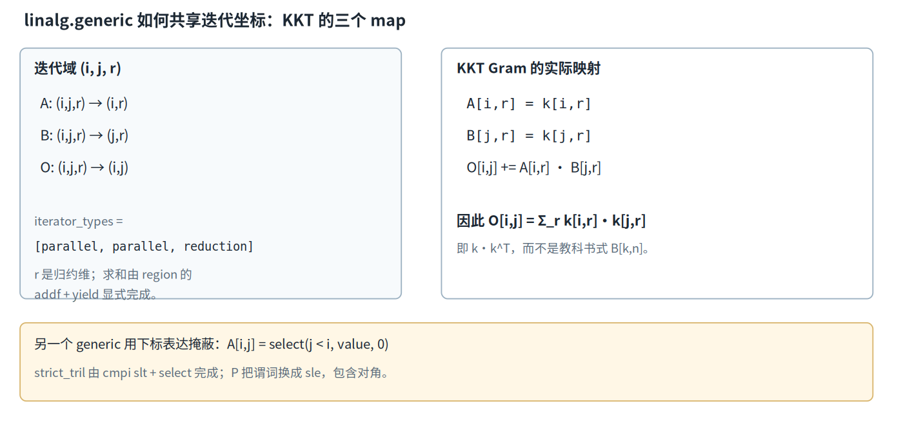

*图 2：KKT Gram 的三个 indexing map。共享的 (i,j,r) 分别映射到 k(i,r)、k(j,r) 与输出 (i,j)，第三个迭代维是归约维；掩蔽则由 cmpi 与 select 表达。*


### 2. 广播与 A 矩阵的位置谓词

广播（broadcasting）也来自映射。若某个迭代坐标没有出现在一条映射右侧，沿该坐标移动时会重复读取同一元素。A 矩阵的 generic 同时使用矩阵、按行广播的向量、按列广播的向量和另一个行尺度：

```mlir
linalg.generic {
  indexing_maps = [
    affine_map<(i, j) -> (i, j)>,
    affine_map<(i, j) -> (i)>,
    affine_map<(i, j) -> (j)>,
    affine_map<(i, j) -> (i)>,
    affine_map<(i, j) -> (i, j)>
  ],
  iterator_types = ["parallel", "parallel"]
} ins(%kkt, %gc, %gc, %beta_c :
      memref<64x64xf32>, memref<64xf32>, memref<64xf32>,
      memref<64xf32, strided<[2], offset: ?>>)
  outs(%Abuf : memref<64x64xf32>) {
^bb0(%a0: f32, %a1: f32, %a2: f32, %a3: f32, %o0: f32):
  %d0 = arith.subf %a1, %a2 : f32
  %e0 = math.exp2 %d0 : f32
  %m0 = arith.mulf %a0, %a3 : f32
  %m1 = arith.mulf %m0, %e0 : f32
  %i0 = linalg.index 0 : index
  %j0 = linalg.index 1 : index
  %lt = arith.cmpi slt, %j0, %i0 : index
  %r0 = arith.select %lt, %m1, %f0 : f32
  linalg.yield %r0 : f32
}
```

[evidence/G1/l1_bwd_chunked_T128_C64.mlir:2538-2558]

五条映射依次读取 `kkt[i,j]`、`gc[i]`、`gc[j]`、`beta[i]`，并写入 `A[i,j]`。`gc[i]` 不含 `j`，所以同一行内复用一个值；`gc[j]` 不含 `i`，所以按列复用。两个 `parallel` 维与 region 中不读 `%o0` 的事实相互印证：每个输出元素只由当前坐标计算并完整覆盖，目标旧值不参与结果。

`linalg.index 0/1` 取出当前坐标，`cmpi slt` 形成 `j<i` 的严格下三角（strict lower triangular）谓词，`strict_tril` 就由这个谓词和随后的 `arith.select` 直接表达。于是 region 计算了 `beta_i × KKT[i,j] × exp2(gc_i-gc_j)`，并在对角线及上三角写零。这里的 `%gc` 是内部 log2 域的包含式前缀和；外部语义仍是 `g≤0`、衰减倍率 `exp(g)`，生成器先计算 `g_log2=g×log2(e)`，所以 IR 中的 `math.exp2` 与外部自然指数一致 [tools/gdn_l1_gen.py:16-24]。

### 3. A 用 slt，P 用 sle

后续重算中的 P 包含对角衰减项。它先把 `q·kᵀ` 写入 `%Abuf`，再在同一个缓冲上施加衰减和含对角掩蔽（mask）：

```mlir
linalg.generic {
  indexing_maps = [
    affine_map<(i, j) -> (i, j)>,
    affine_map<(i, j) -> (i)>,
    affine_map<(i, j) -> (j)>,
    affine_map<(i, j) -> (i, j)>
  ],
  iterator_types = ["parallel", "parallel"]
} ins(%Abuf, %gc, %gc : memref<64x64xf32>, memref<64xf32>, memref<64xf32>)
  outs(%Abuf : memref<64x64xf32>) {
^bb0(%a0: f32, %a1: f32, %a2: f32, %o0: f32):
  %d3 = arith.subf %a1, %a2 : f32
  %e4 = math.exp2 %d3 : f32
  %m4 = arith.mulf %a0, %e4 : f32
  %i3 = linalg.index 0 : index
  %j3 = linalg.index 1 : index
  %le = arith.cmpi sle, %j3, %i3 : index
  %r5 = arith.select %le, %m4, %f0 : f32
  linalg.yield %r5 : f32
}
```

[evidence/G1/l1_bwd_chunked_T128_C64.mlir:2835-2852；前置 `q·kᵀ` 在 2821-2834 行]

这里要读 `sle` 与前面的 `slt`：`j≤i` 保留对角，`j<i` 排除对角，谓词差异就是 A 与 P 的数学边界。`ins` 和 `outs` 使用同一 `%Abuf`，每个 `(i,j)` 只读写自己的元素，因此可以原地更新。条件直接进入比较和选择，没有分配、填充再读取一个 0/1 mask 矩阵。`arith.select` 只选择值；它之前的 `exp2` 与乘法仍可能对被掩蔽的位置执行，不能把省去 mask 物化理解成省去这些位置的算术。

对角线给出了最短的数值检查。A 在 `i=j` 时条件为假，输出必为零；P 在同一位置条件为真，且 `gc_i-gc_i=0`，衰减因子为 1，所以对角保留 `q_i·k_i`。对 `j>i`，两者都写零；对 `j<i`，两者都保留各自已有的矩阵值并施加衰减。用这四类位置核对输出，比只比较矩阵整体范数更容易定位谓词写反的错误。

原地形式还多出一项审查义务：确认后续仍需要旧 `%Abuf` 的读取者已经完成，并确认单次 generic 内不存在跨输出点的依赖。此处的逐点映射满足这个条件；换成同时读取邻近元素的 region 后，同样的 ins/outs 别名可能改变结果。

### 4. 【练习】一个小 tensor generic

下面的 tensor 形式计算 `y[i,j]=x[i,j]+b[j]`。`%init` 提供目标初值，`%0` 是新的 tensor 值，原来的 `%init` 仍可供其他使用读取。

```mlir
func.func @add_bias(%x: tensor<2x3xf32>, %b: tensor<3xf32>,
                    %init: tensor<2x3xf32>) -> tensor<2x3xf32> {
  %0 = linalg.generic {
    indexing_maps = [
      affine_map<(i, j) -> (i, j)>,
      affine_map<(i, j) -> (j)>,
      affine_map<(i, j) -> (i, j)>
    ],
    iterator_types = ["parallel", "parallel"]
  } ins(%x, %b : tensor<2x3xf32>, tensor<3xf32>)
    outs(%init : tensor<2x3xf32>) {
  ^bb0(%xv: f32, %bv: f32, %ov: f32):
    %sum = arith.addf %xv, %bv : f32
    linalg.yield %sum : f32
  } -> tensor<2x3xf32>
  return %0 : tensor<2x3xf32>
}
```

先指出哪条映射产生广播，以及每个 `b[j]` 被几个迭代点读取；再把 region 改为 `linalg.yield %ov`，判断 `%0` 与 `%init` 的关系。检查后解释为何 memref 形式的同一 generic 没有 `-> tensor` 结果。

`convert-linalg-to-loops` 把这些迭代坐标实体化后，KKT 的加法归约会显式进入循环。第十章的 `scf.for`、`iter_args` 与 `scf.yield` 将直接呈现这种跨迭代数据流。

## 十、SCF 与 CF：顺序、归约和循环携带值

结构化控制流（structured control flow，SCF）把循环、条件和携带值保留为 op 与 region。控制流（control flow，CF）方言则提供基本块、块参数和显式分支。两者都能表达 SSA 数据流，但前者直接保留循环边界与条件结构，后者把这些信息分配到块拓扑中。

### 1. 前代换中的值携带与内存携带

循环携带值（loop-carried value）是某一轮产生、下一轮继续使用的值。`scf.for` 用 `iter_args(%acc = %init)` 声明它：首轮的 `%acc` 来自 `%init`，当前轮通过 `scf.yield` 交给下一轮，循环结果则是退出时携带的值。若循环一次也不执行，结果就是初始值。前代换求 `T=(I+A)⁻¹` 的真实 IR 同时展示了这种值归约和跨行内存依赖：

```mlir
linalg.fill ins(%f0 : f32) outs(%Tbuf : memref<64x64xf32>)
scf.for %i2 = %c0 to %cC step %c1 {
  memref.store %f1, %Tbuf[%i2, %i2] : memref<64x64xf32>
  scf.for %j2 = %c0 to %i2 step %c1 {
    %sum = scf.for %k2 = %j2 to %i2 step %c1
        iter_args(%acc2 = %f0) -> (f32) {
      %aik = memref.load %Abuf[%i2, %k2] : memref<64x64xf32>
      %tkj = memref.load %Tbuf[%k2, %j2] : memref<64x64xf32>
      %pk = arith.mulf %aik, %tkj : f32
      %ak = arith.addf %acc2, %pk : f32
      scf.yield %ak : f32
    }
    %neg = arith.negf %sum : f32
    memref.store %neg, %Tbuf[%i2, %j2] : memref<64x64xf32>
  }
}
```

[evidence/G1/l1_bwd_chunked_T128_C64.mlir:2559-2573]

最内层要读 `%acc2 → %ak → scf.yield → %sum` 这条链。`%acc2` 是当前轮的块参数，`%ak` 是加上 `A[i,k]×T[k,j]` 后的新值，`%sum` 是整个 `scf.for` 的 SSA 结果；`scf.yield` 结束当前迭代的数据流，并非从函数返回。外层 `j<i` 保证内层至少有一个 `k` 点，归约从 `%f0` 开始，最终按 `T[i,j]=-Σ A[i,k]T[k,j]` 写回。

取 `i2=3、j2=1` 可以手算这条链。内层依次处理 `k2=1、2`，初始 `%acc2=0`；第一轮加入 `A[3,1]T[1,1]`，第二轮把这个中间和作为 `%acc2`，再加入 `A[3,2]T[2,1]`。退出后的 `%sum` 只包含这两个有序乘积，取负后写 `T[3,1]`。其中 `T[1,1]` 是更早写下的单位对角，`T[2,1]` 来自前一行。IR 中没有单独的“更新 acc”指令，yield 的操作数与下一轮的块参数完成了这个概念上的更新。

若把 `iter_args` 整个删除，`%acc2` 和 `%sum` 的值通道也随之消失，只剩每次从内存读取或重新定义中间值的实现方式。携带值的类型与数量必须同时匹配初始化列表、循环结果类型和 yield 操作数列表；任何一处不一致都会在 op 验证阶段暴露。零次执行时直接采用初值的规则，也使空归约无须另写条件分支。

嵌套 region 让外层归纳变量 `%i2`、内层 `%j2` 直接出现在更深的循环体中。region 内新定义的 SSA 值受作用域约束，跨出循环需要 op 结果；内存内容则通过 load/store 留下效果。`%Tbuf` 的 memref 句柄始终是同一个 SSA 值，其指向的内容随外层逐行更新。读取 `T[k,j]` 时 `k<i`，所依赖的行已经在较早的外层迭代完成，所以前代换的行顺序属于正确性条件。

三个循环轴的依赖并不相同。外层 `i2` 不能把第 3 行移到第 2 行之前，因为第 3 行会读取第 2 行。固定 `i2` 后，不同 `j2` 写入不同的 `T[i,j]`，它们读取的是更早行以及本行输入 A，并未通过当前行的另一个 `j` 形成同类递推。最内层则通过 `%acc2` 明确串起浮点加法的值链。循环嵌套深度本身不回答可交换性，必须按读集、写集和携带值分别画依赖。

这条区分也限制常见改写。交换外层 `i2` 与中层 `j2` 会改变上界 `%i2` 的含义，还会破坏跨行可用性；重排最内层虽然保持实数求和项集合，却改变 f32 舍入次序。对固定行的不同列做并行化有另一种依赖依据，同时仍要处理外层状态与内存竞争。读 IR 时先找跨迭代路径，再讨论调度，比按 `scf.for` 的文本层级猜测安全。

### 2. 没有 iter_args 也可能携带状态

门控前缀和没有 `iter_args`，状态保存在 `%gc` 指向的内存中：

```mlir
%g0v = memref.load %g_c[%c0] : memref<64xf32, strided<[2], offset: ?>>
memref.store %g0v, %gc[%c0] : memref<64xf32>
scf.for %i = %c1 to %cC step %c1 {
  %ip = arith.subi %i, %c1 : index
  %prev = memref.load %gc[%ip] : memref<64xf32>
  %cur = memref.load %g_c[%i] : memref<64xf32, strided<[2], offset: ?>>
  %cs = arith.addf %prev, %cur : f32
  memref.store %cs, %gc[%i] : memref<64xf32>
}
```

[evidence/G1/l1_bwd_chunked_T128_C64.mlir:2514-2522]

读这段循环要沿地址追踪依赖：第 `i` 轮读取 `%gc[i-1]`，加上输入 `%g_c[i]`，再写 `%gc[i]`。句柄没有逐轮产生新版本，内存内容承担了携带作用。把它改写为标量 `iter_args` 也能表达同一数学递推，但还需要在每轮保存 `%gc[i]` 供后续矩阵计算使用。两种写法区分了 SSA 值依赖与内存读写依赖，优化器需要分别检查。

顺序还影响浮点结果。前代换的内层按 `k=j,j+1,…,i-1` 依次执行 `addf`，前缀和按 `i` 递增；`convert-scf-to-cf` 会保留这个求值顺序。f32 加法不满足结合律，交换归约顺序、树形归约或重新关联乘加可能改变舍入和溢出表现。数学等价的循环交换需要同时核对依赖方向与数值容差，不能只看实数公式。

### 3. for、if、while 与基本块下降

`scf.for` 表达带下界、上界和步长的计数循环，`iter_args` 与结果类型组成携带值合同。`scf.if` 用 `i1` 条件选择 then 或 else region，各分支用 `scf.yield` 产生统一的 op 结果；若只进行内存写等副作用，也可以没有结果。`scf.while` 适合退出条件需要在迭代中计算的循环，其 before region 计算条件并用 `scf.condition` 决定继续或退出，after region 执行循环体并用 `scf.yield` 更新携带值。三者都把控制结构留在 op 内，支配关系和 region 嵌套可直接检查。

带结果的 `scf.if` 让两个分支在同一结果类型上汇合，无须先分配临时内存再于分支外 load。`scf.while` 的 before region 可以先检查当前携带值，条件为假时不进入 after region；after region 产生的值经 yield 回到条件计算。阅读 while 时要把 `scf.condition` 的布尔操作数与其余携带操作数分开，前者选择控制方向，后者维持数据流。

`convert-scf-to-cf` 后，计数循环被拆成条件判断、循环体、回边与出口所在的基本块。归纳变量和 `iter_args` 成为块参数，`scf.yield` 变成带参数的 `cf.br`，条件成为 `cf.cond_br`。`scf.if` 同样下降成分支与汇合块，分支结果改由汇合块参数接收。此时仍有 SSA 和支配关系，但“哪些块共同构成一个 for”需要从拓扑恢复；循环上界、步长与结构化 region 的直观匹配已经消失。适于循环结构的分析和改写应在 SCF 层完成，LLVM 下译前的显式分支则留给 CF。

CF 块参数表示控制流边上的值传递。回到同一块时，参数可来自前一轮的 yield；从入口首次进入时，参数则来自初始化值。`cf.br ^body(%x)` 与函数调用不同，它不建立新的函数栈帧，也不隐式保存循环状态。`cf.cond_br` 只根据条件选择后继并传递各自的操作数，是否形成循环取决于 CFG 中是否存在回边。

这次下降主要换写控制结构，不会主动把两条 `addf` 改成另一种归约树。后续 canonicalization、循环变换或带快速数学许可的优化仍需分别审查。将数值漂移归因于 SCF 到 CF 之前，应先对照两边的分支、块参数和算术顺序，确认实际发生改写的阶段。

### 4. 【通用补充】iter_args 不建立异步可见性

下面的伪 IR 省略 async 运行时的完整类型，保留关键依赖。异步 region 写 `%buf`，顺序循环在没有等待 token 的情况下读取它：

```mlir
%token = async.execute {
  memref.store %one, %buf[%c0] : memref<1xf32>
  async.yield
}
%sum = scf.for %i = %c0 to %n step %c1
    iter_args(%acc = %zero) -> (f32) {
  %x = memref.load %buf[%c0] : memref<1xf32>
  %next = arith.addf %acc, %x : f32
  scf.yield %next : f32
}
// 读取前缺少 async.await %token 及目标要求的同步
```

`%acc` 只把浮点值从一轮交给下一轮，它没有表示异步写何时完成，也没有给 `%buf` 的 load/store 添加 happens-before 关系。循环可能重复读到旧值，或与异步写并发；把 token 加进 `iter_args` 同样只增加一个 SSA 携带值，不能替代等待。正确实现需要在读取前等待相应生产操作，并按目标内存模型配置 fence、barrier 或代理同步。

普通 memref load/store 只表达访问，不附送跨执行流的完成关系。原子操作可以为特定访问提供原子性，其顺序与可见范围仍要服从目标内存模型，不能自动修复这里缺失的等待。分析这类反例时应分别列出值依赖、内存依赖和同步依赖，三条链需要各自闭合。

内存句柄、视图和值结果在下降到这里后已经清晰可见。第十一章将检查 tensor 缓冲化怎样决定分配、拷贝和别名，以及这些 memref 操作怎样继续下降到 LLVM。

## 十一、Tensor 到 Memref：Bufferize 真正决定了什么

张量（tensor）值只有形状、元素类型和值语义；一次“修改”会产生新的 tensor 值，旧值的后续读取仍看到旧内容。内存引用（memref）把计算放到具体存储位置，load/store 通过地址读写内容。缓冲化（bufferize）需要为原来的值计算选择存储、分配、拷贝和复用方式，同时保持可观察结果不变。

这段过渡改变了优化的提问方式。tensor 数据流主要追问某个值由谁产生、被谁使用；memref 数据流还要追问某次 load 与先前哪次 store 指向同一位置，以及两个写操作是否重叠。一个 tensor 结果对应一次 alloc 只是常见选择，分析也可能复用某个输入或中间缓冲。反过来，看到两条 alloc 也不能推断后续变换永远不会引入别名，机器层的存储分配还可以另有布局策略。

拷贝同样不能按数量孤立评价。若旧 tensor 值已经没有任何读取者，原地写通常可以保留结果语义；若函数边界、其他返回值或后续 op 仍观察旧值，就需要保留原存储或另建副本。缓冲化把这些条件落实到具体 op，后续优化才能基于明确的内存效果继续工作。

### 1. 值、位置、布局与地址空间

memref 的 SSA 句柄只有一个定义点，这个性质约束句柄的 def-use，不限制底层存储是否重叠。两个句柄可以引用同一缓冲，一个句柄也可以同时出现在 `ins` 与 `outs` 中。别名（alias）因此是内存分析和变换必须处理的事实。不能根据 SSA 名称不同就推断存储不相交，也不能仅凭类型相同就推断可以复用。

几个 op 对应不同的存储决定。`memref.alloc` 产生新缓冲的句柄，CPU 堆缓冲通常在生命周期末端匹配 `memref.dealloc`，目标管理的内存空间则遵循相应释放合同；`memref.copy` 复制内容，保留源缓冲的独立值；`memref.subview` 建立原存储上的视图，本身不复制元素。复用已有缓冲可以减少分配和流量，但只有在旧值的所有读取完成后才保持 tensor 的值语义。缓冲化的核心检查正是这些读取、写入与生存期关系。

视图类型还记录布局。偏移（offset）给出起点相对基地址的位置，步长（stride）给出各维下标增加一时跨过多少元素，动态 offset 或 stride 在类型中写作 `?`。真实 L1 的连续两层切片展示了这些信息怎样随视图传播：

```mlir
%k_bh = memref.subview %k[%b, 0, %h, 0] [1, 128, 1, 16] [1, 1, 1, 1]
  : memref<1x128x2x16xf32>
    to memref<128x16xf32, strided<[32, 1], offset: ?>>
%k_c = memref.subview %k_bh[%off, 0] [64, 16] [1, 1]
  : memref<128x16xf32, strided<[32, 1], offset: ?>>
    to memref<64x16xf32, strided<[32, 1], offset: ?>>
```

[evidence/G1/l1_bwd_chunked_T128_C64.mlir:2494,2508；排版有折行]

读 `%k_bh` 的形状和步长可以判断：时间维每前进一个元素要跨过 H×K=32 个 f32，特征维保持连续；`offset:?` 表示偏移依赖 `%b`、`%h`，并非运行时缺少值。第二层选择 64 行后仍保留 `[32,1]`，说明 chunk 视图没有变成紧凑的 64×16 副本。最后的步长列表 `[1,1]` 是相对源步长的倍率。KKT 直接读取这个 strided 视图，因此转置来自 linalg 映射，物理布局仍由 memref 类型描述。

布局之外还有内存空间（memory space）。它说明存储属于哪个目标地址空间，影响可执行的访问 op 和后续下译。项目的 GPU 生成器把 tile 类型明确标为 workgroup：

```python
sa_ty = f"memref<{bt}x{bk}x{dt}, #gpu.address_space<workgroup>>"
sb_ty = (f"memref<{bv}x{bk}x{dt}, #gpu.address_space<workgroup>>" if kt else
         f"memref<{bk}x{bv}x{dt}, #gpu.address_space<workgroup>>")
```

[tools/gdn_l2_gen.py:422-424]

这里要区分形状、元素类型、步长和地址空间四种信息；workgroup 标注不会自动把全局输入复制到共享内存，实际分配、拷贝与同步仍需相应 IR。CPU L1 未附此属性，使用默认内存空间。

### 2. 当前 L1 上的 one-shot-bufferize 是 no-op

`one-shot-bufferize` 通过缓冲化接口和数据分析统一处理 tensor 数据流，决定哪些结果可原地写入、何处需要分配或拷贝；`bufferize-function-boundaries` 还转换函数边界的 tensor 类型。当前 GDN L1 从生成器起点已经包含 `memref.alloc/subview/load/store`，算法直接使用 f32 memref 和原地状态，所以这条 pass 对该输入没有 tensor 可转换，实际为 no-op。保留它是为了让将来的 tensor 前端接入同一管线，不能据此声称现有 L1 曾经由 tensor 自动展开。

完整的 11 条命令如下，顺序构成输入合同：

```bash
"$OPT" "$IN" \
  -one-shot-bufferize="bufferize-function-boundaries" \
  -convert-linalg-to-loops \
  -convert-scf-to-cf \
  -expand-strided-metadata \
  -lower-affine \
  -convert-math-to-llvm \
  -convert-arith-to-llvm \
  -finalize-memref-to-llvm \
  -convert-cf-to-llvm \
  -convert-func-to-llvm \
  -reconcile-unrealized-casts \
  -o "$OUT"
```

[scripts/run_l1.sh:23-35；no-op 记录见 evidence/G1/l1_harness_report.md:60-62]

逐条看输入、输出和相互依赖：

| 顺序与 pass | 输入到输出 | 需要它的原因及顺序约束 |
|---|---|---|
| 1. one-shot-bufferize | tensor 计算及边界转为 memref 计算及边界，按需引入分配和拷贝 | 给后续循环与 LLVM 下译提供位置语义；当前 L1 空转，放在最前便于接入 tensor 前端 |
| 2. convert-linalg-to-loops | linalg op 转为 scf 循环、memref 访问和标量计算 | 在缓冲化后处理目标存储，并把迭代空间展开，供下一条处理 SCF |
| 3. convert-scf-to-cf | scf.for、if、while 转为基本块、块参数和 cf 分支 | 接收上一条产生的循环；先消除结构化控制，后续才能统一转换 CF |
| 4. expand-strided-metadata | subview、形状折叠和元数据提取等复杂 memref op 展开为显式的 offset、size、stride 计算与较简单操作 | 当前降秩 strided subview 需要它；它使用 affine 构造，故排在 lower-affine 前，也排在 memref 最终下译前 |
| 5. lower-affine | affine.apply 变为 arith 算术，affine.for、if 变为 SCF | 消除上一步及输入中的仿射构造，让 arith 下译看到普通标量运算 |
| 6. convert-math-to-llvm | math 运算转为 LLVM intrinsic、运算或相应调用 | 本例把 math.exp2 降为 llvm.intr.exp2；在最终函数与控制流下译前处理数学语义 |
| 7. convert-arith-to-llvm | arith 整数、index 和浮点运算转为 LLVM 方言运算 | 接收 lower-affine 与各循环展开产生的标量算术，避免遗留高层算术 |
| 8. finalize-memref-to-llvm | memref 描述符、全局量、分配释放和访存转为 LLVM 类型、指令与运行时调用 | 复杂视图已展开后再完成存储下译；函数签名转换也需要一致的存储类型表示 |
| 9. convert-cf-to-llvm | cf.br、cf.cond_br 等转为 LLVM 基本块与分支 | 放在 SCF 已降为 CF 之后，接管最终控制流 |
| 10. convert-func-to-llvm | func 函数、调用、返回和签名转为 LLVM 对应形式 | 在操作数与 memref 表示明确后统一函数边界，形成可调用的 LLVM 方言模块 |
| 11. reconcile-unrealized-casts | 折叠往返后类型相同的 unrealized_conversion_cast 链 | 等各方言转换都接通后再清理过渡桥；它不能补救缺失的算术、函数或内存转换 |

`lower-affine` 可能产生新的 `scf.for` 或 `scf.if`，当前命令却已经完成 `convert-scf-to-cf`。现有 L1 所需路径可以沿此顺序通过；若前端加入 `affine.for` 或 `affine.if`，就要检查它出现的位置及 lower-affine 的产物，可能需要把 lower-affine 提前，或在其后再次执行 SCF 到 CF。判断依据是每一步后的真实 IR 与转换目标合法性，不能只凭 pass 名称复用顺序。

### 3. JIT 入口与 libm

下降后的模块仍包含 LLVM 方言和运行时符号，`mlir-runner` 负责即时编译（JIT）并调用入口：

```bash
LIBS="$BUILD/lib/libmlir_runner_utils.so,$BUILD/lib/libmlir_c_runner_utils.so,$BUILD/lib/libmlir_float16_utils.so"
"$RUNNER" "$OUT" --shared-libs="$LIBS" --entry-point-result=void
```

[scripts/run_l1.sh:20-21,37]

`runner_utils` 与 `c_runner_utils` 提供打印等运行支持，`float16_utils` 提供半精度辅助；共享运行库同时把 libm 带入符号解析环境。当前 `math.exp2` 经 `llvm.intr.exp2` 后由 JIT 对 libm 解析，无需另加 `convert-math-to-libm`。`--entry-point-result=void` 与生成器 main 的返回约定一致。JIT 能执行只说明整条 ABI、符号与 IR 下译链闭合，数值正确性仍由独立规约对拍确认。

### 4. 【通用补充】真实 one-shot-bufferize 输出

下面的 tensor 输入同时返回插入后的新值 `%y` 与原值 `%x`。这个例子是教程补充，用来观察旧值仍被读取时的存储决策，不属于项目的 GDN 内核：

```mlir
func.func @insert_keep_old(%x: tensor<4xf32>, %v: f32)
    -> (tensor<4xf32>, tensor<4xf32>) {
  %i = arith.constant 1 : index
  %y = tensor.insert %v into %x[%i] : tensor<4xf32>
  return %y, %x : tensor<4xf32>, tensor<4xf32>
}
```

对这份输入实际执行 `mlir-opt -one-shot-bufferize="bufferize-function-boundaries"`，输出为：

```mlir
module {
  func.func @insert_keep_old(%arg0: memref<4xf32, strided<[?], offset: ?>>, %arg1: f32)
      -> (memref<4xf32>, memref<4xf32, strided<[?], offset: ?>>) {
    %c1 = arith.constant 1 : index
    %alloc = memref.alloc() alignment = 64 : memref<4xf32>
    memref.copy %arg0, %alloc : memref<4xf32, strided<[?], offset: ?>> to memref<4xf32>
    memref.store %arg1, %alloc[%c1] : memref<4xf32>
    %cast = memref.cast %alloc : memref<4xf32> to memref<4xf32, strided<[?], offset: ?>>
    return %alloc, %arg0 : memref<4xf32>, memref<4xf32, strided<[?], offset: ?>>
  }
}
```

[paper/zh/v6examples/insert_keep_old.bufferized.mlir:1-9；由上述命令对 insert_keep_old.mlir 实际生成]

第二个返回值仍要求 `%x` 的原内容，所以直接在 `%x` 上 store 会破坏结果。pass 新分配 `%alloc`，先完整 copy，再对副本写入；`%arg0` 原样返回，函数边界的 tensor 类型则换成带动态 stride/offset 的 memref。若旧值没有后续使用且接口允许写，分析可能选择复用并减少拷贝；判断条件来自使用链与生存期，而非操作数名称。这个真实输出也把“当前 L1 已是 memref 而 bufferize 空转”和“真正 tensor 前端需要分配与复制”区分开了。

各转换 pass 之间还需要一致的类型合同与合法性判定。第十二章将用同一组脚本和项目自有两个改写 pass 检查渐进式下降的实际边界。

## 十二、渐进式下降与 Dialect Conversion：合法性、类型和过渡 Cast

方言转换（Dialect Conversion）把“改写哪些 op”扩展为三份合同：目标终态允许什么、源类型怎样变成目标类型、每个非法 op 用哪些模式替换。渐进式下降可以暂时保留高层与低层 op 的混合物，但每个转换点都要维持 SSA 使用双方的类型一致，最终还要满足目标方言的合法性要求。

### 1. 合法性、模式和类型是三份独立合同

转换目标（ConversionTarget）描述合法性。`addLegalDialect` 或 `addLegalOp` 声明可以保留的终态 op，`addIllegalOp` 或 `addIllegalDialect` 声明必须消除的 op，`addDynamicallyLegalOp` 则按具体实例的类型、属性或操作数判断。例如，同一个容器 op 可以只在结果类型已转换后合法。具体操作上的设置优先于整个方言的设置；未显式分类的 unknown op 还可另设动态合法规则。

转换模式（ConversionPattern）负责消除非法 op。`OpConversionPattern<T>` 的 `matchAndRewrite` 多一个 adaptor：被匹配 op 仍描述原操作数，adaptor 提供当前已重映射、符合 TypeConverter 预期的操作数。类型发生变化时使用 adaptor 能避免把新类型值直接塞回旧 op。模式可以先生成仍不合法的中间 op，再由其他模式接续转换；驱动器按目标合法性决定何时完成。

类型转换器（TypeConverter）只回答类型映射，包括一对一和一对多，不在 `addConversion` 回调里生成 IR。函数与区域签名还要相应转换块参数。若替换值与尚未转换的使用方类型不同，框架会请求物化（materialization）：source materialization 把新替换值转回旧 source 类型，target materialization 把尚未转换的值转成模式期待的 target 类型。物化回调可以生成真实转换 op，也可以在过渡阶段生成 cast。

`applyPartialConversion` 允许原本合法或允许保留的 unknown op 留下，但显式非法 op 仍须成功处理；`applyFullConversion` 要求整个转换根内的 op 都满足给定目标。full 的严格程度取决于目标定义，若目标把其他方言也声明为合法，成功并不表示只剩一种方言。

这三份合同可以分别定位故障。报出某个 op 仍非法，首先检查目标分类及是否存在能匹配该实例的模式；模式匹配却在 adaptor 处得到意外类型，检查 TypeConverter 与物化规则；转换在仍有旧类型用户时失败，检查 source materialization 是否能构造所需值。把所有 op 都标成合法可以掩盖第一类问题，却不能完成预期下降，因此合法目标本身也需要用输出 IR 审计。

区域签名是另一处常见边界。只替换 op 结果而未转换函数参数、返回类型或基本块参数，使用链仍会在边界处断开。反过来，只改签名而不改写调用者，也会留下类型不一致。渐进式下降允许这些边界暂时由桥连接，但每一座桥都应有明确的后续消除路径。

### 2. 项目调用的上游转换

L1 脚本末段把数学、算术、内存、控制流和函数分别交给上游 pass，最后清理过渡 cast：

```bash
  -convert-math-to-llvm \
  -convert-arith-to-llvm \
  -finalize-memref-to-llvm \
  -convert-cf-to-llvm \
  -convert-func-to-llvm \
  -reconcile-unrealized-casts \
```

[scripts/run_l1.sh:29-34]

读这些名字时要把调用者与实现者分开。脚本在项目中，ConversionTarget、TypeConverter 和 ConversionPattern 的实现由对应上游 pass 封装；项目没有为这条 L1 命令另写一套合法性框架。各 pass 的先后安排让上一阶段的输出成为下一阶段的合法输入，最后的 reconcile 只有在生产者与消费者转换都完成后才能看清哪些 cast 已成无操作链。

GPU 侧的 L2 还包含调度解释与 NVVM pipeline；它同样由上游转换 pass 组成，但与 transform 工件的关系在第十三、十九章展开。这里先固定转换框架的边界：IR 合法化属于 Dialect Conversion，PTX 文本提取和 ptxas 不属于它。

### 3. 自有 pass 使用贪心改写

`gdn-to-chunk` 的前向模式直接继承 `OpRewritePattern`，pass 主体调用 `applyPatternsGreedily`：

```cpp
struct FwdToLowering : OpRewritePattern<gdn::GdnFwdOp> {
  using OpRewritePattern::OpRewritePattern;
  LogicalResult matchAndRewrite(gdn::GdnFwdOp op,
                                PatternRewriter &rewriter) const override {
    Location loc = op.getLoc();
    SmallVector<Value> args{op.getQ(), op.getK(), op.getV(),
                            op.getBeta(), op.getG()};
    if (op.getH0()) args.push_back(op.getH0());
    auto fnTy = rewriter.getFunctionType(ValueRange(args).getTypes(),
                                         op.getResultTypes());
    if (auto module = op->getParentOfType<ModuleOp>())
      ensureL1Entry(module, rewriter, kL1FwdSym, fnTy);
    auto callee = rewriter.getStringAttr(kL1FwdSym);
    auto call = rewriter.create<func::CallOp>(
        loc, callee, op.getResultTypes(), args);
    call->setAttr("gdn.config", op.getConfig());
    rewriter.replaceOp(op, call.getResults());
    return success();
  }
};
// 省略 BwdToLowering 与声明辅助函数
if (failed(applyPatternsGreedily(getOperation(), std::move(patterns))))
  signalPassFailure();
```

[dialect/lib/GdnPasses.cpp:38-59,93-100；声明去重见 26-35 行，反向模式见 61-85 行]

这里能判断当前实现只把 `gdn.fwd` 替换为 `func.call @__gdn_l1_fwd_chunk`，准备参数与结果类型，透传 `gdn.config`；`ensureL1Entry` 先查已有符号，避免重复声明。它没有展开 KKT、前代换和状态递推，也没有 TypeConverter 或 ConversionTarget。完整 L1 文本由 `tools/gdn_l1_gen.py` 生成。贪心驱动也没有“源方言必须全部消失”的全局目标，未匹配 op 可以保留，成功结果不能替代合法性审计。

`gdn-lower-hatch` 使用相同的驱动方式，单个 Elect 模式是一对一替换：

```cpp
struct ElectLowering : OpRewritePattern<GdnElectOp> {
  using OpRewritePattern::OpRewritePattern;
  LogicalResult matchAndRewrite(GdnElectOp op,
                                PatternRewriter &rewriter) const override {
    rewriter.replaceOpWithNewOp<NVVM::ElectSyncOp>(
        op, rewriter.getI1Type(), Value());
    return success();
  }
};
// populateGdnHatchLoweringPatterns 注册 12 个模式
if (failed(applyPatternsGreedily(getOperation(), std::move(patterns))))
  signalPassFailure();
```

[dialect/lib/GdnHatch.cpp:43-50,215-230]

读继承关系和 pass 主体即可判断：这里同样没有自定义 DialectConversion、动态合法目标或 TypeConverter。对该例而言，输入输出类型简单，普通 rewriter 已足够；需要协调多个 op 的签名、允许混合终态或处理一对多类型时，转换框架提供的合同才有直接用途。上游转换能力仍可由脚本调用，这与项目自有 C++ 是否实现该框架是两件事。

### 4. 过渡 cast 与 pass 排序

类型转换经过多个 pass 时，生产端可能已变成新类型，消费端仍期待旧类型。`builtin.unrealized_conversion_cast` 提供临时的类型桥，使混合 IR 在转换过程中保持可表达；它没有为目标机器定义一套任意类型间的运行时转换语义。需要永久保留的转换应使用有明确语义的 op。

以一个旧值 `x:!old` 为例。生产端转换后得到 `x_new:!new`，未转换的消费者仍需 `!old`，source materialization 要在二者之间提供旧类型值。稍后消费者也开始转换，它的模式期待 `!new`，target materialization 又为尚未替换的其他输入提供目标类型。驱动器可能在此过程中给出不同的过渡 SSA 值，模式不应假定 adaptor 一定就是生产者最初 replaceOp 时提供的那个值；应依赖它保证的目标类型。

这也解释了为何 cast 数量本身不能作为失败指标。两个独立 pass 各自插入桥时，中间出现额外 cast 是正常过渡状态；完成消费者转换后，一些桥会折叠，一些则指出仍未接通的类型边界。需要检查的是残留 cast 的两端类型、生产者、消费者以及后续负责它们的 pass。

`reconcile-unrealized-casts` 清理的是沿 cast 链往返后回到相同类型的情况，例如 A→B→C→A 可直接接回原值。它不能证明任意 A→B 与 B→A 在数值上互逆，也不能替缺失的 conversion pattern 补齐语义。因此清理 pass 通常放在相关转换之后；若其后又改变函数签名或 memref 表示，还需重新检查是否产生新桥。动态合法谓词、签名转换与清理顺序应围绕实际残留 IR 设计。

### 5. 【通用补充】用内置类型完成一次转换

下面用 MLIR 自带的 `index` 与 `i64` 演示类型转换，不再引入未定义的 demo 方言。它只是类型与过渡 IR 的教学例，不是 GDN 的实现，也不把 index 的平台相关宽度和 i64 的固定宽度混为语义等价。`ConversionTarget` 允许 `arith.addi` 在结果为 i64 时保留，模式负责把 index 形式改写到这个终态：

```cpp
TypeConverter types;
types.addConversion([](Type type) { return type; });
types.addConversion([](IndexType type) -> Type {
  return IntegerType::get(type.getContext(), 64);
});
auto bridge = [](OpBuilder &b, Type type, ValueRange inputs, Location loc) {
  if (inputs.size() != 1) return Value();
  return UnrealizedConversionCastOp::create(b, loc, type, inputs).getResult(0);
};
types.addSourceMaterialization(bridge);
types.addTargetMaterialization(bridge);

struct AddI64 : OpConversionPattern<arith::AddIOp> {
  using OpConversionPattern::OpConversionPattern;
  LogicalResult matchAndRewrite(
      arith::AddIOp op, OpAdaptor adaptor,
      ConversionPatternRewriter &rewriter) const override {
    rewriter.replaceOpWithNewOp<arith::AddIOp>(
        op, adaptor.getOperands(), rewriter.getI64Type());
    return success();
  }
};

ConversionTarget target(ctx);
target.addLegalDialect<arith::ArithDialect>();
target.addDynamicallyLegalOp<arith::AddIOp>([](arith::AddIOp op) {
  return op.getResult().getType().isInteger(64);
});
RewritePatternSet patterns(&ctx);
patterns.add<AddI64>(types, &ctx);
if (failed(applyPartialConversion(module, target, std::move(patterns))))
  signalPassFailure();
```

【通用补充，依据上游 Dialect Conversion API；`module`、上下文与 pass 注册略】

`addLegalDialect<arith::ArithDialect>()` 给出默认可保留的算术方言，针对 `arith.addi` 的动态规则再收紧到“结果已经是 i64”。`applyPartialConversion` 允许其他暂时合法的 op 留下，但被规则覆盖的 index 形式必须改写。`adaptor.getOperands()` 提供已按目标类型准备的输入，避免把旧 index 操作数直接塞回新 op。

过渡效果可以用一个 `index` 返回值的消费者观察：

```mlir
// 转换前：addi 的结果仍被 index 的 return 使用
%sum = arith.addi %a, %b : index
return %sum : index

// 概念上的过渡形态：两个输入先物化到 i64，输出再桥回 index
%a64 = unrealized_conversion_cast %a : index to i64
%b64 = unrealized_conversion_cast %b : index to i64
%sum64 = arith.addi %a64, %b64 : i64
%sum = unrealized_conversion_cast %sum64 : i64 to index
return %sum : index
```

source materialization 负责给仍需旧类型的消费者提供 index 值；target materialization 负责给新模式提供 i64 输入。若后面还有真实的 index→i64 数值转换 op，应把桥换成那个有语义的 op，而不是把 `unrealized_conversion_cast` 当成运行时指令。完成消费者转换后，`reconcile-unrealized-casts` 才能清理可消除的往返桥；`applyFullConversion` 则要求根内所有剩余 op 都满足目标，不能只把 addi 一个模式跑完就宣布完成。

### 6. L0–L4 设计与真实调用边界

L0 的 `gdn.fwd/bwd` 表达 tensor 语义，L1 的生成器给出可执行 chunk 算法，L2 由 payload、transform 工件和配置承载调度，L3 使用机器相关 op，L4 落到 sm_120a cubin。这个分层说明各类决策的归属与验证位置。

真实连通范围应按代码陈述：`gdn-to-chunk` 当前完成 L0 入口调用改写、config 透传和声明去重；`tools/gdn_l1_gen.py` 独立生成完整 memref 级 L1；`run_l2.sh` 消费生成好的 payload/transform/config，按需先运行 `gdn-lower-hatch`，再解释调度并调用上游 NVVM pipeline，最后由 ptxas 汇编。L0–L4 是设计与验证分层，现有代码没有提供一条从任意 `gdn.fwd` 自动展开全部算法、选择调度并产出 cubin 的统一转换链。

## 十三、Transform Dialect：用 IR 编写调度

一份 `linalg.matmul` 或 `scf.for` 描述计算结构，切块大小、缓冲版本数和流水深度决定这些结构怎样执行。Transform Dialect（变换方言）把后一类决定也写成 MLIR：变换脚本持有指向计算 IR 的句柄，按顺序调用改写动作。调度因此成为可解析、可比较、可随配置存档的文本，同时仍由上游变换实现执行。

### 1. payload、transform 与句柄

被改写的计算称为载荷 IR（payload IR），本目录中是 `payload.mlir`；描述改写过程的变换 IR（transform IR）位于 `transform.mlir`。两者可以在同一编译输入中出现，却承担不同角色。payload 含 `func.func`、`gpu.launch`、`memref.alloc` 等计算操作；transform 含匹配、切块、流水等控制操作。普通的 SSA 值表示数据，变换句柄（handle）表示一组 payload 操作或值与该组对象之间的映射。

`!transform.any_op` 是任意操作句柄，一个句柄可以关联多个操作；`!transform.op<"memref.alloc">` 进一步限定对象类型。`transform.structured.match` 在指定作用域内按操作名收集对象并产生新句柄。匹配不到对象通常得到空句柄，所以后续还应检查实际改写结果，不能把脚本通过解析等同于调度已经生效。

模块属性 `transform.with_named_sequence` 声明命名序列，`transform.named_sequence @__transform_main` 给出解释器入口。入口参数的 `transform.readonly` 约束该根句柄的消费方式；它允许序列通过子句柄修改 payload，并不把整次执行变成只读分析。根句柄 `%arg0` 因而可以反复用于 `match`。

### 2. 十五行工件的动作顺序

下面的真实工件对应 kkt、bf16、MMA、两级流水、64×64×32 tile 和四 warp 配置，全文只有十五行。

```mlir
module attributes {transform.with_named_sequence} {
  transform.named_sequence @__transform_main(%arg0: !transform.any_op {transform.readonly}) {
    %allocs = transform.structured.match ops{["memref.alloc"]} in %arg0
      : (!transform.any_op) -> !transform.op<"memref.alloc">
    transform.memref.multibuffer %allocs <factor = 2, skip_analysis>
      : (!transform.op<"memref.alloc">) -> !transform.any_op
    %func = transform.structured.match ops{["func.func"]} in %arg0
      : (!transform.any_op) -> !transform.any_op
    transform.nvgpu.create_async_groups %func bypass_l1 : (!transform.any_op) -> (!transform.any_op)
    %loops = transform.structured.match ops{["scf.for"]} in %arg0
      : (!transform.any_op) -> !transform.any_op
    transform.nvgpu.pipeline_shared_memory_copies failures(propagate) %loops depth = 2 peel_epilogue : (!transform.any_op) -> !transform.any_op
    transform.yield
  }
}
```
[evidence/G2/gen/kkt_bf16_mma_p2_t64x64x32_w4/transform.mlir:1-15]

第 3–6 行先找到两个共享内存分配，再执行多缓冲（multibuffer）。该变换把分配扩大为原来的两倍并修正使用者，使相邻循环迭代使用不同版本，消除临时缓冲造成的迭代间依赖。`skip_analysis` 跳过跨迭代无依赖证明，正确性责任随之交给工件作者；这份 payload 使用 `vector.transfer_write`，当前分析所接受的覆盖形式无法证明它，项目记录也明确要求这个选项 [evidence/G2/gen_report.md:121-123]。

以这份配置手算缓冲账：每个 64×32 bf16 tile 占 4096 B，A、B 各一份时为 8192 B；factor=2 后，两个分配合计 16384 B。这个乘法是审查调度时的静态预期，解释后的 IR 应呈现扩容后的分配和按迭代切换的使用者。它还不能代替机器资源报告，尤其该 G2 归档的 `smem_static` 没有可解析数值，需结合后续 PTX 修复链和实际装载结果判断。

第 7–9 行匹配函数并建立异步复制组。`create_async_groups` 把函数内可识别的全局到共享内存 `vector.transfer` 改成异步复制，在连续复制后建立组并插入等待。`bypass_l1` 对满足 16 字节条件的传输设置绕过 L1 的属性；这里的 `vector<8xbf16>` 恰好是 16 字节，后续可看到 `cp.async.cg`。省略该选项时走 `cp.async.ca`。异步指令的存在并不自动形成重叠，等待位置与循环流水共同决定重叠窗口。

第 10–12 行重新匹配 `scf.for`，再做共享内存复制的软件流水。`depth = 2` 与双缓冲配套，让下一阶段的装载可以和当前阶段的计算交错；`peel_epilogue` 将排空阶段剥成循环后的尾声，避免依赖循环体内的谓词化支持。上游把足够缓冲和深度内无依赖列为调用者责任，这正解释了工件中 multibuffer 必须先于 pipeliner。

【通用补充】两级流水可以用三次迭代理解：序言先装载第 0 块；稳态在第 i 块计算期间装载第 i+1 块；最后一块没有后继装载，只剩计算与等待。`peel_epilogue` 把最后这一步放到主循环外。depth 描述同时在飞的阶段数，既不是线程数，也不等同于循环展开次数。若只有单缓冲，提前装载会覆盖仍在使用的数据，所以缓冲版本和流水深度必须联合审查。

这里还体现了句柄消费（handle consumption）。修改 payload 的 transform op 通常消费输入句柄；被消费句柄及其指向子树的关联句柄可能失效，继续使用类似使用悬空指针。`create_async_groups` 明确消费 `%func` 并返回新函数句柄，函数内部旧循环句柄也可能失效。工件没有沿用任何旧循环句柄，而是在第 10 行重新 `match`，从当前 payload 建立新映射 [../llvm-mlir/mlir/docs/Dialects/Transform.md:272-324；../llvm-mlir/mlir/include/mlir/Dialect/NVGPU/TransformOps/NVGPUTransformOps.td:43-58]。`%arg0` 只读保留，使这次重匹配有稳定的作用域入口。若下一个动作仍以整个函数为目标，可以使用 `create_async_groups` 返回的新函数句柄；这里要寻找另一类操作，所以从根作用域重新匹配更直接。句柄是否可继续使用取决于操作声明的消费效果和失效规则，不能仅凭 SSA 名称仍然存在作判断。

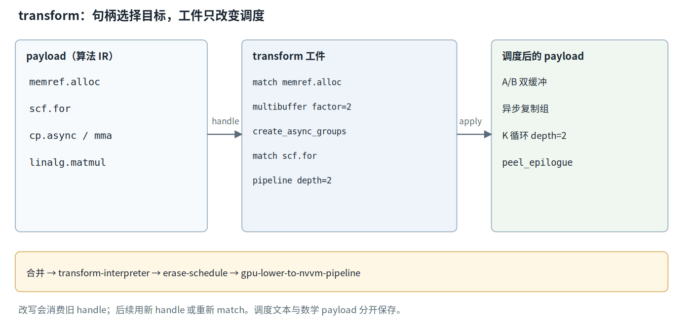

*图 3：transform 工件通过 handle 选择 payload 中的操作，依次施加多缓冲、异步复制和软件流水。旧 handle 被消费后需要重新 match；解释器执行后再擦除调度。*


### 3. 切块不等于 GPU 线程分发

no-MMA 路径使用另一个动作：以 `scf.for` 为载体做结构化切块。

```mlir
%mms = transform.structured.match ops{["linalg.matmul"]} in %arg0
  : (!transform.any_op) -> !transform.any_op
%tiled, %loops:2 = transform.structured.tile_using_for %mms tile_sizes [16, 16]
  : (!transform.any_op) -> (!transform.any_op, !transform.any_op, !transform.any_op)
```
[evidence/G4/gen_verify/kkt_bf16_nomma_p0_t64x64x32_w4/transform.mlir:3-5]

`tile_using_for` 把二维迭代域分成 16×16 块，返回切块后的操作和两个外层循环句柄。三个结果可以继续交给向量化、循环变换或其他选择动作。它改变迭代结构，没有在这些结果上指定 `gpu.thread_id`、warp 或 lane 的映射。

线程几何在 payload 中独立给出：

```mlir
gpu.launch blocks(%bx, %by, %bz) in (%gx = %c1, %gy = %c1, %gz = %c1)
           threads(%tx, %ty, %tz) in (%bxx = %c128, %byy = %c1, %bzz = %c1) {
```
[evidence/G2/gen/kkt_bf16_mma_p2_t64x64x32_w4/payload.mlir:69-70]

这两行只规定网格与 CTA 的线程数。MMA 路径随后由生成器显式计算 warp、lane 和 fragment 下标 [evidence/G2/gen/kkt_bf16_mma_p2_t64x64x32_w4/payload.mlir:75-85]。no-MMA 路径若没有进一步分发，`-convert-linalg-to-loops` 留下的仍是标量循环；G3 的 SASS 审计记录了未分发的三层循环及其高开销 [evidence/G3/solver_report.md:108-118]。因此，检查 tiling 是否生效要看新循环和 tiled op，检查 GPU 分发则要另看线程下标、映射操作及最终 SASS。

### 4. 解释器、调度擦除与 identity 绕行

运行脚本把 payload 与 transform 合并，`-transform-interpreter` 从 `@__transform_main` 开始顺序执行动作；之后的 `-test-transform-dialect-erase-schedule` 删除变换序列，使后续 NVVM 管线只看到改写后的 payload。

```bash
cat "$TMP/payload.gdn.mlir" transform.mlir > "$TMP/combined.mlir"
"$MLIR_OPT" "$TMP/combined.mlir" -transform-interpreter -o "$TMP/sched.mlir"
# ……中间省略 identity 分支与 linalg 兜底……
"$MLIR_OPT" "$TMP/sched2.mlir" -test-transform-dialect-erase-schedule \
  -gpu-lower-to-nvvm-pipeline="cubin-chip=sm_120a cubin-features=+ptx87 cubin-format=assembly" \
  -o "$TMP/asmobj.mlir"
```
[scripts/run_l2.sh:53-55、61-72，两段合排]

可检查的产出分三层：`sched.mlir` 应出现多缓冲、异步组和流水循环；`asmobj.mlir` 应只含计算与 GPU 对象，不再含命名序列；最终 `meta.json` 可用指令计数复核。真实解释结果把分配从单个 64×32 tile 扩成了两个版本：

```mlir
%alloc = memref.alloc() : memref<2x64x32xbf16, #gpu.address_space<workgroup>>
%alloc_0 = memref.alloc() : memref<2x64x32xbf16, #gpu.address_space<workgroup>>
// 后续仍有 device_async_copy：tile 的数据通路也被保留下来
%186 = nvgpu.device_async_copy %arg0[%12, %182], %subview_3[%c0, %c0], 8 bypassL1 : ...
```

[paper/zh/v6examples/kkt.sched.mlir:214-215,267-268；真实 transform-interpreter 输出]

这两行直接验证 `factor=2` 已作用于 A/B 两个分配，而不是只改变了 transform 文本。`device_async_copy` 则验证异步复制动作进入了 payload。全文生成的 `kkt.sched.mlir` 还保留 K 循环与尾声结构，可用它继续做修改 depth、tile 或 match 目标的差异实验。该配置的 PTX 含 48 条 `mma.sync` 与 1542 条 `cp.async`，SASS 含 48 条 HMMA 与 1536 条 LDGSTS，说明调度确实到达机器产物 [evidence/G2/gen/kkt_bf16_mma_p2_t64x64x32_w4/meta.json:26-29、51-62]。

identity schedule 只含 `transform.yield`，常用于 warp 专化等直接发射目标 op 的 payload。当前脚本检测不到 structured、nvgpu 或 memref 变换时，会跳过解释器并直接复制 payload [scripts/run_l2.sh:48-59]。这是针对当前版本的绕行：该解释器会把裸顶层函数再包进 `module {}`，额外嵌套导致后续管线在 workgroup memref 上转换失败。这个行为带工具链版本条件，不应提升为 Transform Dialect 的普遍语义；更换版本后应先用同一 identity 工件复测，再决定是否保留绕行。

### 5. propagate 与 suppress 的失败边界

kkt 工件的 `failures(propagate)` 表示：循环边界不是静态值、找不到可流水的共享内存装载等前提失败会向上传播，解释器以错误结束。这对当前模板很合适，因为静默保留原循环会让配置名中的 `p2` 与实际产物脱节。

生产前向模板采用过另一种策略：

```mlir
%loops = transform.structured.match ops{["scf.for"]} in %arg0
  : (!transform.any_op) -> !transform.any_op
transform.nvgpu.pipeline_shared_memory_copies failures(suppress) %loops depth = {depth} peel_epilogue : (!transform.any_op) -> !transform.any_op
```
[tools/gdn_full_gen.py:591-593]

`failures(suppress)` 把可恢复的前提失败压下，结果句柄继续关联原循环，后续序列可以执行；它不会把不可恢复错误或后续转换失败变成成功。当前树还有一个更窄的实测限制：非复制型 `scf.for` 即使在该模式下也可能使整个解释过程失败，所以生产生成器把普通 cell 循环写成 `scf.while`，只让目标 K 循环保持 `scf.for` [tools/gdn_full_gen.py:1129-1135]。选择失败模式后仍需核对哪些循环真正被流水，不能把 suppress 当作普遍兼容开关。

## 十四、从十个参数到三份产物：生成器、解释器与表达边界

`kkt_bf16_mma_p2_t64x64x32_w4` 同时是配置名、证据目录名和 payload 首行的一部分。它背后的决策向量有十维：`dtype`、`prec`、tile 的 M/N/K、`warps`、`pipeline`、`mma`、`warpspec`、`tma`。`stage` 与全局 K/V 给定问题，目录名和 `driver` 服务于产物组织，均不增加这十维自由度。生成器的职责是把这份向量变成同源的 `payload.mlir`、`transform.mlir` 与 `config.json`，再由解释器和离线工具链生成机器产物。

### 1. 先校验，再发射

校验函数把跨参数条件集中在发射之前。下面一段守护 MMA fragment 与 K 循环；更早的代码还检查类型、warp 数、warp 专化和 TMA 的组合，并为缺省的 `prec`、`warpspec`、`tma` 填值。

```python
if cfg["mma"]:
    if bt % 16:
        raise ValueError("mma=on requires tile.M multiple of 16")
    if dt == "bf16" and bk % 16:
        raise ValueError("mma=on bf16 needs tile.K multiple of 16")
    if dt == "f32" and bk % 4:
        raise ValueError("mma=on f32(tf32) needs tile.K multiple of 4")
    if bv % (warps * 8):
        raise ValueError("mma=on requires tile.N multiple of 8*warps")
    if cfg["pipeline"] > 0 and k_glob // bk < cfg["pipeline"]:
        raise ValueError("pipeline depth exceeds K-loop trip count")
```
[tools/gdn_l2_gen.py:119-129]

这些检查对应具体 IR 前提：M/N/K 要铺满 fragment，每个 warp 要取得完整 N 侧份额，流水版本数不能超过 K 迭代数。内建配置经 `C()` 调用 `validate()`，JSON 配置在 `main()` 中也先校验 [tools/gdn_l2_gen.py:1174-1180、1321-1327]。校验发生在本次目录写入之前，不会先写出半份 payload 再报错；已有目录里的旧产物仍需单独管理。

发射侧由 `gen_payload()` 与 `gen_transform()` 分担。前者依据 `mma` 和 `warpspec` 选择直接 MMA fragment、linalg 或生产者—消费者模板，并把 tile、类型和 launch 几何写入文本 [tools/gdn_l2_gen.py:908-919、1075-1090]；后者只携带当前 transform 能表达的调度动作 [tools/gdn_l2_gen.py:1103-1167]。`Buf.l()` 累积行，`Buf.text()` 加末尾换行，输出次序完全由调用次序决定 [tools/gdn_l2_gen.py:145-153]。

```python
with open(os.path.join(out, "payload.mlir"), "w") as f:
    f.write(gen_payload(cfg))
with open(os.path.join(out, "transform.mlir"), "w") as f:
    f.write(gen_transform(cfg))
with open(os.path.join(out, "config.json"), "w") as f:
    json.dump(cfg, f, indent=2)
if cfg.get("tma") == "on":
    with open(os.path.join(out, "tensormap_spec.json"), "w") as f:
        json.dump(tensormap_spec(cfg), f, indent=2)
```
[tools/gdn_l2_gen.py:1337-1345]

三次写入共享同一个已校验字典，避免分别重建参数造成漂移。TMA 配置额外产生 `tensormap_spec.json`，因为设备端描述符还需要主机编码合同；这不改变“三份基础产物”的划分。

从求解器进入时，`to_config()` 先把整数编码还原为类型字符串，把三个布尔量还原为开关，再按阶段补齐 K/V；`config_name()` 用同一字典生成规范名。warp 专化追加 `_ws`，TMA 再追加 `_tma`，o 阶段名还携带 K/V，防止不同形状落到同一证据目录 [tools/gdn_solver.py:261-289]。因此目录名是派生索引，配置字典才是生成输入。手工改名不会改动 IR，手工只改 payload 注释也不会改动配置；审查时应以字典、发射文本和实际机器产物三方一致为准。

### 2. 一个配置的端到端实例化

真实 payload 把配置同时保留在注释、类型、常量与操作结构里。下面合排关键行，省略常量表和展开的地址计算。

```mlir
// GDN L2 stage 'kkt': C = tril(k @ k^T) * exp2decay  knobs={"name":"kkt_bf16_mma_p2_t64x64x32_w4","stage":"kkt","dtype":"bf16","dims":{"K":128,"V":64},"tile":{"M":64,"N":64,"K":32},"warps":4,"mma":true,"pipeline":2,"prec":"bf16"}
func.func @gdn_kkt_kernel(%kg: memref<64x128xbf16>, %cg: memref<64x64xbf16>) {
  // ……
  gpu.launch blocks(%bx, %by, %bz) in (%gx = %c1, %gy = %c1, %gz = %c1)
             threads(%tx, %ty, %tz) in (%bxx = %c128, %byy = %c1, %bzz = %c1) {
    // ……
    %sa0 = memref.alloc() : memref<64x32xbf16, #gpu.address_space<workgroup>>
    %sb0 = memref.alloc() : memref<64x32xbf16, #gpu.address_space<workgroup>>
```
[evidence/G2/gen/kkt_bf16_mma_p2_t64x64x32_w4/payload.mlir:1-2、69-70、214-215，合排]

`dtype=bf16` 进入输入、输出和共享 tile 的元素类型；tile.M=64 与 tile.K=32 进入 `%sa0`，tile.N=64 与 tile.K=32 进入 `%sb0`。网格为 1×1，因为全局 64×64 输出恰好由一个 tile 覆盖；128 个线程等于四 warp。K=128 的全局归约在第 256 行以 32 为步长进入 `scf.for`，MMA 原子的 `mmaShape = [16, 8, 16]` 和 bf16/f32 fragment 类型可在第 1310 行核对 [evidence/G2/gen/kkt_bf16_mma_p2_t64x64x32_w4/payload.mlir:256、1310]。这些位置让读者能从产物反推参数，而不必相信目录名。

```json
{
  "name": "kkt_bf16_mma_p2_t64x64x32_w4",
  "stage": "kkt",
  "dtype": "bf16",
  "dims": {
    "K": 128,
    "V": 64
  },
  "tile": {
    "M": 64,
    "N": 64,
    "K": 32
  },
  "warps": 4,
  "mma": true,
  "pipeline": 2,
  "prec": "bf16"
}
```
[evidence/G2/gen/kkt_bf16_mma_p2_t64x64x32_w4/config.json:1-18]

`config.json` 是机器可读视图，payload 注释便于人工追踪，二者应能对账。该 G2 归档没有 `warpspec` 与 `tma` 键，这是旧归档的字段形态；当前生成器默认二者为 `off`，求解器的 `to_config()` 则显式写出 `producer_consumer/off` 与 `on/off` [tools/gdn_l2_gen.py:93-103；tools/gdn_solver.py:261-275]。审查旧目录时应记录这个差异，不能虚构归档中不存在的键。

十维进入三份基础产物的路径可以直接沿分支追踪。`dtype/prec` 改 payload 类型和 MMA 原子；三个 tile 改 launch、memref 与循环，其中 M、N 还经过上限为 16 的模板计算决定 no-MMA 工件切块；`warps` 改线程数和 warp 的 N 偏移；`pipeline` 改工件的 multibuffer factor 与流水 depth；`mma` 同时选择 payload 模板和 transform 分支；`warpspec/tma` 选择直接操作、描述符与 identity 工件。所有值都进入配置字典，只有当前表达路径需要的字段会改变 transform 文本。

一个有效的实例化检查应当同时查看差分与不变量。把普通 MMA 配置的 pipeline 从 2 改为 3，config 数值、工件 factor/depth、缓冲版本和 PTX 复制组织应一起改变，输入数学语义与函数参数则保持不变。把 `warpspec` 打开后，payload 会大幅改写而 transform 变成 identity，这仍是配置生效。反过来，若一个旋钮只改了目录名，三份产物和 PTX 均无差异，就应立即检查它是否在当前分支被固定、被默认值覆盖，或根本没有接入发射路径。

### 3. 从两份 IR 到 cubin 与资源账

`scripts/run_l2.sh <config-dir>` 先合并并解释两份 IR，再擦除调度、下降 NVVM、提取 `kernel.ptx`。第 81 行用 `ptxas -v -arch=sm_120a kernel.ptx -o kernel.cubin` 同时生成二进制和资源报告，第 84 行生成 `sass.txt`，第 93–127 行把配置、ptxas 指标、PTX/SASS 计数写入 `meta.json` [scripts/run_l2.sh:69-84、93-127]。当前脚本还保存 `asmobj.mlir`，便于检查 launch 参数 [scripts/run_l2.sh:75-78]。

```text
"metrics": {
  "registers": 255,
  "smem_static": null,
  "spill_stores": 5708,
  "spill_loads": 6920,
  "stack_frame": 3808
},
"ptx_features": { "mma.sync": 48, "cp.async": 1542 },
"sass_ops": { "HMMA": 48, "LDGSTS": 1536 },
"ptx_size_bytes": 282907
```
[evidence/G2/gen/kkt_bf16_mma_p2_t64x64x32_w4/meta.json:18-29、51-62，字段合排]

原始报告还给出 3808 字节栈帧、5708 字节溢出写、6920 字节溢出读、255 寄存器和一个 barrier [evidence/G2/gen/kkt_bf16_mma_p2_t64x64x32_w4/ptxas_v.txt:1-6]。这些数字是 ptxas 对实际 PTX 的分配结果，可用来复核求解器的资源假设；`smem_static=null` 也提醒读者，这份 G2 lowering 没留下可解析的静态共享内存数字，不能把空字段当作零字节。`cubin` 证明汇编成功，PTX/SASS 计数证明调度特征存在，数值正确性仍需独立验证。

这里存在三种不同口径的容量检查：生成器 `validate()` 用 220 KiB 挡下明显超出演射边界的配置，Z3 strict 用 100,352 B 建模可装载预算，ptxas 与 CUDA 装载面对最终二进制 [tools/gdn_l2_gen.py:130-138；tools/gdn_costmodel.py:112-114]。前两者都是模型或工程门槛，最后一层才可能包含对齐、静态与动态分配及驱动细节。容量对账要比较同一生命周期和同一份分配清单，不能只比较两个总数是否接近。

### 4. 三个参数平面按消费位置划分

第一类是上述 L2 config：它描述 stage-kernel 的十维空间，可由 Z3 枚举，并随三份基础产物归档。第二类是生产生成器的 `GDN_*` 环境参数，例如 `GDN_F1WY` 选择 warp 并行求解，`GDN_SCANDB` 选择扫描双缓冲 [tools/gdn_full_gen.py:1091-1101、1150-1159]。它们控制完整算子的模板分支、驻留和手工 staging，不自动进入 L2 的十维求解域。

第三类在 PTX 与汇编阶段消费。`GDN_MAXREG_K` 按入口名子串给多入口 PTX 分别插入 `.maxnreg`，`GDN_MAXREG` 则给整个文件追加 ptxas 的 `--maxrregcount` [tools/gdn_smem_fix.py:683-712、789-800]。此时 transform 调度早已擦除，逐 kernel 的 PTX 指令无法由前面的 transform op 表达。相同的环境变量前缀不代表同一平面，判断依据是参数在哪个工具、哪个表示层被读取。

完整算子构建把全部 `GDN_`/`G5` 环境值以及生成器、PTX 修改器源码纳入缓存键，避免不同参数平面误用旧 cubin [tools/gdn_full_rt.py:28-44]。这个键控连接了三类参数，却没有把它们合并成一个已经由 Z3 完备描述的搜索空间。

复现记录也应按平面拆开：L2 实验保存 config 与两份 IR；生产模板实验保存环境变量子集及生成器版本；PTX 实验还要保存修改后的 PTX、汇编器选项和逐入口报告。只记录其中一层，可能得到相同的 MLIR 却得到不同的 cubin，也可能得到相同的 PTX 却使用了不同的主机描述符。缓存键能防止误用旧产物，完整证据仍需能解释每一次文本变化来自哪个平面。

### 5. 生成器与 transform 的表达边界

warp 专化在当前 L2 中由 payload 直接写成 `scf.if` 生产者—消费者分支，含 warp 编号广播、`gdn.setmaxnreg dec 96/inc 224`、mbarrier 和 elect；对应 `gen_transform()` 只发 identity 序列 [tools/gdn_l2_gen.py:565-568、584-625、1108-1112]。所以 warp 专化是十维配置的一部分，其结构实现位于 payload 模板，不能据此声称所有调度都由 transform op 表达。

手工 staging 也依赖模板纪律。生产生成器用线程跨步的 `scf.while` 组织 cell 搬运，并刻意让非 K 循环避开当前 pipeliner 的匹配范围 [tools/gdn_full_gen.py:1129-1147]。线程到地址的分配、bank 几何和跨 kernel 缓冲复用需要显式下标与资源设计。PTX `.maxnreg` 更位于 MLIR 之后。三层介质各自保留可检查文本：payload/transform、生产模板及其环境配置、PTX 与 ptxas 报告。

求解范围同样需要分层。Z3 和成本模型排序的是 kkt、o 等 stage-kernel 配置，单个目录的 cubin 只实例化一个阶段。完整算子的发布选择还受多 kernel 交互、主机协议和实际负载影响，G5 使用了成对实测 A/B；G6 明确把这部分与离线排名成本分开记账 [evidence/G6/search_cost.md:93-111]。三份基础产物给出可复现的实例化入口，ptxas 给出静态复核，完整算子的采用决策仍要由设备测量闭合。

## 十五、调度空间的合法域：Z3 变量、耦合与资源约束

一个旋钮向量只有在生成器能够发射、IR 能够满足结构前提、资源能够装入目标硬件时才具有可执行意义。`KnobSpace` 把这些条件写成 SMT（模理论可满足性）断言：Z3 负责判断变量指派是否同时满足全部条件，生成器与 ptxas 随后在各自层级复核。断言集定义了求解器眼中的合法域，它是否与真实生成器一致，需要持续对账。

### 1. 十维变量、域与声明序

```python
# -- decision variables (fixed declaration order => determinism) --
dtype = z3.Int("dtype")            # 0 = bf16, 1 = f32
prec = z3.Int("prec")              # 0 = bf16, 1 = tf32
bt = z3.Int("tile_M")
bv = z3.Int("tile_N")
bk = z3.Int("tile_K")
warps = z3.Int("warps")
pipe = z3.Int("pipeline")
mma = z3.Bool("mma")
ws = z3.Bool("warpspec")
tma = z3.Bool("tma")
self.v = dict(dtype=dtype, prec=prec, bt=bt, bv=bv, bk=bk,
              warps=warps, pipe=pipe, mma=mma, ws=ws, tma=tma)
```
[tools/gdn_solver.py:98-110]

`z3.Int` 创建整数符号，`z3.Bool` 创建布尔符号；此时尚未有任何赋值。`dtype` 和 `prec` 用整数编码，因为元素宽度等算术需要引用它们；三个纯开关用布尔量。`self.v` 的插入顺序固定为 dtype、prec、M、N、K、warps、pipeline、mma、warpspec、tma，模型读取、缺失值补全和输出翻译都沿这份登记表进行。

基域为 tile {32, 64, 128}、warps {2, 4, 8}、pipeline {0, 2, 3} [tools/gdn_solver.py:70-74]。M 还要整除 64，N 要整除 kkt 的 64 或 o 阶段的 V，K tile 要整除全局 K；过滤后的列表用 `z3.Or` 写成成员约束 [tools/gdn_solver.py:112-121]。布尔变量的域由类型给出，`prec` 则由下述耦合约束固定到 0 或 1。生成器还接受 M=16 和更小的 8 倍数 tile，求解器主动采用更窄的 G3 研究域，两种“可生成”和“纳入搜索”的口径不能混用。

这个窄域决定完备性命题的边界：对基域穷尽可能覆盖研究合同中的每一点，却没有覆盖生成器语法允许的全部配置。若以后加入 M=16 或新的 pipeline 值，需要同步扩展 Python 域元组、Z3 成员断言和补全候选，再重新记录空间数量。只改其中一处会造成“求解器看不到”或“补全能产生而主约束拒绝”的分裂。

### 2. 耦合、对齐与流水前提

`z3.Implies(a, b)` 表示前件成立时后件必须成立；前件为假时，该断言不再限制其他变量。`z3.If(c, x, y)` 则构造条件表达式，根据符号条件在两个值之间选择，常用于资源公式。它与 Python 的即时分支不同，选择会保留在待求解公式里。

```python
s.add(z3.Implies(dtype == 0, prec == 0))
s.add(z3.Implies(dtype == 1, prec == 1))
s.add(z3.Implies(z3.Not(mma), prec == dtype))
s.add(z3.Implies(mma, bt % 16 == 0))
s.add(z3.Implies(z3.And(mma, dtype == 0), bk % 16 == 0))
s.add(z3.Implies(z3.And(mma, dtype == 1), bk % 4 == 0))
s.add(z3.Implies(mma, bv % (8 * warps) == 0))
s.add(z3.Implies(z3.And(mma, pipe > 0), K >= bk * pipe))
s.add(z3.Implies(z3.And(z3.Not(mma), pipe > 0), K >= bk))
ws_ok = z3.And(stage == "kkt", dtype == 0, mma)
s.add(z3.Implies(ws, ws_ok))
s.add(z3.Implies(tma, ws))
s.add(z3.Implies(ws, pipe == 2))
```
[tools/gdn_solver.py:126-145，省略注释]

前三条把精度与数据类型锁在一起：bf16 对应 prec=bf16，f32 对应 tf32；前两条已经完全决定 prec，no-MMA 的第三条重复同一规范映射，不再增加自由度。MMA 对齐对应真实原子：M 高为 16，bf16 的 K 原子为 16，tf32 为 4；N 按 8×warps 分配，保证每个 warp 至少得到完整的八列份额 [tools/gdn_l2_gen.py:296-318]。

流水约束限制深度不得超过可用 K 趟数。warp 专化只开放给 kkt 的 bf16 MMA；TMA 蕴含 warp 专化，因为描述符、生产者和 mbarrier 协议都位于该模板。warpspec 使用 identity transform，`pipeline` 在那里不改变工件，固定为 2 只是规范形，避免枚举出文本不同而调度等价的重复点 [tools/gdn_solver.py:138-145；tools/gdn_l2_gen.py:1108-1112]。

用真实内建配置 `kkt_bf16_mma_p3_t64x64x32_w4` 代入可以看到断言怎样协同：K=128，bt=64、bv=64、bk=32、warps=4、pipe=3 [tools/gdn_l2_gen.py:1185-1189]。三个 tile 都整除全局维；M 和 bf16 K 对齐成立，64 能被 8×4 整除；三阶流水需要至少 96 个 K 元素，实际有 128 个。warpspec 与 TMA 关闭，相关蕴涵不额外限制该点。结构检查通过后，普通 MMA 的单版本 A/B 缓冲为 8192 B，三个版本合计 24576 B；128 线程按 255 寄存器估计占 32640 个，也低于 SM 预算。这个手算展示的是每条约束的可解释性，最终仍要生成并检查真实产物。

### 3. 寄存器与三种共享内存账

资源公式用 `If` 按 dtype、warp 专化、TMA 和流水开关选择字节数。下面保留当前求解器原式，其中 no-MMA 一行必须与生成器实际分配对账。

```python
esz = z3.If(dtype == 0, 2, 4)
threads = 32 * (warps + z3.If(ws, 1, 0))
s.add(threads * 255 <= 65536)
pair = (bt * bk + bk * bv) * esz
smem_mma = z3.If(ws,
                 pair + z3.If(tma, 64 * 64 * esz, 0) + 8,
                 pair * z3.If(pipe > 0, pipe, 1) * self.n_gemm)
smem_nomma = (bt * K + K * bv + bt * bv) * esz
smem = z3.If(mma, smem_mma, smem_nomma)
cap = (cm.SMEM_USABLE_B if mode == "strict" else 220 * 1024)
s.add(smem <= cap)
```
[tools/gdn_solver.py:148-160]

寄存器账按每线程 255 个上限估计，warp 专化增加一个生产者 warp。每 SM 的 65,536 个寄存器是结构预算，因此八 warp 再加生产者会得到 288 线程并越界；普通八 warp 的 256 线程则只剩极小的分配余量。255 是该算子族的保守模型假设，实际每个入口仍以 ptxas 报告为准 [tools/gdn_solver.py:149-152；evidence/G3/solver_report.md:45-56]。

共享内存有三种形态。普通 MMA 的 `pair` 是 A、B 两个 tile，流水深度决定版本数，pipeline=0 按单缓冲计，o 阶段再乘两个 GEMM。warp 专化采用单份输入缓冲，TMA 增加 64×64 输出 staging，另计 8 字节 mbarrier。no-MMA 让两个操作数的完整 K 维驻留，并给累加 tile 记账。strict 容量为 100,352 B，即 99 KiB opt-in 减 1 KiB 保留；generator 模式的 220 KiB 只镜像生成器校验上限，不能替代 strict 硬件预算 [tools/gdn_costmodel.py:112-114；tools/gdn_solver.py:157-160]。

### 4. 从断言追到 IR 与失败现场

| 约束 | 对应 IR 位置 | 违反后的可观察失败 |
|---|---|---|
| 类型与精度耦合 | MMA fragment 类型、形状和精度属性 | 生成器抛出配置错误；手改 IR 可能触发 verifier 或下降失败 |
| 全局维与 tile 整除 | launch 网格、块偏移、共享 tile 类型 | 生成器拒绝残块；绕过检查会造成覆盖缺口或越界风险 |
| MMA 的 M/N/K 对齐 | fragment 下标与 `nvgpu.mma.sync` | fragment 份额不完整，校验、验证或 lowering 失败 |
| warp 数与 N 分配 | 线程几何和每 warp 的 N 偏移 | 某些 warp 没有完整原子份额，生成器拒绝配置 |
| 流水深度与 K 趟数 | multibuffer、异步组和 K 循环 | 生成器拒绝深度越界；强行改写会使流水前提失效 |
| TMA 与 warp 专化耦合 | 描述符、生产者分支、mbarrier | 生成器拒绝缺少协议载体的组合 |
| 寄存器预算 | launch 线程数和 ptxas 分配 | 模型排除超预算点；实际超额会影响驻留或装载 |
| 共享内存预算 | workgroup 分配及其缓冲版本 | 生成器容量报错，或后续汇编、装载与驻留核算失败 |

这张表提供双向审计路径：由约束能找到它保护的 IR，由 IR 反推字节数或对齐条件也能检查断言。生成器的 `ValueError`、MLIR verifier、ptxas 和 CUDA 模块装载是不同关卡，任何一个通过都不能替代其余关卡。

### 5. no-MMA 公式的一致性问题

当前生成器已经明确把 no-MMA 累加器改为 f32：

```python
esz = 2 if dt == "bf16" else 4
smem = (bt * bk + bk * bv) * esz
if cfg["mma"] and cfg["pipeline"] > 0:
    smem *= cfg["pipeline"]
if cfg["mma"] is False:
    # G4: G2 operand staging + f32 accumulator (see gen_payload_linalg)
    smem = (bt * k_glob + k_glob * bv) * esz + bt * bv * 4
if smem > 220 * 1024:
    raise ValueError(f"smem budget exceeded: {smem}B")
```
[tools/gdn_l2_gen.py:130-138]

`gen_payload_linalg()` 生成的 `ac_t` 形状为 bt×bv、元素类型为 f32，说明常数 4 来自实际 IR，而非额外保守余量 [tools/gdn_l2_gen.py:768-799]。求解器第 157 行与成本模型第 567 行仍使用 `(bt*K + K*bv + bt*bv)*esz`，让累加器随输入 dtype 取 2 或 4 字节 [tools/gdn_costmodel.py:557-568]。两处模型一致地保留了旧式，却与当前生成器不一致。

对账应从生成物的分配清单开始，逐个记录元素类型、形状、分配次数、缓冲版本和生命周期，再把这些量映射到公式的一项。solver 与 costmodel 使用相同旧公式只能证明两处彼此一致，不能构成对生成器的独立验证。还应注意 workgroup 分配在后续 PTX 修复中可能改变表现形式，所以静态公式、生成器预估和 ptxas 报告要按同一语义层比较。一个可重复的检查是挑选位于容量边界附近的点，分别手算三份结果，再用实际分配类型判定哪一项发生漂移。

以一个真实合法的边界配置为例：o 阶段、bf16、K=192、V=128、tile.M=64、tile.N=128、tile.K=64、mma=off。旧估算为 `(64*192 + 192*128 + 64*128)*2 = 90,112 B`，低于 strict 100,352 B；按当前生成器的 f32 accumulator，应为 `(64*192 + 192*128)*2 + 64*128*4 = 106,496 B`，超过 strict 6,144 B。生成器的 220 KiB 上限接受该点，strict 求解域却应把它排除。这个例子同时通过了 tile.M=64 整除 64、N=128 整除 V=128、K=64 整除 192 的结构检查，避免拿一个生成器本来就不接受的角点讨论模型误差。

因此，G3 报告中的 368、465、204 分别只能作为 kkt K=128、o K=128/V=128、o K=64/V=64 在归档模型下的空间记录 [evidence/G3/solver_report.md:72-83]。`unsat` 能证明给定断言已被穷尽，不能证明断言与现实一致。当前没有重算后的修正数量，也没有已修复的实现可供引用；正确的审计顺序是先统一生成器、solver、costmodel 的元素宽度与分配生命周期，再重新枚举、编译并复核资源报告。

## 十六、穷尽而不失控：阻塞枚举、防御与确定性

有限旋钮域可以逐点列出，难点在于证明没有漏点，同时妥善处理求解器的部分模型和资源中断。`KnobSpace.enumerate()` 把每次可满足判定转化为一个完整向量，再用阻塞子句永久排除它；外部成本模型只消费这份清单。合法性、排名与终止凭证因此可以分别检查。

### 1. check 的三态与阻塞子句

`Solver.check()` 返回 `sat`、`unsat` 或 `unknown`。`sat` 表示当前断言集存在满足指派，随后才能调用 `model()` 取见证；`unsat` 表示当前断言集已经证明无解；`unknown` 表示本次判定没有得到结论，常见诱因包括资源限额或非线性算术。第三种结果不能当作空间为空。`sat` 也不要求解唯一，模型只是至少一个见证；这里的“模型”是变量指派，与用于预测时间的成本模型属于两种对象。

```python
while len(out) < limit:
    r = s.check()
    if r != z3.sat:
        self.last_check = str(r)
        break
    m = s.model()
    # ……按声明序读取，并补全 m[zv] 为 None 的维度……
    out.append(vals)
    block = [self.v[k] != (z3.BoolVal(v) if isinstance(v, bool)
                           else z3.IntVal(v))
             for k, v in vals.items()]
    s.add(z3.Or(block))
```
[tools/gdn_solver.py:230-257，省略模型读取与统计]

阻塞子句（blocking clause）对刚得到的完整向量逐维写“不等于”，再用 `Or` 连接。下一个模型只要有一维不同就可满足它，完全相同的向量则被排除。每轮新增一条子句，旧子句始终保留，所以不会重复输出。布尔值和整数分别用 `BoolVal`、`IntVal` 构造，避免把 Python 类型直接混进符号表达式。

【通用补充】假设只有 tile {32, 64} 与一个 mma 布尔量，空间共四点。得到 `(32, true)` 后，阻塞条件允许 `(32, false)`、`(64, false)`、`(64, true)`，恰好排除原向量。若误用 `And` 连接所有“不等于”，只有所有维都不同的点才能通过，会错误丢掉只改一维的合法点。四轮阻塞之后的 `unsat` 才对应这四点已经穷尽。

当所有合法向量都被阻塞后，新增的 `check()` 返回 `unsat`，`last_check` 留下终止证据。这证明的是“当前变量域、当前约束和全部阻塞子句下已无新点”。若循环因 `limit` 停下，或最后一次判定为 `unknown`，都没有这份完备性。即便正常得到 `unsat`，它也只覆盖模型定义的空间；no-MMA 字节公式若与生成器漂移，穷尽仍旧成立，现实合法域却需要重新对账。

### 2. partial model 的确定性补全

Z3 的模型可以省略对可满足见证不必要的常量解释，此时 `m[zv]` 返回 `None`。直接调用 `as_long()` 会把一个求解协议问题推迟成类型异常。当前实现先读取所有已给出的值，再按声明序处理缺失键；每补全一个值，就把它加入后续补全所要固定的指派。

```python
s = self.solver
saved_rlimit = self.rlimit
s.set("rlimit", 0)
s.push()
try:
    pin = [self.v[k] == (z3.BoolVal(v) if isinstance(v, bool)
                         else z3.IntVal(v))
           for k, v in fixed.items()]
    s.add(z3.And(pin))
    for cand in self.domains[key]:
        s.push()
        s.add(self.v[key] == (z3.BoolVal(cand)
                              if isinstance(cand, bool)
                              else z3.IntVal(cand)))
        ok = s.check() == z3.sat
        s.pop()
        if ok:
            return cand
    raise RuntimeError(
        f"z3 partial model: no legal completion for knob {key!r} "
        f"given {fixed!r} (space {self.stage} K={self.K} "
        f"V={self.V}); this is a solver contract violation -- "
        f"please report with the full command line")
finally:
    s.pop()
    s.set("rlimit", saved_rlimit)
```
[tools/gdn_solver.py:187-212]

外层 `push` 固定其余已读值，内层 `push/pop` 逐候选增加一个等式。第一个仍返回 `sat` 的域值就是补全结果，合法性由原约束集直接判定，无需在 Python 里复制一套规则。域元组顺序固定，多个合法补全时也会选同一个。补全发生在本轮阻塞子句加入之前，原来的 sat 模型保证至少存在一个候选；若全部失败，异常会携带旋钮、形状和固定指派 [tools/gdn_solver.py:177-186]。

探测前把 `rlimit` 置零很关键：若候选检查因限额返回 `unknown`，简单比较 `== sat` 会把它误当成非法候选。`finally` 恢复求解器状态和原限额，避免临时固定值泄漏到后续枚举。输出中的 `enum_stats` 记录模型数、缺失解释和补全探测次数，使这条防御路径可被审计 [tools/gdn_solver.py:228-229、250-252]。

### 3. unknown 重试与拒绝截断

主枚举遇到 `unknown` 时，已经产出的列表只是前缀。`solve()` 不会继续给它排名，而是从头重建无资源上限的空间并重试一次。

```python
if getattr(space, "last_check", "unsat") == "unknown":
    rl_retry = True
    space = KnobSpace(stage, K, V=V, mode=mode, rlimit=0)
    combos = space.enumerate(limit=limit)
    if getattr(space, "last_check", "unsat") == "unknown":
        raise RuntimeError(
            f"solver returned unknown even without the rlimit cap "
            f"({stage} K={K} V={V}); refusing to emit a truncated "
            f"space of {len(combos)} configs")
```
[tools/gdn_solver.py:360-373，省略注释]

`rlimit` 是求解器内部工作量计数，默认 20,000,000，与墙钟超时相比更适合重放 [tools/gdn_solver.py:67-68、93-96]。无上限重试仍返回 `unknown` 时，异常明确拒绝输出截断空间，并带上阶段、形状和已得配置数。`rlimit_retry_uncapped` 随 JSON 落盘，复核者能看到结果是否走过重试 [tools/gdn_solver.py:396-406]。这项防御保护清单完整性，不保证每个模型点都能编译或数值正确，后两者仍由生成、汇编和设备验证负责。

### 4. 非线性目标放在求解器外排序

项目没有把这项目标直接交给 `Optimize`。成本模型含最大值、混合、除法以及占用相关分岔，合法域公式也含变量乘积；把它们一并塞入优化搜索，会增加非线性算术与 `unknown` 的处理负担。当前空间只有数百个归档点，逐点预测更便宜，也能保留每项 `terms_ms` 供审计。这个选择不表示 `Optimize` 不能处理任何非线性问题，而是利用小空间把判定完备性与目标求值解耦 [tools/gdn_solver.py:14-22]。

```python
ranked.sort(key=lambda r: (round(r["predicted_ms"], 12), r["name"]))
for i, r in enumerate(ranked):
    r["rank"] = i + 1
```
[tools/gdn_solver.py:393-395]

外部排序键先取预测毫秒并舍入到十二位小数，再按规范配置名排序。第一键决定预测优劣，第二键为相同预测值提供稳定次序；排名不再依赖 Z3 返回模型的先后。每个点保留配置、预测时间、成本分解和 smem 模型值，因而可以独立重算排序 [tools/gdn_solver.py:379-409]。

### 5. 确定性、时间数字与结论范围

求解器设置 `random_seed=7`，声明序、域顺序、缺失键处理顺序和阻塞子句叠加顺序固定；终排序又用 `(predicted_time, name)` 的具体实现消除模型顺序影响 [tools/gdn_solver.py:67-68、93-110、254-257]。G3 对 368 项排名的名称顺序和预测时间做了逐字节一致性复核，G6 重跑复现了 368/465 空间及首选 [evidence/G3/solver_report.md:60-64；evidence/G6/search_cost.md:24-28]。逐字节比较应指向排名有效载荷；`enumeration_seconds` 是墙钟观测，跨环境比较整份 JSON 时需单独处理。

可操作的复现检查要固定阶段、K/V、形状、标定输入、模型形式和 Z3 版本，连续求解两次，再比较配置名序列、预测值的序列化字节、成本分解及结束态。若只比较 Top-1，排序中部漂移会被漏掉；若只比较枚举序列，又会漏掉外部排序的不确定性。完备枚举配合全序排序还带来一个可检验性质：求解器内部给出模型的顺序即使变化，最终排名仍应相同；若清单被截断，这个性质失去前提。

时间数字也与结论层次绑定。G3 记录 kkt K=128 的 368 点枚举 0.29 秒，o K=128/V=128 的 465 点为 0.33 秒，o K=64/V=64 的 204 点为 0.15 秒 [evidence/G3/solver_report.md:72-83]。G6 在同一环境重计前两个空间，枚举分别为 0.307 和 0.379 秒，含全清单成本模型排序的完整求解分别为 0.378 和 0.444 秒；kkt 与 o 两次 stage-kernel 求解合计约 0.8 秒 CPU [evidence/G6/search_cost.md:17-40]。

0.8 秒与 fla 前向 16.55 秒、反向 23.26 秒、合计 39.81 秒设备首搜的对比，比较的是两份搜索/排序墙钟账本：本方对 stage-kernel 候选做离线枚举和排序，fla 对自己的候选逐个编译并上机计时。它们不是同一候选集合，也不是同形状受控对拍；约 50 倍只是这些记录的搜索成本比值，不是完整算子的运行加速比。它不包含一次性标定，也不代表完整算子无需 GPU 验证。完整算子的发布配置另外使用实测 A/B，阶段模型在 18 个测点上的 Spearman 0.8962 也只衡量该测点集的排序质量 [evidence/G6/search_cost.md:103-111；evidence/G3/GATE_REPORT.md:9-10]。此外，368/465/204 是 G3 模型下的归档数量；生成器与 no-MMA 资源公式对账完成前，不能把这些数量提升为当前所有路径无条件完备的合法空间。

### 6. 【练习】给 limit 饱和增加显式防线

现有限额只控制 `while len(out) < limit`，它本身不是饱和检测。请设计一个结束态 `limit-saturated`：达到上限时再判定一次，区分“恰好枚举完”“仍有未枚举点”和“无法判定”；只有最后的 `unsat` 才允许进入完整空间排名，后两种情况分别拒绝输出或进入既定无上限重试。测试至少覆盖 limit 为 0、1、空间大小减一、空间大小和空间大小加一，并检查异常信息及 JSON 结束态。这个练习描述待实现的防护，不代表现有项目已经具备它。

## 十七、成本模型的物理量：标定、计数、速率与占用

编译期排序要在毫秒尚未发生之前比较数百个配置。形状、tile 和循环趟数可以给出工作量，工作量却不能直接决定次序：同样一字节，在 L2 与 DRAM 中的代价不同；同样一条指令，标量循环与张量核也走不同流水线。独立速率来源因而处在模型的底层。它把计数转换成时间，也让新形状可以复用同一套物理量，而无须为每个配置拟合一条曲线。

### 1. 六个微基准测量什么

一次性标定（calibration）用微基准（microbenchmark）隔离单一硬件能力。`k_mma` 测 bf16 张量峰值，`k_smem` 测共享内存 16B 读取，`k_gread` 以 32MiB 与 512MiB 两种缓冲区分别测 L2 驻留和 DRAM 读取，`k_ex2` 测 SFU 的 `ex2.approx.f32` 吞吐，`k_bar` 测 128 线程块的 `bar.sync` 往返，`k_cpasync` 测 16B 异步复制吞吐。计时采用 CUDA 事件，至少 5 次预热、50 次测量并取中位数；网格按 82 个 SM 乘 8 块铺开。入口脚本声明整段窗口约一分钟、显存低于 2GB，重跑覆盖同名结果，并保存三次 GPU 状态快照与计算进程清单。[tools/gdn_calib/calib_bench.cu:132-154,171-214][scripts/run_calib.sh:1-10,19-39]

张量基准的主体很短，却同时展示了测量与计数两个要点：

```cuda
asm volatile(
    "mma.sync.aligned.m16n8k16.row.col.f32.bf16.bf16.f32 "
    "{%0,%1,%2,%3}, {%4,%5,%6,%7}, {%8,%9}, {%0,%1,%2,%3};\n"
    : "+f"(c0), "+f"(c1), "+f"(c2), "+f"(c3)
    : "r"(a0), "r"(a1), "r"(a2), "r"(a3), "r"(b0), "r"(b1));
// 外层 reps，内层展开 8 条独立累加链；另有永不成立的 sink 分支。
double instr = (double)grid8 * 128 * 2048 * 8;
```

[tools/gdn_calib/calib_bench.cu:33-50,203-214，两段节选]

读这段代码要看三点：m16n8k16 原子含 4096 FLOP，八路展开用于填满指令级并行，`sink` 分支阻止死代码消除。末行的 `128` 又暴露了口径风险：它按线程累计指令，而 `mma.sync` 由整个 warp 协同完成。微基准的真实值只有连同计数单位一起保存，才能成为可靠分母。

G3 排序验证归档的共载窗口给出下表；tf32 峰值由 bf16 的 0.5 倍结构比推导，发射基准则由参考核单独锚定。[evidence/G3/validation.json:16-35][evidence/G3/calibration_shared.json:48-89]

| 物理量 | 归档值 |
|---|---|
| bf16 / tf32 张量峰值 | 115.5 / 57.8 TFLOP/s |
| 共享内存读带宽 | 113.1 TB/s |
| L2 / DRAM 读带宽 | 2144.3 / 824.6 GB/s |
| SFU ex2 吞吐 | 3.23 Telem/s |
| bar.sync 往返 | 7.707 ns |
| cp.async 16B 吞吐 | 1388 GB/s |
| kernel 发射基准 | 6.073 µs |

这些值属于同一轮验证，不能与另一窗口的测量随意拼接。当前 `calibration.json` 已是空闲窗口重测，其中 DRAM 为 851.4 GB/s；824.6 与 851.4 因此代表两种测量条件。[evidence/G3/calibration.json:16-23,62-67]

微基准的适用范围也由构造方式决定。32MiB 缓冲小于 64MiB L2，重复计时测到驻留带宽；512MiB 缓冲才把访问推向 DRAM。共享内存基准中的规则访问可能受广播优待，所以 113.1 TB/s 不能被解释为任意 bank 模式的保证。共载快照记录利用率、显存和时钟，让带宽下降可以追溯；中位数抑制单次抖动，最小值与最大值仍保留窗口离散程度。独立速率来源由此带有设备、访问形态和测量窗口三项限定，远比一条规范峰值更接近待排序内核的实际条件。

### 2. warp 级修正与速率契约

原始 `flops` 字段曾达到 3.70 PFLOP/s，恰好保留了逐线程计数造成的 32 倍膨胀。加载器用独立保存的 `instr_per_s` 重算，并留下修正旗标：

```python
warp_flops = mma_instr / 32.0 * 4096.0
if mma_flops > warp_flops * 1.5:
    self.m["mma_flops_field_asbuilt"] = mma_flops
    mma_flops = warp_flops
    self.m["mma_flops_corrected"] = True
```

[tools/gdn_costmodel.py:343-356，节选]

这里读的是单位守恒：32 条 lane 共同完成一条 warp 指令，不能再乘 32。除以 32 后得到 115.5 TFLOP/s，与每 SM 四条张量流水线的时钟归一相互印证。其余速率也有各自单位：带宽是 B/s，ex2 是 elem/s，屏障与发射是 ns。标定表因此包含物理量和单位纪律；cp.async 的 1388 GB/s 在当前模型中保留为测量项，并未单独充当 `T_lsu` 的分母。[evidence/G3/solver_report.md:146-168]

### 3. 六个时间项如何由计数除以速率

`predict` 把同一配置的特征转换成资源时间。下面几处赋值是模型的核心：

```python
terms["T_mma"] = feats["mma_flops_per_cta"] / (peak / calib.sm_count)
macs = feats["ffma_flops_per_cta"] / 2.0
terms["T_ffma"] = macs * NOMMA_CYC_PER_MAC / calib.m["clock_hz"]
terms["T_gmem"] = feats["gmem_bytes_per_cta"] / calib.per_sm(bw_key)
terms["T_smem"] = feats["smem_bytes_per_cta"] / calib.per_sm("smem_bw")
lsu_ops = (feats["cpasync_warp_ops"] + feats["lds_warp_ops"]
           + feats["stg_warp_ops"])
terms["T_lsu"] = lsu_ops / (LSU_IOPS_PER_CLK * calib.m["clock_hz"])
terms["T_spill"] = spill_bytes / (calib.per_sm("l2_bw") * SPILL_BW_FRAC)
```

[tools/gdn_costmodel.py:689-724，按项节选]

`T_mma` 的分子是每 CTA 的 `2*bt*bv*K*n_gemm`，分母是全机张量峰值的每 SM 份额。`T_ffma` 服务 no-MMA 标量三重循环：MAC 数乘 SASS 读出的 10 cyc/MAC，再除以实际时钟。旧 CUDA 核屋顶线忽略这条未分布循环的发射与依赖限制，曾低估 100–400 倍。

`T_gmem` 统计 A、B tile 与输出的逻辑字节，按 L2 驻留或 DRAM 选择速率；`T_smem` 统计 CSE 后唯一 fragment 装载的字节。两者都除以 82 得到每 SM 份额。`T_lsu` 改问发射压力：cp.async、ld.shared 与 st.global 的 warp 指令总数，除以每 SM 每时钟 4 条 LSU 指令和时钟频率。均匀地址复制可能在导线上被扇区去重，发射次数却不会因此消失。`T_spill` 则把动态 LDL/STL 操作乘 4B，再除以每 SM 的 L2 带宽份额。[tools/gdn_costmodel.py:46-94,514-555]

以 bt=bv=64、K=128、单个 GEMM 的 bf16 kkt 为例，张量项分子为 2×64×64×128=1,048,576 FLOP。每 SM 分母为 115.5 TFLOP/s 除以 82，得到约 0.744 µs，与验证文件的该项一致。全局字节的分子为 40,960B，采用 L2 驻留速率时约为 1.566 µs。手算能暴露两类常见错误：把全机速率直接除进单 CTA 工作量会把时间缩小 82 倍，把线程级 FLOP 再乘进分子又会放大 32 倍。两项的相对大小还提示，在流水路径的 max 重叠中，此配置由全局访存项主导。[evidence/G3/validation.json:163-179]

此外还有三项串联成本：动态屏障次数乘 7.707 ns 得 `T_bar`，kkt 的 `bt*bv` 个 ex2 除以 SFU 每 SM 速率得 `T_ex2`，分配次数乘 `malloc_ns` 得 `T_alloc`。发射常数 6.073 µs 来自 `ref_f16` 实测减去其模型内非发射项，是全局锚点。[tools/gdn_solver.py:430-447][evidence/G3/validation.json:16]

### 4. 静态自检、动态溢出与资源审计

解析计数需要与真实代码对照。G3 的 18 个 GDN 配置自检中，`mma.sync`、`ld.shared`、`bar.sync` 静态计数均为 18/18 精确命中，cp.async 因序言与参数收尾有 +0.4% 至 +1.6% 偏差。软件流水的 peel 复制因子也在这项检查内；它验证了公式确实描述生成代码，而非仅凭数学形状猜测。[evidence/G3/solver_report.md:120-125][tools/gdn_solver.py:525-593]

溢出计数多走一步。优先读取被计时 cubin 的 ptxas 报告，报告缺失时回退到 SASS 的 LDL/STL 静态计数，再消除 peel 对静态与动态次数的不同影响：

```python
spills = (so.get("LDL") or 0) + (so.get("STL") or 0)
pipe = max(feats["pipe"], 0)
dyn = spills * (feats["trips"] + pipe) / (1 + pipe)
feats["spill_dyn_ops_per_cta"] = dyn * feats["threads"]
spill_bytes = feats["spill_dyn_ops_per_cta"] * 4.0
```

[tools/gdn_costmodel.py:616-625,710-712，节选]

这里能判断静态指令数如何进入动态时间项，也能看出版本必须一致：另一遍编译可能有不同寄存器分配，旧 cubin 的溢出计数不能套到新 cubin 上。自检也不等于资源账已经完备。当前 no-MMA 成本模型仍把 accumulator 按 `esz` 计入 `(bt*K + K*bv + bt*bv)*esz`，生成器却明确分配 f32 accumulator；末项应为 `bt*bv*4`。用真实合法配置 o、bf16、K=192、V=128、tile.M=64、tile.N=128、tile.K=64、mma=off 对账：旧式为 `(64*192 + 192*128 + 64*128)*2 = 90,112 B`，新式为 `(64*192 + 192*128)*2 + 64*128*4 = 106,496 B`，后者超过 strict 的 100,352 B，而生成器的 220 KiB 门槛仍接受。G3/G6 的 368、465 应作为相应报告与约束快照阅读，这个差异正是重新审计合法域的入口。[tools/gdn_costmodel.py:557-568][tools/gdn_l2_gen.py:130-138,768-799]

### 5. v1、v2、v3 与占用波次

三种形式逐步增加机制。v1 用屋顶线（roofline）组合计算、全局访存和共享访存：有软件流水或 warp 专化时取最大值，同步 p0 路径取和，再串联发射、屏障、溢出与 ex2。v2 加入 LSU 发射项和设备分配项。v3 再加入占用（occupancy）与波次（waves），让整形状的 CTA 数进入总时间。

```python
by_regs = regs_per_sm // (threads * regs)
by_smem = max(1, smem_usable // max(1, feats["smem_static_model"]))
by_warps = WARP_SLOTS_PER_SM // warps
occ = max(1, min(by_regs, by_smem, by_warps, CTA_SLOTS_PER_SM))
waves = max(1, math.ceil(total_ctas / (calib.sm_count * occ)))
```

[tools/gdn_costmodel.py:647-657,731-740，两段节选]

占用取寄存器、共享内存、warp 槽与 CTA 槽四项限制的最小值；波次是总 CTA 除以全机驻留容量后向上取整。单 chunk 验证中波次为 1，所以 v2 与 v3 秩相同；大形状下小 tile 产生更多 CTA，二者可能翻转头部。占用模型给出可检验预测，仍需全形状实测检查。

最后要区分参数纪律与预测能力。模型没有逐配置拟合常数，仍可以选择 v1/v2/v3、替换有 SASS 依据的结构常数，并保留明显绝对误差。该次验证的 `calibration_fallback_keys` 明确只有 `malloc_ns`；静态共享内存修复使 18 个配置的 `n_allocs` 和 `T_alloc` 全为零，因此这个后备值未参与有效排序数值。后备清单、逐项时间和秩指标应一起阅读，单看任何一个都不足以审定模型。[tools/gdn_costmodel.py:597-611,715-741][evidence/G3/validation.json:37-39,73-94]

## 十八、排序是否可信：秩相关、扰动、盲区与搜索成本

成本模型交付的是候选次序。求解器按预测时延从小到大排列，再把头部配置交给编译和实测；预测值若整体缩小一个正数因子，只要相对次序保持，头部仍然可用。质量评估因此要先问保序性，再单独记录绝对误差。把两种问题混在一起，会用毫秒偏差否定一个有效排序器，也可能用漂亮的相关系数掩盖错误的延迟预测。

### 1. Spearman 看整体，Top-K 看可用头部

Spearman 秩相关（Spearman rank correlation）先把预测值与实测值分别换成秩（rank），再计算两组秩的 Pearson 相关。秩接近 1 表示快慢次序高度一致，接近 0 表示缺乏单调关系，负值意味着方向相反。它关注相对位置，对严格单调变换不变，自然容纳统一尺度偏差。

```python
def spearman(xs, ys):
    """Pearson correlation of average ranks (tie-safe)."""
    n = len(xs)
    if n < 2:
        return float("nan")
    rx, ry = _ranks(xs), _ranks(ys)
    mx, my = sum(rx) / n, sum(ry) / n
    num = sum((a - mx) * (b - my) for a, b in zip(rx, ry))
    den = math.sqrt(sum((a - mx) ** 2 for a in rx)
                    * sum((b - my) ** 2 for b in ry))
    return num / den if den else float("nan")
```

[tools/gdn_costmodel.py:763-773；平均秩实现见 748-760]

读实现时要确认平局得到平均秩，计算没有随机数，两个输入按相同配置一一对应。这样验证过程也满足确定性。整体相关仍可能掩盖头部错误：若下游只编译前五名，其余十三名的次序再准确也不能弥补首选掉出前五。`topk_overlap` 因而计算预测 Top-K 与实测 Top-K 的交集占比；G3 取 K=5，0.8 表示两边前五名共享四个配置。[tools/gdn_costmodel.py:776-781]

一个四配置例子能看清两种指标的互补性。若实测名次为 A、B、C、D，预测为 B、A、D、C，局部两两交换会拉低 Spearman，但预测前两名仍与实测前两名完全重合，Top-2 为 1。反过来，整体名次大致正确的列表也可能把实测第一名挤到第六。前者通常不妨碍只取头部的搜索，后者需要检查模型在哪一类配置附近误判。Top-K 还依赖 K 的选择，报告 0.8 时必须同时写出 K=5，不能把不同 K 的重叠率横向比较。

### 2. n=18 怎样组成，分阶段结果说明什么

20 个已构建配置中，G3 计时文件有两条状态记录被过滤器排除，留下 18 个有效样本：

```json
"n_measured": 18,
"times_skipped_by_status": [
  ["kkt_bf16_mma_p2_t64x64x64_w4_ws", "TIMEOUT"],
  ["kkt_bf16_mma_tma_ws", "NOT_TIMED"]
]
```

[evidence/G3/validation.json:2-15，省略其余字段]

`TIMEOUT` 来自当时 warp 专化配置的 mbarrier 硬件死锁；`NOT_TIMED` 来自当时 TMA cubin 没有数据全局，主机 CUtensorMap 接线尚未进入计时装置。加载器只接受 OK、空状态或 TIMED，避免把失败配置当作零秒样本。[tools/gdn_costmodel.py:799-807,850-867] 这两项排除描述 G3 数据快照。G4 已修复 mbarrier 协议与 TMA 描述符接线，20/20 配置通过数值验证，不能继续把旧 TIMEOUT 当作当前能力边界。[evidence/G4/GATE_REPORT.md:79-104,106-148]

18 个样本包括 kkt 的 10 个、o 的 6 个，以及单原子与 ldmatrix 两个参考锚。kkt 覆盖 p0/p2/p3、2/4/8 warps、不同 tile 和 no-MMA；o 覆盖 bf16/f32、MMA/no-MMA 与两组 K/V。验证程序先算整体 Spearman，再按阶段分别计算；样本少于 3 的阶段不单独打分。[evidence/G3/calib_report.md:81-102][tools/gdn_solver.py:487-499]

计时使用静态共享内存修复后的零参 cubin，CUDA 事件测量 50 次并取中位数；预测端优先读取同一批被计时 cubin 的 meta，避免把另一遍编译的寄存器和溢出情况混入分子。测量与标定窗口都有共载披露，所以绝对毫秒只适合该窗口，秩检验关注配置在同一条件下的相对表现。n=18 仍是小规模覆盖样本，门槛 0.7 是工程验收规则，并非统计显著性或跨形状置信区间；两个参考锚用于发射和 ldmatrix 检查，也不应被解释成完整 stage 家族。[evidence/G3/solver_report.md:9-19][evidence/G3/calib_report.md:74-79]

| 指标 | v2 结果 |
|---|---|
| 整体 Spearman，n=18 | 0.8962 |
| kkt Spearman，n=10 | 0.936 |
| o Spearman，n=6 | 0.829 |
| Top-5 重叠 | 0.8 |
| 预设门槛 | 0.7，PASS |

[evidence/G3/validation.json:52-70,471-472]

分阶段结果防止较大的 kkt 家族遮蔽较弱的 o 家族。0.8962 也不应被读成“延迟准确率 89.62%”：它是秩的相关系数。v3 在单 chunk 数据上与 v2 数值和秩相同，因为波次均为 1；这组数据无法裁决占用项的全形状预测。

### 3. 扰动检验与绝对误差盲区

排序通过门槛后，还要检验结论对常数误设和测量噪声是否敏感。G3 对各做 200 次注入：五个结构常数分别进行正负两倍缩放时，Spearman 保持在 0.882–0.902；对实测时间加入均匀 ±5%、±10%、±20%、±30% 噪声时，相关中位数依次为 0.896、0.890、0.885、0.885，最差第五百分位为 0.856。±30% 已明显大于记录中的运行间散布，结果支持排序结论在该窗口具有鲁棒性，但不把 18 个样本扩展成跨芯片证明。[evidence/G3/solver_report.md:172-187]

两组扰动检查的是不同故障来源。常数缩放改变模型内部的资源权重，回答速率或结构常数估错后次序是否容易翻转；时间噪声保持预测不变，回答实测名次的有限抖动会不会改变验收结论。秩在宽扰动下稳定，说明若干配置之间存在明显的机制差距，例如 MMA 与未分布标量循环的毫秒级差异。对于预测值接近、机制又未被建模的两个配置，同样的实验不能提供精确首选保证，仍应交给头部子集实测或补充特征。

盲区要按机制列出。MMA 路径的绝对延迟被系统性低估约 3–5 倍，片段装载依赖链与屏障往返延迟没有完整进入模型；近似统一缩放对秩影响有限，却足以否定把预测毫秒直接当作交付延迟。p0 的同 tile、同 warp 实测约 105 µs，p2 约 21 µs，模型只给 p0 约 7.4 µs：它判对了 p0 更慢，却低估 `.ca` 串行化幅度。no-MMA 的 kkt 与 o 也存在不同误差，o 的 strided-B 每 MAC 实付代价约为模型的两倍。[evidence/G3/solver_report.md:108-118,127-142]

因此需要两份验收口径。排序器看 Spearman、Top-K、分阶段和扰动；绝对延迟预测器还要逐配置报告比值误差、依赖链与未建模效应。零逐配置拟合约束不会自动消除第二类误差，模型形式被验证选中也不等于绝对时间已校准。

### 4. 搜索成本只衡量搜索

CPU 侧记录中，kkt 的 368 个配置完整求解为 0.378 秒，o 的 465 个配置为 0.444 秒，合计约 0.8 秒；枚举之外已经包含每个候选的成本模型排序。kkt 计时行标明 B4T8192H16，o 行为 K=128、V=128。这里的 368、465 是 G6 在指定维度与当时资源约束下的记录，no-MMA accumulator 的字节修正仍需重新审计合法域，不能把这些计数外推成所有路径的永久常数。[evidence/G6/search_cost.md:17-22][evidence/G6/scratch/solver_timing_summary.json:1-55]

这 0.8 秒是纯 CPU 墙钟，首选候选运行前不占用搜索用 GPU。39.81 秒则是同步后的首调墙钟，包含 Triton 编译与设备计时，不能直接等同于 GPU 执行 kernel 的累计时间。对比的价值在搜索位置和重复支付方式：解析模型与标定表可跨形状复用，运行时 autotune 在缓存未命中时按进程和形状键重新编译、测量。这里比较的是搜索/排序环节的两份墙钟账本，不是同一候选空间的受控加速比；候选集合、kernel 数和实测形状差异要留在口径说明中。

设备侧首搜测量采用 B1T2048H16、K=V=128：前向花费 16.551 秒，跨 5 个 kernel 测 25 个配置；反向新增 23.261 秒，跨 4 个 kernel 测 23 个配置，合计 39.81 秒、48 个配置。G6 将每形状搜索账本并列后给出约 50 倍的首搜开销比，含义限于候选空间排序这一环节：给定候选集合，CPU 枚举与解析排序可以避免逐候选设备编译和计时。该倍数不是完整算子的运行加速比，0.8 秒也不包含一次性标定；上述 CPU 与设备测量也不是逐形状对拍。[evidence/G6/fla_autotune_cost.json:2-16,22-72,146-163][evidence/G6/search_cost.md:93-111]

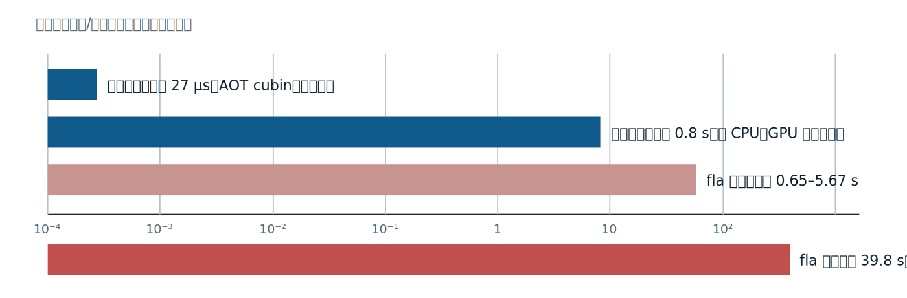

*图 4：新形状调度/调优成本（对数刻度）。本方 0.8 s 为 stage-kernel 的离线求解与排序，fla 39.8 s 为设备首次搜索；完整算子另有实测 A/B。*


另一组摊销实验记录，配置缓存命中后，Triton 编译缓存冷、热两种首调分别为 5.672 秒与 0.651 秒，相对该次 43.911 秒冷搜索为 7.7 倍与 67.5 倍，故摊销口径写作 7.7–67 倍。两组实验的缓存状态不同，首搜约 50 倍与摊销倍数应并列披露，不能共用一个未经说明的分母。[evidence/G6/fla_amortize_r26.json:395-406]

成本优势也不替代最终选择。G6 明确记录，完整算子的出货配置还使用逐杠杆、成对 GPU A/B；模型负责缩小搜索，实测负责确认机器协议、完整流水线与真实形状下的收益。可信的工作流同时保留秩指标、绝对盲区、搜索账单和最终 A/B，四者回答的问题各不相同。[evidence/G6/search_cost.md:100-111]

## 十九、GPU/NVVM 下降链：从 Launch 到 gpu.binary 与 PTX

`gpu.launch` 同时描述主机发射和设备执行区域，硬件却无法直接装载这段 IR。下降（lowering）要把两种视角拆开：主机保留带网格参数的发射调用，设备函数进入独立模块，再经 NVVM、LLVM 与 NVPTX 形成目标对象。阅读这条链时，每一步都应能回答“哪个方言还保留什么语义”，直到 PTX 文本、`ptxas` 与 SASS 接上。

### 1. grid、CTA、warp、lane 与地址空间

网格（grid）由协作线程块（CTA，Cooperative Thread Array）组成，CTA 内线程按 32 条一组构成 warp，warp 内的一条线程称 lane。`gpu.launch` 的 `blocks in` 给网格维数，`threads in` 给每 CTA 维数；`gpu.thread_id` 是 CTA 内索引， lane 通常是线程索引模 32，warp 序号则是商。MMA、elect 等操作以 warp 为执行单位，地址计算仍以 lane 持有自己的寄存器值。

G4 的单原子参考输入把 `blocks in` 设为 1×1×1、`threads in` 设为 32×1×1，launch 区域中包含两个输入 memref、一个输出 memref 和一项 linalg.matmul，并以 `gpu.terminator` 结束。这份输入只有一个 CTA、一个 warp；区域外的 `func.func` 属主机，区域内 linalg 会在 transform 阶段改写成机器 op。[evidence/G4/gen_verify/ref_f16_sm80_atom/payload.mlir:40-51] 若改成一个 128 线程 CTA，则 thread 0–31 属于 warp 0，thread 32–63 属于 warp 1。共享内存与 `gpu.barrier` 的可见范围是整个 CTA，MMA fragment 的分布范围则是单 warp；把这两个作用域混为一谈，会在多 warp kernel 中错误推断数据已经就绪。

地址空间也沿这条边界保持明确：该项目的普通全局 memref 落到 `ld.global/st.global`，`#gpu.address_space<workgroup>` 落到 CTA 共享的 `.shared`，fragment vector 最终分到寄存器。寄存器没有跨 lane 的普通 load/store 地址，warp 内交换需要 shfl 等专门机制；共享内存可按 CTA 内地址访问，全局内存则跨 CTA 可见。通用指针与共享窗口地址不能凭类型猜想互换，PTX 中的 `cvta` 或静态 `.shared` 符号才是可核对依据。G4 的 ldmatrix 产物同时出现 `.shared`、`ldmatrix...shared` 和 `mma.sync`，可直接检查这三层的落点。[evidence/G4/gen_verify/ref_ldmatrix/kernel_smemfix.ptx:19-20,83-96]

【通用补充】把全局下标写成 block 与 thread 的组合，才能看清循环如何变成 GPU 工作。下面是一个 2 个 CTA、每 CTA 64 线程的复制核；它是独立小例，不声称由通用管线自动完成映射：

```mlir
gpu.launch blocks(%bx, %by, %bz) in (%gx = %c2, %gy = %c1, %gz = %c1)
           threads(%tx, %ty, %tz) in (%bxx = %c64, %byy = %c1, %bzz = %c1) {
  %bid = gpu.block_id x
  %tid = gpu.thread_id x
  %base = arith.muli %bid, %c64 : index
  %i = arith.addi %base, %tid : index
  %ok = arith.cmpi ult, %i, %n : index
  scf.if %ok {
    %x = memref.load %a[%i] : memref<?xf32>
    memref.store %x, %b[%i] : memref<?xf32>
  }
  gpu.terminator
}
```

第 0 个 CTA 的 thread 0 处理元素 0，第 1 个 CTA 的 thread 0 处理元素 64；`bid*64+tid` 是全局下标。若 `n` 不是 64 的倍数，`scf.if` 的 guard 阻止越界。outlining 后，这段区域成为 `gpu.func` 的设备体，主机保留 `gpu.launch_func` 与网格实参。Tiling 只改变循环结构，映射还要由这样的 block/thread 下标显式完成；本项目生成器正是把这部分工作写在 payload 中，不能由 pass 名称推断自动获得。

### 2. 当前 GPUToNVVMPipeline 的真实顺序

当前 LLVM worktree 的公共段先降低 nvgpu，再做 GPU kernel 勾勒（outlining）；随后降低 vector、SCF、NVVM 与 func，附加 NVPTX 目标，并处理 affine、arith、index。设备段和主机段各有自己的后续 pass：

```cpp
pm.addPass(createConvertNVGPUToNVVMPass());
pm.addPass(createGpuKernelOutliningPass());
pm.addPass(createConvertVectorToSCFPass());
pm.addPass(createSCFToControlFlowPass());
pm.addPass(createConvertNVVMToLLVMPass());
pm.addPass(createConvertFuncToLLVMPass());
// ……目标附加、affine/arith/index 下降、canonicalize 与 CSE……
pm.addNestedPass<gpu::GPUModuleOp>(createConvertGpuOpsToNVVMOps(opt));
// ……设备模块内的规范化与 unrealized cast 清理……
pm.addPass(createGpuToLLVMConversionPass(opt));
gpuModuleToBinaryPassOptions.compilationTarget = options.cubinFormat;
pm.addPass(createGpuModuleToBinaryPass(gpuModuleToBinaryPassOptions));
```

[llvm-mlir/mlir/lib/Dialect/GPU/Pipelines/GPUToNVVMPipeline.cpp:41-65,70-99，按段节选]

先读 `ConvertNVGPUToNVVM`：MMA、异步复制等 nvgpu 机器 op 在此获得 NVVM 表达。`GpuKernelOutlining` 把 launch 区域勾勒为 `gpu.module` 中的 `gpu.func`，主机发射点改成 `gpu.launch_func`。设备侧 `ConvertGpuOpsToNVVMOps` 处理 thread ID、barrier 等 gpu 语义；`ConvertNVVMToLLVM` 再把 NVVM intrinsic 接入 LLVM 方言。主机侧 `GpuToLLVMConversion` 规范 launch 实参与运行时 ABI，`GpuModuleToBinary` 驱动 LLVM/NVPTX 翻译并封装对象；当前 asmobj 仍保留 `gpu.launch_func`，说明发射 op 与设备对象可以共同作为 runner 的输入。管线由这三段依次组装，并非单一转换 pass。[llvm-mlir/mlir/lib/Dialect/GPU/Pipelines/GPUToNVVMPipeline.cpp:103-122][llvm-mlir/mlir/lib/Conversion/GPUCommon/GPUToLLVMConversion.cpp:424-437,560-562]

pass 顺序体现了依赖关系。勾勒先建立 `gpu::GPUModuleOp`，后续 nested pass 才有明确的设备模块作用域；SCF 先转成控制流，函数、arith、index 与 memref 元数据再进入 LLVM 可表达的形式。设备端与主机端的 `ReconcileUnrealizedCasts` 用来清理转换边界暂时保留的 cast，canonicalizer 与 CSE 只做规范化和公共表达式消除。看到这些 pass 在管线中，不能推断它们会修复错误的 fragment 坐标或异步完成协议。

`GpuNVVMAttachTarget` 把 triple、chip、features、优化级别和后端命令选项附着到设备模块，后面的对象生成因而使用同一份目标描述。[llvm-mlir/mlir/lib/Dialect/GPU/Pipelines/GPUToNVVMPipeline.cpp:49-64,92-99] 管线选项还包含 index 位宽、bare-pointer 调用约定和 pattern rollback；`run_l2.sh` 只显式设置 chip、features、format，其余采用该 worktree 默认值。审计目标错误时，应检查实际 `asmobj` 的 `#nvvm.target` 与 PTX `.target`，不能只根据命令行意图判断后端已经接受配置。

### 3. gpu.object 中仍然住着主机与设备两种信息

`cubin-format=assembly` 让对象携带 PTX 汇编字符串。真实 `asmobj.mlir` 中，主机发射与设备对象同时存在：

```mlir
gpu.launch_func @gdn_ref_kernel_kernel::@gdn_ref_kernel_kernel
  blocks in (%1, %1, %1) threads in (%0, %1, %1) : i64
gpu.binary @gdn_ref_kernel_kernel [
  #gpu.object<#nvvm.target<chip = "sm_120a", features = "+ptx87">,
    assembly = "//\0A// Generated by LLVM NVPTX Back-End\0A…">]
```

[evidence/G4/gen_verify/ref_f16_sm80_atom/asmobj.mlir:5-11；缩排，object properties 与 assembly 中部省略]

`gpu.launch_func` 的符号引用指向 `gpu.binary` 中的 kernel，blocks/threads 实参仍是主机运行时要提交的值；`#gpu.object` 则记录目标 chip、features 和设备产物。assembly 中的 `\0A` 是 MLIR 对换行的字节转义，不能把它当普通未转义文本复制给 `ptxas`。

这里的容器层级值得分开：`gpu.binary` 是原设备模块在宿主模块中的命名载体，`#gpu.object` 是其中一份按特定目标生成的对象。引用写作 `模块名::kernel名`，可同时检查主机调用点与设备入口是否对应。当前 format 选 assembly，所以对象载荷是 PTX 字符串；若选择 cubin，载荷形态会变成二进制，文件名中的 `binary` 并不保证每次都能直接读到文本。主机实参表还记录常量在勾勒后被提升成哪些 kernel 参数，后续消除常量参数时正需要按这个位置顺序还原。

抽取后的参考 PTX 可以把目标选项与机器指令对齐检查：

```ptx
.version 8.7
.target sm_120a
.address_size 64
.visible .entry gdn_ref_kernel_kernel()
.maxntid 32, 1, 1
// ……寄存器声明、地址计算与 ld.global……
mma.sync.aligned.m16n8k16.row.col.f16.f16.f16.f16
    {%r10, %r11},
    {%r2, %r3, %r4, %r5},
    {%r6, %r7},
    {%r8, %r9};
```

[evidence/G4/gen_verify/ref_f16_sm80_atom/kernel.ptx:1-7,14-19,55-59，节选]

`.version` 与 `.target` 验证 `+ptx87`、`sm_120a` 已到达后端，`.entry` 与 `.maxntid` 给出可装载入口及线程上限，最后的 `mma.sync` 证明高层矩阵片段已落入预期指令族。这里仍是 PTX 虚拟 ISA；寄存器最终分配、调度与机器编码要由 `ptxas` 决定，SASS 才可用来核对那些结果。

### 4. run_l2.sh 把可检查的中间物串起来

项目脚本的入口是生成器已经写好的 `payload.mlir`、`transform.mlir` 与 `config.json`。含 gdn hatch op 时先降到树内 nvgpu/nvvm，再合并 transform；非恒等工件运行解释器，残留 `linalg.matmul` 的 no-MMA 路径补 `convert-linalg-to-loops`。随后才进入 NVVM 管线：[scripts/run_l2.sh:36-72]

```bash
"$MLIR_OPT" "$TMP/sched2.mlir" -test-transform-dialect-erase-schedule \
  -gpu-lower-to-nvvm-pipeline="cubin-chip=sm_120a cubin-features=+ptx87 cubin-format=assembly" \
  -o "$TMP/asmobj.mlir"
python3 "$REPO/tools/gdn_extract_ptx.py" "$TMP/asmobj.mlir" kernel.ptx
cp "$TMP/asmobj.mlir" asmobj.mlir
"$PTXAS" -v -arch=sm_120a kernel.ptx -o kernel.cubin > ptxas_v.txt 2>&1
"$NVDISASM" -c kernel.cubin > sass.txt
```

[scripts/run_l2.sh:69-84]

`erase-schedule` 先清除已消费的调度注记。保留 `asmobj.mlir` 有两个直接收益：可以检查 host launch 参数，也能从 `#gpu.object` 抽取 PTX；`gdn_extract_ptx.py` 查找 assembly 属性、还原 MLIR 字节转义，并要求结果含 `.version` 与 `.target`。[tools/gdn_extract_ptx.py:1-7,46-76] 脚本优先选择支持新 PTX ISA 的 `ptxas-blackwell`，再以相同 `sm_120a` 汇编并输出资源报告，最后用 `nvdisasm` 留下 SASS。[scripts/run_l2.sh:26-31] 因后续还需文本修复与审计，这里显式选择 assembly；直接交给 runner 的冒烟链则可使用默认二进制对象。整条命令覆盖 L2 payload 之后的路径，并未承诺从 CPU L1 或任意高层 GDN IR 自动直达 cubin。

这些文件也构成故障分层。`asmobj.mlir` 缺失说明 NVVM 管线尚未完成；assembly 抽取失败时检查 format 与对象属性；`ptxas` 失败时检查 PTX ISA、chip 和指令拼写；`ptxas -v` 成功后，资源报告给出寄存器、溢出与共享内存，`nvdisasm` 才能验证 HMMA、LDSM、LDGSTS 等最终 SASS 形态。前三层任何一层通过，都不能替代后一层检查，更不能替代装载运行。

还有一条与真实执行有关的边界：当前树对 kernel 内 workgroup `memref.alloc` 的某些下降会产生设备 malloc 与通用地址转换，原始 cubin 虽可由 `ptxas` 生成，却可能在硬件上非法寻址。G4 的真机数值结果经过 `gdn_smem_fix.py` 修复后的 cubin 获得，不能把 `run_l2.sh` 打出 `kernel.cubin` 直接叙述为所有 payload 已自动可运行。[evidence/G3/calib_report.md:36-72][evidence/G4/GATE_REPORT.md:8-17] 这也是脚本同时保存 PTX、asmobj、资源报告和 SASS 的意义：编译成功、资源可解释、硬件协议正确是三个依次验证的状态。

### 5. sm_80 文件在 sm_120a 上验证什么

上游测试文件位于 `TensorCore/sm80/`，原始 RUN 行指定 `sm_80` 与 `+ptx76`。项目冒烟脚本保留测试的 transform 与数值负载，手动路径把 chip 改为 `sm_120a`、features 改为 `+ptx87`，再交给 `mlir-runner`：[llvm-mlir/mlir/test/Integration/GPU/CUDA/TensorCore/sm80/transform-mma-sync-matmul-f16-f16-accum.mlir:1-8]

```bash
"$BUILD/bin/mlir-opt" "$T" \
  -transform-interpreter $ERASE \
  -gpu-lower-to-nvvm-pipeline="cubin-chip=sm_120a cubin-features=+ptx87" \
| "$BUILD/bin/mlir-runner" \
    --shared-libs="$BUILD/lib/libmlir_cuda_runtime.so,..." \
    --entry-point-result=void
```

[scripts/smoke_sm80.sh:30-43，共享库清单缩略]

这份上游 sm_80 测试在 RTX 5090 上以重定向后的 sm_120a 目标真实运行，G0 记录 f16 m16n8k16 结果正确。[evidence/G0/GATE_REPORT.md:31-32] 它验证的是同一 `mma.sync` 指令族所经过的 transform、nvgpu、NVVM、LLVM/NVPTX、cubin 装载与运行工具链；目录名和原始 RUN 行仍属于 sm_80，运行证据却来自 sm_120a。它能隔离工具链故障与自产 kernel 故障，覆盖范围仍受该测试的 f16 MMA 路径限制，不能外推为所有机器 op 或 sm_80 实机验证。

脚本还区分测试装置与备用路径：有 `llvm-lit` 时先按上游 RUN 装置执行，Unsupported 或 Failed 不会算作通过，随后才进入手动 `mlir-opt | mlir-runner`。手动路径没有指定 `cubin-format=assembly`，因为目标是由 runner 立即装载，无须抽出 PTX 做项目后处理；`run_l2.sh` 选择 assembly 则服务于工件审计。手动路径也没有把 runner 输出再送入 FileCheck，所以数值正确性依据 G0 对落盘输出的核对，不能仅凭末尾的 SMOKE PASS 字样推断。两条路径共享下降核心，末端交付形态随消费方式改变。[scripts/smoke_sm80.sh:20-44][evidence/G0/GATE_REPORT.md:31-32]

## 二十、机器 Op 的合同：MMA、ldmatrix、异步复制、mbarrier 与 TMA

机器 op 同时受两类合同约束。MLIR verifier 检查类型、形状、属性与部分合法域，硬件还要求寄存器片段坐标、每 lane 地址、跨线程完成协议和内存对齐。一个 `vector<2x2xf32>` 可以类型正确而列映射错误，一个 mbarrier 可以操作数合法而相位永远无法完成。阅读生成器时，SSA 定义链只解决值从哪里来；还要继续追踪这个值在 32 条 lane 上分别代表什么。

### 1. MMA fragment 的类型与坐标必须一起读

fragment（片段）是分布式 tile 在单 lane 寄存器中的部分。对 m16n8k16，令 lane 为 L，groupID `g=L/4`，组内线号 `tig=L%4`。A、B 与累加器 D 虽同属一次 `nvgpu.mma.sync`，每 lane 持有的元素数和坐标并不相同：

```mlir
%g = arith.divsi %lane, %c4 : index
%tig = arith.remsi %lane, %c4 : index
%t2 = arith.muli %tig, %c2 : index
%rowA0 = arith.addi %g, %c0 : index
%rowAh0 = arith.addi %g8, %c0 : index
%ncolg0 = arith.addi %ncol0, %g : index
%ncolt0 = arith.addi %ncol0, %t2 : index
%ncolgp10 = arith.addi %ncol0, %t2p1 : index
// ……A/B fragment 装载……
%g0f0_0_0r = nvgpu.mma.sync(%g0f0_0_0a_b7, %g0f0_0_0b_b3, %ia0_0)
  mmaShape = [16, 8, 16] :
  (vector<4x2xbf16>, vector<2x2xbf16>, vector<2x2xf32>)
  -> vector<2x2xf32>
```

[evidence/G4/gen_verify/kkt_bf16_mma_p2_t64x64x32_w4/payload.mlir:151-153,290-301,1385，合并节选并缩排]

类型先给出寄存器账：A 的 `vector<4x2xbf16>` 是每 lane 8 个 bf16，B 的 `vector<2x2xbf16>` 是 4 个，D 的 `vector<2x2xf32>` 是 4 个 fp32；16×8 输出的 128 个元素除以 32 lane 正好为 4。`prev` 到结果的 SSA 链承担跨 K 段累加。坐标再给出语义：A 行使用 `g` 与 `g+8`，K 坐标按 `2*tig` 及相邻元素、8 列半区展开；B 的 N 坐标使用 groupID `g`；D 的四个元素位于行 `g/g+8`、列 `2*tig` 与 `2*tig+1`。

取 L=5 手算，g=1、tig=1。该 lane 的 A 行落在 1 与 9，B 负责 N=1 的列片段，D 却负责输出列 2 与 3、行 1 与 9。若只看“每 lane 四个输出”而忽略坐标，很容易把 B 的 N=1 错用于 D 的列起点。向量中的 `[0,0]、[0,1]、[1,0]、[1,1]` 也不是任意排列：前两元素对应行 g 的相邻两列，后两元素对应行 g+8 的相同两列。写 epilogue 时，extract 下标、行值与列值必须作为一组核对。

G3 的 1168/2080 缺陷就出在 B 与 D 的列坐标混用。旧 epilogue 把 D 的偶数元素写到 B 所用的 `ncol+g`，导致 lane 间冲突写与未覆盖列，kkt 仅覆盖 1168 个严格下三角元素，o 也只有 2304/4096 个非零。当前代码用 `%ncolt` 和 `%ncolgp1` 分别写 D 的偶、奇列；G4 修复后 kkt 精确覆盖 2080 个参考位置，o 全覆盖，MMA 配置对 fp64 参考的最大差为 bf16 输出量化量级。[tools/gdn_l2_gen.py:273-282,338-358][evidence/G4/GATE_REPORT.md:53-75]

同一类型检查也解释当前生成器的 tf32 路径选择：它使用 m16n8k4，A/B fragment 改为 `vector<2x1xf32>` 与 `vector<1x1xf32>`，D 仍为 fp32。这里的 K=4 是该生成器路径当前的选择，不应被理解为上游上限；NVGPU 的 shapeK 只是基本片大小，kTile 可以组合多个基本片，当前上游已能表达 TF32 m16n8k8。[tools/gdn_l2_gen.py:296-318；../llvm-mlir/mlir/lib/Dialect/NVGPU/IR/NVGPUDialect.cpp:218-264]

### 2. ldmatrix 的地址是每 lane 输入

`nvgpu.ldmatrix` 让 warp 从共享内存聚拢 8×8 的 16 位矩阵片。每条 lane 提供一个 16B 行地址；x4 的四个矩阵片按 lane 分组取得地址，树内下降不会把统一基址自动扩散成这些行。当前参考核显式计算象限坐标：

```mlir
%lr8 = arith.remsi %lane, %c8 : index
%ld8 = arith.divsi %lane, %c8 : index
%ld8m2 = arith.remsi %ld8, %c2 : index
%arowoff = arith.muli %ld8m2, %c8 : index
%ld16 = arith.divsi %lane, %c16 : index
%acol = arith.muli %ld16, %c8 : index
%arow = arith.addi %lr8, %arowoff : index
%af = nvgpu.ldmatrix %sa[%arow, %acol] numTiles = 4 transpose = false : ...
%brow = arith.remsi %lane, %c16 : index
%bf = nvgpu.ldmatrix %sb[%brow, %c0] numTiles = 2 transpose = true : ...
```

[tools/gdn_l2_gen.py:720-738；两条 op 的完整 memref/vector 类型省略]

A 的地址满足行 `L%8 + 8*((L/8)%2)`、列 `8*(L/16)`，对应 TL、BL、TR、BR 四个象限；B 的 x2 trans 路径用 `L%16` 选择 K 主序行。读 PTX 时应看到每条 lane 的地址计算先于 `ldmatrix...shared`，且上游共享 tile 已写入并完成同步。统一 `%sa[%c0,%c0]` 也能通过类型检查，却让所有 lane 指向同一行；G4 曾观察到 16 行输出相同、最大差 0.032。采用上述地址后，参考锚与 fp64 结果完全一致。[evidence/G4/GATE_REPORT.md:167-177][evidence/G4/gen_verify/ref_ldmatrix/kernel_smemfix.ptx:83-96]

这里的一个地址对应一整行 16B，并非该 lane 最终持有的一个元素。硬件完成跨 lane 聚合后，x4 返回寄存器的次序还与四个矩阵片一一对应；地址象限顺序或 transpose 属性改变时，fragment 解释也要同步改变。verifier 不会替读者证明每 lane 地址落在有效行内，也不会证明此前的 `st.shared` 已被其他 warp 看见，因此需要把地址公式、屏障和最终 MMA 结果一起审计。

### 3. 异步复制的 token 只追踪完成，跨 warp 可见仍需同步

`nvgpu.device_async_copy` 发起全局到共享复制并返回 token；`device_async_create_group` 把本线程的一组 token 组成完成组；`device_async_wait ... numGroups = 0` 等到本线程没有未完成的旧组，非零 N 则允许保留较新的 N 组。等待具有每线程语义，其他 warp 的复制是否完成、共享写入是否对读者可见，需要另行建立同步关系。

```python
def agroup(e, toks):
    g = e.v("agr")
    e.l(f"{g} = nvgpu.device_async_create_group {', '.join(toks)}")
    return g

def await_all(e, g):
    e.l(f"nvgpu.device_async_wait {g} numGroups = 0")

# astage_tile 先按线程跨步发射 16B copy 并收集 token
g = agroup(e, toks)
await_all(e, g)
e.l("gpu.barrier")
```

[tools/gdn_bwd_gen.py:1662-1674,1711-1740，函数与调用体合并节选]

这段同步封装中，token 列表必须覆盖所有本线程发射的 copy，`gpu.barrier` 再把各线程的完成等待连接成 CTA 级发布点。手工按线程跨步分配 16B 块还避免地址流被所有 warp 重复杂射；`nthr` 必须与真实发射线程数一致，否则部分块无人复制。需要预取与计算重叠时，wait 应推迟到首次消费之前；树内某些 `create_async_groups` 路径会在组后立即 wait 0，手工发射的价值正在于由调用者决定这个同步点。[tools/gdn_bwd_gen.py:1664-1685]

双缓冲可以据此理解：第 i+1 组复制已经发起后，消费第 i 个缓冲区前使用 `numGroups = 1`，允许较新的组保持未完成，同时等较旧组完成。这个数值描述尚未完成的组数，既不表示字节数，也不表示等待多少线程。若消费者跨 warp，仍要在旧组完成与读取之间设置 CTA 或 mbarrier 可见性协议；只把 0 改成 1，无法自动得到正确的流水。

### 4. mbarrier 是相位协议，elect 与寄存器调整也有执行范围

当前 warp 专化路径把 mbarrier 用作纯数据就绪屏障。初始化计数为 1，生产者 warp 选出的 leader 是唯一到达者，消费者只等待相位；TMA 开启时，到达者还用 `expect_tx` 预告搬运字节，两个 TMA 完成的 transaction credit 与这一次 arrive 共同完成相位。

```mlir
%bar = nvgpu.mbarrier.create -> <memorySpace = #gpu.address_space<workgroup>>
scf.if %isz { gdn.mbarrier.init %bar, %c1 : ... }
gpu.barrier
// 生产者 warp
 gdn.setmaxnreg dec 96
 %el = gdn.elect -> i1
 scf.if %el {
   gdn.mbarrier.arrive.expect_tx %bar, %c16384 : ...
   gdn.tma.async.load %descA[%k0, %c0, %c0, %c0], %bar to %sa : ...
   gdn.tma.async.load %descB[%k0, %c0, %c0, %c0, %c0], %bar to %sb : ...
 }
// 消费者 warps
 gdn.setmaxnreg inc 224
 gdn.mbarrier.try_wait.parity %bar, %parity, %cticks : ...
// ……MMA 消费数据……
gpu.barrier
%parn = arith.xori %parity, %true : i1
```

[evidence/G4/gen_verify/kkt_bf16_mma_tma_ws/payload.mlir:313,370-396,1199-1200，控制流缩排与重复类型省略]

这里有两组独立同步。init 后的 `gpu.barrier` 保证屏障初始化先于首次 arrive/wait 对各 warp 可见；循环尾的 `gpu.barrier` 保证消费者读完单缓冲后，生产者才能进入下一次覆盖。`parity` 每轮异或翻转，使 try_wait 等待正确相位。16384B 恰为两个 64×64 bf16 tile 的总字节数，expect_tx 若与描述符实际搬运量不符，数据就绪条件同样失真。非 TMA 路径则先 wait 本生产 warp 的 cp.async group，再由 elected leader 做普通 arrive。[tools/gdn_l2_gen.py:544-547,585-631]

协议可以按相位逐项审计，数据就绪和缓冲复用分别对应最后两行：

| 步骤 | 状态与动作 | 证明的责任 |
|---|---|---|
| 初始化 | `init count=1`，随后 CTA barrier | 屏障对象先于任何 arrive/wait 对所有 warp 可见 |
| 生产 | elected leader 做 `arrive.expect_tx(16384)`，发出两次 TMA | 到达次数与预告字节数正确，且只有一个到达者 |
| 完成 | 两个 TMA 的 transaction credit 与 arrive 共同完成当前相位 | 数据实际到齐，而非只有指令已发射 |
| 消费 | 消费者 `try_wait.parity` 通过后读取 tile | 等待的是正确相位，消费者不需要再 arrive |
| 复用 | 消费结束后的 CTA barrier，parity 异或翻转 | 下一次覆盖发生在全部读者结束之后，形成下一轮相位 |

这张表也解释了为什么计数为 1：相位完成所依赖的 arrive 只能来自在等待之前就能执行的参与者。若还要求正在 try_wait 的消费者事后 arrive，相位完成便会依赖一个被该相位阻塞的动作。数据就绪与缓冲复用也要分开证明；前者由 mbarrier 相位完成，后者由循环尾全 CTA barrier 防止过早覆盖。增加 arrive 次数或延长 try_wait ticks 都无法修补这两个条件中的缺失项。

`gdn.elect` 下降为 `NVVM::ElectSyncOp`，在活跃 warp 中选出一条 lane，适合唯一的 TMA 发射或 mbarrier arrive；它不承担 CTA 级互斥。`setmaxnreg dec 96` 与 `inc 224` 分别声明生产者和消费者的寄存器上限，应按 warp 一致执行，并结合角色数与占用预算检查。方言 verifier 对数值只要求 8 的倍数等局部条件，无法证明分支是否 warp 一致，也无法证明整个相位协议无死锁。[dialect/lib/GdnHatch.cpp:29-49,243-250]

### 5. TMA 描述符采用 CUDA 维序，装载坐标保持该顺序

张量内存加速器（TMA，Tensor Memory Accelerator）依据描述符搬运多维盒形区域。MLIR memref 的最内维位于维度表末尾，CUDA TensorMap 的 c0 则对应最内维。主机辅助函数因此在编码时反转 globalDim、globalStrides 与 boxDim：

```cpp
globalDim[i] = static_cast<uint64_t>(descriptor->sizes[Rank - i - 1]);
globalStrides[i] = static_cast<uint64_t>(
    descriptor->strides[Rank - i - 2] * elementSizeInBytes[tensorDataType]);
// ……
boxDim[r] = static_cast<uint32_t>(inputBoxDims[tensorRank - r - 1]);
```

[llvm-mlir/mlir/lib/ExecutionEngine/CudaRuntimeWrappers.cpp:505-520,568-570，循环节选]

这段代码回答描述符怎样编码。设备装载坐标沿另一路径直接透传进 `cp.async.bulk.tensor` 的 c0..cN，不再反转，所以 payload 已按 CUDA 序写 `%k0` 在第一位。G4 的 descA 是 rank-4，`global_dim=[128,64,1,1]`、`box_dim=[64,64,1,1]`、坐标为 `[%k0,0,0,0]`；descB 同理以 K 为最内维。共享 B tile 也排成 `[bv,bk]` 的 K 连续形式，才能由行主序输入连续填充。[evidence/G4/gen_verify/kkt_bf16_mma_tma_ws/tensormap_spec.json:10-57][tools/gdn_l2_gen.py:518-531]

描述符类型与坐标正确仍遗漏单位和目的地址合同。globalDim 与 boxDim 以元素计数，globalStrides 以字节计数，K 坐标 `%k0` 也是元素偏移；把 64 个 bf16 的 128B 错填成坐标 128，会把装载位置放大两倍。编码后的 CUtensorMap 由主机上传并传设备指针，G4 装置采用 256B 对齐的描述符分配。共享内存目的 tile 另有 128B 对齐要求，即使 `swizzle=none` 也适用，两种对齐不要混为同一对象。[evidence/G4/GATE_REPORT.md:106-142]

当前 PTX 修复器为静态 tile 统一发射 `.shared .align 128 .b8 symbol[size]`，并插在 `.visible .entry` 之前。[tools/gdn_smem_fix.py:199-208] G4 记录过 16B 对齐导致 `CUDA_ERROR_MISALIGNED_ADDRESS`，sanitizer 定位到 UTMALDG；128B 修复后 TMA 配置完成并通过数值检查。主机还要按 spec 编码 CUtensorMap、上传并把设备指针作为 kernel 参数传入，cubin 中存在 TMA 指令并不能替代这份运行时接线。[evidence/G4/GATE_REPORT.md:106-148]

最终审计应把 verifier、PTX/SASS 和全输出验证连起来。fragment 列坐标、ldmatrix 每 lane 行地址、异步组的跨 warp 可见性、mbarrier 到达计数与缓冲复用、TMA 字节数和维序，都超出单纯 IR 类型合法域。当前修复版的证据是 G4 在 seed 0 与 seed 7 下均为 20/20 通过，重发射逐位确定；这些结果验证的是已执行配置及其协议，仍应随生成器改动重跑。[evidence/G4/GATE_REPORT.md:8-17,49-56]

## 二十一、词表之外：Inline Asm 与唯一自定义指令扩展

`gdn.mma.tf32k8` 是自定义指令扩展预算中唯一的实际支出：预算至多 5 个，使用 1 个。它通过内联汇编（inline asm）发出目标指令，接收 4 个 A、2 个 B、4 个 C 的 f32 标量，返回 4 个 f32 的 D 标量[dialect/include/Gdn/GdnHatch.td:185-193]。一个 op 获得这项支出的前提，不能停在“PTX 手册里有这条指令”；词表缺口、寄存器合同、片段布局、整链数值和资源成本必须依次成立。

### 1. 必要性必须按版本与产物复核

反向计算里不少 GEMM 直接消费 f32 中间量。bf16、tf32、fp32 都有 8 位指数；显式尾数分别为 7、10、23 位，计入隐含位后的有效精度分别为 8、11、24 位。直接转 bf16 会再次量化已经承载误差的中间量。目标指令因而是 `mma.sync.aligned.m16n8k8...tf32`，无须把输入改成 bf16。

先看当前的 NVGPU verifier：`shapeK` 表示基本片大小，tf32 的 shapeK=4，`kTile=k/shapeK` 允许多个基本片，所以 shapeK 不能被读成 K 的上限。当前 NVGPU→NVVM 也按 gemmShape 逐片创建 NVVM MMA；上游测试已经直接给出 `mmaShape=[16,8,8]`[../llvm-mlir/mlir/test/Dialect/NVGPU/mma-sync-f32-to-tf32.mlir:13-18；verifier 的基本片处理见 ../llvm-mlir/mlir/lib/Dialect/NVGPU/IR/NVGPUDialect.cpp:218-264]。本项目 G2 建立扩展时核对的 NVVM 记录则是另一版本：当时的 m16n8k8 组合只覆盖 f16、bf16 和整型，未提供所需 TF32 形式[evidence/G2/gen_report.md:125-134]。这两条事实必须按版本分开。

当前上游 `llvm-mlir/mlir/include/mlir/Dialect/LLVMIR/NVVMOps.td:2860-2862` 已把 TF32 的 `GEOM<16,8,4>` 与 `GEOM<16,8,8>` 都列入 `tf32_mma_ops`；`NVGPUDialect.cpp` 的基本片处理也说明 K 可以通过 kTile 组合扩大。项目当时实际能发出的 TF32 原子仍是 K=4，下面摘自 stock `o_f32` 配置的真实产物：

```ptx
mov.b32 %r5, 0f00000000;
mma.sync.aligned.m16n8k4.row.col.f32.tf32.tf32.f32
    {%r6, %r7, %r8, %r9},
    {%r2, %r3},
    {%r4},
    {%r5, %r5, %r5, %r5};
```

[evidence/G4/gen_verify/o_f32_mma_p2_t64x64x32_w4_K64V64/kernel.ptx:6228-6233]

读这段产物要看三处：形状字段确为 `m16n8k4`，A/B 类型确为 `tf32`，累加与结果仍为 `f32`。它记录的是当时生成器实际选择的形态，不能用来证明当前上游只能 K=4。当前上游已能表达 TF32 m16n8k8；本实现仍保留 `gdn.mma.tf32k8` 与 inline asm，是否迁移到上游路径，需要重新检查类型、布局、数值和性能，而不能把 G2 的缺口写成 MLIR 的永久限制。

### 2. 约束字符串同时描述类型与寄存器生存期

当前下降直接创建 `LLVM::InlineAsmOp`。PTX 文本、约束和操作数顺序如下；结构体与四条 `extractvalue` 的后续代码在此省略：

```cpp
static const char *kPtx =
    "mma.sync.aligned.m16n8k8.row.col.f32.tf32.tf32.f32 "
    "{$0, $1, $2, $3}, {$4, $5, $6, $7}, {$8, $9}, "
    "{$10, $11, $12, $13};";
static const char *kConstraints =
    "=&f,=&f,=&f,=&f,f,f,f,f,f,f,f,f,f,f";
auto structTy =
    LLVM::LLVMStructType::getLiteral(ctx, {f32, f32, f32, f32});
SmallVector<Value, 10> args{op.getA0(), op.getA1(), op.getA2(),
                            op.getA3(), op.getB0(), op.getB1(),
                            op.getC0(), op.getC1(), op.getC2(),
                            op.getC3()};
auto asmOp = LLVM::InlineAsmOp::create(
    rewriter, loc, structTy, ValueRange(args),
    rewriter.getStringAttr(kPtx), rewriter.getStringAttr(kConstraints),
    /*has_side_effects=*/UnitAttr::get(ctx),
    /*is_align_stack=*/UnitAttr(),
    /*tail_call_kind=*/
    LLVM::TailCallKindAttr::get(ctx, LLVM::TailCallKind::None),
    /*convergent=*/UnitAttr(),
    /*asm_dialect=*/
    LLVM::AsmDialectAttr::get(ctx, LLVM::AsmDialect::AD_ATT),
    /*operand_attrs=*/ArrayAttr());
```

[dialect/lib/GdnHatch.cpp:174-199，省略前面的 loc、ctx、f32 定义]

约束从左到右先声明 4 个输出，再声明 10 个输入，所以 `$0..$3` 是 D，`$4..$7` 是 A，`$8/$9` 是 B，`$10..$13` 是 C。`f` 请求 32 位浮点寄存器，`=` 表示输出，`&` 表示提前破坏（early-clobber）：分配器不得把该输出放进任一输入寄存器。普通 `=f` 允许在输入最后一次使用后复用其寄存器；对一条同时读取整组 A、B、C 并写整组 D 的 MMA，这种复用会让同一原子内的读写集合相交。

内联汇编对 LLVM 是一个带合同的指令黑盒。框外的十个 SSA 输入和结构体结果仍参与优化，框内的矩阵语义、lane 映射和并发读写顺序则不会由 LLVM 自动推导。下降把四个结果组成 literal struct，再用四条 `extractvalue` 接回独立 f32 SSA 值，避免借助临时内存交换片段。这样做也把审计责任划得很清楚：类型与生存期由约束表达，矩阵含义只能交给探针验证。

缺陷有明确的机器指纹。普通 `=f` 下，ptxas 曾把 D 四元组映射到同一指令的 A 四元组，SASS 出现 `HMMA R12, R12, R10, R16`；K=16 的双原子链有 118/128 个单元稳定出错，错值恰好缺少完整的 k 项[dialect/lib/GdnHatch.cpp:152-169]。四个 `=&f` 将这个分配空间排除。硬件允许的原地累加语义与这里更强的分配约束也要分开：实现选择让 D 与所有输入保持不同。旧 `nvvm.inline_ptx` 的 BasicPtxBuilder 路径只生成普通 `=f`，无法表达这项约束，所以当前实现没有走那条捷径。

### 3. 片段布局要用可精确判决的数据上机

约束正确只保证寄存器不互相覆盖，不能保证每个 lane 拿到的矩阵元素正确。片段（fragment）是 warp 指令把矩阵元素分摊到各 lane 寄存器的映射；本项目用 `g = lane >> 2`、`t = lane & 3` 表示其坐标：

```text
A 16x8: a0=(g,2t)   a1=(g+8,2t)
        a2=(g,2t+1) a3=(g+8,2t+1)
B 8x8 : b0=(2t,g)   b1=(2t+1,g)       [k,n]
D 16x8: d0=(g,2t)   d1=(g,2t+1)
        d2=(g+8,2t) d3=(g+8,2t+1)     [m,n]
```

[tools/gdn_bwd_gen.py:2030-2036]

A 的顺序是“行半外层、列对内层”：a0 与 a1 先跨两个八行半区，a2/a3 才走到相邻 k 列。bf16 m16n8k16 常让人按打包列对类推寄存器顺序，照搬到 TF32 K=8 会错位。这里的价值在于每个寄存器都有坐标，发射器可以做索引断言，探针也能逐单元指出错在哪一组。

整型探针先把舍入从判决中移除：

```python
A = rng.integers(0, 8, (16, 8)).astype(np.float32)
B = rng.integers(0, 8, (8, 8)).astype(np.float32)
C = rng.integers(0, 8, (16, 8)).astype(np.float32)
Dref = A.astype(np.int64) @ B.astype(np.int64) + C.astype(np.int64)
assert Dref.max() < 2048  # tf32-exact
# ... 发射一个 warp 并读回 D ...
if np.array_equal(D, Dref):
    print("[tf32k8_probe] PASS: D == A@B + C EXACTLY (16x8x8 atom)")
```

[evidence/G5/scratch/tf32k8_probe/tf32k8_probe_run.py:28-33,49-57，省略 CUDA 装载]

小整数及其乘加结果都落在 TF32 可精确表示的范围内，因此期望是逐位相等；任何缺项、交换或跨行错位都无法被容差吞掉。探针还把两类故障的指纹分开了：early-clobber 缺失表现为稳定缺少若干完整 k 项，片段顺序错误则会在坐标映射下呈现系统性错位。若一开始就用随机浮点和宽松误差门，这两类问题都可能被误读成正常舍入。第二层再换 `N(0,1)` 输入，与 f64 参考和截断 TF32 模拟分别比较[evidence/G5/scratch/tf32k8_probe/tf32k8_probe_run.py:58-84]。归档结果为对 f64 最大误差 4.2e-3，与截断模拟相差约一个 ulp 的量级[evidence/G5/bwd_report.md:275-287]。前者确认真实舍入误差存在，后者确认误差符合 TF32 语义；两次试验合起来，才能区分“恰好算对的错误精度路径”和真正的 TF32 MMA。

原子探针之后还有发射器探针。tgemm 要处理 A/B 转置、是否累加、是否取负和三类偏移，正确的单原子坐标仍可能被外层索引算错。套件覆盖实际使用的 13 种组合，每种都生成独立 kernel，并以 NumPy 参考逐元素核对；它曾定位到奇数 k 列被额外加一的错误[evidence/G5/bwd_report.md:291-311]。这层验证把“指令本身正确”与“生成器在每种调用方式下都正确”分开，也使后续位点准入有一个可复用的正确基座。

### 4. 位点准入选址的是误差传播与机器资源

原子正确不代表每个 GEMM 位点都该启用。最初的 24 个 f32 GEMM 候选逐一单独接入，在 T512 上观察整条反向链相对参考的梯度误差；16 个通过数值与性能门后进入放行集[evidence/G5/bwd_report.md:319-347]。这个 24→16 是该候选集的审计截面，后续新增的其他分组不能倒算进同一分母。

逐位点试验比一次全开更有诊断力。单开某个位点时，整链误差的变化可以与该位置的传播路径对应；若所有位点同时开启，多个扰动会混合，无法知道应当撤回哪一处。这里衡量的是最终 dq、dk、dv、dbeta、dg、dh0 等输出合同，而非孤立 GEMM 的最大误差。局部误差很小仍可能在递推中放大，局部舍入可见也可能被后续数据尺度吸收。

否决理由展现了局部舍入如何沿算法传播。`wy.u` 使 dk 误差达到 1.06e-2，超过 8e-3 合同，因为 u 的扰动会经状态扫描进入 Sn；同形状、同 K 的 `wy.w` 只带来 1.4e-5，获得放行。`dhu` 的三个数值干净位点则撞上资源墙：完全展开的 tgemm 位于反向串行 chunk 循环内，ptxas 从 128 寄存器、188B 溢出变为 255 寄存器、116–128B 溢出，阶段时间从 3.69ms 增至 4.67ms，遂保留标量路径[evidence/G5/bwd_report.md:321-340,369-374]。

回退是普通发射分支：

```python
if tag is not None and tag in TF32_SITES:
    tgemm(e, out, a, b, M, N, Kd, at=at, bt=bt, acc=acc, neg=neg,
          a_off=a_off, b_off=b_off, o_off=o_off, bar=bar, tag=tag,
          warps=warps)
else:
    sgemm(e, out, a, b, M, N, Kd, at=at, bt=bt, acc=acc, neg=neg,
          a_off=a_off, b_off=b_off, o_off=o_off, bar=bar, kahan=kahan)
```

[tools/gdn_bwd_gen.py:2338-2349]

`TF32_SITES` 按位点决定走向，未入选及被否决的位置继续调用语义相同的 `sgemm`。这使数值否决与性能否决都无需改变算子结构。放行集由候选分组减去显式排除项构成，排除项旁记录了越界误差或资源回退原因[tools/gdn_bwd_gen.py:2073-2100]。配置因此也能接受审计：看到某个标签，就能判断它为何走张量核，看到另一个标签，也能确认标量回退仍在编译覆盖之内。

性能判断不能只看单条 MMA 的理论吞吐。完全展开会增加寄存器活跃集合和指令文本，位于串行循环时还会重复暴露这些成本；占用、溢出、循环结构与归约方式需要一起计时。启用 tgemm 与配套 warp 归约改造后，归档端到端中位数从 14.16ms 降至 11.06ms；报告同时把 dqkwg、wyb 的收益归因于 MMA 和归约并行化，不能把全部差额记到这一条指令名下[evidence/G5/bwd_report.md:352-367]。

### 5. 一条扩展对应一条完整检查链

必要性由项目建立扩展时的 NVVM 记录与真实 stock PTX 证明；当前上游已能表达 TF32 m16n8k8，是否迁移需要重新做类型、布局、数值和性能验证。正确性由 early-clobber、SASS 指纹和整型片段探针证明；数值语义由随机舍入试验与逐位点整链误差证明；性能由资源报告和端到端计时共同裁决；任何位点不满足条件，都能回到标量实现。五道检查各自回答不同问题，任何一道通过都不能替代下一道。预算 1/5 只是本实现自设的审计规则，不代表当前上游的永久表达力边界；词表外代码必须携带足够证据，并且始终存在可发射、可验证的回退路径。

## 二十二、NVVM 之后的改写：静态共享内存、别名、寄存器与宽存

`tools/gdn_smem_fix.py` 位于 NVVM 已产出 PTX、ptxas 尚未生成出货 cubin 的缝隙中。它是 Python 驱动的 PTX 文本后处理器，不进入 MLIR PassManager，也不重写 SSA IR。运行器先调用生成器与 `scripts/run_l2.sh`，再调用该工具；最终装载的是改写后重新汇编的 `kernel_smemfix.cubin`[tools/gdn_full_rt.py:72-85,107-124]。四个变换各自利用这一层才完整可见的信息：malloc 调用序列、最终分配尺寸、逐入口文本和已调度的窄存指令。

这里的正则不是通用 PTX 解析器。它们只接受生成器与 LLVM 当前产出的窄语法，匹配锚定行首、指令名和寄存器形式，未知的合法写法应当保持不变。第二次 ptxas 再承担完整语法检查，真机验证负责语义检查。窄识别、保守回退和权威汇编器组合起来，避免用一个不完整的解析器去猜测所有 PTX。

### 1. device malloc 变成带 128B 对齐的 .shared

stock 下译把 workgroup memref 分配表示成设备端 malloc，再把返回指针转换到 shared 窗口。裸 ptxas 不链接设备运行时，堆指针也不具备共享 tile 所需的地址语义。真实输入中，一次 8192B 分配和两种地址转换同时存在：

```ptx
{ // callseq 0, 0
.param .b64 param0;
.param .b64 retval0;
st.param::func.b64 [param0], 8192;
call.uni (retval0), malloc, (param0);
ld.param::func.b64 %rd220, [retval0];
} // callseq 0
// ...
cvta.to.shared.u64 %rd8, %rd220;
cvta.to.shared::cluster.u64 %rd196, %rd221;
```

[evidence/G4/gen_verify/kkt_bf16_mma_tma_ws/kernel.ptx:98-104,188,389，中间省略]

改写后，调用序列消失，入口前出现静态符号，普通 shared 与 cluster 变体都改成符号取址：

```ptx
.shared .align 128 .b8 __gdn_smem0[8192];
.shared .align 128 .b8 __gdn_smem1[8192];
// ...
mov.u64 %rd8, __gdn_smem0;
mov.u64 %rd196, __gdn_smem1;
```

[evidence/G4/gen_verify/kkt_bf16_mma_tma_ws/kernel_smemfix.ptx:17-18,170,371，中间省略]

前后对照应追踪 `%rd220/%rd221` 的 use-def 链，确认没有遗留对已删除 malloc 返回寄存器的读取。`::cluster` 是 TMA 目的地址使用的形式；漏改它会让张量装载写入无效共享地址。`.align 128` 也有硬件含义：sm_120a 的 `cp.async.bulk.tensor` 目的即使关闭 swizzle 仍要求 128B 对齐，较早的 16B 对齐曾触发 `CUDA_ERROR_MISALIGNED_ADDRESS`[evidence/G4/GATE_REPORT.md:131-142]。

工具先配对 callseq 的开闭编号，只有同时识别 malloc、尺寸和返回寄存器才删除；随后按源寄存器共享同一个静态符号：

```python
if "malloc" not in body:
    return m.group(0)
sm = SIZE_RE.search(body)
rm = RET_RE.search(body)
if not sm or not rm:
    return m.group(0)
malloc_reg_size[rm.group(1)] = int(sm.group(1))
return ""
# ...
lines = [f".shared .align 128 .b8 {s}[{n}];" for s, n in decls]
```

[tools/gdn_smem_fix.py:101-110,199-204]

这里能判断文本改写的保守边界：识别不完整就保留原文；`CVTA_RE` 中的可选 `(?:::\w+)?` 同时覆盖普通和 cluster 形式[tools/gdn_smem_fix.py:73-80]。静态声明沿用 MLIR 其他路径已经使用的 PTX 习惯写法，合法性再由第二次 ptxas 检查。

声明中的字节数之和还不是最终资源账。ptxas 会把不满足对齐粒度的声明向上取整，F1KS 的 46,144B 声明合计因此对应 46,352B 报告值[tools/gdn_full_gen.py:4403-4409]。审计时应同时保留两处数字：前者用于核对生成器的 arena 布局，后者用于判断实际驻留。只用声明总和可能误判一个贴着双 CTA 门槛的配置。

### 2. 生存期别名把独立分配映射到竞技场

共享内存峰值按同一时刻仍存活的字节计算，IR 中先后存在的独立 tile 可以复用同一物理区间。SSA 值唯一性约束的是值及其定义关系，并不禁止底层内存别名。项目在 IR 中保留清晰的独立 `memref.alloc`，到 PTX 层依据已审计生存期实施复用；这是一项布局选择，与“MLIR 原理禁止别名”无关。

生成器随产物写出 `smem_alias.json`。`identify` 用 malloc 字节数反查 tile，`arenas` 声明基区大小，`alias` 给出基 tile 与字节偏移。JSON 只把生成器已经完成的生存期分析传给后处理器；尺寸相同本身不能证明可复用，区间不越界与最后读、首次写之间的同步仍由生成器负责。改写器承担可靠识别和机械映射，不会从一张尺寸表臆造生存期事实。F1 的布局如下：

```json
"gdn_fwd_f1_kernel": {
 "identify": {"9216": "Abf", "9504": "Tt",
              "8704": "vt", "8976": "k2"},
 "arenas": {"Abf": 9216, "Tt": 9504},
 "alias": {"vt": ["Abf", 0], "k2": ["Tt", 0]}
}
```

[evidence/G5/gen_fwd/B4T2048_mono/smem_alias.json:3-23，按单行压缩展示]

F1 的 vt、k2 在求解结束后才使用，Abf、Tt 的对应字节此时已经死亡。原 PTX 分别转换四个独立 malloc 结果；改写后，后两者落到前两者基址：

```ptx
// before
cvta.to.shared.u64 %rd17, %rd113;  // vt, 8704B
cvta.to.shared.u64 %rd18, %rd114;  // k2, 8976B
// after
mov.u64 %rd17, __gdn_smem_gdn_fwd_f1_kernel_4;
add.u64 %rd17, %rd17, 0;
mov.u64 %rd18, __gdn_smem_gdn_fwd_f1_kernel_5;
add.u64 %rd18, %rd18, 0;
```

[evidence/G5/gen_fwd/B4T2048_mono/kernel.ptx:89-102,248-249；evidence/G5/gen_fwd/B4T2048_mono/kernel_smemfix.ptx:181-191]

`add 0` 看似多余，却保留统一模板；非零偏移时同一形式直接表达子区间。尺寸用于识别，因为 LLVM 可以调整 malloc 调用顺序。唯一性检查决定整个布局能否采用：

```python
if len(regs) != 1:
    print(f"[smem_fix] WARN alias: size {sz_s} for '{tile}' "
          f"matches {len(regs)} mallocs -- aliasing disabled")
    ok = False
    break
# ...
if not ok:
    arena_of, alias_of, reg_of_tile, tile_of_reg = {}, {}, {}, {}
```

[tools/gdn_smem_fix.py:132-136,150-151]

零匹配表示分配已消失，无需重定向；多匹配或引用未识别 tile 会弃用别名，退回每个 malloc 一个独立声明。失败损失空间收益，不改变已验证的寻址语义。这也是后处理层适合承载该变换的原因：最终尺寸已经稳定，失败时仍保留完整原始分配。

### 3. .maxnreg 给出逐入口的静态预算

单模块多入口（mono）cubin 内不同 kernel 可以有不同寄存器预算，文件级 `--maxrregcount` 无法同时表达 `f2:128` 与 `f3:168`。`GDN_MAXREG_K` 按入口名子串匹配并插入 PTX directive：

```ptx
// before
.visible .entry gdn_dqkwg_kernel_kernel()
.maxntid 256, 1, 1
{
// after
.visible .entry gdn_dqkwg_kernel_kernel()
.maxntid 256, 1, 1
    .maxnreg 128
{
```

[evidence/G5/scratch/r19b_final_T8192/dqkwg/kernel.ptx:37-39；evidence/G5/scratch/r19b_final_T8192/dqkwg/kernel_smemfix.ptx:49-52]

当前注入器的入口匹配与追加逻辑为：

```python
m = re.match(r"\s*\.visible\s+\.entry\s+([\w.$]+)", ln)
if m:
    name = m.group(1)
    key = next((k for k in want if k in name), None)
    if key:
        out.append(f"\t.maxnreg {want[key]}")
        applied[name] = want[key]
```

[tools/gdn_smem_fix.py:699-707]

上面的 dqkwg 文本来自注入审计产物，directive 位于目标 entry 的资源声明区。`.maxnreg` 约束 ptxas 对该 entry 的静态寄存器分配；`gdn.setmaxnreg` 则下降为 `nvvm.setmaxnreg`，用于 warp 专化执行期间按 increase/decrease 方向调整寄存器配额[dialect/lib/GdnHatch.cpp:29-39]。前者影响编译后的入口资源账，后者是设备代码中的动态寄存器管理指令，二者不能互相替代。

注入器逐项记录实际命中的 entry，请求数与命中数不符就打印警告[tools/gdn_smem_fix.py:683-712]。真正对账还要读改写后那次 ptxas 的报告：文本变化会改变调度与分配，第一遍未修复 PTX 的寄存器数没有资格代表出货 cubin。第二十三章的 128/168 案例正说明这条边界。

更低的上限也不自动带来更优机器。寄存器收紧可能提高驻留，同时把活跃值压到本地内存；是否值得，取决于增加的驻留能否覆盖溢出流量及其延迟。因而 `.maxnreg` 的验收至少要并列记录寄存器数、spill、驻留 CTA 和端到端时间，不能只检查 directive 已出现在文本里。

### 4. WST 把四条 16 位访存合成两条 32 位访存

宽存变换 WST（wide-store）寻找相邻的 shared 16 位装载及其 global 16 位存储。下面同一循环中，LLVM 把高地址 store 调到了低地址 store 前面，配对若只按文本顺序就会漏掉：

```ptx
// before
$L__BB0_94:
ld.shared.b16 %r1653, [%rd543];
ld.shared.b16 %r1654, [%rd543+2];
st.global.b16 [%rd544+2], %r1654;
st.global.b16 [%rd544], %r1653;
// after
$L__BB0_94:
ld.shared.b32 %r9000, [%rd543];
st.global.b32 [%rd544], %r9000;
```

[evidence/G5/gen_fwd/B4T2048_mono/kernel.ptx:3328-3332；evidence/G5/gen_fwd/B4T2048_mono/kernel_smemfix.ptx:3270-3272]

配对器按地址关系工作：shared 偏移必须相差 2B，global 必须同基址且也相差 2B，每个源寄存器只能有一次使用，装载必须先于各自 store。满足这些条件后，小端 32 位寄存器装入的两个 16 位单元与原来的字节序列一致，写回地址也一致。未满足任一条件的站点保留原指令，所以候选缺失只是失去融合机会。

新寄存器从 `%r9000` 起分配，并用显式逗号清单声明：

```python
decl = "\t.reg .b32 " + ", ".join("%%r%d" % i
                                  for i in range(9000, new_reg[0])) + ";"
```

[tools/gdn_smem_fix.py:554-562]

对应真实产物为 `.reg .b32 %r9000, %r9001, %r9002, %r9003;`[evidence/G5/gen_fwd/B4T2048_mono/kernel_smemfix.ptx:60]。这里不用区间或计数声明，因为当前 ptxas 对这种高编号形式有限制。核心替换与删除旧指令的逻辑位于同一份配对器[tools/gdn_smem_fix.py:518-553]；mono 路径还受 `GDN_WST` 和 `GDN_WST_SCOPE` 双重限定，只有选定模块执行[tools/gdn_smem_fix.py:773-777]。

四条变两条直接减少指令站点，却不承诺时间减半。宽存还要求配对地址满足对齐，实际收益受 LSU 发射、shared bank 几何和全局扇区利用率影响。配对正确性由地址与字节图像证明，性能则交给同形状交错配对测量；WST 与后续的 lane 几何调整各自有不同验收问题。

### 5. 缓存、mono 合并与失败路径共同保护产物

后处理产物会被缓存，缓存键必须覆盖能够改变 PTX 的输入。当前键纳入所有 `GDN_`、`G5` 前缀环境变量以及生成器、改写器自身源码：

```python
for k in sorted(os.environ):
    if k.startswith("GDN_") or k.startswith("G5"):
        h.update(f"{k}={os.environ[k]}\n".encode())
for f in ("gdn_full_gen.py", "gdn_smem_fix.py"):
    p = os.path.join(TOOLS, f)
    if os.path.exists(p):
        h.update(f"\n#{f}#".encode())
        with open(p, "rb") as fh:
            h.update(fh.read())
return h.hexdigest()[:16]
```

[tools/gdn_full_rt.py:28-44]

键随 `full_spec.json` 落盘。旋钮或源码变化时，构建转向 `<out_dir>_k<hash8>`，旧目录保留以供取证[tools/gdn_full_rt.py:47-70]。没有缓存键标记的旧目录按兼容策略继续受信，这条例外也属于缓存合同，不能省略。

mono 合并还有独立的符号问题：ptxas 会跨 entry 合并同名 `.shared`，三个模块各自的 `__gdn_smem0` 若尺寸不同，就可能让一个 kernel 经另一个 kernel 较小的共享区越界。合并器在拼接前加入模块标签：

```python
def rename_syms(text, tag):
    return re.sub(r"__gdn_smem(\d+)",
                  lambda m: "__gdn_smem_%s_%s" % (tag, m.group(1)),
                  text)
```

[tools/gdn_smem_fix.py:715-729]

这一道改名与四变换共同接受第二次 ptxas 检查。整个工具的失败纪律很具体：别名识别不唯一就回退，WST 条件不全就保留窄指令，找不到 `.visible .entry` 就拒绝插入声明，最终汇编失败则打印 stdout/stderr 并非零退出[tools/gdn_smem_fix.py:199-208,800-804,843-847]。数值路径不做重结合，WST 要求字节图像相同，别名要求生存期与偏移已经证明；不能保证时就保留独立、可汇编的形态。后处理因此既改变机器产物，也始终把“无法识别”与“允许改写”分开。

## 二十三、出货前的审计：ptxas、SASS、Sanitizer 与差分定位

cubin 装载前的最后一份静态资源账来自 ptxas，硬件实际执行的指令序可由 nvdisasm 反汇编为 SASS，越界与竞态则交给 compute-sanitizer 在真机上观察。三类证据回答的问题不同：资源账估计驻留与溢出，SASS 检查指令选择和控制流，动态工具捕获具体访问。只有把它们指向同一个产物，审计才成立。

### 1. ptxas -v 的字段要落到资源含义

`ptxas -v` 按 entry 报资源。一个 kkt 配置的真实输出为：

```text
ptxas-blackwell info : Compiling entry function 'gdn_kkt_kernel_kernel' for 'sm_120a'
ptxas-blackwell info : Function properties for gdn_kkt_kernel_kernel
    0 bytes stack frame, 0 bytes spill stores, 0 bytes spill loads
ptxas-blackwell info : Used 96 registers, used 1 barriers
```

[evidence/G4/gen_verify/kkt_bf16_mma_p0_t64x64x32_w4/ptxas_v.txt:2-5]

`Used 96 registers` 是每线程静态寄存器数。结合 CTA 线程数与每 SM 65,536 个 32 位寄存器，可计算寄存器允许的驻留 CTA 数；实际驻留还受共享内存、线程数和硬件粒度共同约束，项目审计所用的同一边界见[evidence/G5/bwd_report.md:2574-2599]。`bytes smem` 是每 CTA 静态共享内存，适合与双 CTA 门槛对账。`stack frame` 指向本地栈需求，`spill stores/loads` 按字节报告寄存器溢出到本地内存的规模，非零时需要继续查访问频率和所在热路径。`used 1 barriers` 是 barrier 资源占用，不等于动态执行了一次 `bar.sync`。

这份样例的 96 寄存器、1 个 barrier、三类零字节只描述该 entry。`gmem` 描述模块全局存储，也不能当作每线程开销。读报告时先把单位、作用域和 entry 对齐，再谈 occupancy，能避免把几个同名“大小”混成一笔账。

### 2. 双遍报告只认出货那一遍

第一遍由 `run_l2.sh` 对未修复 `kernel.ptx` 执行，报告写入 `ptxas_v.txt`，随后 `kernel.cubin` 生成第一版 SASS[scripts/run_l2.sh:74-84]。第二遍由 `gdn_smem_fix.py` 对 `kernel_smemfix.ptx` 再调用同一个 ptxas，产生实际装载的 cubin[tools/gdn_smem_fix.py:790-804,833-847]。共享声明、别名、`.maxnreg` 和宽存都在两遍之间改变文本，ptxas 因而可以合法地选择另一种调度与寄存器分配。

这也意味着 `meta.json` 中由第一遍自动采集的 registers 不能无条件贴到第二版 cubin 上。审计目录需要显式保存第二遍输出，并让它与 `kernel_smemfix.cubin` 的哈希同槽归档；若又注入 cap 或改动 PTX，还要保存新的重汇编报告。文件名相近不构成证据链，产物、报告和配置键必须一一对应。

归档中有一个代价直接的案例：第一遍报 128 寄存器，第二遍出货 cubin 却为 168、零溢出。256 线程下，双 CTA 需要 2×256×168 个寄存器，超过 65,536，ncu 因寄存器只允许单 CTA，每 SM 仅 8 个 warp；阶段性能变为预期的 0.78 倍。插入 `.maxnreg 128` 后，2×256×128 恰好装满寄存器文件，双 CTA 恢复，实测 achieved occupancy 从 15.02% 升至 29.17%[evidence/G5/bwd_report.md:2574-2600]。

同一资源报告文件还保留了另一组两次汇编对照：

```text
Used 174 registers, used 1 barriers, 47616 bytes smem
Used 128 registers, used 1 barriers, 88 bytes cumulative stack size, 47616 bytes smem
88 bytes stack frame, 84 bytes spill stores, 120 bytes spill loads
```

[evidence/G5/scratch/r19b_final_T8192/dqkwg/ptxas_smemfix_v.txt:5,10-11，按字段节选]

174→128 来自后续上限注入，同时出现 88B 栈帧与 84/120B 溢出。它能说明 cap 的代价必须和收益一起读；128/168 案例则说明第二遍自然分配也可能高于第一遍。两组数字方向不同，结论一致：报告必须绑定具体 PTX 和 cubin，出货对账读取第二遍及其后续重汇编结果。

### 3. SASS 计数检查指令形态，不冒充动态时间

`nvdisasm -c` 把 cubin 反汇编成 SASS。`run_l2.sh` 对文本中的 HMMA、LDGSTS、LDS、STS、LDL、STL、BAR.SYNC、LDSM、EX2 做静态计数，同时保存 PTX 的精确 MMA 签名[scripts/run_l2.sh:83-84,107-120]。同一份 kkt 配置记录为：

```json
"ptx_features": {"mma.sync": 16, "cp.async": 514},
"sass_ops": {"HMMA": 16, "LDGSTS": 512,
             "LDS": 83, "LDL": 0, "STL": 0,
             "BAR.SYNC": 2, "EX2": 30}
```

[evidence/G4/gen_verify/kkt_bf16_mma_p0_t64x64x32_w4/meta.json:30-33,55-64，保留相关字段]

HMMA 是张量核矩阵乘加，LDGSTS 对应全局到共享的异步搬运路径。HMMA=16 与 PTX 的 16 个 MMA 站点相符，LDGSTS=512 则说明该配置的异步复制已落实到预期指令族；LDL/STL 为零与这份第一遍报告的零溢出相互印证。TMA 配置可作为反例：它有批量张量搬运，却记录 LDGSTS=0，因为实际走的是 UTMALDG 等其他指令[evidence/G4/gen_verify/kkt_bf16_mma_tma_ws/meta.json:30-34,55-64]。

这些计数是静态指令站点数。循环次数、warp 数、谓词执行率和访存延迟都未包含，不能直接把 HMMA 或 LDGSTS 数换算成毫秒。它们适合验证“目标指令是否出现”“意外溢出是否存在”“两版代码差在哪”，动态成本仍需计时或剖析器补齐。

做版本差分时还要区分寄存器重编号与真正指令变化。可先看 opcode、立即数和控制流标签，再追踪操作数依赖；若直接按整行文本排序，大量合法重编号会淹没关键差异。反向地，差异很少也不能立即推出语义相近：一条地址立即数、屏障或谓词就足以改变整个 kernel 的访问集合。

### 4. Sanitizer 给出访问现场，racecheck 给出同步假设

compute-sanitizer 的 memcheck 用于越界、非法地址和对齐错误，racecheck 检查共享内存访问竞态。G4 的 TMA 故障被定位到 `UTMALDG.4D`，由此确认静态 tile 的 128B 对齐要求[evidence/G4/GATE_REPORT.md:131-142]；mono 曾跨 entry 合并同名 `.shared`，sanitizer 报出 0xa800 的 shared write，指向 F3 经较小符号越界写[evidence/G5/fwd_report.md:236-239]。两类报告都把抽象的数值损坏还原成具体地址与指令。

竞态检查需要同样的证据纪律。项目已有可直接置于工具下运行的 F1 脚本，其注释明确给出 `compute-sanitizer --tool racecheck python <this>` 的用法[evidence/G5/scratch/r17f/racecheck_f1ks.py:1-7]。真实日志列出 6 组读写 hazard，第一组为 kernel+0x420 的读与 +0x490 的写，汇总为 6 errors[evidence/G5/scratch/r17f/racecheck_f1ks.log:1-21]。这些 offset 可与 SASS 地址对照，进一步还原到扫描步的跨 warp 读写。

hazard 数不等于错误输出单元数，日志跑完也不证明数值正确。动态工具会改变调度，某些只在双 CTA 共驻出现的缺陷反而可能被隐藏；报告也记录了 sanitizer 串行化后缺陷不显形的情况[evidence/G5/fwd_report.md:1671-1676]。因此 sanitizer 用于提出或证伪具体访问假设，最终仍需位级输出、重复运行和驻留对照闭合。

### 5. 单条 MOV 差分把数值故障缩到清零步幅

F1 在强制单 CTA 时正确、双 CTA 时损坏。两版 SASS 的唯一差异是：

```sass
MOV R4, 0x2490   // 通过版：Tg 尺寸 9,360B
MOV R4, 0x4410   // 失败版：Tg 尺寸 17,424B
```

[evidence/G5/fwd_report.md:1812-1815]

计算指令路径相同，差别落在共享内存尺寸及随之而来的驻留状态。单条 MOV 本身还没有指出清零错误，它提供的是高价值收缩：无需再审查两套不同的数学实现，应转而测量共驻如何改变未初始化字节。接着转储 Tb/Tg，坏单元精确落在 `zero_up` 漏写的位置：清零循环以 32×8=256 为步幅，却只有 128 个线程，导致每 tile 768 个应清零单元从未写入。单 CTA 的 393,216/393,216 个受查单元恰好读到零，双 CTA 时同一地址含活跃旧数据[evidence/G5/fwd_report.md:1798-1824]。当前生成器把修复后的步幅选择写得很直白：

```python
# 旧路径 32*8；GDN_ZFIX 使用 nthr，覆盖全部 cell。
_zfix_stride = nthr if os.environ.get("GDN_ZFIX") else 32 * 8
if not _zf:
    if not _np0:
        emit_cell_while(e, C * C, _zfix_stride, zero_up)
```

[tools/gdn_full_gen.py:1376-1385，注释压缩]

差分先排除一套不同的数学代码，tile 转储再指出具体写集漏洞，最后以步幅改为线程数、双 CTA 下十次逐位一致收尾[evidence/G5/fwd_report.md:1874-1885]。很多错误值只有 1e-14 量级，容差比较会把它们视为通过；位级差分在这里承担的是正确性检查，而非更苛刻的性能偏好。

### 6. 【通用补充】mlir-reduce 与 pass 二分

自动缩例适合缺陷已能稳定复现、但 IR 很大的情况。首先写一个 interestingness 脚本：只有原始故障签名仍存在时返回 0，其他失败、环境错误和“文件无法解析”都返回非 0。随后对故障发生层的输入运行：

```bash
mlir-reduce input.mlir --test=interesting.sh -o reduced.mlir
```

缩例过程中要保存原始 IR、工具版本和完整 pipeline，并反复确认故障没有变成另一种错误。若问题只在某个 pass 后出现，先对 pipeline 前缀做二分：用前 N 个 pass 分别产生 good/bad 输出，找到首个使输出由好变坏的 pass，再对该 pass 的输入缩例。二分时固定输入、选项、线程数与随机种子，good 与 bad 的判定也要使用同一判定器（oracle）；否则首个坏前缀可能只是环境波动的位置。崩溃问题可先保存 crash reproducer；数值问题则要把参考比较嵌入 interestingness，不能只检查编译器是否退出成功。

本仓现有 `scripts/`、`tools/` 没有把 `mlir-reduce` 或自动 pass bisect 接入这条调试链；项目实际使用的是生成器删除探针、手工配置对照、SASS 差分和真机验证。删除探针也明确标注 timing-only，输出会损坏，不可用于数值验收[tools/gdn_full_gen.py:1842-1864]。自动缩例是补充手段，不能替代这里的位级与机器证据。

## 二十四、前向机器设计：三 Kernel 边界与瓶颈驱动的优化

前向算子同时含有 chunk 内代数、跨 chunk 状态递推和大流量输出重算。三者的依赖方向与资源需求不同，机器设计先把它们拆成 F1、F2、F3，再让每个 kernel 的 grid、共享内存和流水结构服从自己的瓶颈。chunk 长 C=64，NC=T/C；V 方向按 BV 切成 VT 份。

### 1. 三个 kernel 各自拥有一条清晰的依赖边界

| kernel | grid | 核心职责 | 并行结构 |
|---|---|---|---|
| F1（wy） | (NC, B·H) | gc 扫描、kkt、A/T 求解、u/w 预计算 | 每个 CTA 处理一个 chunk 与一个 batch-head |
| F2（scan） | (B·H·VT, 1) | 状态跨 chunk 递推，写 h_all、v_new 与终态 | 不同 batch-head 和 V-tile 并行，chunk 链在 CTA 内串行 |
| F3（o） | (NC·B·H, VT) | 由 h_all、v_new、q/k 重算并写输出 o | chunk 与 V-tile 恢复并行 |

F1 的五段职责直接写在生成器契约中[tools/gdn_full_gen.py:1827-1838]；F2 的 group-A 预取、vp、vn、sd 和状态更新顺序也有明确定义[tools/gdn_full_gen.py:2631-2649]。F3 将 qk 与 oi 放在同一 K-loop，再让驻留 P 与 v_new 做 oa，输出含行尺度与最终缩放[tools/gdn_full_gen.py:3687-3695]。这条边界把唯一的全序列递推限制在 F2，F1、F3 都能利用 NC 方向的并行度。

单 cubin 多入口（mono）形态把三个零参数入口和一套公共全局缓冲装进一个 cubin。F1 的 `gc_out` 在装配时改名为 `gc`，三个入口按 F1、F2、F3 的顺序生成[tools/gdn_full_gen.py:3909-3921]。同步合同只有几行：

```python
def wrap_module_mono(kernels, params, meta):
    """One module, one set of public globals, three zero-arg kernels.
    Kernel boundaries are the stream-order syncs; the staged path then runs
    without any device-to-device handoff copies."""
```

[tools/gdn_full_gen.py:3925-3928]

同一 stream 的 kernel 边界提供完成顺序：F2 启动时 F1 的公共全局写已经可见，F3 同理等待 F2。公共缓冲取消分立方块之间的 device-to-device 交接拷贝，kernel 边界保留算法所需的可见性；同步没有搬进复杂的跨 CTA 信号协议。

### 2. fused 的 4.53ms 解释了并行度为何优先于融合

`--path fused` 是持久（persistent）单 kernel：grid 为 B·H·VT，状态 S 驻留共享内存，chunk 循环在核内完成全部工作。它减少入口边界并保住状态，却也把 F1 的 chunk 并行折进每条状态链。T8192、B1、H16、BV32 时，三 kernel 的 F1 有 128×16=2048 个 CTA；fused 只有 16×4=64 个 CTA，每个还要串行走过 128 个 chunk。搬运同样的 tile 或增加局部异步流水，无法消除这项结构性差距[evidence/G5/fwd_report.md:982-994]。

归档 fused 经核内异步 staging 后达到 4.530ms，输出保持位级一致，资源池仍为 99,072B[evidence/G5/fwd_report.md:1393-1415]；最终 mono 在正式测量中为 0.7851ms@T8192[evidence/G5/fwd_report.md:3299-3308]。两个数字来自不同归档窗口，适合说明设计量级，不应伪装成同一次配对实验。4.53 对 0.785 的差距与 grid 分析相互印证：减少 kernel 边界带来的收益，不足以弥补 WY 工作失去 chunk 级并行。

fused 仍有保留价值。它提供状态全程驻留的融合极限参照，可独立检验核内 staging、数值与确定性，也能量化“再多核内重叠还能买多少时间”。正式性能路径由三 kernel 承担，fused 则让融合边界成为可测量对象，而非只凭设计偏好争论。

### 3. F1KS：46,352B 换来双 CTA，收益来自延迟隐藏

F1KS 将三类空间压缩叠加起来：求解阶段去掉 f32 的 A 镜像，uw 的 v/k 操作数按 K 分成两个半程并复用半尺寸 tile，求解结束的 Abf/Tt 字节再作为后两者的生存期竞技场；kkt 的 bk 降为 16，同步缩小多缓冲 k tile。声明合计 46,144B，经 ptxas 对齐补 padding 后报告 46,352B，低于 49,152B 的静态双 CTA 门槛[tools/gdn_full_gen.py:1933-1943,4399-4409]。加入扫描双缓冲的硬化版本报告 46,608B，仍在同一驻留档内[evidence/G5/fwd_report.md:1834-1840]，两个数字对应不同缓冲配置，不能混写。

半 K 的真实 payload 使用 32×136 的 vt：

```mlir
%acp = nvgpu.device_async_copy %v[%ix_223], %vt[%idv_5, %im_31], 8 bypassL1
  : memref<16777216xbf16> to memref<32x136xbf16, #gpu.address_space<workgroup>>
%acp_2 = nvgpu.device_async_copy %v[%ix_227], %vt[%idv_6, %im_33], 8 bypassL1
  : memref<16777216xbf16> to memref<32x136xbf16, #gpu.address_space<workgroup>>
```

[evidence/G5/gen_fwd/B1T8192_mono/payload.mlir:2255-2264，后续拷贝省略]

这里要看目的 tile 已缩到 32 行，源地址仍按原逻辑单元计算，装载保持 16B 对齐。`136` 不是任意 padding：它由 K=128 加 8 列垫行组成；K=32 的切分边界位于完整 m16n8k16 原子之间。两个半程复用同一组 `[32,136]` tile，accumulator 从第一半程传入第二半程，f32 加法顺序不变，因此位级等价有构造依据[tools/gdn_full_gen.py:1939-1943]。空间收益来自复用和缩小缓冲区，不靠改变归约顺序换取。

把累加关系写成伪代码会更清楚：

```text
acc = 0
for half in [0, 1]:
    stage_half_tile(half)              # 复用同一个 [32,136] tile
    for kb in range(half*32, (half+1)*32, 16):
        acc = mma(acc, A[kb:kb+16], B[kb:kb+16])
```

`acc` 不在半程边界清零，两个半程的 k 区间也不重叠；这正是“缩小 tile 而不改变数学归约”的检查点。

驻留翻倍有效，是因为 F1 的画像属于延迟受限。独占剖析记录 long_scoreboard 占 24.3%、barrier 占 22.9%，DRAM 利用约 56.8%，调度器 No-Eligible 达 82.6%；更多独立 CTA 能填补等待与同步空洞[evidence/G5/fwd_report.md:2457-2466]。T8192 上 F1 从 278.7µs 降至 225.2µs，减少 53.5µs[evidence/G5/fwd_report.md:1834-1840]。数字验证的是“延迟受限时提高驻留”这条机制，不能推出所有 kernel 双 CTA 都会提速。

### 4. F1ZF：把 8.5µs 清零工作放进空闲线程

F1 的分块求解先清零转置输出中代入不会写入的单元，再由前 64 个线程处理对角块递推。递推期间线程 64–127 空闲，清零却原本排在它前面并独占一段屏障间隔。基础清零函数保持简单：

```python
def zero_up(i):
    r = divsi(e, i, cC)
    c = remsi(e, i, cC)
    gt = e.v("svgt")
    e.l(f"{gt} = arith.cmpi sgt, {r}, {c} : index")
    e.l(f"scf.if {gt} {{")
    e.l(f"  memref.store {zbf}, {Tb}[{r}, {c}] : {Tb_ty}")
    e.l(f"  memref.store {zbf}, {Tg}[{r}, {c}] : {Tg_ty}")
    e.l("}")
```

[tools/gdn_full_gen.py:1366-1375]

F1ZF 让空闲的上半线程并发执行这项工作，并用一条 barrier 取代原来的两段分隔。折叠后的块级谓词只写串行代入不触碰的单元；代入路径会写同块全部单元，包括负零上角，所以两个写集保持不相交，输出位级一致[tools/gdn_full_gen.py:1341-1358]。

删除 phase-0 的探针给出约 8.5µs 上限，代表整段工作完全消失；并发折叠在 T8192 的三次配对读数为 −7.7、−7.9、−6.7µs，约兑现上限的 91%[evidence/G5/fwd_report.md:2473-2488]。余量来自清零仍然消耗的指令、存储和同步资源。删除用于估价，折叠是在估价之内重新安排执行，两种数字的关系正好检查优化是否接近其理论边界。

### 5. F2 垫行：先消除共享内存的几何放大

F2 曾把大量时间花在 `ldmatrix` 的共享内存读侧。共享内存有 32 个 bank，每个 4B 宽；128B 行距会让同一组 8 行反复落进相同的 4-bank 组，形成 8 路冲突。为每个被 `ldmatrix` 读取的二维 bf16 tile 增加 8 列，即每行多 16B，行使起点逐行旋转 4 个 bank，8 行可覆盖全部 32 个 bank；16B 增量也保住异步拷贝的对齐[tools/gdn_full_gen.py:2676-2683]。

这项修改没有减少矩阵运算，却撤掉了每次片段装载的硬件串行化。归档 w8/bv64 配置中，F2 从 473µs 降至 249µs[evidence/G5/fwd_report.md:340-356]。它说明“DRAM 流量不大”仍可能存在存储瓶颈：共享内存 bank 几何会在数据抵达寄存器之前放大延迟，剖析中的 MIO queue full 比全算法 FLOP 数更能指出修复位置。

### 6. F2US：把 u 段从串行全局读放回乒乓预取

F2 的 vn 尾声曾按 MMA fragment 映射直接从全局读取 u。每个 lane 读 2B、相邻有效单元呈 4B 跨距，32B 扇区只有一半字节被使用；每 chunk、每 CTA 的 4KB 逻辑数据由此放大为约 8KB 扇区流量，而且装载延迟位于 vp→vn→sd 的串行链上[evidence/G5/fwd_report.md:996-1012]。

F2US 增加 `[2C,BV+8]` 的 ut 行乒乓 tile，让 u 与 w、k、gc 共用 chunk 顶部发出的 group-A 异步预取，在 chunk 末统一等待。空间从 84,480B 增至 94,720B，仍保持单 CTA；读侧变为带垫共享内存：

```mlir
%vnu = memref.load %ut[%ix_311, %nct_vp_0]
  : memref<128x40xbf16, #gpu.address_space<workgroup>>
%vnf = arith.extf %vnu : bf16 to f32
%vnd = arith.subf %vnf, %evn : f32
```

[evidence/G5/gen_fwd/B1T8192_mono/payload.mlir:4157-4159]

`u − (w@S)` 的 extf、subf 和后续运算顺序未变，改变的是同一字节的来源与到达时间。T8192 的 F2 从 0.4017ms 降至 0.2972ms，减少 104.5µs；同批归档的形状判定从中位数比值 1.021 提升到 1.101[evidence/G5/fwd_report.md:954-964,1060-1069]。这项优化同时移除扇区放大与串行延迟暴露，因此收益远高于“多了一次共享拷贝”的直观成本。

它仍受形状约束。w8/bv64 下 ut 加倍，池达到 115,200B，超过 101,376B 的每块 opt-in 上限，ptxas 会拒绝；所以 F2US 按构建形状启用，不能成为无条件默认[evidence/G5/fwd_report.md:1014-1022]。

### 7. 删除探针决定下一步该看哪一段时间

优化对象来自时间去向，而非指令表面。删除探针保留同步骨架和共享内存存活结构，移除某段计算或存储，再与出货形态交错计时；这些变体输出无效，只能用于定价[tools/gdn_full_gen.py:1842-1886]。T8192、约 227µs 的 F1 基线上，归档读数如下：

| 被删除的阶段 | 表观时间 |
|---|---:|
| uw：gemm、尾声与 u/w 写回 | 116.5µs |
| kkt：K-loop 与 A 尾声 | 59.5µs |
| solve 整体 | 41.3µs |
| gc 扫描与 beta 阶段 | 17.6µs |
| solve phase-0 | 8.5µs |

[evidence/G5/fwd_report.md:2429-2448]

各项不能直接相加。删除一段也会移除它与其他阶段的带宽、发射和延迟重叠，所以读数是表观成本与串行成本上限；合计超过总时间正好暴露这种重叠。可靠的用途是排序：uw 是最大段，kkt 次之，单独攻击一条小规模尾声很难改变整核。

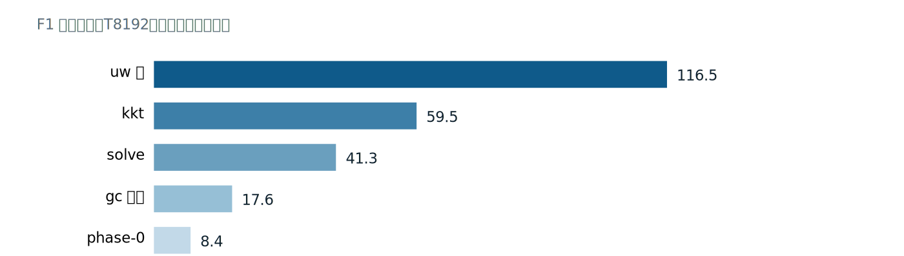

*图 5：F1 在 T8192 下的逐段成本（删除探针，µs）。uw 段占最大份额，分段合计含重叠收益，因此用于判断瓶颈顺序而非机械相加。*


进一步拆分 kkt，k-tile staging 搬运算法所需 33.55MB，表观 40.6µs，折合 826GB/s；同一共载窗口的 D2D 读写合计标定为 765GB/s[evidence/G5/fwd_report.md:2887-2917]。在当前几何下，这段流已贴近器件带宽屋顶，且字节数是算法最小流量。继续做 tile 微调之前，必须先回答还能减少哪些字节，或者能否改变计算结构。

### 8. F3 的负收益封住了“驻留越高越好”的直觉

F3KS 也把共享池从 82,176B 压到 47,360B，达到双 CTA，位级、确定性和重复运行检查均通过；性能却反向变化：T8192 的 F3 增加 96.1µs。将同一份 bk16 代码强制回单 CTA，增加量为 115.6µs，说明双 CTA 只挽回约 20µs，K-loop 改造本身付出了约 110µs。更多 barrier、wait 和 staging 发射随迭代数增加，覆盖了驻留收益[evidence/G5/fwd_report.md:2231-2258]。

F3 在 T8192 搬运约 120MB 的 h_all、v_new 与 o，属于带宽受限。增加驻留可以隐藏延迟，却不能减少这些字节，也不能免除新增循环管理指令。F1KS 的 −53.5µs 与 F3KS 的 +96.1µs 因此并不矛盾：前者给延迟空洞填入独立工作，后者在带宽路径上增加开销。

瓶颈驱动的方法到此处闭合。延迟受限时购买并行驻留，共享读侧冲突时修改几何，串行链上的窄读改为提前批量 staging，算法最小流量贴近屋顶时停止微调。负收益变体保留数值证据和默认关闭的开关，让下一次设计能从已测边界出发，而不必重新相信一条未经定价的直觉。

## 二十五、反向机器设计：重算、双向扫描与仿射携带

反向状态梯度的旧发射器把每个分块（chunk）的约八段 GEMM 级工作放在同一条逆时间链上：装配 P、Bhat、Qg、W，计算 dvp 的两项，更新 dH，再顺手累积 dk、dg 所需的部分和。后一块必须等前一块完成，增加线程块（CTA）也无法切开这段依赖。真正昂贵的是链上被迫串行的工作种类，GEMM 数量只是其可见表象。

内核代号先固定：终态链为 `wy → fwdscan → caryM → bpre → dhs → dkb → dqkwg → wyb`，依次负责 WY 重算、前向扫描、M/B 预计算、逆向携带、部分和重算与梯度组装；`dhu` 是早期串行链的名称。第 4 节给出每个内核的输入输出职责，读代码时可以先按这张图定位。

### 1. 从顺序更新提取携带算子

令 Xₙ 为到达 chunk n、尚未执行本块更新的 dH。旧顺序形式可写成：

```text
dvpₙ   = Pₙᵀ dOₙ + Bhatₙ Xₙ
Xₙ₋₁  = 2^gclₙ Xₙ + Qgₙᵀ dOₙ − Wₙᵀ dvpₙ
```

把第一式代入第二式，利用矩阵乘法的结合律与分配律，分别收集 Xₙ 和 dOₙ：

```text
Xₙ₋₁ = AₙXₙ + Bₙ
Aₙ = 2^gclₙ I − WₙᵀBhatₙ
Mₙ = Qgₙᵀ − WₙᵀPₙᵀ
Bₙ = MₙdOₙ
```

这里的 gcl 是 chunk 末行的 log2 域累积衰减。外部语义仍是 decay = e^g、g≤0；内部先将 g 乘 log2(e)，再用 exp2，因此算子中才出现 2^gcl。重结合保留了每个数学乘积，但浮点求值次序已经改变，代数等价仍需独立数值对照。

CPU 验证器特意保留一条经过 dvp 的真顺序路径，避免用同一个复合公式验证自身：

```python
for n in reversed(range(NC)):
    Xs[n] = X
    if W_list is None:
        X = A_list[n] @ X + M_list[n] @ dOs[n]
    else:
        gcl = gc[n][-1]
        Bhat = k[n] * np.exp2(gcl - gc[n])[:, None]
        Qg = q[n] * np.exp2(gc[n])[:, None]
        dvp = P_list[n].T @ dOs[n] + Bhat @ X
        X = (np.exp2(gcl) * X + Qg.T @ dOs[n] - W_list[n].T @ dvp)

# carry_walk 中的独立复合路径
B_list = [M @ dOs[n] for n, M in enumerate(M_list)]
X = dht.copy()
for n in reversed(range(NC)):
    Xs[n] = X
    X = A_list[n] @ X + B_list[n]
```

[tools/gdn_carry_validate.py:121-145，节选并省略公共初始化与返回语句]

读点时先追踪 `Xs[n] = X`：它固定了更新前（pre-update）数据合同。`W_list` 分支经过 dvp，`carry_walk` 只消费 A、M、B，两者拥有独立的乘加分组。这样才能把 4.9e-17（T512）和 8.3e-17（T2048）的 fp64 最大偏差解释为重结合的舍入差，在约 130 的 X 范数上相当于 2–3 ulp。fp32 回放预测底噪 1.2e-8，GPU 链内实测 2.2e-8，说明目标机结果也落在预判量级。[tools/gdn_carry_validate.py:111-145；evidence/G5/bwd_report.md:699-715,856-857]

### 2. 超收缩与 v 切片复用回答不同问题

基准门分布下，逐块算子的谱半径 ρ(Aₙ)≤2.3e-18，范数也不超过 2.2e-17。谱半径描述渐近放大能力，范数补充一步增长的界；两者合起来说明跨块耦合在这条数据分布上极弱，复合误差不会沿长链积累。Aₙ 只依赖 W、k、g，不含 v 或 dO，因此一个 K×K 算子只需复合一次，便可服务所有 v 列切片，预复合成本能随切片数摊薄。

这两条性质不能互换使用。仿射重结合对任意门分布在代数上成立，超收缩只属于测得的门分布；弱衰减时 A 可接近单位算子，近酉（unitary）压力例的范数曾达到约 8.8。当前默认分支利用强衰减进一步退役 caryA 和 A_all，dhs 随之退化为 B_all/dht 的移位携带；`GDN_ARET=0` 恢复完整 A 递推。把退役条件写成生成器开关，正是为了让分布假设保持可见。[tools/gdn_bwd_gen.py:382-402]

验证器还检查了 2、4、8、16 段的二级扫描：段内以零状态局部行走，段边界串行复合，再用后缀算子修正，fp64 偏差同为 2–3 ulp。[tools/gdn_carry_validate.py:148-190] 数学可行并未自动带来设备收益。段算子需要额外的 K×K 复合，边界修正增加内核与全局中间量，而强衰减已经削弱了长链耦合的收益空间。保留一级精确链、压缩每一步暴露延迟，因而不是保守选择；它由工作量和实测共同决定。

### 3. 预复合移出串行链，部分和改为独立重算

caryM 以 B·H·NC 个独立 CTA 计算 Mₙ。这里先给后文反复出现的 split-bf16 一个最小定义：把 x 拆成 `hi=bf16(x)` 与 `lo=bf16(x−hi)`，用 `hi·hi + hi·lo + lo·hi` 三条 bf16 mma 恢复更多尾数；hi/lo 的数学与误差账在第二十七章展开。当前实现先放 Qgᵀ，再用 split-bf16 三链减去 WᵀPᵀ，最后一个 k16 切片的收尾（epilogue）完成减法。以下片段位于 `for i0 in range(0, K, BK2)` 内，此时 mb 已含 Qgᵀ：

```python
# mb[a, c] = q[c, i0+a] 2^gc_c - sum_r W[r, i0+a] P[c, r]
def _cm_epi(mi, ni, ei, row, col, acc):
    x = mma_extract(e, acc, ei // 2, ei % 2, "cmx")
    cur = load2(e, mb, row, col)
    e.l(f"memref.store {op2(e, 'subf', cur, x)}, "
        f"{mb.name}[{row}, {col}] : {mb.ty}")

accs = None
for kb0 in range(0, C, 16):
    # 省略 W 与 P 的 hi/lo staging
    accs = mma_gemm(e, f"cmh{i0}_{kb0}", BK2, C, 16, 8,
                    whs.name, whs.ty, phs.name, phs.ty, accs=accs)
    accs = mma_gemm(e, f"cml{i0}_{kb0}", BK2, C, 16, 8,
                    whs.name, whs.ty, pls.name, pls.ty, accs=accs)
    accs = mma_gemm(e, f"cmm{i0}_{kb0}", BK2, C, 16, 8,
                    wls.name, wls.ty, phs.name, phs.ty, accs=accs,
                    epilogue=_cm_epi if kb0 == C - 16 else None)
```

[tools/gdn_bwd_gen.py:3390-3427，保留累加与 epilogue，省略初始化和切片暂存]

读这段代码要区分 `mb` 的初值、三链的部分积与最后一次减法。`accs` 跨 k16 切片保留同一数学累加，epilogue 只在末尾执行，避免每片重复减 Qgᵀ。由此可以判断 caryM 对 chunk 间状态没有读写依赖，适合按 M=B·H·NC 并行，也能确认 M 的生成与 v 切片无关。

bpre 再把 Mₙ 乘到 dOₙ 上。原始 dO 已是 bf16，只需拆 M 侧；两条 mma 对应 M_hi·dO 与 M_lo·dO，K 的平方根倒数尺度只在最后的 epilogue 执行一次：

```python
def epi_b(mi, ni, ei, row, col, acc):
    x = mma_extract(e, acc, ei // 2, ei % 2, "bex")
    xs = op2(e, "mulf", x, scale)
    # 省略全局列下标计算
    gstore(e, xs, G["B_all"], bty, [m, gcc], src_dt="f32")

for i0 in range(0, K, BK2):
    stage_split_ew(e, ahi, alo, G["M_all"], mty, m, C, i0 * C, BK2, C)
    accs = mma_gemm(e, f"bmh{i0}", BK2, V, C, 8, ahi.name, ahi.ty,
                    dotT.name, dotT.ty)
    accs = mma_gemm(e, f"bml{i0}", BK2, V, C, 8, alo.name, alo.ty,
                    dotT.name, dotT.ty, accs=accs, epilogue=epi_b)
```

[tools/gdn_bwd_gen.py:3510-3528，省略 epilogue 的地址展开]

这里读的是职责边界：bpre 消费 M_all、产出 B_all，不知道 Xₙ，也不保存跨 chunk 累加器。尺度只在 `epi_b` 出现一次，说明它位于缩并之后。于是 caryM 与 bpre 都能按块并行，dhs 的完整形式每步只剩 B 切片加 A@X 的一次 GEMM。

dkb 能独立，是因为 dh_all 保存的恰为 pre-update Xₙ。旧链在更新前消费该值形成 dkB、rowB、s5；新链先存轨迹，dkb 再按 chunk 重算这些纯函数，并在本地折叠 v 切片归约。dhu 的串行部分和因此消失，dqkwg 每格也只读一个已归约值。[tools/gdn_bwd_gen.py:3995-4016]

这里交换的是计算位置与存储流量。dh_all 必须先写后读，caryM、bpre 也要生成真实全局张量；收益来自这些访问脱离逆时间依赖，并可按块、按列并行。dkb 的一个 CTA 负责一个 chunk，v 方向归约仍在固定顺序中完成，因而并行化没有求助于无序原子加。审查这类改写时，应同时核对输入是否确为 pre-update、归约顺序是否写入合同，以及新增全局读写是否仍小于临界路径上的延迟收益。

### 4. 八内核终态与退役边界

当前发布链的数据流和职责如下，箭头表示全局中间量的生产与消费顺序：

| 顺序 | 内核 | 主要职责 |
|---|---|---|
| 1 | wy | 重算 WY、P 等块内因子，供双向扫描与六梯度使用 |
| 2 | fwdscan | 顺向重算 h_all 与 v_new，提供块入口前向状态 |
| 3 | caryM | 逐块生成 M_all |
| 4 | bpre | 逐块生成 B_all |
| 5 | dhs | 逆向保存 pre-update dh_all，并产生 dh0 |
| 6 | dkb | 独立重算 dkB、rowB、s5，折叠 v 切片 |
| 7 | dqkwg | 组装 dq、dk_local、dW_all、dvp_all 等中间梯度 |
| 8 | wyb | 完成 dA 双侧掩蔽收缩，写出 dk、dβ、dg、dv |

caryA 的退役直接体现在发射清单，而非表格外的一条备注：

```python
kernels = [s.strip() for s in args.kernels.split(",") if s.strip()]
if ARET and "caryA" in kernels:
    kernels.remove("caryA")
```

[tools/gdn_bwd_gen.py:9081-9084；ARET 默认值见 402 行，省略日志打印]

读这段逻辑可确认，默认配置即使收到含 caryA 的候选列表，也会在生成前将其删除；没有消费者的 A_all 不再落盘。历史报告中的九内核链包含 caryA，可用于核对仿射改写和后续分阶段测量的来源，不能用来描述当前发射数。dhs 的 A 窗口、dkb 的 split-bf16 等优化也应按所测构建理解，而非无条件叠加到退役分支。

历史含 caryA 的九 kernel 构建在 T2048 的归档汇总中，扫描复杂体由 3.13 ms 降到 2.01 ms（1.56×），dkb 单件由 0.96 ms 降至 0.25 ms。数字背后的核心收益是把操作数装配和部分和移出逆时间临界路径；并行预复合仍要付真实 GEMM 与全局流量成本，不能按删除指令数估算收益，也不能用这个历史合计直接替代当前八 kernel 的扫描族时间。

2.01 ms 只覆盖扫描复杂体的阶段账，3.13/2.01 不能直接当成端到端加速比。扫描复杂体只是端到端的一部分，其余时间仍在 wy、fwdscan、dqkwg、wyb。dhs 保留 NC 步逆向依赖，说明优化后的机器仍有明确串行地板；继续增加预复合并行度不会缩短这段地板。性能判断因此需要逐阶段求和与端到端交错计时相互印证，还要记录 caryA 是否在场，避免把不同清单的阶段项机械相加。

### 5. 算法知识落在生成器中

这次改写由 Python 发射函数、A_all/M_all/B_all/dh_all 的全局合同和 CPU fp64 验证器共同实现。仓库没有能识别任意 MLIR 递推、证明其仿射结构并自动重排的通用 pass，也没有把 pre-update 协议推导成通用分析。生成器承载的是这个算子的算法级规格；MLIR 负责表达发射后的循环、存储与 GPU 操作。可迁移的是推导和验证方法，套用到其他算子仍需重新建立携带方程、消费时点和数值门。

## 二十六、数据通路与存储几何：流水、Bank 与驻留的联合核算

一个 tile 从全局内存到张量核，要依次回答四个问题：哪些线程发出哪些字节，数据何时对其他线程束（warp）可见，共享内存地址落在哪些存储体（bank），以及这块生命周期会抬高多少驻留成本。四项账目相互制约。搬得更快可能增大缓冲，缓冲压缩可能改变行距，寄存器上限又可能把驻留收益兑换成溢出。

### 1. 线程跨步暂存与完成协议

暂存（staging）的基本单元是 16B，对应 8 个 bf16 或 4 个 f32。生成器采用线程跨步（thread-strided）认领：tid 决定首个块，后续块每次跨过 nthr 个位置，异步令牌（token）留在调用方作用域，等待点由流水结构决定。

```python
el = 8 if dt == "bf16" else 4
nch = Cc // el
tot = R * nch
assert tot % nthr == 0, f"astage: {tot} chunks % {nthr} threads"
for kk in range(tot // nthr):
    p = tid if kk == 0 else _tadd(e, tid, kk * nthr)
    # 省略 r、cc 与全局/共享列下标计算
    t = e.v("acp")
    e.l(f"{t} = nvgpu.device_async_copy {src}[{m}, {gcol2}], "
        f"{dst.name}[{r}, {dcol}], {el} bypassL1 : {gty} to {dst.ty}")
    toks.append(t)

# astage_sync 的组队与排空
g = agroup(e, toks)
await_all(e, g)
e.l("gpu.barrier")
```

[tools/gdn_bwd_gen.py:1687-1714,1735-1740，省略地址展开]

读这段代码先看 `p`，再看 `tot // nthr`，最后看 wait 后的屏障。设 `nch = Cc // el`，线性块编号为 `p = tid + kk*nthr`，则 `r = p // nch` 是行，`cc = p % nch` 是块内列；源全局列为 `r*cm + cc*el + col0`，目的共享列为 `cc*el + dst_col0`。例如 `nthr=128、tid=1` 时，kk=0、1、2 分别认领 p=1、129、257；只要 `tot % nthr == 0`，这些跨步序列恰好覆盖全部块且不重复。`p` 同时决定写集覆盖和全局合并访问；nthr 若与启动线程数不符，会有 16B 块无人认领。块统一（block-uniform）反例更能说明下标的分量：若 256 个线程都遍历全部 tot 个块，同一数据会被发射 256 次；若保留 tot/nthr 次循环却让所有线程使用同一个 p，则只有 1/256 的块被覆盖，每块又重复 256 次。前者浪费带宽，后者还会让陈旧数据进入计算。

`nvgpu.device_async_wait` 只排空调用线程所等待的异步组，其他 warp 的读者需要 `gpu.barrier` 建立 CTA 级先后关系。生成器绕开会在组队后立即排空的默认 transform，是为了把等待移到计算之后；省掉这道显式屏障则会破坏可见性合同。[tools/gdn_bwd_gen.py:1662-1680]

### 2. 乒乓缓冲把等待藏进有效工作

双缓冲按奇偶区分当前阅读窗口与下次写入窗口。完整仿射递推分支（`GDN_ARET=0`）的 dhs 将 K×K 的 A 拆成 K×32 滚动窗口，避免一次驻留 64KB；计算窗口 w 时，窗口 w+1 已在途中：

```python
for w in range(NW):
    if w + 1 < NW:
        toks = []
        astage_tile(e, G["A_all"], aty, "%m", K, (w + 1) * BKW,
                    AW[(w + 1) % 2], 0, K, BKW, gdt("A_all"), toks)
        gw = agroup(e, toks)
    rgemm_aw(e, Xa, AW[w % 2], w * BKW, X, K, BV, BKW,
             acc_buf=(Xb if (w == 0 and Xb is not None) else Xa))
    e.l("gpu.barrier")
    if w + 1 < NW:
        await_all(e, gw)
        e.l("gpu.barrier")
```

[tools/gdn_bwd_gen.py:3891-3906]

读点在两道屏障的不同职责。`rgemm_aw` 后的屏障封住当前窗口的共享读，允许它在两次迭代后重写；wait 后的屏障发布下一窗口的异步落盘。`AW[w % 2]` 与 `AW[(w+1) % 2]` 保证两事件落在不同半区，kk 递增的 FMA 次序保持不变。真实对照中 dh_all 与 dh0 逐位相同，dhs 从 0.59 ms 降至 0.32 ms。[evidence/G5/bwd_report.md:1801-1825]

当前默认的 caryA 退役分支不再需要 A 窗口，改用 Xb 的两个列半区携带 B_all/dht；流水原则仍然成立，池与内核清单却属于另一种构建。[tools/gdn_bwd_gen.py:3671-3689,3717-3752] 这也说明乒乓只是缓冲复用协议，预取距离、读者结束点和寄存器压力必须一起核算。

### 3. LDGSTS 到 LDSM 之间的数据完整性规则

这套 sm_120a 工具链出现过一种静默失效：cp.async（SASS 的 LDGSTS）落盘的 tile 经普通标量共享读完全正确，经 ldmatrix（LDSM）读回却出现构建相关的错行。数值差可大到 dk 1.34、dv 2.18，容差门能够报警，却不能修复数据通路。生成器规定，LDSM 操作数必须由标量共享写产生；异步落盘区域在首个 LDSM 读者前执行一次恒等重写：

```python
e.l(f"scf.for %lu = %tid to {e.ic(R * Cc)} step %nt {{")
e.depth += 1
i, j = e.v("lui"), e.v("luj")
e.l(f"{i} = arith.divsi %lu, {e.ic(Cc)} : index")
e.l(f"{j} = arith.remsi %lu, {e.ic(Cc)} : index")
v = e.v("luv")
e.l(f"{v} = memref.load {buf.name}[{i}, {j}] : {buf.ty}")
e.l(f"memref.store {v}, {buf.name}[{i}, {j}] : {buf.ty}")
e.depth -= 1
e.l("}")
e.l("gpu.barrier")
```

[tools/gdn_bwd_gen.py:1751-1761]

`launder_pass` 读什么就原样写回什么，因此值位级不变；它改变的是共享写路径。末尾屏障让全部恒等写先于 LDSM。由此可以判断，在本文记录的工具链与复现条件下，异步 tile 只能直接喂普通 `ld.shared`，需要 LDSM 时必须经过这类重写或改用逐元素 staging。这是当前工具链下的保守规避，不是通用 MLIR 或 PTX 的禁令；版本变化后应先用最小复现重新判定。

### 4. Bank 几何要分别核算读侧与写侧

共享内存有 32 个 bank，每个宽 4B；地址相差 128B 整数倍的两个字落入同一 bank。ldmatrix 一次读取 8 行、每行 16B。若行距是 128B 的倍数，8 个行起点反复命中同一组 4 个 bank，形成 8 路冲突。给 bf16 tile 增加 8 列，即把行距增加 16B，行起点每次移动 4 个 bank，8 行可扫过 32 个 bank，同时保持 16B 对齐。dkb 的 `vh/vl/hh/hl` 因而都声明为 `BV+8` 列，垫列从不进入 MMA 写集。[tools/gdn_bwd_gen.py:4147-4160] 前向 F2 的同类修复将 473 µs 降至 249 µs。

写侧的 WST 把相邻两个 bf16 配对为一次 32 位读写，指令与循环迭代减半。直接套到 32 列、80B 行距的 F2 tile 却反慢 4.3 µs：每行只有 16 对，平铺映射让一个 warp 跨两行，lane 28–31 与 lane 0–3 撞 bank。W32P 保留配对字节，只改 lane 到行的双射：

```python
if (os.environ.get("GDN_W32P") and cols == 32 and rows % 8 == 0
        and nthr == 128):
    hi16 = e.v("w3h")
    e.l(f"{hi16} = arith.cmpi uge, %lane, {e.c(16)} : index")
    hi4 = e.v("w3h4")
    e.l(f"{hi4} = arith.select {hi16}, {e.c(4)}, {e.c(0)} : index")
    hcol = addi(e, "%warp", hi4)
    c0 = muli(e, remsi(e, "%lane", e.c(16)), e.c(2))

    def body3(i):
        k = divsi(e, i, e.c(nthr))
        row = addi(e, muli(e, k, e.c(8)), hcol)
        rr = addi(e, row_base, row) if row_base is not None else row
        # 省略同地址的 v0/v1 配对读写
```

[tools/gdn_full_gen.py:1036-1059，省略配对内存操作]

读这段下标可还原 `row = 8*(i>>7) + warp + 4*(lane>=16)`，列基为 `2*(lane%16)`。低半 warp 访问行 r 的 16 对，高半访问行 r+4；80B 等于 20 个字，而行号差 4 带来 80 个字的位移，80 mod 32 = 16，两半区恰好覆盖互补的 16-bank 集合。该映射在七个场景减少 17.9–22.6 µs，且每行、每对仍只写一次。[tools/gdn_full_gen.py:986-1002]

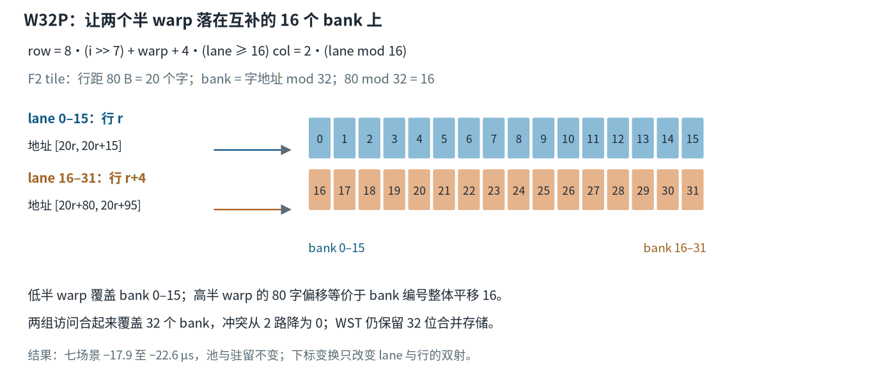

*图 6：W32P 的 lane→行映射。80 B 行距等于 20 个字，80 mod 32 = 16，使两个半 warp 落到互补的 16-bank 集合；WST 的 32 位合并存储得以保留。*


### 5. 生存期别名压缩静态池

生存期（lifetime）结束后的 tile 可以把字节交给后续 tile。memref 的 SSA 值唯一并不禁止底层内存别名；本项目选择在 PTX 后处理阶段按生成器声明的布局合址，并用尺寸唯一性识别 malloc，识别失配便整体回退到无别名布局。一个简洁的前向布局表是：

```python
alias_modules["gdn_fwd_f1_kernel"] = {
    "identify": {"9216": "Abf", "9504": "Tt",
                 "8704": "vt", "8976": "k2"},
    "arenas": {"Abf": 9216, "Tt": 9504},
    "alias": {"vt": ["Abf", 0], "k2": ["Tt", 0]},
}
```

[tools/gdn_full_gen.py:4430-4435]

读表时先核对 identify 的尺寸能否唯一锚定，再检查 vt、k2 的首次写入是否晚于基 tile 的最后读取。arenas 给出保留字节，alias 给出折叠位置；它能让静态申报反映同时活跃的数据，而非所有 tile 的生命周期拼接。屏障必须封住跨界读写，异步落盘还要遵守上一节的消费规则。

三个反向资源池的归档压缩结果如下；caryA 一项属于其退役前的历史构建：

| 内核 | 压缩前 | 压缩后 | 主要手段 |
|---|---|---|---|
| dqkwg | 100,864B | 47,616B | 双竞技场别名与 epilogue 停车 |
| caryA | 82,176B | 28,592B | split 改写并退役四个共存 tile |
| wyb | 100,096B | 45,056B | 双竞技场别名与暂存退役 |

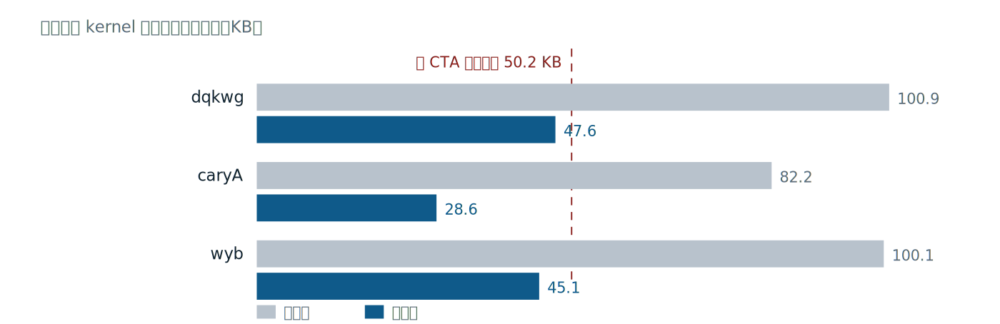

*图 7：生存期别名压缩三个反向 kernel 的静态共享内存池。caryA 对应其退役前的历史构建；每个数字都应与最终后处理后的资源报告一起阅读。*


三者在各自测量构建中达到每 SM 两个 CTA。dqkwg 的每 SM warp 数由 7.59 升至 14.53；逐入口 `.maxnreg` 固定 128 后，另一次实测占用由 15.02% 升至 29.17%，warp 数由 8.00 升至 14.23。读取这些数字要同时检查最终 smem_fix 后那遍 ptxas 报告，第一遍资源数可能对应尚未发布的 cubin。[evidence/G5/bwd_report.md:2508-2601]

`.maxnreg` 是 PTX 入口上的静态寄存器上限，ptxas 据此安排驻留；`gdn.setmaxnreg` 则在 kernel 内做 warp 间再分配，warp 专化时生产者降到 96、消费者升到 224。前者影响 CTA 能否驻留，后者影响已驻留 warp 的可用寄存器与溢出，二者不能互相替代。

寄存器账可以直接手算：256 线程、每线程 128 寄存器时，两个 CTA 需要 2×256×128 = 65,536 个寄存器，恰好达到寄存器文件上限。若最终调度实际需要 168 个，驻留便跌回一个 CTA；强行压低上限又可能引入本地内存溢出。静态池、寄存器、spill 字节和实测活跃 warp 必须一起阅读，任何单项都不足以宣布驻留优化成功。
驻留也不是普遍收益。F3 在 T8192 约流动 120MB，属于带宽受限；双 CTA 版本实测反慢 96.1 µs。分解账显示，同代码强制单 CTA 慢 115.6 µs，其中 K 循环重排约付出 110 µs，驻留只买回约 20 µs。[evidence/G5/fwd_report.md:2231-2258]

通用 MLIR 能检查类型、地址和部分资源约束，却没有这份 GDN 调度中的 tile 消费指令、lane 映射、异步 token 距离和门控分支知识。理论上可另写带目标 bank 模型与活性分析的专用 pass；现有通用管线无法仅凭 IR 自动推出这些几何事实。生成器把它们与发射决策放在同处，再用 ptxas、SASS、数值门和实测画像复核，才使每次地址改写同时满足正确性与资源预算。

## 二十七、精度也是调度约束：Split-BF16 的三链与代数折扣

反向 GEMM 常消费 fp32 中间量，而大数相消会把读取侧的舍入放大到输出。精度选择因此会改变 tile 数、共享内存池、MMA 数量和寄存器生存期（live range）。Split-BF16 用一个 hi/lo 分量对保留更多尾数，再以三条 bf16 张量核乘法和 fp32 累加器恢复足够细的乘积分辨率；它带来的调度成本必须与数值收益一起核算。

### 1. 指数域相同，尾数分段

bf16、tf32、fp32 都有 8 位指数；显式尾数分别为 7、10、23 位，计入隐含位后的有效精度分别为 8、11、24 位。直接转 bf16 损失的是有效数字，动态范围并没有因指数位减少而同比缩小。

对正规范围内的 fp32 数 x 定义：

```text
hi = bf16(x)
lo = bf16(x − float32(hi))
```

hi 提供首段约 8 位有效数字，lo 接着表示残差。两个分量的有效位段合计仍能放进 fp32 的 24 位精度，所以 hi+lo 这次 fp32 加法自身可以精确完成；hi+lo 与原值 x 之间仍保留第二次 bf16 截断的误差。这个区分决定了后续误差账不能写成“完全恢复原值”。

以绝对值位于 [1,2) 的数为例，单路 bf16 的相邻间隔是 2^-7，hi 的最大舍入距离约为 2^-8。残差进入更小的指数区间后再由 lo 量化，有效尾数得以延伸约 8 位，距离 fp32 的 24 位仍有差距。反向中间量还常由若干 O(10) 的项相消为 O(0.1)，直接 bf16 暂存曾在相关位点造成 4.6e-2–6.9e-2 的绝对误差。分量对的价值正是在这种相消前保留细粒度，而非扩大指数范围。
两个分量数相乘时展开为：

```text
(ah + al)(bh + bl)
= ah·bh + ah·bl + al·bh + al·bl
```

前三项各走一条 bf16 MMA，累加器保持 fp32。al·bl 是被三链舍弃的二阶小项；单值 split 的表示残差可到约 2^-17，而三链省略项和分量舍入通常按约 2^-16 的乘积误差类估计。dkb 的端到端 dk 从 tf32 的 1.04e-2 降至 1.73e-3，约 6 倍；2^-11 与 2^-16 的量级差只是误差类比较，不能直接当成最终输出倍率。两个理论量级也不能当成所有输出的固定比值，最终输出仍须经过端到端容差门。这里不能把某个被省略项孤立成全部误差来源，三链之后的每一次累加仍在 fp32 网格上舍入。

### 2. 两遍拆分把共享数据依赖写清楚

`_split_bf16` 第一遍生成 hi 并写入共享内存，第二遍重读原值和 hi，再生成 lo。两道 `gpu.barrier` 分别隔开 hi 写读与 hi/lo 的后续消费：

```python
e.l(f"scf.for %sh = %tid to {e.ic(R * Cc)} step %nt {{")
# 省略 i、j 的线程跨步下标
v = load2(e, src, i, j)
if cvec is not None:
    v = op2(e, "mulf", v, ldsc(e, cvec, j))
e.l(f"%sht = arith.truncf {v} : f32 to bf16")
e.l(f"memref.store %sht, {hi.name}[{i}, {j}] : {hi.ty}")
e.depth -= 1
e.l("}")
e.l("gpu.barrier")
e.l(f"scf.for %sl = %tid to {e.ic(R * Cc)} step %nt {{")
# 省略同一组 i、j 下标
v = load2(e, src, i, j)
if cvec is not None:
    v = op2(e, "mulf", v, ldsc(e, cvec, j))
h = load2(e, hi, i, j)
r = op2(e, "subf", v, h)
e.l(f"%slt = arith.truncf {r} : f32 to bf16")
e.l(f"memref.store %slt, {lo.name}[{i}, {j}] : {lo.ty}")
e.depth -= 1
e.l("}")
e.l("gpu.barrier")
```

[tools/gdn_bwd_gen.py:1398-1425，省略循环深度调整和重复下标展开]

读这段发射器要跟踪三个值：f32 的 v、bf16 的 hi、由 v−hi 得到的 lo。`truncf` 出现两次，第二次的输入已是残差，所以 lo 不会简单重复 hi。第一道屏障把共享 hi 的生产与消费分开，第二道屏障让完整分量对先于 MMA 的跨 warp 读取。即使两遍当前采用相同线程映射，显式屏障也把可见性合同固定在 IR 中，避免后续调度改变映射后引入隐蔽竞态。

可选 cvec 在拆分前执行一次 f32 缩放，适用于任意尺度；此时恒等式作用对象是“缩放后再舍入”的 v，两条分量共享同一次缩放误差。拆分本身还需要一对带 16B 垫行的 bf16 tile，资源消耗已经进入了第二十六章的 bank 与驻留账。

### 3. 三链调用必须落到三组真实操作数

dkb 对 vnew 与 dh 各生成一对 hi/lo，再把三条 GEMM 串入同一逻辑累加器。可选 VTF 分支为不同 v 切片准备两组累加器；默认顺序仍保持 hh、hl、lh：

```python
_split_bf16(e, vh, vl, vngb, C, BV)
_split_bf16(e, hh, hl, cur, K, BV)
if VTF:
    tgt = maccs1 if (vt % 2 == 1) else maccs0
maccs = mma_gemm(e, f"dkBhh{vt}", C, K, BV, 8, vh.name, vh.ty,
                 hh.name, hh.ty, accs=tgt if VTF else maccs)
maccs = mma_gemm(e, f"dkBhl{vt}", C, K, BV, 8, vh.name, vh.ty,
                 hl.name, hl.ty, accs=maccs)
maccs = mma_gemm(e, f"dkBlh{vt}", C, K, BV, 8, vl.name, vl.ty,
                 hh.name, hh.ty, accs=maccs)
```

[tools/gdn_bwd_gen.py:4246-4258]

读调用顺序即可还原代数：hh 使用 vh·hh，hl 使用 vh·hl，lh 使用 vl·hh，没有第四条 ll。`accs=maccs` 让后一条链接收前一条的 fp32 累加结果。VTF 的 tgt 只改变 v 切片求和的结合方式，不改变每个切片内部的三项分解；它会引入另一种浮点求值次序，必须单独过数值与确定性验证。

真实 PTX 能把这种对应关系核对到寄存器组：

```ptx
mma.sync.aligned.m16n8k16.row.col.f32.bf16.bf16.f32
    {%r336, %r337, %r338, %r339}, {%r280, %r281, %r282, %r283},
    {%r332, %r333}, {%r300, %r301, %r302, %r303};
mma.sync.aligned.m16n8k16.row.col.f32.bf16.bf16.f32
    {%r340, %r341, %r342, %r343}, {%r280, %r281, %r282, %r283},
    {%r334, %r335}, {%r304, %r305, %r306, %r307};
mma.sync.aligned.m16n8k16.row.col.f32.bf16.bf16.f32
    {%r344, %r345, %r346, %r347}, {%r284, %r285, %r286, %r287},
    {%r332, %r333}, {%r308, %r309, %r310, %r311};
```

[evidence/G5/scratch/r21b_ks2_T8192/dkb/kernel.ptx:336-350]

A 片段 {%r280–283} 为 v_hi，{%r284–287} 为 v_lo；B 片段 {%r332,333} 与 {%r334,335} 分别为 h_hi、h_lo。三条因此恰为 hi·hi、hi·lo、lo·hi。C 操作数组承接上一 k 段对应链的 D，说明 fp32 累加跨缩并段延续；本段 D 使用新寄存器号属于目标码寄存器分配，追踪依赖时不能只比较寄存器名字。

dkb 的实测把数值与性能同时落地：内核由 0.96 ms 降至 0.25 ms，dk 最大误差为 1.73e-3，与标量 fp32 路径的 1.731e-3 几乎重合；同一位点的 tf32 曾达到 1.04e-2，越过 8e-3 门限。这说明三链的乘积误差控制在该输出上足够，但不能外推为所有位点都足够。

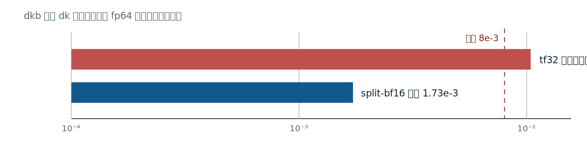

*图 8：dkb 位点的 dk 输出误差（对 fp64 参考，对数刻度）。split-bf16 保留更多尾数并以三条 mma 链接，三链的乘积误差类约为 2^-16；tf32 在该位点超出容差。*


### 4. 两条代数性质各删去一条链

若尺度只依赖输出行 i、与缩并下标 kk 无关，就有 `Σ s_i·a_i,kk·b_kk,j = s_i·Σ a_i,kk·b_kk,j`。dvp_bh 的 k 原本已是 bf16，行尺度可移到 epilogue，只需拆 dh 侧：

```python
gr = ldsc(e, gc, row)
d = op2(e, "subf", gcl, gr)
xs = op2(e, "mulf", x, exp2f(e, d))

accm = mma_gemm(e, f"dvbh{vs}_{ks}", C, BV, BK, 4,
                a_src, a_ty, bhi.name, bhi.ty)
accm = mma_gemm(e, f"dvbl{vs}_{ks}", C, BV, BK, 4,
                a_src, a_ty, blo.name, blo.ty,
                accs=accm, epilogue=epi_bh)
```

[tools/gdn_bwd_gen.py:7768-7770,7784-7788，省略 epi_bh 的累加写回]

读点是 a_src 指向原始 bf16 k，bhi/blo 只来自 dh，尺度在两条链结束后才乘。三链由此降为两条，少一对 A 侧 split tile，也少一次分量乘积。尺度移出缩并会改变一次 f32 舍入的位置，所以“代数可移”仍需输出误差验证；原始 k 无需再次量化则是该项优化的精确性基础。

第二条恒等式针对 2 的幂尺度。在不发生上溢、下溢或次正规损失的范围内，乘 2^d 只平移指数，不改变有效数字的舍入格点：

```text
split(v·2^d) = split(v)·2^d
```

`stage_split_T` 在转置暂存时把该尺度折进 hi 与 lo：

```python
v = gload(e, src_g, gty, [m, _gcol_int(e, i, j, cm, col0)])
if cvec is not None:
    x = ldsc(e, cvec, s)
    v = op2(e, "mulf", v, x)
if vec is not None:
    x = ldsc(e, vec, j)
    v = op2(e, "mulf", v, x)
e.l(f"%spuh = arith.truncf {v} : f32 to bf16")
e.l(f"memref.store %spuh, {hi.name}[{j}, {s}] : {hi.ty}")
hw = e.v("spuw")
e.l(f"{hw} = arith.extf %spuh : bf16 to f32")
r = op2(e, "subf", v, hw)
e.l(f"%spul = arith.truncf {r} : f32 to bf16")
e.l(f"memref.store %spul, {lo.name}[{j}, {s}] : {lo.ty}")
```

[tools/gdn_bwd_gen.py:956-969；恒等式合同见 939-949 行]

这段 fused helper 在寄存器中保留 hi 的 widened 值，一次扫描便能算 lo；它与前述两遍共享源 helper 的形状不同，读代码时不应机械套用同一实现。历史 caryA 利用 2 的幂恒等式把 Bhat 行尺度折进 A 侧 split，B 侧退化为原始 bf16 k 转置，四个共存 tile 随之退役。归档结果为 5.00× 提速、共享池 82,176B→28,592B、寄存器 255→76。[evidence/G5/bwd_report.md:1827-1853] caryA 已在当前默认门控分支退役，这些数字用于解释代数折扣的收益来源，不属于八内核终态的现行资源表。

### 5. 数值、性能、流量要分别结账

**数值账**看最终输出与参考的距离。乘积残差只是预算入口，后续相消、前缀和与携带链会放大或吸收它。tf32 在 dkb 的超门结果说明 10 位尾数没有普遍适用性；其他位点若输入原本就是 bf16，tf32 反而增加无收益的量化。Split-BF16 也应逐链验证，尤其在改变 v 切片结合顺序或移动尺度时。

**性能账**包括三条 MMA、两次分量暂存、屏障和累加器生存期。它的对照对象是标量 fp32 的每乘加多条指令，以及特定位点可用的 tf32；三链的乘积吞吐必须按三次发射核算，不能由单条 bf16 MMA 的峰值直接推算。行尺度与 2 的幂折叠删除一条链，值更大的收益常来自同步减少 tile、寄存器和驻留压力。

**流量账**没有随尾数补偿下降。一个 fp32 值变成两个 bf16，合计仍为 4B；写入和读取都要搬运 hi、lo 两路，共享内存还要容纳两份 tile 与垫列。Split-BF16 改善乘积精度并启用张量核，不节省存储字节，也不能缓解由中间量流量决定的带宽下界。把三本账并列后，精度选择便显出其调度含义：每一次数值改写都要重新核对 MMA 数、池、寄存器、屏障和输出裕度。

## 二十八、验证塔与容差合同：从 FileCheck 到跨进程逐位一致

一段 IR 通过解析、一个 kernel 数值达标、一次计时更快，分别只排除了部分故障。验证需要把结构、资源、数值、写集、时序和性能拆成不同判据，并记录每把尺子的盲区。容差回答误差是否越界，逐位一致回答相同执行是否产生相同字节，交错终判回答性能差能否与测量窗口区分；三者不能互相代签。

### 1. 四层验证各查一种可归因性

结构测试与数值测试从入口就分开：L0 冒烟只固定 op、config 和调用边界，具体的 FileCheck/lit 写法已在第三章给出；它们不能证明六梯度数值或共享内存时序。四层验证的组织如下：

| 层 | 被测对象 | 主要尺子 | 核心结论 |
|---|---|---|---|
| L1 语义 | CPU memref 级 L1 | JAX fp64、fla naive、MLIR L1 三方交叉 | 数学定义与执行规约闭合 |
| L2 静态 | 20 个旋钮配置及最终 PTX/SASS | FileCheck 类结构断言、ptxas 资源、SASS 指令 | 配置、指令与资源申报可审计 |
| L3 阶段 | 逐配置 GPU kernel | 逐位相同的输入、算法同构的 fp64 twin | 20/20 在种子 0 与 7 下分别通过 |
| L4 全链 | 完整算子、写集、重复运行与计时 | 六梯度、结构不变量、逐位一致、交错终判 | kernel 间合同与发布结论闭合 |

L1 的三方距离落在各自量程地板：MLIR L1 对 JAX 前向约 6e-7，反向六梯度最差 6.4e-6；JAX 前向对 fla naive recurrent/chunk 的 fp32 相对误差分别为 1.2e-7 和 2.3e-6。JAX 自身还用顺序、chunk 与 VJP 对照约束规约。三条独立边同时很小，比单一“与参考一致”更能排除参考和实现共同写错的可能。

L2 必须读最终发布 cubin 对应的 ptxas 报告，因为后处理后的第二次编译可能改变寄存器与 spill。SASS 能确认 mma、LDSM、LDGSTS 等指令确已落地，仍不能由指令存在推出操作数映射正确。L3 的 20/20 双种子则把数据置换纳入验证，降低只对一组嵌入输入调参的风险。[evidence/G4/GATE_REPORT.md:8-17,49-56]

### 2. fp64 twin、写集与量化台阶互相定位

阶段参考遵守两条纪律。第一，GPU 与 numpy twin 接收同一份已量化输入字节，输入侧差不混入结果；第二，twin 采用相同 chunk、缩放次序和算法形态，以 fp64 重算，测到的差主要归因于 kernel 内部舍入与实现缺陷。若换成另一种算法参考，算法重结合差和机器误差会混在一起，定位能力随之下降。

结构不变量进一步检查“该写的格子是否都写了”。kkt 的 64×64 严格下三角连同对角应有 2080 个单元，一次 mma 路径只覆盖 1168 个：

```text
frag_epilogue stored the accumulator's even elements at column
ncol + %g -- the lane's B-fragment N index -- instead of the
accumulator/D-fragment N index 2*threadID_in_group.
Result: two lanes wrote conflicting values to the same columns while
other columns were never written (kkt: 1168/2080 cells covered;
o: 2304/4096).
After the fix every mma config writes all 2080 kkt tril cells / all
o cells and matches the fp64 twin at 9.77e-4.
```

[evidence/G4/GATE_REPORT.md:62-75，原文节选]

读这份记录应先数写集，再看 fragment 布局。B fragment 的 lane 列索引被误用于 D fragment，导致两条 lane 写同列、其他列缺失。数值容差也会失败，2080 的精确计数却把故障定位到 epilogue 列映射；FileCheck 即使成功匹配 `mma.sync`，也看不见这个写集漏洞。

修复后的 9.77e-4 还有一项量化对账：9.765625e-4 等于 2^-10。对处于 [0.25,0.5) 区间的 bf16 数，相邻量化点间隔为 2^-9，四舍五入的最大半格误差正是 2^-10。精确模拟 f32 累加与 bf16 输出舍入得到 9.765625e-4，GPU 实测的小数记录 9.77e-4 与其一致。[evidence/G4/GATE_REPORT.md:72-75] 这把最大残差归因到输出量化台阶；它并不单独证明所有中间操作无误，所以仍需 fp64 twin、完整写集和双种子共同裁决。

### 3. 容差合同以基线距离标定，以本方裕度放行

端到端合同按输出张量分档，使用最大绝对误差：

| 输出 | 放行门限 |
|---|---|
| o、ht | 5e-3 |
| dq、dk、dv、dh0 | 8e-3 |
| dβ、dg | 2e-2 |

门限参照 fla 自身对 JAX fp64 的距离。dβ、dg 若沿用 8e-3，会比基线若干标定残差还紧，失去“同级准确”的含义；2e-2 与这些输出的基线距离处于同一量级。合同约束本方产物，并不保证每个 fla 标定点都自动落入该门限。

容差文件保留了每个形状的误差、参考幅值与 bf16 输出地板。大形状 dg 的一条记录是：

```json
"dg": {
  "fla_dtype": "torch.float32",
  "max_abs_err": 0.02581325795185463,
  "ref_max_abs": 3.7026142737449854,
  "rel_err": 0.0069716303247937235,
  "bf16_out_floor": 0.005954688964605381
}
```

[evidence/G5/refs/tolerances.json:218-223]

读点时比较 max_abs_err 与 bf16_out_floor，而非只看 rel_err。对当前 JSON 的 24 个输出记录，直接用 `max_abs_err / bf16_out_floor` 逐项计算，得到 0.612–4.335 倍，中位数 2.072 倍（本文据 `evidence/G5/refs/tolerances.json` 复算）。残差总体处于输出量化尺度附近；最小项低于 1，说明 `bf16_out_floor` 是尺度估计而非逐元素严格下界。这里统计的是 fla 对 fp64 参考的误差与估计输出地板之比，不能把其他报告的筛选或四舍五入口径混作同一组数字。

本方还要报告门限除以实测最大误差的裕度。当前 R3/R4 八 kernel 的六形状记录中，最紧的一项为 dk 的 1.588 倍：

| 输出 | 对应最大误差 | 最紧裕度 |
|---|---:|---:|
| o | 6.486e-4 | 约 7.7 倍 |
| ht | 7.493e-4 | 约 6.7 倍 |
| dq | 7.5585e-4 | 约 10.58 倍 |
| dk | 5.0362e-3 | 约 1.588 倍 |
| dv | 5.6902e-4 | 约 14.06 倍 |
| dβ | 5.1743e-3 | 约 3.865 倍 |
| dg | 3.5887e-3 | 约 5.573 倍 |
| dh0 | 2.2018e-4 | 约 36.33 倍 |

[evidence/G5/scratch/r3_logs/verify_*.json，六形状当前记录；前向数字沿用正式验证记录]

dk 是最紧的反向输出，改动其操作数精度、累加顺序或携带输入时应提高审查优先级。dv、dh0 的大裕度也不能兑换成随意舍入，因为误差可能经其他梯度间接传播。裕度是特定形状与输入分布下的观测，不是对未来配置的证明。

### 4. 跨进程逐位与交错终判封住另外两类漏洞

低 ulp 竞态可以稳定地躲在宽容差内。终判协议固定同一 cubin、输入与发射几何，在全新 CUDA 上下文和模块加载下跨进程重复 5 次，要求各阶段输出逐位一致。验证史记录了五个真实竞态，均在数值容差内，多数只有 1–3 ulp；bpre 的单 kernel 新鲜模块实验曾在 1000 次中出现 14 次双稳态，修复后为 0。wyb 的另一处竞态在同进程十次循环中未复现，说明进程内重复不足以覆盖模块轮换打开的时序窗口。[evidence/G5/bwd_report.md:1516-1586]

补屏障约付出 0.3% 的 T2048 端到端代价，T512 上处于窗口噪声内。[evidence/G5/bwd_report.md:1675-1685] 这笔性能成本换来对陈旧共享读、重 staging 与 fragment 时序的可见性。逐位一致仍只证明已测执行没有漂移，不能替代不同输入下的数值验证。

性能终判采用同一进程、同一窗口、逐位相同输入的本方与基线交错成对计时。逐对比值的中位数与中位数之比是两个估计量，报告时必须分别命名。符号检验直接用胜负对数计算精确二项尾概率：

```python
def sign_test_p(ratios, ref=1.0):
    wins = sum(1 for r in ratios if r > ref)
    losses = sum(1 for r in ratios if r < ref)
    n = wins + losses
    if n == 0:
        return None
    k = min(wins, losses)
    p_lt = sum(math.comb(n, i) for i in range(k + 1)) / 2.0 ** n
    return round(min(1.0, 2.0 * p_lt), 6)
```

[tools/gdn_final_adjudicate.py:80-94，省略函数 docstring]

读实现可见，平局的比值被丢弃，n 只计胜负对，k 取较少一侧，再计算双侧精确尾概率。正式协议使用 30 对并辅以效应量相对四分位距的可判性规则；记录字段 p 经四舍五入到六位小数后为 0，通常意味着未舍入 p < 5e-7，不表示数学概率为零。交错设计让共载和时钟漂移尽量同时作用于一对样本，绝对毫秒数仍需与窗口信息一起阅读。

### 5. 故障矩阵规定测试的取舍

| 故障 | 能发现的测试 | 不能发现或难以定界的测试 |
|---|---|---|
| D fragment 列映射错误 | 非零写集计数、fp64 twin | 只匹配 mma 文本的 FileCheck、资源报告 |
| 1–3 ulp 重 staging 竞态 | 跨进程逐位一致、针对性竞态隔离 | 常规数值容差、单次编译检查 |
| 生存期别名发生读写重叠 | 全阶段逐位对照、完整输出与 sanitizer | arena JSON 存在性检查、ptxas 编译成功 |
| 寄存器或 spill 导致驻留回退 | 最终 ptxas、SASS、占用画像 | 数值 oracle、纯 IR 结构断言 |
| 仿射重结合或缩放次序错误 | 真顺序 fp64 对照、六梯度端到端门 | FileCheck、指令族覆盖、占用测量 |
| 共载或时钟造成性能假象 | 同窗交错配对与可判性规则 | 分离进程绝对时延、数值正确性测试 |

FileCheck 与数值裁决器（oracle）的分工由此清晰：前者固定产物中应当出现或消失的结构，后者检查执行结果与数学参考的距离。资源报告补充机器预算，写集检查补充覆盖，逐位协议补充运行时序，交错计时补充性能证据。只有各层结论指向同一个可复现 cubin，验证塔才把“代码看似正确”收敛为可归档的发布依据。

## 二十九、覆盖如何成为证据：PTX 收割、T1/T2 与扩展预算

“能表达手写内核”只有落到可数的机器产物上，才可以检验。这里的收割（harvest）是把参考实现编译成 PTX、SASS 与资源日志，再从文本提取指令族和结构特征。T1 检查指令与精确签名，T2 检查调度结构；数值验证仍由第二十八章的矩阵承担，性能则由第三十章另行裁决。

### 1. 把参考实现变成离线文本

fla 的 Triton 内核使用提前编译（Ahead-of-Time，AOT）接口。目标三元组明确写成 CUDA、计算能力 120、warp 宽度 32，避免宿主机自动探测改变产物。

```python
def compile_one(k, sig: dict, cexpr: dict, warps: int, stages: int):
    import triton
    from triton.compiler import ASTSource
    from triton.backends.compiler import GPUTarget
    src = ASTSource(fn=k, signature=sig, constexprs=cexpr)
    tgt = GPUTarget("cuda", 120, 32)
    return triton.compile(
        src, target=tgt,
        options={"num_warps": warps, "num_stages": stages})
```
[tools/harvest_flaptx.py:257-263，函数换行排版，语句保持原意]

读这段代码要看 `target` 与两个调度选项：`num_warps`、`num_stages` 会改变指令和资源，因而属于收割坐标的一部分。锁定目标后，编译、PTX 保存和 `ptxas -v` 都可在 CPU 上完成；这能判断产物对应哪个架构，却不能代替该架构上的数值运行。

FlashQLA 走另一条确定性路径：驱动固定 `TILELANG_DEFAULT_TARGET` 为 `sm_120a`，由 TileLang 导出 kernel 源，再经 NVCC 生成 PTX/cubin；`nvdisasm -c kernel.cubin` 负责反汇编。[scripts/harvest_qla.sh:38-42；tools/harvest_qlaptx.py:117-133,155-166] 两条路径都无需执行 GPU kernel。纯 CPU 的含义是采集可离线复算，并不表示目标架构、编译器版本和补丁可以省略；这些信息必须与 PTX 一同归档。

收割的最小单位是“kernel 名加完整配置”，不能只有函数名。相同 Triton 函数在不同 warps、stages 或 tile 下会产生不同指令清单；FlashQLA 的工具链补丁也会改变可生成的目标。每个目录因此同时保存 PTX、cubin、SASS 与日志，汇总表只充当索引。复查者应能从汇总行回到对应文本，无需再次凭函数名编译一个可能不同的配置。

资源日志也有独立用途。收割器从 `ptxas -v` 提取寄存器、静态共享内存、溢出读写和栈帧，这些字段构成后面的包络与 T2 判分材料。[tools/harvest_flaptx.py:246-253] PTX 适合核对虚拟指令签名，SASS 适合观察后端实际映射；两者分层保存，可以避免把 PTX 静态条数误当成最终机器指令的动态执行次数。

### 2. 两个参考极点

两家实现提供了差异足够大的资源与调度包络。包络是一组观测范围，描述参考实现实际占据了哪些设计点。

| 维度 | fla 包络 | FlashQLA 包络 |
|---|---|---|
| 每线程寄存器 | 40–255，常见顶格与溢出 | 88–128，由 setmaxnreg 约束 |
| 最大读或写溢出 | 0–5348 B | 0–1752 B |
| 异步装载 | 多级 ld.global；状态 kernel 使用 cp.async | TMA、mbarrier、elect.sync 领导者 |
| warp 专化 | 无 | 五个 kernel 中四个使用 |
| 循环形态 | 多数展开，bra 为 0–16 | 真循环，bra 为 107–611 |
[evidence/G2/coverage_matrix.md:54-63；evidence/G0/fla_ptx/SUMMARY.md:1-24；evidence/G0/qla_ptx/SUMMARY.md:1-7]

读表要同时看指令和资源。255 寄存器配溢出、无专化、展开循环勾勒出 fla 一极；固定寄存器、TMA 协议和真循环勾勒出 FlashQLA 另一极。由此可以把“覆盖两家”拆成具体结构问题：能否生成多级流水，能否形成领导者—屏障协议，能否承受相应的寄存器与溢出状态。表中没有耗时，所以不能从中推出任何一方的速度。

### 3. T1：指令族、变体与精确签名

T1 把同义拼写归并为指令族，再用三态记录生成集：YES 表示某配置已经发射且参考变体齐备，PARTIAL 表示族已出现但缺参考中的个别变体，NO 表示生成集中未出现。33 族的账目为 8 YES、19 PARTIAL、6 NO；feature 层 15 族按 G6 表逐行重算为 7 YES、6 PARTIAL、2 NO。[README.md:302-311]

PARTIAL 要读到变体粒度。例如 `ldmatrix` 缺少 x1 与部分 x4 转置形态，`cp.async.ctrl` 缺 `wait_all`，`mbarrier` 差显式 CTA 作用域拼写。它们说明“族名相同”仍可能掩盖操作数、向量宽度或旗标差异，也给出可逐项复查的残差清单。feature 层的两个 NO 要分开读：`stmatrix` 在 NVVM 已有词汇，但本方 epilogue 的片段映射存储方案实测从 249µs 增至 380µs，时间变为 1.526×、约增加 53%，因此按测量关闭；`barrier` 的 NO 是命名归并结果，`gpu.barrier` 已覆盖所需屏障语义。它们都不构成能力缺口。这里的 NO 保存了有证据的设计选择。[evidence/G6/coverage_hatch_summary.md:96-103]

三态计数没有“覆盖率百分比”的含义。19 个 PARTIAL 各自缺的内容不同，6 个 NO 也要区分测量否决、命名归并与当前 kernel 不需要的融合或打包。一个严谨单元格至少应能回答四个问题：参考中出现了什么，本方哪个配置出现过什么，残差精确到哪条拼写，关闭它的依据是什么。缺少任何一项，YES 也可能只是粗粒度同名。

结论还受生成集范围约束。这里的 YES 是 G2 的 20 个配置与 G5-G/当前生产生成物联合形成的存在性证明，并不声称任意配置、任意形状都会走同一路径。新增参考指令时，应先扩充收割合同，再判断需要新增旋钮、调整下降，还是确认当前算子没有这项需求。

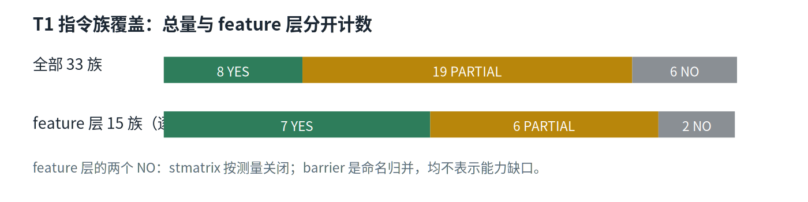

*图 9：T1 指令族覆盖。feature 层按 G6 表逐行重算为 7 YES / 6 PARTIAL / 2 NO；stmatrix 按测量关闭，barrier 的 NO 是命名归并。*


指令族仍不足以描述张量核，必须继续比较包含形状、输入精度和累加类型的完整签名。

| mma 签名 | 本方 | fla | FlashQLA |
|---|---|---|---|
| bf16 m16n8k16，f32 累加 | 552 条，YES | 2708 条 | 2496 条 |
| tf32 m16n8k8，f32 累加 | YES | 576 条 | 0 条 |
[evidence/G6/coverage_hatch_summary.md:36-41]

读表时，条数描述被清点文本的规模，YES 描述精确签名是否出现，两者不能混成覆盖率。bf16 行证明三家共享主力签名；tf32 行证明本方能发出 fla 的 K=8 拼写，同时 FlashQLA 收割物没有这一签名。精确匹配比“都用了 mma”更能约束实现能力。

静态签名计数也不能直接换算计算量。循环体会重复执行，不同 kernel 的网格和 tile 又不同，552 对 2708 并不代表工作量之比。签名 YES 只把问题推进到操作数布局与数值：寄存器顺序错误时，文本仍可能完全正确，所以 tf32 扩展还保留 early-clobber 约束和整型硬件探针作为配套证据。[evidence/G6/coverage_hatch_summary.md:79-87]

### 4. T2：结构最近邻与规模边界

T2 选四张结构卡：fla 的 `chunk_fwd_kernel_o`、`bwd_kernel_dhu`，以及 FlashQLA 的 `fused_fwd`、`fused_bwd`。每张卡从本方 20 个配置中，按指令族 Jaccard 相似度、mma 签名匹配和指令总数接近度寻找最近邻；寄存器、共享内存、溢出另用正负 30% 包络判分。[README.md:313-317；evidence/G2/coverage_matrix.md:69-113]

这里的 30% 是预先声明的结构匹配容差，不能解释为统计置信区间。Jaccard 相似度看指令族集合，无法表达依赖顺序；mma 签名与异步协议、循环、资源卡补足了这部分信息。最近邻只负责找一张便于人工比较的配置，OUT 必须保留，否则匹配过程会把最有诊断价值的差异隐藏掉。四张卡覆盖两个设计极点，也不代表所有可能的手写实现都已纳入合同。

最近邻用于读结构，不用于排名。fla 极点所需的 255 寄存器、0/2/3 级流水和 cp.async，FlashQLA 极点所需的 setmaxnreg、TMA、mbarrier、elect.sync 与真循环，都能在旋钮空间生成；后一类配置还经过硬件数值验证。结构要素逐项可达，并不保证某个最近邻落入全部资源包络。

```text
### qla:fused_bwd/default
- mma.sync total **1600** (est. per loop body ~200 over 8 back-edge loop(s); bra=422)
- resources: regs=128, smem=2048B, spill st/ld=1098/1752B
- ours closest config: **kkt_bf16_mma_tma_ws**
  - regs 255 vs ref 128 -> OUT (1.99x); smem 8 vs 2048 -> OUT (0.00x) (±30%)
  - mma total 32 vs ref 1600 (0.02x); family Jaccard basis for 'closest' selection
```
[evidence/G2/coverage_matrix.md:104-113，省略签名、异步与其他资源计数行]

这段卡先读 1600 的来源：约 200 条循环体指令经八个回边复用，文本计数描述融合规模。再读两个 OUT 所揭示的边界：最近配置的寄存器超出包络，单 chunk kernel 与全融合反向 kernel 的 mma 规模相差约 50 倍。T2 能确认 TMA、屏障、专化和循环等要素存在，不能据此声称阶段拆分与单 kernel 融合拥有相同资源或性能。

### 5. 扩展预算限制证明成本

覆盖还应交代为此扩展了多少编译器词汇。项目自设的审计预算允许至多 5 个自定义 NVVM op，当前实现实际使用 `gdn.mma.tf32k8` 一个 inline-asm 扩展：它源于 G2 记录中的 NVVM 词表缺口与当时的 K=4 产物。当前上游 NVVM 和 NVGPU→NVVM 已能表达 TF32 m16n8k8，因此这笔支出不能被解释为 MLIR 的永久表达力边界；是否迁移到上游路径，仍需重新验证类型、布局、数值和性能。setmaxnreg、elect、mbarrier、TMA、prefetch 等其余计划词汇已能经当前主干表列下降。[evidence/G6/coverage_hatch_summary.md:79-94；../llvm-mlir/mlir/include/mlir/Dialect/LLVMIR/NVVMOps.td:2860-2862]

预算使表达力主张带有价格：若无限制添加私有指令，覆盖可以通过扩张词汇获得；只支出一个扩展，说明大部分结构仍由通用 IR 与下降路径承担。T1/T2 到此证明的是指令表达力与参考风格可达。性能等价还涉及依赖链、占用、流量和测量窗口，必须由独立计时证据回答。

## 三十、性能如何裁决：交错测量、双窗口与完整结果

同一组 cubin 在空载机器上也可能给出不可直接比较的绝对时延。一次复测中，fla 的 B4T2048 前向在相隔数分钟的两个进程里分别为 0.9240 ms 与 1.3617 ms，差异 47%；进程间空闲降频与步内持续时钟留下了明显不同的状态。[evidence/G5/GATE_REPORT_FULL_REMEASURE.md:130-139] 另一项受控实验只翻转模块构建顺序，访存最重 kernel 的偏差便从 +14.8 µs 变成 −16.8 µs，对应约 6% 的 160 MB 工作集开销。[evidence/G5/fwd_report.md:2015-2027]

### 1. 交错终判控制什么

交错终判（interleaved adjudication）把双方放进同一进程、同一测量窗口，用同一配方生成的逐位相同输入，逐对执行本方与 fla。正式前向记录每形状 30 对；每对先记本方 CUDA 事件时间，再记 fla 事件时间，并保存两侧原始数组与窗口前后的 `nvidia-smi` 快照。预热已经吸收 cubin 装载和 fla 自动调优，测到的稳态时间不应混入首次搜索。[tools/gdn_final_adjudicate.py:183-196,232-270]

“逐位相同”指张量内容一致，不声称双方共用同一设备地址。本方经运行时 staging 获得输入，fla 使用自己的设备张量；审计时应核对生成配方、种子和 dtype，而不能把指针相同当成协议要求。实现中的每对顺序固定为本方后 fla，“交错”描述双方样本交替取得，并不包含 AB/BA 换序。发射顺序或模块构建顺序的效应需要单独的翻转实验，不能由这个名称推定已经消除。

配对削弱了发生在两对之间的共同漂移，中位数抑制单侧离群点。它仍有两类残余：共载突发若落在某一对的单个成员内，会直接污染该对；固定模块装载顺序还可能留下单向布局偏差。因而原始对、四分位距、装载顺序探针和独立窗口都要保留。绝对毫秒数可用于工程排布，跨进程相除不能承担性能结论。

### 2. 两个加速比与拒绝表态的字段

第 i 对比值记为 r_i = fla_i / ours_i，大于 1 表示本方较快。`speedup_ratio_of_medians` 是先各取一侧中位数再相除，回答两个典型绝对时间的比例；`speedup_median_of_ratios` 是先逐对相除再取中位数，回答典型配对的相对效应。两侧尾部不对称时，两者会分离，所以正式表同时列出，不能选用较好看的一项代替另一项。

显著性使用精确双侧符号检验：只计每对相对 1 的胜负，剔除平局，用二项分布精确尾和计算 p。30 对全部同号时，未舍入的双侧 p 约为 1.9e-9；样本很少时，检验力的下限也随之变差。离散度与可判性由同一段代码落盘。

```python
med = statistics.median(ratios)
if len(ratios) >= 2:
    q1, _, q3 = statistics.quantiles(
        ratios, n=4, method="inclusive")
else:
    q1 = q3 = ratios[0]
iqr = q3 - q1
iqr_rel = (iqr / med) if med else float("inf")
effect = med - 1.0
decidable = bool(effect > 0 and (iqr_rel == 0 or
                                 effect > 3.0 * iqr_rel))
return {
    "n_pairs": len(ratios),
    "median_ratio": round(med, 4),
    "iqr": round(iqr, 4),
    "iqr_over_median": round(iqr_rel, 4),
    "sign_test_p_vs_1": sign_test_p(ratios),
    "decidable": decidable,
}
```
[tools/gdn_final_adjudicate.py:97-126，省略 min/max 与规则字符串字段]

读代码先看 IQR 来自逐对比值，再看 `decidable` 要求正效应超过相对 IQR 的三倍。它为“当前窗口能否支持优胜判断”提供保守门槛；false 表示按此规则暂缓，不等于证明双方相等。p 字段经六位小数舍入后为 0，通常意味着未舍入 p < 5e-7，不能解释为概率绝对为零。[tools/gdn_final_adjudicate.py:80-94]

符号检验与效应估计也承担不同职责。p 很小只说明在符号检验原假设下，当前胜负符号较少见；它不衡量快了多少，也不保证另一个进程或窗口仍有相同中心。IQR 描述样本中间一半的散布，也不能解释为置信区间；三倍规则是预先声明的工程判据，用来阻止在湍流窗口过度解读。把点估计、p、IQR 和 `decidable` 一起读，才能区分“效应很大”“符号很稳定”和“窗口足以裁决”这三件事。

### 3. 前向双窗口全表

共载（co-load）窗口保留其他计算任务造成的环境压力，空闲窗口尽量排除这类任务。下表的毫秒数、两个加速比、n、IQR、p 和 `decidable` 均取自原始字段；n 为成对样本数。

| 形状 | 窗口 | 本方 ms | fla ms | 中位数之比 | 逐对比值中位数 | n | IQR | p 字段 | decidable |
|---|---|---:|---:|---:|---:|---:|---:|---:|---|
| B1T2048H16 | 共载 | 0.186560 | 0.396448 | 2.1250 | 2.1174 | 30 | 0.8891 | 0.0 | false |
| B4T2048H16 | 共载 | 0.821312 | 1.002944 | 1.2211 | 1.2029 | 30 | 0.3288 | 0.000325 | false |
| B1T8192H16 | 共载 | 0.785056 | 1.059296 | 1.3493 | 1.3307 | 30 | 0.2363 | 0.0 | false |
| B1T2048H16 | 空闲 | 0.212624 | 0.342448 | 1.6106 | 1.6140 | 30 | 0.1640 | 0.0 | true |
| B4T2048H16 | 空闲 | 1.206880 | 1.287680 | 1.0669 | 1.0719 | 30 | 0.0531 | 0.0 | false |
| B1T8192H16 | 空闲 | 0.969008 | 0.960480 | 0.9912 | 0.9857 | 30 | 0.0408 | 0.042774 | false |
[evidence/G5/final_adjudicate_r25f_w32p.json:94-121,198-225,302-329；evidence/G5/final_adjudicate_clean3.json:94-121,198-225,302-329]

读表必须按行组合字段。共载三形状的两个点估计都大于 1，但 `decidable` 全为 false，较大的 IQR 提醒读者窗口湍流仍与效应同量级，不能写成无条件的决定性胜利。空闲窗口只有 B1T2048 同时满足效应与离散度门槛；B4T2048 点估计大于 1 而未过门槛，B1T8192 两个估计都接近 1，应保留为持平附近的未决结果。两类窗口回答的环境问题不同，任一类都不能吞并另一类。

六个数也不应再平均成一个“前向加速比”。共载可能放大双方对内存压力和时钟状态的不同敏感性，空闲复测则可能缩小这种差距；平均会抹去形状与环境两个决定性条件。可复用的结论是逐行、逐窗口的条件判断，原始数组则为以后更换统计方法保留复核余地。

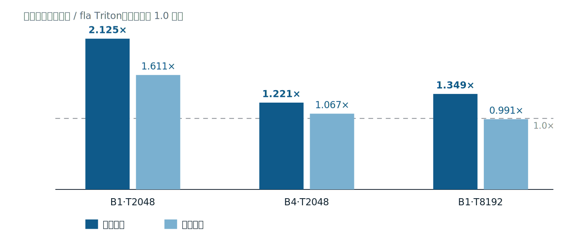

*图 10：前向对 fla Triton 的加速比。共载与空闲窗口分别为每形状 30 对交错计时；绝对时间与两种加速比估计量见第 30 章。*


### 4. 反向六负载点与仿射结构

形状负载定义为 u = B·H·(T/64)/512，即总 chunk 数除以 512。早期阶梯报告记录九 kernel 历史链；当前生成器的终态链已删除 caryA，保留 wy、fwdscan、caryM、bpre、dhs、dkb、dqkwg、wyb 八个 kernel。两种代际并列，避免把历史拟合误读成当前复测；表中当前加速比均为 fla 时间除以本方时间。

| 形状 | u | 历史本方 ms | 历史 fla ms | 当前本方 ms | 当前加速比 |
|---|---|---:|---:|---:|---:|
| B1T512H4 | 0.0625 | 0.5573 | 1.2107 | 0.4588 | 1.723 |
| B1T2048H16 | 1 | 2.1917 | 1.3319 | 1.7883 | 0.488 |
| B1T2048H32 | 2 | 4.1539 | 1.6316 | 3.2644 | 0.415 |
| B4T2048H16 | 4 | 7.9710 | 3.0757 | 6.2444 | 0.411 |
| B1T8192H16 | 4 | 8.1377 | 3.2277 | 6.2010 | 0.453 |
| B1T16384H16 | 8 | 16.1609 | 6.4045 | 12.1521 | 0.462 |
[evidence/G5/rc1_ladder_report.md:30-52；evidence/G5/r4_fusion_report.md:185-203；README.md:398-413]

历史六点在 u≥1 上的最小二乘拟合为：本方 0.138 + 1.996u ms，fla 0.298 + 0.746u ms；残差分别不超过 0.16 ms 与 0.29 ms。低截距解释小形状的固定成本优势，较高斜率解释负载增加后的落后，两个 u=4 测点也说明 B 与 T 方向可以共用负载坐标。当前八 kernel 链已改变系数，其相邻大形状边际估计为 1.488 ms/u，不能与上述历史截距拼成新直线。[evidence/G5/r3_report.md:126-160]

仿射式在这里只描述已测负载结构，不应随意外推。u<1 只有一个历史点，不能据此精确声明交点；u≥16 还受显存预算与测量信息价值约束。拟合的用途是分离固定开销和边际成本、指导下一次核算，新的 kernel 代际或新的数据流出现后必须重新估计。

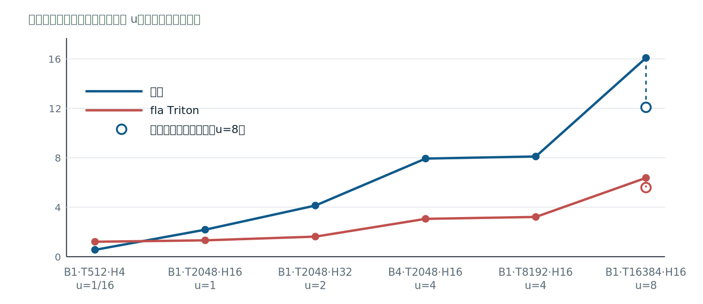

*图 11：反向端到端时间随形状负载 u 变化。实线为历史共载窗口的阶梯测量，空心点为终态在另一窗口的复测；历史九 kernel 与当前八 kernel 链分开阅读。*


当前比值完整呈现小形状 1.723×与大形状 0.411–0.488×。u=8 时本方 12.1521 ms、fla 5.6247 ms；这个差距只描述当前执行结果，可利用的执行余量要由第三十一章的理想时间下界另行判定。

### 5. 冷启动属于部署成本

本方交付 AOT cubin，部署路径不含运行时 autotune。RC1 曾按当时九 kernel、每个约 3 µs 估算约 27 µs 的发射固定项；这不是覆盖进程创建、CUDA 上下文、模块装载和主机 staging 的完整冷启动实测，也不是当前八 kernel 的实测值。[evidence/G5/rc1_scaling_predictions.md:35-42；tools/gdn_bwd_gen.py:9081-9084]

fla 在全新缓存下，每形状前向首搜为 18.7–30.8 s，反向为 29.3–38.3 s，合计约 48–69 s；磁盘缓存命中后仍有 0.65–5.67 s 记录。[evidence/G5/rc1_ladder_report.md:137-146；evidence/G5/CAMPAIGN_CLOSEOUT.md:22-27]

这些数字衡量部署路径：AOT 把生成、调度和汇编移到部署前，fla 的首搜则在新形状首次调用时支付。它们可以支持“本方无需运行时搜索”的结论，不能把 27 µs 与 48–69 s 组成完整冷启动加速比。公平报告还应分别保存构建耗时、缓存状态、首次调用口径，以及 Triton 编译缓存冷、热的区别。

### 6. FlashQLA 提供第三个参照

FlashQLA 的 sm_120 前向提供更高的速度参照，但当前没有与本方同窗口、同输入的交错终判。归档测量还使用了 export 垫片和 `block_DV=64`：默认 `block_DV=128` 的前向 kernel 请求 112,640B 动态共享内存，超过 101,376B 上限；垫片后的前向才得到下列中位数。把 FlashQLA 的中位数与本方共载窗中位数作描述性比较，只能作为不同窗口的工程参考：

| 形状 | FlashQLA ms | 本方 ms | 本方 / FlashQLA（描述性） |
|---|---:|---:|---:|
| B1T2048H16 | 0.139040 | 0.186560 | 1.342 |
| B4T2048H16 | 0.354848 | 0.821312 | 2.315 |
| B1T8192H16 | 0.404224 | 0.785056 | 1.942 |

[evidence/G5/flashqla_fwd.json:18-47；本方见 final_adjudicate_r25f_w32p.json；不同窗口不得解释为正式加速比]

因此不给统一的倍速范围。更准确的结论是：FlashQLA 标出了当前前向仍可追求的速度空间，而双方需要补一次同窗口、同配方、同统计协议的比较，才能形成正式相对性能判断。

反向需要更谨慎的发布状态说明。当前工具链下，公开调用先遇到 export 缺失，默认 kernel 还请求 112,640 B 动态共享内存，超过 101,376 B 上限。加入运行时垫片并把前向 block_DV 调为 64 后，B1T2048 反向测得 1.4348 ms，同窗 fla 为 1.349 ms，二者大致相当；该记录是单窗口点测，没有交错终判，也缺少梯度的 JAX 交叉检查。[evidence/G5/baseline_report.md:186-217]

三方关系因此各有约束：fla 提供完整前反向基线，FlashQLA 提供前向高速度参照及独立反向点测，本方提供同一编译管线的前反向产物与 AOT 部署。每项结论都应留在自己的测量口径内。

## 三十一、大形状反向的边界：误差预算、流量下界与融合定价

当前八 kernel 反向链的六点阶梯中，u≥1 的五个大形状点实测加速比为 0.41–0.49×；同一字节集合在理想执行下的估计只有 0.85–0.92×。两个数字回答不同问题：前者包含发射、同步、驻留和带宽利用不足，后者假设标定带宽被完全利用，用来约束执行改进最多能走到哪里。[evidence/G5/CAMPAIGN_CLOSEOUT.md:22-37,51-78]

### 1. 实测差距中还有执行余量

理想执行（ideal execution）在这里指按当前必须搬运的字节与标定带宽计算屋顶线时间下界，再加固定端到端项。它不计全部发射和同步成本，因此给出的是时间下界，并据此换算加速比上界；它不是实际延迟预测。

u=8 时，当前实测为 12.1521 ms，fla 为 5.6247 ms，比值 0.4629；当前字节集合的理想时间约为 6.1–6.6 ms。按当前流量模型，实测与理想估计相差约 1.8–2.0×，这是待兑现的执行改进空间，不是保证可全部回收的收益。把这部分余量全部兑现，速度也只进入 0.85–0.92×区间，距离 1.1×仍很远。实测差距同时含有执行质量与字节合同两项，不能全部归给其中一项。[evidence/G5/r3_report.md:157-177；evidence/G5/r4_fusion_report.md:191-203]

### 2. 误差预算决定哪些字节可以缩小

第一项独立检查逐符号评估中间量能否从 fp32 降为 bf16 存储。fp64 孪生模型保持生产递推状态为 fp32，只在全局写边界截断、在读边界扩展，并分别测量单个符号与符号集合给梯度带来的误差增量。16 个 M-row 候选中，10 个通过、6 类保留 fp32；被否决的五个大符号合计 470 KiB/M-row，另有一组流量很小的携带量也保留 fp32。评分输出 dq、dk、dv 同样锁定 fp32。[evidence/G5/r2_bf16_globals_report.md:26-65]

| 候选符号 | dk 误差增量 | dβ 误差增量 | 判定 |
|---|---:|---:|---|
| u_all | 4.6e-2 | 4.3e-5 | 否决 |
| vnew_all | 4.6e-2 | 未绑定 | 否决 |
| dvp_all | 1.2e-3 | 4.8e-2 | 否决 |
| dkB_sum | 6.1e-2 | 未绑定 | 否决 |
| dk_local | 6.2e-2 | 未绑定 | 否决 |
[evidence/G5/r2_bf16_globals_report.md:37-58]

读表要寻找真正绑定合同的输出轴。dvp_all 的 dk 增量很小，却被 dβ 的 4.8e-2 否决；其余大符号主要受 dk 约束。由此能判断，统一降低整条链的精度会掩盖各符号不同的误差传播，逐符号探针才可以给出可执行的存储类型清单。10 个通过项是许可集合，默认实现采用其中 9 个，并未把“可降”机械等同于“应降”。

否决的机制是大数相消。部分 dk 局部项的量级为 O(10)，相减结果只有 O(0.1)。bf16 与 fp32 都有 8 位指数，差别在尾数；对 O(10) 项作 bf16 舍入后，绝对误差落到已经相消的小结果上，相对误差随之放大。第二十七章的 split-bf16 用 hi+lo 保留更多尾数，三链的乘积误差类约为 2^-16（单值 split 的表示残差可约 2^-17），但两条 bf16 仍占 4 B/元素，无法减少这些边的存储流量，也不能改变这条链中相消发生的位置。

单符号通过仍不足以批准整组改写。容差扫描记录了 dkB_sum 与 dk_local 的误差在集合中同向叠加：B4 上两者分别约为 6.2e-2 与 6.9e-2，组合后的 dk 增量达到 1.15e-1。原因仍是它们进入同一组相消求和。验证因此需要“单符号留半门限、集合作线性保守投影、关键组合实测”三层记录；把每个符号独立合格直接推成整链合格，会漏掉误差相关性。[evidence/G5/tolerance_sensitivity.md:83-99]

### 3. 流量下界给执行改进封顶

第二项检查只问：保留当前数据类型和读写边，最少需要搬多少字节。定价模型从全链约 1.70 MiB/M-row 的边清单出发，扣除已允许的类型收缩与死边删除后，流量下界约为 0.75 ms/u。带宽、固定项和 fla 同窗时间共同决定下表；容差核算的精确代表值为 6.14 ms 与 0.916×。[evidence/G5/tolerance_sensitivity.md:101-119]

| 账目 | 本方时间 | 相对 fla 的比值 |
|---|---:|---:|
| u 为 8 的当前实测 | 12.1521 ms | 0.4629 |
| u 为 8 的理想执行范围 | 6.1–6.6 ms | 0.85–0.92× |
| u 为 8 时达到 1.1×所需时间 | 不超过 5.11 ms | 1.1× |
[evidence/G5/r3_report.md:162-177；evidence/G5/scratch/r4_price.py:84-110]

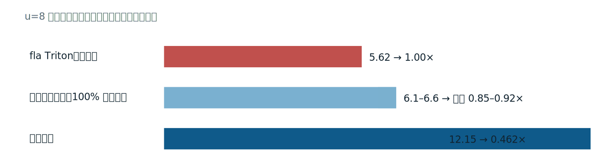

*图 12：u=8 的流量下界算术。理想执行仍需 6.1–6.6 ms，对 fla 5.62 ms 的上限为 0.85–0.92×；实测 12.15 ms 另含执行余量。*


读表应先比较 5.11 ms 与 6.1–6.6 ms：目标时间已经低于当前字节集合的理想下界，执行调优无法独自弥合这段距离。再比较 12.1521 ms 与下界，确认执行余量仍需工程改进。即使假想删除 dqkwg、wyb、dhs 三个大 kernel，上界也只有约 0.88×；它们负责评分梯度，删除不能成为实现方案，这个计算只用于检验融合想象是否隐含了过强的字节假设。

下界依赖明确条件。边的重复读取次数来自当前生成器，带宽来自本机标定，固定项和 fla 分母来自对应窗口；更换数据流、设备或测量窗口都要重算。它提供的是一组可审计假设下的排除性结论。把 0.75 ms/u 移到另一个实现前，应先证明两者搬运相同的边并具有相同的重复次数。

### 4. 融合定价同时计算收益与驻留代价

第三项检查评估 dqkwg 与 wyb 融合，希望删掉共享中间量的全局读写。G 累加要求完整操作数，dvp 又在链尾再次被读取，因此相关驻留区跨越融合体的大部分生命期，不能靠简单阶段交错复用。定价器枚举四组可删除边的 16 个子集，并同时计算共享内存池与可省流量。

```python
for m in range(16):
    s = [n for i, n in enumerate(names) if m >> i & 1]
    park = sum(PARK[n] for n in s)
    pool = max(POOL_DQKWG + park, POOL_WYB + park)
    kill = sum(TOT[n] for n in s)
    subsets.append((s, pool, kill))

best = max((x for x in subsets if x[1] <= BAR_STATIC and x[0]),
           key=lambda x: x[2])
perfect = max(subsets, key=lambda x: x[2])
```
[evidence/G5/scratch/r4_price.py:56-80，省略打印与两 CTA 判定]

读代码要看 `pool` 与 `kill` 总是一起生成：删除更多全局边，需要更多跨阶段驻留。`best` 只从静态共享内存上限内的子集选择，因而能判断“节省流量”是否还有可构建的载体；这段算术在写融合 kernel 前就能排除不可行集合。

完美融合需要 129,792 B，超过构建上限；最佳可构建集合的池为 97,024 B，只能覆盖完美集合约 82% 的目标流量，并把驻留从两个 CTA/SM 降为一个。实测单 CTA 代价在 T2048 为 1.155×，在 T8192 为 1.2597×，收益会被占用反转侵蚀。u=8 的最好、中间、最差净收益分别为 +0.620、−0.107、−0.834 ms，正号表示省时；最好角还假设全部流量按 DRAM 计价且 wyb 不付单 CTA 代价。即使允许不可构建的完美融合，比值上限也只有约 0.544×。[evidence/G5/r4_fusion_report.md:88-110,112-167]

最好到最差的三个数属于假设角点，不能当作置信区间。dqkwg 的单 CTA 因子有实测，wyb 的相应因子则留在上下界中，这种不对称必须随结果披露。融合定价的价值在于把不可构建、可构建但驻留变差、以及理想但不可实现的收益分开；其否定范围也限于这两个 kernel、当前边集合与这些实测参数。

### 5. 容差扫描检验合同本身

第四项检查放宽 dk 容差，同时保持 dβ、dg、dv 合同不变。单符号门限取合同的一半，为集合内其他误差预留空间。五档 dk 合同（8e-3、1e-2、1.2e-2、1.5e-2、2e-2）及相应单符号门限的扫描结果相同：没有符号解锁、没有新增可减字节，流量下界保持 0.750 ms/u，u=8 的加速比上界保持 0.916。

从 8e-3 放宽到 2e-2 没有任何符号返回，流量与上界完全不动。首个集合级解锁需要 dk 放宽约 8.2×；完整五符号类需要 dk 约 15×与 dβ 约 2.4×同时放宽，B4 的 dg 还需略过 2.0e-2。全部解锁后，u=8 理想上界只有 1.08–1.15×，而且仍要兑现约 2×执行余量才可能接近它。上界描述合同松动后的可到达范围，不能写成实测提速。[evidence/G5/tolerance_sensitivity.md:121-165,185-213]

### 6. 边界应指导下一次改动

四项分析分别检查降精度、理想执行、删除读写边和修改容差，任何一项都不依赖另一项的否定结论。它们共同说明：在当前形状、数据配方与误差合同下，即使兑现现有执行余量，也难跨越 1.1×；当前 0.41–0.49×中仍可改进的部分，则应由逐 stage 计时继续追踪。

可移动边界的输入也很具体：改变误差容差会重开符号集合，改变算子或数据衰减状态会改变相消强度，改变算法数据流会重写字节集合，重新标定带宽会移动下界。每次改动都应重跑误差探针、资源池核算和交错测量，使性能主张与它的适用条件一起更新。

边界不妨碍继续做执行优化。把 0.46×向理想区间推进仍会降低延迟，也能检验成本模型对发射受限部分的判断是否准确；只是这项改进不应再绑定 1.1×的既定目标。将可达的工程改进与需要改变合同的目标分列，后续工作才能同时保留进取空间与证据约束。

## 三十二、迁移到下一个 AI 算子：重写什么、复用什么、如何复现

迁移从语义差异开始。新算子若也有分块递推、矩阵乘和跨阶段状态，GDN-MLIR 的下降与验证骨架可以延续；数学规约、数据流和资源关系必须重新证明。可直接执行的工作簿如下，每一步都以工件完成与否作为前进条件。

### 1. 九步迁移工作簿

| 步骤 | 要回答的问题 | 可检查产出 |
|---|---|---|
| 语义规约 | 数学、形状、状态、别名、精度与边界条件是什么 | fp64 可执行规约、小形状反例、前反向输出合同；GDN 类门控须单列对数域和底数转换 |
| op/config | 调用者需要声明什么，配置合法域在哪里 | ODS、属性、trait、verifier、合法与非法 IR；诊断范围不冒充完整数值证明 |
| L1 | 能否先得到与 GPU 无关的可执行算法 | memref 或 tensor 算法 IR、CPU 生成器、与规约及参考实现的交叉误差；标注 bufferize 实际生效或为 no-op |
| 调度参数 | 哪些选择会改变 tile、流水、融合和指令形态 | 旋钮 schema、默认值、单位、非法组合、逐 stage 配置样例 |
| 约束/成本 | 合法空间能否穷尽，资源与排序如何计算 | Z3 变量与约束、unsat 完备性记录、资源公式、标定表、排序相关性与盲区 |
| 目标探针 | IR 词汇怎样落到真实指令和 ABI | 锁定 target 的 PTX/cubin、nvdisasm SASS、ptxas 资源、最小硬件探针；内联扩展附操作数布局证明 |
| 验证矩阵 | 哪些形状、类型、种子与执行方式必须通过 | 前反向数值、容差标定、双种子、fresh-process 逐位一致性、sanitizer 与失败样本 |
| 性能与边界 | 哪个窗口支持什么结论，负结果由什么造成 | 30 对交错 JSON、两个加速比、IQR/decidable、双窗口、冷启动、流量或融合边界 |
| 证据包 | 第三方怎样从命令回到原始产物 | 环境版本、命令、配置哈希、原始日志、报告与证据索引；每个数字可追到文件行或 JSON 字段 |

工作簿还要贴合当前实现的真实边界。`gdn-to-chunk` 目前只把 `gdn.fwd/bwd` 改为 `func.call @__gdn_l1_*`，透传 config 并复用函数声明；完整 L1 文本由 `tools/gdn_l1_gen.py` 生成。迁移时可以复用入口改写模式，不能据此宣称 pass 已自动展开全部 chunk AST。[dialect/lib/GdnPasses.cpp:23-90；scripts/repro.sh:248-260]

当前 L1 已是 f32、原地状态的 memref 级 CPU 标量 IR，`run_l1.sh` 中的 one-shot-bufferize 对这类输入实际为 no-op，保留它是为了将来的 tensor frontend。[scripts/run_l1.sh:23-37] 数值域也要写入规约：外部 GDN 语义为 decay=e^g 且 g≤0，内部先计算 g_log2=g·log2(e)，再调用 `math.exp2`；两种底数不可混写。[docs/L0_SEMANTICS.md:7-20；tools/gdn_l1_gen.py:16-20,223-236]

读这张表应沿依赖方向检查：语义规约没有闭合，后续 PTX 只能证明发射；资源公式未对账，求解结果再快也不能进入生成；缺少原始样本，性能表无法复审。每行留下的产出恰好说明当前可以主张什么，也暴露尚不能主张什么。

### 2. 复用按机制分类

| 原样复用 | 参数化复用 | 必须重写 |
|---|---|---|
| MLIR 的 rewrite、canonicalization、Dialect Conversion 与 PassManager 基础设施 | gdn-opt 注册、ODS/config 外壳、CPU/GPU pass 管线 | 新 op 的数学语义、状态合同及 verifier 中的领域规则 |
| Z3 固定序阻塞枚举方法、符号检验与配对统计算法、resource_guard | 旋钮声明、标定表、形状分派、收割 kernel 清单与目标架构 | L1 算法体、stage 划分、全局读写边、生存期池及相应的资源公式 |
| nvdisasm、ptxas、CUDA event 与证据目录的组织方式 | transform payload、验证 harness 的形状/dtype/容差参数、T1/T2 参考配置 | 新精度或布局的 fragment 映射、误差预算、参考基线、性能下界与融合价格 |

“原样”指机制及其通用实现可以直接采用，“参数化”仍要求检查单位、默认值和假设是否适用。尤其是成本模型：硬件标定可以沿用测量方法，操作数流量、复用次数和驻留关系随算子改变。复用比例无需预先承诺，三类清单本身就是迁移设计的验收材料。

求解范围也应保持分层。当前 Z3 负责 stage-kernel 的十维旋钮合法域，成本模型负责候选排序，完整算子的最终选择还使用实测 A/B。SAT 或枚举完备只证明所声明变量与约束下的合法性，不能替代端到端最优性证明。迁移新增旋钮时，应同步更新声明域、阻塞枚举、资源公式和实测复核，避免只改生成器而让求解器继续接受旧空间。[tools/gdn_solver.py:163-174；README.md:258-294]

### 3. G0–G6 复现入口

```bash
cd ~/codebase/gdn-mlir
make status
make repro-list
make repro-g0
make repro-g1
make repro-g2
make repro-g3
make repro-g4
make repro-g5
make repro-g6
# 以下命令替代逐门执行，首个失败即停止
make repro-all
```
[Makefile:27-55；scripts/repro.sh:346-412]

读命令先看依赖：G0 准备环境、LLVM、sm_80 上游冒烟与两家收割物，其中冒烟在芯片重定向为 sm_120a 后于 5090 运行，用来验证同 mma.sync 指令族的工具链；G1/G2 可在 CPU 复核语义和覆盖，G3 依赖标定与设备计时，G4 验证配置，G5 才进入全算子测量，G6 复核搜索成本。`repro-all` 的顺序保留这些依赖，逐门日志和 JSON 判据比进程退出码更能说明通过原因。[scripts/repro.sh:225-345]

参考环境为 WSL2、conda 环境 gdn、CUDA 13.x，以及计算能力至少 12 的 NVIDIA GPU；纯 CPU 门可在没有该 GPU 的机器上先运行。部分驱动会更新规范证据路径，恢复或对比旧数字前要保存当前工作树，不能把“幂等”误解为所有历史文件都永不覆盖。[scripts/repro.sh:23-38；README.md:418-430]

资源纪律与命令同等重要。并行度按空闲内存每作业 2.5 GB 估算并限制在 4–12；watchdog 在空闲低于 6 GB 时暂停、回升到 8 GB 时恢复、低于 3 GB 时终止己方任务；全局重构建使用单一槽位。GPU 工作先登记窗口，正确性短跑可共享且控制在 2 GB 内，正式计时使用空闲窗口，绝不终止他人进程。持久产物留在仓库文件系统，长任务按 stage 与内容哈希断点续跑。[scripts/resource_guard.sh:14-57；CONTRIBUTING.md:3-12]

### 4. 八项结课实践

| 实践 | 任务 | 可检查产出 |
|---|---|---|
| 1. 方言 | 定义一个小算子、config 属性与 verifier | ODS、合法/非法 IR、诊断文本；逐项说明 verifier 未检查的语义 |
| 2. rewrite/conversion | 写一个局部 rewrite，再把自定义 op 渐进转换到标准方言 | pass 源码、前后 MLIR、未匹配反例、转换后类型与合法性检查 |
| 3. CPU pipeline | 用 linalg/scf/memref 实现数值核并执行 CPU 管线 | 分阶段 IR、JIT 结果、fp64 误差；明确 bufferize 的真实作用 |
| 4. transform | 用 payload/handle 写出两种调度 | 两份 transform 工件、对应 MLIR 差异、tile/流水参数与资源变化 |
| 5. Z3 | 建模旋钮、资源约束并以阻塞子句穷举 | 变量表、约束、unsat 日志、确定性枚举；no-MMA 示例须按 f32 累加器核对字节与 strict 上限 |
| 6. GPU MMA | 从 GPU IR 到 PTX/SASS，验证一种 MMA 布局 | 精确 mma 签名、SASS、ptxas 寄存器/共享内存/溢出、整型 fragment 硬件探针 |
| 7. 数值—PTX—资源闭环 | 改一处精度或布局并同时审计三类后果 | 数值误差、PTX/SASS diff、资源 diff、双种子与 fresh-process 哈希，形成同一证据包 |
| 8. 迁移 | 选择一个结构相近算子走通九步工作簿 | 语义到证据包的完整目录、三列复用清单、T1/T2、双窗口结果和至少一项边界分析 |

这些任务覆盖 AI 编译器开发中最常用的核心能力，不把“80%”写成对上游全部 API 的虚假覆盖率。完成第 1–4 项即可独立走通方言、rewrite/conversion、CPU pipeline 与 transform；第 5–8 项再进入 Z3、GPU、数值—资源—性能联合审计和迁移。每项都以可检查产物验收，不以读过的 API 名称验收。

第五项练习可用一个真实合法配置检查模型与实现：o、bf16、K=192、V=128、tile.M=64、tile.N=128、tile.K=64、mma=off。当前生成器的 no-MMA 累加器为 f32，按当前实现应为 106,496 B；旧资源公式为 90,112 B，会把该点误放进 100,352 B 的 strict 上限，而生成器的 220 KiB 上限仍可接受。发现这类差异应先修正模型，再解释合法空间计数。[tools/gdn_solver.py:147-160；tools/gdn_l2_gen.py:130-138,769-778]

### 5. 血统、对照与许可

机制来源与参照关系需要分开。fla 提供 Triton 性能基线和 T1/T2 一极，FlashQLA 提供 TileLang 手写 warp 专化的另一极；两者都是外部对照实现。TileLang 的 Ascend 后端带来 Z3 编译期调度机制，本仓把决策变量从指令时槽上移为旋钮向量。XLA/TPU 提供语义单一事实源、编译期确定调度与分层验证的哲学参照。CAKE 以 agent 写 IR 和自改进闭环为代表，提供方法对照；本仓采用约束求解与确定性证据链，不据此主张代码血统。[README.md:432-443]

本仓代码、文档与证据树采用 Apache License 2.0。[LICENSE:1-6；README.md:450-452] fla 与 FlashQLA 均为 MIT 许可，在此只作对照基准，归档的 PTX 收割物不含其源码。再分发它们的源码、修改或相关声明时，仍需遵守各自许可并保留版权与许可文本；本仓的 Apache-2.0 标识不会改变外部项目的许可。迁移所得证据包应同时记录上游版本、补丁和许可来源，使技术血缘与法律边界都可回查。
